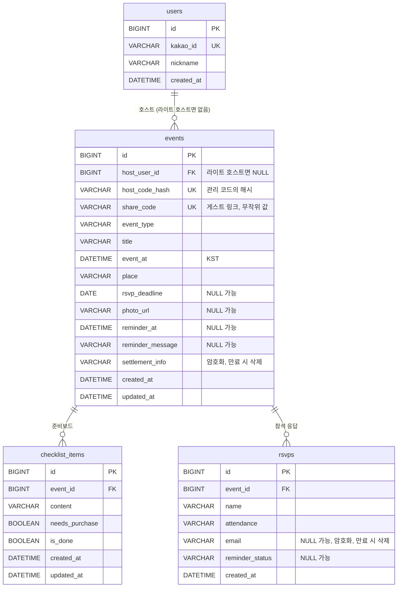

# 백엔드 기준 문서 (backend.md)

작성 중인 문서이며 완성본이 아니다. 꺾쇠 자리표시자가 남은 칸은 아직 묻지 않은 항목이다. 충족 조건과 필수 여부는 `backend-intake-protocol.md`를 따른다.

- 항목마다 한 줄에 결정 / 근거 / 정한 사람 / 상태를 쓴다. 정한 사람은 이름 대신 역할(백엔드, 백엔드+프론트엔드 등)이며, 비어 있으면 확정하지 않는다. 상태는 `미응답 · 제안 · 미정 · 확정 · 충돌 · 미적용` 중 하나다. 팀과 정할 것은 `미정`, 근거에 「팀과 정할 것(PM / 프론트엔드·앱 개발자)」. 테스트·배포·버그 수정처럼 실제 동작 확인이 필요한 항목은 끝에 `/ 확인: 미확인 · 확인 계획 있음 · 테스트로 확인됨 · 배포 환경에서 확인됨 (출처)`를 붙인다.
- 상세 값은 표에 한 번만 적고, 항목에는 결론과 표 위치만 적는다.
- 기능 ID(FN-01)는 prd.md 14절의 것을 그대로 쓴다. API ID(API-01)는 여기서 붙이고 client.md가 그대로 쓴다. 다른 문서의 항목 ID(prd.md D1 등)는 이 문서의 같은 글자 ID와 뜻이 다르다.
- **비밀 값(API 키, DB 비밀번호, 토큰)과 실제 사용자 데이터는 이 문서 어디에도 적지 않는다.**

## 00 문서 상태

- 서비스명: 모임집(Zip) (SRC-09 PRD 루트)
- 서비스 종류: 웹
- 버전: v0.15
- 상태: 작성 중(2주차 범위 완료)
- 현재 단계: 2주차 : DB 설계하고 서버 준비하기 (팀 빌딩~1주차 항목은 미정으로 남긴 채 넘어옴)
- 작성자와 결정권자: 백엔드
- 인터뷰 모드: 주니어, 영역별 조정: C5(스키마 변경·백업)는 신입 방식
- 팀 구성: PM 1 · 디자이너 2 · 클라이언트 개발자(웹 프론트엔드) 2 · 백엔드 3
- 이번 범위 밖: 대규모 트래픽 대비, MSA, 고가용성 클러스터, 웹 결제 PG 실연동, 법무 검토 (팀 조건 2절)
- 확정한 항목 수: 개발자가 원할 때만 셈

| 모듈 | 적용 여부 | 이유 |
| --- | --- | --- |
| W 웹 클라이언트 3개 | 적용 | 웹 서비스 (개발자 답변) |
| P 앱 클라이언트 7개 | 모듈 비활성 | 웹 서비스라 해당 없음 |
| X 서비스 안 AI 기능 4개 | 적용 | AI 체크리스트 생성에 외부 OpenAI API를 씀 (개발자 답변). 서버에서 호출하는지는 X2에서 확인 |

## 01 자료와 출처

| 자료 ID | 자료 (PRD, 화면 목록, 회의 메모 등) | 버전 | 제공자 | 열람 여부 | 활용 범위 |
| --- | --- | --- | --- | --- | --- |
| SRC-01 | PRD (대화에 붙여 넣은 본문: 1~6절 + TBD 안건 1~3) | 버전 표기 없음. SRC-08이 나온 뒤로는 예전 본문 | 백엔드(PM 작성본 전달) | 읽음 | v0.11까지의 A1·A2 후보. v0.12부터는 SRC-08을 기준으로 하고, SRC-08에 없는 내용(TBD 안건 등)만 참고 |
| SRC-02 | `build.gradle`, `compose.yaml`, `application.yml` | main 03ed755 | 저장소 | 읽음 | B1 기술 스택 |
| SRC-03 | `README.md` | main 03ed755 | 저장소 | 읽음 | B4 로컬 실행, 배포 환경 변수 이름 |
| SRC-04 | `docs/git-convention.md` | main 03ed755 | 저장소 | 읽음 | B3 브랜치·PR 규칙 |
| SRC-05 | `swyp-team-rules.md`, `backend-intake-protocol.md` v1.0 | - | 백엔드 | 읽음 | 단계·범위·작성 규칙 |
| SRC-06 | 피그마 레이어 CSS (대화에 붙여 넣음: 초대장·작성 1~8·홈 화면, 와이어프레임 프레임 이름, 논의 메모) | 버전 표기 없음, 작업 중인 시안 | 백엔드(디자이너 작업본 전달) | 레이어 이름과 글자만 읽음. 이미지로 들어간 와이어프레임 화면 속 내용은 못 봄 | A2 필요 데이터 후보, D1 API 후보, 15절 미정 안건. 화면 ID(S-xx)는 없음 |
| SRC-07 | 화면 구조도(IA) 이미지 (대화에 붙여 넣은 SVG 안의 그림: 랜딩 → 비회원·게스트·회원 메뉴) | 버전 표기 없음, 작업 중인 시안 | 백엔드(디자이너 작업본 전달) | 읽음. 그림 위 제목 글자는 도형으로 변환되어 못 읽음. 리마인더·공동호스트·알림 설정 칸은 배경색 사각형으로 가려져 있음 | 사용자 유형별 기능 구분(A1·A4), D1 API 후보, OPEN-05·09·10·12 |
| SRC-08 | PRD • 기능명세서 (Notion 페이지. 루트 1 + 프로덕트 정책 2 + 기능 영역 7 + 세부 기능 16 + 세부 동작 3 = 29쪽) | 버전 표기 없음. 2026-11-17에 읽음 | 백엔드(PM 작성본을 개인 워크스페이스에 복제해 전달) | 복제본 29쪽을 모두 읽음. 원본 페이지는 열지 못해 복제 뒤 바뀐 내용은 모름. 루트의 외부 연동 블록 1개와 Figma 링크 안의 내용은 못 봄 | v0.12~v0.14의 기준. v0.15부터는 SRC-09를 기준으로 하고, 이 판의 번호는 「옛 4-2」처럼 적음 |
| SRC-09 | PRD • 기능명세서 11-18판 (Notion 페이지. 루트 1 + 프로덕트 정책 2 + 기능 영역 7 + 세부 화면 20 = 30쪽) | 버전 표기 없음. 30쪽의 수정 시각이 모두 2026-11-18 09:51~09:52(KST)로 이어져 있어 그때 한꺼번에 복제된 사본으로 보임. 그 뒤 원본에서 바뀐 내용은 들어 있지 않음 | 백엔드(개발자의 Notion에 연결된 페이지를 AI가 직접 읽음) | 30쪽을 모두 읽음. PM의 원본은 열지 못함. 루트의 외부 연동 블록 1개와 Figma 링크 안의 내용은 못 봄. 3-3·4-2가 가리키는 「템플릿 기반 초대장 제작」「2-3. 리마인드 설정」 쪽은 없음 | v0.15부터 범위·데이터·권한의 기준(개발자 요청 「다시 맞추고 2주차 시작」). 기능 ID(FN-xx)는 없고 PRD 자체 번호(1-1 ~ 7-3)만 있어 「PRD 3-2」처럼 적음. SRC-11 회의록이 이 사본에 없는 화면 번호(2-3 리마인드 설정, 3-3 템플릿 선택, 4-3 참석자 대시보드)를 말하고 있어 원본은 더 바뀐 것으로 보임 |
| SRC-10 | `docs/requirements.md` 요구사항 정의서 초안 (회의용, REQ-01~43, NFR-01~11) | 처음에는 11-18판 PRD 기준. v0.15에 맞춰 다시 씀 | 백엔드 | 읽음 | 이 문서의 결정을 요구사항 문장으로 옮긴 회의용 정리본. 결정의 기준은 이 문서이고, 정리본은 따라 맞춤. |
| SRC-11 | 팀 회의록 (대화에 붙여 넣음. 참여 인원 전원. 안건: 진행상황 공유, 기능명세서·Figma·웹플로우 피드백, 기능 구현 계획) | 날짜 표기 없음. 2026-11-19에 받음 | 백엔드 | 읽음. 회의록이 가리키는 Figma와 기능명세서 시트는 못 봄 | v0.15부터 SRC-09와 다른 곳은 이 회의 결정을 따름(팀 전원 합의). 「회의록 4-3」처럼 적음 |
| SRC-12 | 피그마 「ui 2차」 레이어 CSS (대화에 붙여 넣음: 1-1, 1-3, 1-4, 1-5, 2-1, 2-2, 2-3, 3-1, 3-2, 3-4, 3-5, 4-1, 4-2, 4-3, 5-1, 5-2, 6-1, 준비보드) | 버전 표기 없음. 2026-11-19에 받음 | 백엔드(디자이너 작업본 전달) | 레이어 이름과 화면에 적힌 글자만 읽음. 버튼 글자는 레이어 이름이 복사된 채라 못 읽었고 이미지 안 내용도 못 봄 | v0.15부터 화면 구성의 기준. 이 시안에 화면이 없는 기능은 범위에서 뺌(개발자 결정 「사라진 것 지워」). 「피그마 4-3」처럼 적음 |

## 02 서비스 범위와 필요한 데이터

- **A1** 필수 · 핵심 기능과 서버가 필요한 기능 — 결정: MVP 범위는 아래 표(SRC-09 PRD 11-18판의 화면 20개). 사용자는 게스트·라이트 호스트(비회원)·회원 호스트 세 권한으로 나뉨(PRD 정책 1). v0.14 표에 있던 참석 현황 대시보드(옛 4-2), 상세 참석 현황(옛 6-2), 리마인드 신청·발송 세부(옛 2-2, 2-2-1), 히스토리 삭제(옛 5-2-2)는 11-18판에 화면 쪽이 없어 넣을지 미정(OPEN-24·09·15). 새로 생긴 것은 비회원 보관함(1-2~1-4), 시작 방식 선택(3-3), 항목 상세의 담당자·마감일·메모(7-2), 회원 호스트의 리마인드 설정(4-2), 초대장 사진(PRD 「미정」, OPEN-23). 사진 갤러리와 베스트 샷 투표는 넣지 않음. 개발 일정은 3주로 잡았으나 SRC-09에도 일정이 없음(OPEN-04). 범위 밖으로 둔 것은 00절 「이번 범위 밖」. **v0.15 팀 회의(SRC-11)로 바뀐 것**: 비회원 보관함(1-2)은 삭제, 참석자 대시보드(회의록 4-3)는 넣고 라이트 호스트는 관리자용 입장 코드로 봄, 초대장 사진을 넣음(AI 사진 추천은 없음), 리마인드는 이메일로 보내고 라이트·회원 호스트 모두 시각을 정함, 수정은 회원 호스트만 3-2 전부, 내 모임은 주최한 이벤트만 최대 1년, 이벤트는 모임 시작 이틀 뒤 자동 만료. **v0.15 피그마 ui 2차(SRC-12)에 화면이 없어 뺀 것(개발자 결정)**: 템플릿 선택 화면과 초대장 문구 입력, 마이페이지, 홈의 「내가 할 일」, 「수정됨」 표시, 수집·이용 동의 체크박스와 수신 거부, 인원 수 입력, 응답 변경, 이벤트 삭제. 모임 유형은 9종으로 줄고, 계좌번호·예금주는 「정산 정보」 한 칸이 됨. 준비보드는 빈 프레임만 있어 세부(담당자·마감일·메모)를 보류 / 근거: SRC-09, SRC-11(팀 전원 회의), SRC-12, 개발자 답변(「11-18판으로 다시 맞춤」, 「사라진 것 지워」). 아래 표의 서버 필요 열(백엔드 API가 필요한지)은 개발자가 확인함(v0.15): API가 필요 없는 것은 랜딩 화면 자체, 응답 완료 화면, 3-4 옵션 선택, 링크 복사·카카오톡 공유. 팀과 정할 것(PM) / 정한 사람: 미정 / 상태: 미정

| 기능 (PRD 11-18판 번호. 기능 ID 없음) | 쓰는 사람 | 서버 필요 | 이번 범위 |
| --- | --- | --- | --- |
| PRD 1-1 메인 랜딩 페이지 | 모든 방문자 | 필요 없음 (화면만) | 넣음 |
| PRD 1-2 메인 이벤트 보관함 | - | - | 뺌. 팀 회의에서 삭제(SRC-11) |
| 피그마 1-3 완료된 이벤트, 1-4 진행 중인 이벤트 | 회원 호스트 | 필요 (이벤트 조회, 완료된 이벤트는 참석 인원 수) | 넣음. 회원이 완료된 이벤트까지 볼 수 있음(개발자 결정, v0.15). 1-3은 「총 5명이 함께했어요」를 보여 줌(SRC-12) |
| PRD 1-5 카카오 SNS 로그인 | 회원 호스트 | 필요 | 넣음. 카카오 외 로그인과 이메일 가입은 범위 밖 |
| PRD 2-1 초대장 조회 및 참석/불참 응답 | 게스트 | 필요 | 넣음. 이름(필수)과 이메일(선택), 참석/불참(SRC-11, SRC-12). 초대장은 제목·날짜·시간·장소로 만든 문장과 사진 |
| PRD 2-2 초대장 응답 완료 | 게스트 | 필요 없음 (화면만) | 넣음 |
| PRD 3-1 유형 선택, 3-2 기본 정보 폼 | 라이트 호스트, 회원 호스트 | 필요 (저장은 3-5에서 한 번에. 사진 올리기) | 넣음. 유형 9종 + 직접 입력. 필수는 제목·일시·시간·장소, 선택은 응답마감일·정산 정보(SRC-12). 사진은 제목 칸의 사진 버튼으로 썸네일 9칸 선택 창을 띄움(세부는 OPEN-23) |
| 피그마 3-4 이벤트 준비 관리 (옵션 선택: 준비까지 한 번에 / 초대장만. PRD 사본에서는 3-3) | 라이트 호스트, 회원 호스트 | 필요 없음 (화면 이동에만 쓰는 값, 저장하지 않음. 개발자 결정 v0.15) | 넣음 |
| 템플릿 선택 화면, 초대장 문구 입력 | - | - | 뺌. 피그마에 화면 없음(SRC-12, 개발자 결정 v0.15). 초대장 문구는 입력값으로 자동 생성 |
| PRD 3-5 완성 전 확인 | 라이트 호스트, 회원 호스트 | 필요 (입력한 모든 이벤트 데이터 저장, 공유용 URL 생성) | 넣음 |
| PRD 4-1 비회원 링크 공유 (복사, 공유) | 라이트 호스트 | 필요 (배포용 URL과 관리 코드 발급. 공유 동작은 화면 쪽) | 넣음. 복사 칸이 두 개(SRC-12. 배포 링크와 관리 코드로 보이나 글자는 못 읽음) |
| PRD 4-2 회원 링크 공유, 피그마 2-3 리마인드 설정 | 회원 호스트. 라이트 호스트는 회의(SRC-11)에서 가능하다고 했으나 피그마에는 회원 구역에만 있어 서로 다름 | 필요 (설정 저장, 정한 시각에 이메일 발송) | 넣음. 「언제 보낼까요」 칩 4개, 「몇 시에 보낼까요」 시·분(10분 단위), 「보낼 문구」 편집(SRC-12). 라이트 호스트의 설정은 팀 확인 필요(OPEN-09) |
| PRD 5-1 회원 홈 대시보드 | 회원 호스트 | 필요 | 넣음. 새 이벤트 만들기와 보관함(이벤트 카드, 더보기)(SRC-12). 「내가 할 일」 요약은 뺌(화면 없음, v0.15) |
| PRD 5-2 내 모임 목록 (전체 목록) | 회원 호스트 | 필요 | 넣음. 주최한 이벤트만(참여한 이벤트 없음), 최대 1년까지 열람(SRC-11) |
| PRD 5-3 마이페이지 중 회원 탈퇴 | 회원 호스트 | 필요 | 넣음(개발자 결정, v0.15). 피그마에 화면이 없어 PM·디자이너에게 화면을 요청. 프로필 확인과 로그아웃은 화면이 없어 미정 |
| PRD 6-1 초대장 수정 (진행중 이벤트) | 회원 호스트 | 필요 | 넣음. 수정 범위는 3-2 기본 정보 폼의 전부(SRC-11). 라이트 호스트는 수정 불가 |
| PRD 7-1 AI 준비물 체크리스트 자동 구성 | 회원 호스트 | 필요 (외부 AI API 호출) | 넣음. 라이트 호스트에게는 제공하지 않음 |
| PRD 7-2 항목 상세 설정, 7-3 구매 상품 URL 저장 | - | - | 보류. 피그마의 「준비보드」 프레임이 비어 있음(SRC-12, 개발자 결정 v0.15). 담당자·마감일·메모·네이버 쇼핑·구매 URL은 화면이 나오면 다시 봄(OPEN-10) |
| 피그마 4-3 참석현황 | 회원 호스트, 라이트 호스트(관리 코드) | 필요 | 넣음. 참석·불참석 인원 수와, 응답자 이름·이메일·참석 여부 목록(SRC-12) |
| 이벤트 삭제 | - | - | 뺌. PRD 사본과 피그마 모두 화면 없음(개발자 결정 v0.15). 1년이 지난 이벤트는 서버가 삭제 |
| 행사 후 사진 공유 갤러리, 베스트 샷 투표 (SRC-01의 TBD 안건) | - | - | 뺌. SRC-09에도 없음 (백엔드 답변과 같음) |
| 공동 호스트 | - | - | 뺌. 이벤트마다 호스트 1명 (백엔드 답변, SRC-09에도 없음) |

- **A2** 필수 · 꼭 필요한 데이터와 뺀 데이터, 외부 데이터 — 결정: 기능별 필요 데이터는 도메인 모델 표(SRC-09의 각 화면에서 옮김). 11-18판에서 생긴 데이터: 체크리스트 항목의 담당자·마감일·메모(7-2), 응답 폼의 이메일(리마인드용·선택, SRC-11에서 전화번호 대신), 시작 방식(3-3), 초대장 사진 1장(SRC-11), 라이트 호스트의 관리자용 입장 코드(SRC-11). 뺀 데이터: RSVP의 「미정」 응답, 사진 갤러리·좋아요(SRC-09에 없음). 외부 데이터: 카카오 로그인에서 닉네임과 프로필 이미지를 받아옴(PRD 1-5), AI API가 만든 체크리스트(PRD 7-1). 카카오·AI API의 사용 조건은 확인 전. 초대장 템플릿 원본을 어디에 두는지는 미정(OPEN-16). AI 입력의 「인원 수」는 받는 화면이 없어 뺌(v0.15) / 근거: SRC-09, 개발자 답변. 팀과 정할 것(PM) / 정한 사람: 미정 / 상태: 미정
- **A3** 필수 · 엔티티와 관계 → 도메인 모델 표 — 결정: 이벤트마다 호스트는 1명, 공동 호스트 없음. 엔티티는 이벤트·초대장·체크리스트 항목·RSVP·회원·라이트 호스트. 리마인드 신청은 RSVP에 합침(개발자 결정, v0.15). 개발자가 표의 내용을 확인함(v0.15): 초대장은 이벤트와 같은 테이블, 응답은 회원 계정과 잇지 않음 / 근거: 개발자 답변, SRC-09, SRC-11, SRC-12 / 정한 사람: 백엔드 / 상태: 확정
- **A4** 데이터별 생성·조회·수정·삭제 주체 — 결정: 미정. SRC-09의 「역할」「권한 & 접근」 줄을 도메인 모델 표의 「만들기 / 보기 / 고치기·지우기」 열에 옮김. 초대장 수정은 그 이벤트를 만든 회원 호스트만, 행사일이 지나기 전까지(PRD 6-1). 준비보드는 회원 호스트만(PRD 7-1~7-3). 이벤트 삭제는 11-18판에 기능이 없음(OPEN-15). 참석 현황은 회원 호스트와, 입장 코드를 넣은 라이트 호스트가 봄(SRC-11) / 근거: SRC-09. 팀과 정할 것(PM) / 정한 사람: 미정 / 상태: 미정
- **A5** 상태가 바뀌는 데이터 — 결정: 아래 상태 표. 응답은 마감일이 지나면 막고 마감일이 없으면 행사 당일이 지난 뒤부터 막음(PRD 2-1). 이벤트는 진행 중 → 완료(행사일이 지남) → 만료(시작 이틀 뒤) → 삭제(1년 뒤)이며 상태를 저장하지 않고 날짜로 계산함. 리마인드는 대기 → 발송됨 / 실패(재시도 없음). 체크리스트 항목은 미완료 / 완료. v0.13의 확정은 근거 PRD가 바뀌어 되돌렸다가, 회의 결정과 개발자 답변으로 다시 정함(v0.15) / 근거: SRC-09, SRC-11, SRC-12, 개발자 답변 / 정한 사람: 팀 전체(SRC-11) + 백엔드 / 상태: 확정

### 도메인 모델

| 엔티티 | 설명 | 주요 속성 | 관계 | 만들기 / 보기 / 고치기·지우기 | 연결 기능 | 상태 |
| --- | --- | --- | --- | --- | --- | --- |
| 이벤트 (Event) | 호스트가 만드는 모임 하나 | 모임 유형(9종 + 직접 입력, SRC-12). 제목·장소(각각 최대 16자), 날짜, 시작 시각 — 필수. 응답 마감일, 정산 정보(한 칸) — 선택(SRC-12). 사진 1장(OPEN-23). 리마인드 설정: 보낼 시각과 문구(피그마 2-3). 라이트 호스트의 관리 코드(SRC-11). 모임 시작 이틀 뒤 자동 만료(SRC-11) | 호스트 1명이 소유. 초대장 1개, 체크리스트 항목 여러 개, RSVP 여러 개를 가짐 | 라이트 호스트 또는 회원 호스트 / 회원 호스트는 내 모임에서 주최한 이벤트만, 최대 1년. 라이트 호스트는 관리 코드로 참석현황만 / 그 이벤트를 만든 회원 호스트, 3-2의 모든 항목. 삭제 기능 없음(1년 뒤 서버가 삭제) | PRD 3-1, 3-2, 3-5, 6-1, 피그마 3-4 | 확정 |
| 초대장 (Invitation) | 게스트에게 링크로 보내는 페이지 | 따로 저장하는 문구 없음. 제목·날짜·시간·장소로 만든 문장과 사진 1장(SRC-12), 공유용 URL의 식별값(3-5에서 생성) | 이벤트와 1:1 | 호스트 / 링크를 가진 누구나, 로그인 없이(PRD 2-1) / 그 이벤트를 만든 회원 호스트. 수정해도 공유 링크는 그대로 | PRD 3-5, 2-1, 4-1, 4-2, 6-1 | 확정 |
| 체크리스트 항목 (ChecklistItem) | AI 준비보드의 준비물 한 줄 | 항목명, 구매 필요 여부(O/X), 완료 여부(PRD 7-1). 담당자·마감일·메모·구매 상품 URL은 보류(피그마 준비보드가 빈 화면, v0.15) | 이벤트 1 : 항목 N | AI 생성 또는 회원 호스트 / 회원 호스트 / 회원 호스트 | PRD 7-1, 피그마 준비보드 | 확정 |
| RSVP | 게스트 한 명의 참석 응답 | 이름(필수), 참여 여부(참석/불참), 응답 시각, 리마인드용 이메일(선택. 없으면 리마인드를 받지 않음), 리마인드 발송 상태(SRC-11, SRC-12) | 이벤트 1 : RSVP N. 회원 계정과 잇지 않음(개발자 확정, v0.15) | 게스트(로그인 없음) / 회원 호스트와, 관리 코드를 넣은 라이트 호스트가 참석현황에서. 이메일도 보임(피그마 4-3) / 응답 변경 없음(화면 없음, v0.15). 이메일은 모임 시작 이틀 뒤 만료 때 삭제 | PRD 2-1, 2-2, 피그마 4-3 | 확정 |
| 회원 (User) | 카카오 로그인으로 가입한 회원 호스트 | 카카오 계정 식별자, 닉네임, 가입일(PRD 1-5). 프로필 이미지는 저장하지 않음(개발자 결정, v0.15) | 회원 1 : 이벤트 N(호스트로서). 응답과는 잇지 않음 | 본인(카카오 로그인) / 본인 / 본인이 탈퇴(넣기로 함, 화면은 요청 중). C3의 연쇄 삭제를 따름 | PRD 1-5, 5-1, 5-2 | 확정 |
| 라이트 호스트 | 로그인 없이 초대장을 만들어 보내는 호스트 | 저장할 계정 없음. 초대장을 만들면 배포용 링크와 관리 코드를 받고, 랜딩(1-1)의 「비회원 초대장 관리 코드」 칸에 코드를 넣어 참석현황을 봄. 호스트용 링크는 따로 두지 않고 코드 입력으로 통일, 코드를 잃어버리면 복구 없음(개발자 결정, v0.15). 코드의 길이·형식·저장 방식·시도 제한은 따로 빼 둠(OPEN-05) | 관리 코드 하나에 이벤트 하나. 권한은 초대장 생성, 링크 배포, 참석현황 보기. 수정과 AI 준비보드 없음. 리마인드 설정은 회의와 피그마가 달라 확인 필요(OPEN-09) | 본인 / 관리 코드를 가진 사람 / 수정 불가 | PRD 1-1, 3-1 ~ 3-5, 4-1, 피그마 4-3 | 확정 |

위 표는 개발자가 내용을 확인함(v0.15).

사용자 권한별 기능 (SRC-09 PRD 정책 1과 각 화면의 「역할」 줄):

| 권한 | 로그인 | 제공 기능 |
| --- | --- | --- |
| 게스트 (비회원) | 없음 | 초대장 보기, 참석 응답(이름 필수, 이메일 선택, 참석/불참), 응답 완료 |
| 라이트 호스트 (비회원) | 없음 | 초대장 만들기, 링크 배포, 관리 코드로 참석현황 보기. 수정·AI 준비보드 없음. 리마인드 설정은 확인 필요(OPEN-09) |
| 회원 호스트 | 카카오 로그인 | 홈, 내 모임(주최한 이벤트만, 최대 1년), 완료된·진행 중인 이벤트 보기, 이벤트 생성·링크 공유·리마인드 설정·참석현황·초대장 수정(3-2 전부), AI 준비보드. 탈퇴(화면 요청 중). 프로필 확인·로그아웃은 화면이 없어 미정 |
| 권한 밖 접근 | - | 비회원이 회원 전용 기능(AI 준비보드, 내 모임, 마이페이지)에 접근하면 막고 로그인을 안내. 「준비까지 한 번에」를 고른 비회원은 로그인 화면으로 보냄(PRD 3-3) |

| 엔티티 | 상태 목록 | 바뀌는 조건 | 바꿀 수 있는 사람 |
| --- | --- | --- | --- |
| RSVP | 참석 / 불참 (PRD 2-1) | 응답 마감일이 지났거나, 마감일이 없고 행사 당일이 지나면 입력칸을 숨기고 [응답 마감]으로 바꿈(PRD 2-1). 낸 응답을 바꾸는 기능은 없음(v0.15) | 게스트 |
| 체크리스트 항목 | 미완료 / 완료 (PRD 7-1) | 완료 체크·해제 | 회원 호스트 |
| RSVP의 리마인드 발송 상태 | 대기 → 발송됨 / 실패 (이메일이 있는 응답만) | 호스트가 정한 시각에 이메일 발송(SRC-11, 피그마 2-3). 호스트가 설정하지 않으면 보내지 않음. 실패하면 재시도 없이 실패로 기록(개발자 결정, v0.15) | 시스템(발송), 호스트(설정) |
| 이벤트 | 진행 중 → 완료 → 만료 → 삭제 | 행사일이 지나면 완료. 모임 시작 이틀 뒤 만료: 게스트 이메일과 정산 정보를 지우고 응답자 이름과 참석 여부는 남김. 1년이 지나면 이벤트를 삭제(개발자 결정, v0.15). 상태는 저장하지 않고 날짜로 계산함 | 시스템 |

## 03 기술 스택과 개발 환경

- **B1** 필수 · 언어·프레임워크·DB와 팀 경험 — 결정: Java 21, Spring Boot 4.1.2 (Web MVC, Data JPA, Validation), MySQL 8.4, springdoc(Swagger UI), 테스트는 JUnit + Testcontainers. 백엔드 3명의 사용 경험은 보통 / 근거: 백엔드 3명 모두 이 스택 개발자 (개발자 답변), 저장소 세팅은 SRC-02 / 정한 사람: 백엔드 / 상태: 확정
- **B2** 인원·역할 분담·리뷰하는 사람 — 결정: 백엔드 3명. 담당 영역과 리뷰하는 사람은 아직 나누지 않음, 정할 시점도 보류 / 근거: 개발자 답변. 백엔드 3명이 정할 것 / 정한 사람: 미정 / 상태: 미정
- **B3** 저장소·브랜치 규칙·머지 전 조건 — 결정: 백엔드 저장소는 팀 조직(organization) 아래에 있고 프론트엔드 저장소와 분리. 컨벤션은 저장소마다 따로 둠. 백엔드 규칙은 `docs/git-convention.md`: `main` 직접 push 금지, 작업 브랜치 `<type>/<이슈번호>-<짧은-설명>`, 1명 이상 승인 + `./gradlew build` 통과 후 Squash merge / 근거: 개발자 답변, SRC-04. 저장소는 공개 / 근거: 개발자 답변(질문 목록), SRC-04 / 정한 사람: 백엔드 / 상태: 확정
- **B4** 로컬 실행 방법·환경 변수 예시 파일 위치 — 결정: 실행 순서는 `README.md`(JDK 21 + Docker, `./gradlew bootRun`이 MySQL 컨테이너를 자동 기동). 로컬·배포 환경 변수 모두 값 없이 이름만 적은 예시 파일을 저장소 루트의 `.env.example`로 둠. 파일은 아직 저장소에 없음 / 근거: 개발자 답변(다른 팀원이 쉽게 구성하도록, 질문 목록), SRC-03 / 정한 사람: 백엔드 / 상태: 확정 / 확인: 미확인 (파일 추가 전)

## 04 DB 설계

DB 설계는 사람이 판단한다. AI 초안은 개발자가 정하기 전까지 `제안`이다.

- **C1** 필수 · DB 종류와 선택 이유 — 결정: MySQL 8.4 (관계형), 운영 DB는 AWS RDS. 이유는 백엔드 3명 모두 다뤄 본 스택(B1)이고 RDS 비용은 크레딧으로 감당할 수 있음(개발자 답변, v0.15). v0.14의 「RDS와 EC2 안 Docker MySQL 중 미정」에서 바뀜 / 근거: B1, SRC-02, 개발자 답변 / 정한 사람: 백엔드 / 상태: 확정
- **C2** 필수 · 테이블·컬럼 → 아래 표 — 결정: 아래 표. SRC-09(11-18판)에 맞춰 AI 초안을 다시 씀: 테이블 4개(users, events, checklist_items, rsvps). reminders는 rsvps에 합쳐 email과 reminder_status 두 컬럼으로 둠(개발자 결정, v0.15). 초대장 값은 events에 합침(개발자 결정, v0.14). 11-18판 때문에 바뀐 초안: checklist_items에 담당자·마감일·메모 추가, events의 제목·장소 16자 제한과 시간 형식·응답 마감일 필수 여부(OPEN-22), start_mode가 PRD에 생김(OPEN-19), 전화번호를 응답과 함께 받는 문제(OPEN-09). v0.14에서 개발자가 정한 것(초대장 합침, host_name 뺌, 계좌번호·예금주·전화번호 암호화, 순서 컬럼 없음, updated_at)은 그대로 둠. v0.15(SRC-11 팀 회의): rsvps.user_id와 events.host_password_hash를 빼고, reminders.phone을 email로 바꾸고, events에 photo_url·reminder_at을 더함. v0.15(SRC-12, 개발자 결정): 피그마에 화면이 없는 값의 컬럼(template_code, invitation_text, invitation_edited_at, headcount, rsvps.updated_at, checklist_items의 assignee·due_date·memo, users.profile_image_url)을 빼고, 계좌번호·예금주를 settlement_info 한 칸으로 바꾸고, reminder_message를 더함. 게스트 이메일은 암호화로 정함. 개발자가 표 전체를 검토함(v0.15): rsvps.status를 attendance로 바꾸고, start_mode는 화면 이동에만 쓰는 값이라 빼고, reminder_message는 500자로 둠. 관리 코드는 해시만 저장(host_code_hash), title·place는 VARCHAR(50)으로 정함 / 근거: 도메인 모델(A3 초안), SRC-09, SRC-11, SRC-12 / 정한 사람: 백엔드 / 상태: 확정
- **C3** 필수 · 키·관계·삭제 정책 → 아래 표 — 결정: 회원이 탈퇴하면 그 회원의 이벤트를 지움. 연쇄 삭제는 JPA cascade가 아니라 DB 외래 키의 `ON DELETE CASCADE`로 하고(`V1__init.sql`에 적음), Hibernate가 알도록 엔티티에 `@OnDelete(action = OnDeleteAction.CASCADE)`를 붙이는 안(정확한 동작은 Hibernate 공식 문서 확인 필요). v0.14에 정했던 `rsvps.user_id`(`ON DELETE SET NULL`)와 탈퇴 시 응답 익명 처리는 뺌: 팀 회의에서 참여한 이벤트를 회원과 잇지 않기로 함(SRC-11, 개발자 확정 v0.15). reminders 테이블도 rsvps에 합쳐 관계가 셋으로 줄어듦. 탈퇴는 범위에 넣음(화면은 PM·디자이너에게 요청) / 근거: 개발자 답변(질문 목록, v0.14 채팅, v0.15) / 정한 사람: 백엔드 / 상태: 확정
- **C4** 유니크 제약·인덱스 — 결정: 유니크는 users.kakao_id, events.share_code, events.host_code_hash(관리 코드의 해시). 같은 이벤트에 같은 이름의 응답이 여러 개 들어와도 막지 않고 그대로 둠: 이름만으로는 같은 사람인지 알 수 없고 응답 변경 기능도 없음(개발자 결정, v0.15). 인덱스는 외래 키 외에 따로 두지 않고 느려지면 다시 봄. / 근거: 개발자 답변 / 정한 사람: 백엔드 / 상태: 확정
- **C5** 스키마 변경(마이그레이션)·백업·가짜 데이터 — 결정: 스키마 변경은 지금부터 Flyway로 함. 첫 스키마는 `V1__init.sql` 하나로 시작하고, 로컬·운영 모두 `ddl-auto: validate`로 둠. 출시 전에는 V1을 고치고 DB를 초기화해도 되고, 출시 후에는 이미 적용한 파일을 고치지 않고 새 버전 파일만 추가함. v0.11의 「`ddl-auto: update`로 함」을 뒤집음: `update`는 `local` 프로필에만 있고 `prod`에는 설정이 없어 운영 DB에 테이블이 만들어지지 않음(v0.13 리뷰). 운영 DB 변경도 Flyway 마이그레이션 파일로 함(개발자 답변 「flyway로」). 로컬·테스트 데이터는 모두 가짜 데이터(`user1@example.com` 같은 값)로 만들고, 운영 DB에서는 테스트하지 않음. 백업: 출시 전에는 데이터를 버려도 되므로 백업 없이 감. 출시 후에는 운영 DB에 마이그레이션을 적용하기 직전에 배포 담당이 백업을 받음(RDS면 스냅샷, EC2 안 MySQL이면 `mysqldump` 파일. DB 위치는 C1, 배포 담당은 F4) / 근거: 개발자 답변(v0.13 리뷰, 채팅) / 정한 사람: 백엔드 / 상태: 확정 / 확인: 미확인 (Flyway 의존성·`V1__init.sql`·프로필 설정을 아직 저장소에 넣지 않음)

| 테이블 | 컬럼 | 타입 | 제약 (필수·기본값·유니크·키) | 이유 | 상태 |
| --- | --- | --- | --- | --- | --- |
| users | id | BIGINT | PK, 자동 증가 | 회원 구분 | 확정 |
| users | kakao_id | VARCHAR(64) | 필수, 유니크 | 카카오 계정 식별자. 같은 카카오 계정의 중복 가입을 막음 (PRD 1-5) | 확정 |
| users | nickname | VARCHAR(30) | 필수 | 카카오에서 받아온 닉네임 (PRD 1-5) | 확정 |
| users | created_at | DATETIME | 필수 | 가입일 (PRD 1-5) | 확정 |
| events | id | BIGINT | PK, 자동 증가 | 이벤트 구분. 초대장 값도 이 테이블에 합침(개발자 결정, v0.14) | 확정 |
| events | host_user_id | BIGINT | FK → users.id, 비어 있을 수 있음 | 회원 호스트. 라이트 호스트면 비움 | 확정 |
| events | host_code_hash | VARCHAR(64) | 유니크, 비어 있을 수 있음 | 라이트 호스트 관리 코드의 해시. 코드 원문은 저장하지 않음(개발자 결정, v0.15). 랜딩에서 코드만 넣고 들어오므로 입력값을 해시해 이 컬럼으로 이벤트를 찾음 — 그래서 값마다 결과가 달라지는 솔트 해시는 쓸 수 없고, 대신 코드를 추측하기 어렵게 길게 만듦. 해시 방식과 코드 길이는 구현할 때 정함(OPEN-05) | 확정 |
| events | share_code | VARCHAR(64) | 유니크 | 게스트에게 보내는 초대장 링크의 식별값. 추측할 수 없는 무작위 값으로 만들고 순번 id를 링크에 쓰지 않음(개발자 결정, v0.15). [초대장 완성하기]에서 생성(PRD 3-5) | 확정 |
| events | event_type | VARCHAR(30) | 필수 | 모임 유형. 9종 중 하나 또는 직접 입력한 글자(SRC-12) | 확정 |
| events | title | VARCHAR(50) | 필수 | 제목. 입력은 최대 16자이고 서버에서 16자를 검사(PRD 3-2). 컬럼은 여유를 둠(개발자 결정, v0.15) | 확정 |
| events | event_at | DATETIME | 필수 | 날짜 + 시작 시각. DATETIME으로 받고 KST 기준으로 저장(개발자 결정, v0.15). 리마인드와 이틀 뒤 만료 계산에 시각이 필요해 PM에게 「시간」을 자유 텍스트가 아닌 선택형으로 요청(OPEN-22) | 확정 |
| events | place | VARCHAR(50) | 필수 | 장소. 입력은 최대 16자이고 서버에서 16자를 검사(PRD 3-2). 컬럼은 여유를 둠(개발자 결정, v0.15) | 확정 |
| events | rsvp_deadline | DATE | 비어 있을 수 있음 | 응답 마감일. 피그마 3-2에 필수 표시가 없음(SRC-12). 없으면 행사 당일까지 응답(PRD 2-1) | 확정 |
| events | photo_url | VARCHAR(500) | 비어 있을 수 있음 | 초대장 사진 1장의 주소. 파일은 AWS S3에 두고 DB에는 주소만 저장. 5MB 이하, jpg·png. 1년 뒤 이벤트를 삭제할 때 사진도 같이 지움 — 그 전까지는 내 모임(히스토리)에 남기 때문(개발자 결정, v0.15) | 확정 |
| events | reminder_at | DATETIME | 비어 있을 수 있음 | 리마인드 발송 시각. 화면의 「언제」 칩과 시·분으로 계산한 시각을 저장하는 안(피그마 2-3) | 확정 |
| events | reminder_message | VARCHAR(500) | 비어 있을 수 있음 | 호스트가 고친 리마인드 문구(피그마 2-3 「보낼 문구」. 개발자 결정, v0.15). 길이 제한은 미정 | 확정 |
| events | settlement_info | VARCHAR(255) | 비어 있을 수 있음 | 정산 정보(선택). 피그마 3-2에서 한 칸(SRC-12. v0.14까지 account_number·account_holder 두 컬럼). 암호화해서 저장하고 만료 때 비움(개발자 결정, v0.14). 게스트 초대장에는 보이지 않아 누구에게 보여 주는 값인지 확인 필요(OPEN-07) | 확정 |
| events | created_at | DATETIME | 필수 | 만든 시각. 내 모임의 열람 기간 1년을 무엇부터 세는지는 미정(SRC-11, OPEN-25) | 확정 |
| events | updated_at | DATETIME | 필수 | 마지막으로 바꾼 시각(개발자 결정, v0.14) | 확정 |
| checklist_items | id | BIGINT | PK, 자동 증가 | 항목 구분 | 확정 |
| checklist_items | event_id | BIGINT | 필수, FK → events.id | 어느 이벤트의 준비보드인지 | 확정 |
| checklist_items | content | VARCHAR(200) | 필수 | 항목명. AI가 만들고 호스트가 고칠 수 있음(PRD 7-1) | 확정 |
| checklist_items | needs_purchase | BOOLEAN | 필수, 기본값 false | 구매 필요 여부 O/X (PRD 7-1) | 확정 |
| checklist_items | is_done | BOOLEAN | 필수, 기본값 false | 완료 여부 (PRD 7-1) | 확정 |
| checklist_items | created_at | DATETIME | 필수 | 만든 시각 | 확정 |
| checklist_items | updated_at | DATETIME | 필수 | 마지막으로 바꾼 시각(개발자 결정, v0.14) | 확정 |
| rsvps | id | BIGINT | PK, 자동 증가 | 응답 구분 | 확정 |
| rsvps | event_id | BIGINT | 필수, FK → events.id | 어느 이벤트의 응답인지 | 확정 |
| rsvps | name | VARCHAR(30) | 필수 | 게스트 이름 (PRD 2-1) | 확정 |
| rsvps | attendance | VARCHAR(20) | 필수 | 참석 / 불참 (PRD 2-1). reminder_status와 헷갈리지 않게 status에서 이름을 바꿈(개발자 결정, v0.15) | 확정 |
| rsvps | created_at | DATETIME | 필수 | 응답 시각 | 확정 |
| rsvps | email | VARCHAR(255) | 비어 있을 수 있음 | 리마인드를 받을 이메일(선택 입력). 비어 있으면 리마인드를 받지 않음. 암호화해서 저장하고 모임 시작 이틀 뒤 만료 때 비움(개발자 결정, v0.15) | 확정 |
| rsvps | reminder_status | VARCHAR(20) | 비어 있을 수 있음 | 대기 / 발송됨 / 실패. 이메일이 없으면 비워 둠. 중복 발송을 막고 실패를 구분함. 실패해도 다시 보내지 않음. 보낸 시각은 따로 두지 않고 서버 로그로 봄(개발자 결정, v0.15) | 확정 |

v0.11 초안에서 뺀 컬럼: rsvps.phone(reminders로 옮김. 11-18판 때문에 다시 볼 것, OPEN-09), events.message·image_url(템플릿 방식으로 바뀜. 사진 첨부가 정해지면 사진 컬럼이 다시 필요, OPEN-23), events.concept(「AI가 만든 컨셉」은 SRC-06에만 있고 PRD에 없음). v0.14에서 뺀 컬럼: events.host_name(초대장의 호스트 이름, PRD에 없음, 개발자 결정). 체크리스트 순서 컬럼은 두지 않음(개발자 결정, 순서 바꾸기 기능 없음). v0.15에서 되살린 컬럼: checklist_items의 담당자(v0.11의 assignee_user_id를 뺐으나 11-18판 7-2에 담당자가 생김. 회원을 가리키는 키가 아니라 텍스트 초안). events.start_mode·headcount는 PM 답을 기다리며 표에 남겨 둠(OPEN-19·14). v0.15(SRC-11 팀 회의)에서 뺀 컬럼: rsvps.user_id(참여한 이벤트를 회원과 잇지 않음), events.host_password_hash(비밀번호 대신 입장 코드). 바꾼 컬럼: reminders.phone → email. 더한 컬럼: events.photo_url, events.reminder_at. 그 뒤 reminders 테이블을 없애고 rsvps.email·reminder_status로 합침(개발자 결정, v0.15). v0.15(SRC-12, 개발자 결정)에서 뺀 컬럼: events.template_code·invitation_text·invitation_edited_at·headcount, rsvps.updated_at, users.profile_image_url. 보류한 컬럼: checklist_items의 assignee·due_date·memo·product_url. 뺀 컬럼: events.start_mode(화면 이동에만 쓰는 값). 이름을 바꾼 컬럼: rsvps.status → attendance. 바꾼 컬럼: events.account_number·account_holder → settlement_info. 더한 컬럼: events.reminder_message.

| 관계 | 연결 키 | 종류 (1:1·1:N·N:M) | 삭제할 때 | 상태 |
| --- | --- | --- | --- | --- |
| 회원 1 : 이벤트 N | events.host_user_id | 1:N | `ON DELETE CASCADE` (개발자 답변: 회원이 탈퇴하면 그 회원의 이벤트를 지움). 이벤트에 딸린 체크리스트 항목·응답도 아래 행에 따라 함께 지워짐 | 확정 |
| 이벤트 1 : 체크리스트 항목 N | checklist_items.event_id | 1:N | `ON DELETE CASCADE` | 확정 |
| 이벤트 1 : RSVP N | rsvps.event_id | 1:N | `ON DELETE CASCADE` | 확정 |

테이블 표는 개발자가 표 전체를 보고 정함(v0.15). 게스트가 응답을 바꿀 때 쓸 본인 확인 값(OPEN-13)은 방법이 정해지면 rsvps에 컬럼을 더한다.

### ERD 초안 (AI 제안, 개발자가 다듬는 중)

## 05 API 설계

- **D1** 필수 · API 목록 → 아래 명세 표 — 결정: 미정. 목적별 후보 18개의 번호는 그대로 두고 설명을 SRC-09(11-18판)와 SRC-11(팀 회의)에 맞춤. v0.15에서 API-19(초대장 사진 올리기)를 더해 19개. v0.15에서 피그마에 화면이 없는 API-12·15·17·18을 뺌(번호는 남겨 둠). 탈퇴(API-16)는 화면이 없어도 넣기로 함. 메서드·경로는 D2 공통 규칙을 정한 뒤 붙임. 번호는 프론트엔드 검토 전의 임시 번호이며 합치거나 나뉠 수 있음(예: 3-5에서 한 번에 저장하므로 API-01과 API-05). API-17은 근거 화면이 없어 PM 답을 기다림. 회의록의 2-3·3-3·4-3 쪽은 원본 PRD를 받아 확인 / 근거: SRC-09, SRC-06 와이어프레임 프레임 이름. PRD에 기능 ID가 없어 PRD 자체 번호로 연결. 팀과 정할 것(프론트엔드) / 정한 사람: 미정 / 상태: 미정
- **D2** 필수 · 공통 규칙 (경로 이름, 응답 형식, 날짜·시간, 페이지 나누기) — 결정: 미정. 프론트엔드와 정한 것이 아직 없음. 회의에 가져갈 AI 초안은 명세 표 아래 / 근거: 개발자 답변. 팀과 정할 것(프론트엔드) / 정한 사람: 미정 / 상태: 미정
- **D3** 필수 · 에러 응답 형식과 에러 코드 → 아래 표 — 결정: 미정. SRC-09의 「예외」「비즈니스 규칙」 줄에서 뽑은 실패 상황 후보만 에러 코드 표에 올림 / 근거: SRC-09 / 정한 사람: 미정 / 상태: 미응답
- **D4** 필수 · 명세 공유 위치·변경 알림 — 결정: 미정 / 근거: 미정 / 정한 사람: 미정 / 상태: 미응답
- **D5** 임시 응답(목업) — 결정: 미정 / 근거: 미정 / 정한 사람: 미정 / 상태: 미응답
- **D6** 출시 후 API 변경 규칙 — 결정: 미정 / 근거: 미정 / 정한 사람: 미정 / 상태: 미응답

### API 명세

| API ID | 기능 ID | 메서드 | 경로 | 요청 | 응답 | 에러 코드 | 인증·권한 | 담당 | 상태 |
| --- | --- | --- | --- | --- | --- | --- | --- | --- | --- |
| API-01 | PRD 3-1, 3-2, 3-5 | 미정 | 미정 | 미정 | 미정 | 미정 | 미정 | 미정 | 제안 (이벤트 만들기: 모임 유형, 제목, 날짜, 시작 시각, 장소, 응답 마감일(선택), 정산 정보(선택), 사진. [초대장 완성하기]에서 한 번에 저장하고 배포용 URL 생성. 라이트 호스트에게는 관리 코드도 함께 줌. 라이트 호스트와 회원 호스트 모두) |
| API-02 | PRD 7-1 | 미정 | 미정 | 미정 | 미정 | 미정 | 미정 | 미정 | 제안 (AI 체크리스트 생성·재생성. 회원 호스트만. 재생성 횟수 제한 없음 — OPEN-17. 「준비까지 한 번에」는 이벤트를 저장하기 전에 이 화면으로 감 — OPEN-19) |
| API-03 | PRD 7-1 | 미정 | 미정 | 미정 | 미정 | 미정 | 미정 | 미정 | 제안 (준비보드 조회. 회원 호스트만) |
| API-04 | PRD 7-1 | 미정 | 미정 | 미정 | 미정 | 미정 | 미정 | 미정 | 제안 (체크리스트 항목 추가·수정·삭제·완료 체크. 회원 호스트만. 담당자·마감일·메모·구매 URL은 보류(v0.15)) |
| API-05 | PRD 6-1 | 미정 | 미정 | 미정 | 미정 | 미정 | 미정 | 미정 | 제안 (초대장 수정. 그 이벤트를 만든 회원 호스트만, 3-2 기본 정보 폼의 모든 항목, 공유 링크는 그대로. 「수정됨」 표시는 뺌(v0.15)) |
| API-06 | PRD 2-1 | 미정 | 미정 | 미정 | 미정 | 미정 | 미정 | 미정 | 제안 (공유 링크로 초대장 조회. 로그인 없음. 서버가 링크의 유효성과 응답 기한을 확인. 없는 링크는 「존재하지 않는 초대장입니다」) |
| API-07 | PRD 2-1 | 미정 | 미정 | 미정 | 미정 | 미정 | 미정 | 미정 | 제안 (RSVP 제출: 이름(필수), 참석/불참, 리마인드용 이메일(선택). 기한이 지나면 막음. 응답 변경 없음) |
| API-08 | 피그마 4-3 | 미정 | 미정 | 미정 | 미정 | 미정 | 미정 | 미정 | 제안 (회원 호스트의 참석현황 조회: 참석·불참석 인원 수, 응답자 이름·이메일·참석 여부 목록. 그 이벤트를 만든 회원만) |
| API-09 | PRD 5-2, 피그마 1-3·1-4 | 미정 | 미정 | 미정 | 미정 | 미정 | 미정 | 미정 | 제안 (내 모임 목록: 회원이 주최한 이벤트만, 최대 1년까지, 진행 중/완료 구분. 단일 상세에서 완료된 이벤트는 참석 인원 수를 줌. 회원만) |
| API-10 | 피그마 1-1, 4-3 | 미정 | 미정 | 미정 | 미정 | 미정 | 미정 | 미정 | 제안 (라이트 호스트가 랜딩에서 관리 코드를 넣고 참석현황 조회. 호스트용 링크 없음(개발자 결정, v0.15). 코드 확인 방식과 시도 제한은 OPEN-05) |
| API-11 | PRD 5-1 | 미정 | 미정 | 미정 | 미정 | 미정 | 미정 | 미정 | 제안 (홈 조회: 주최한 이벤트 카드(보관함). 「내가 할 일」은 뺌(v0.15). API-09와 합칠 수 있음) |
| API-12 | PRD 5-3 | 미정 | 미정 | 미정 | 미정 | 미정 | 미정 | 미정 | 뺌 (프로필 확인. 피그마에 마이페이지 화면 없음, v0.15) |
| API-13 | PRD 1-5 | 미정 | 미정 | 미정 | 미정 | 미정 | 미정 | 미정 | 제안 (카카오 로그인·회원가입. 유지 방식은 E2에서 정함. 로그아웃은 마이페이지가 빠져 화면이 없음 — 디자이너 확인) |
| API-14 | 피그마 2-3 | 미정 | 미정 | 미정 | 미정 | 미정 | 미정 | 미정 | 제안 (리마인드 설정: 보낼 시각(「언제」 칩과 시·분)과 문구. 회원 호스트. 라이트 호스트도 되는지는 회의와 피그마가 달라 확인 필요(OPEN-09)) |
| API-15 | PRD 정책 2 | 미정 | 미정 | 미정 | 미정 | 미정 | 미정 | 미정 | 뺌 (리마인드 수신 거부. 피그마에 화면·링크 없음, v0.15) |
| API-16 | PRD 5-3 | 미정 | 미정 | 미정 | 미정 | 미정 | 미정 | 미정 | 제안 (회원 탈퇴. 넣기로 함(개발자 결정, v0.15). 회원 행을 지우면 만든 이벤트와 딸린 응답·체크리스트가 함께 지워짐(C3). S3의 사진도 같이 지워야 함) |
| API-17 | 근거 화면 없음 | 미정 | 미정 | 미정 | 미정 | 미정 | 미정 | 미정 | 뺌 (이벤트 삭제. 화면 없음, v0.15. 1년 지난 이벤트는 서버가 삭제) |
| API-18 | 회의록 3-3 | 미정 | 미정 | 미정 | 미정 | 미정 | 미정 | 미정 | 뺌 (템플릿 목록. 피그마에 템플릿 선택 화면 없음, v0.15. 썸네일 9장은 OPEN-23) |
| API-19 | PRD 3-2 (SRC-11) | 미정 | 미정 | 미정 | 미정 | 미정 | 미정 | 미정 | 제안 (초대장 사진 올리기: 갤러리에서 고른 사진 1장. 크기·형식 제한과 저장 위치는 OPEN-23) |

초대장 사진을 넣기로 해(SRC-11) 사진 올리기 API(API-19)와 파일 저장소가 필요하다(OPEN-23).

API가 아닌 서버 작업: 호스트가 정한 시각에 리마인드 이메일을 보내는 예약 작업(세부는 OPEN-09), 모임 시작 이틀 뒤 게스트 이메일과 정산 정보를 지우는 작업(응답자 이름과 참석 여부는 남김), 1년이 지난 이벤트를 삭제하는 작업(개발자 결정, v0.15).

API를 두지 않는 안: 네이버 쇼핑 검색(PRD 7-2)은 화면이 항목 이름으로 검색 주소를 만들고, 카카오톡 공유와 링크 복사(PRD 4-1, 4-2)는 화면에서 처리(AI 제안, 프론트엔드 확인 전).

공통 규칙 초안 (AI 제안, 프론트엔드와 정하기 전까지 채택 아님):
- 경로: `/api/v1` 아래 복수형 명사, 소문자와 하이픈 (예: `/api/v1/events/{eventId}/rsvps`)
- 요청·응답: JSON, 필드 이름은 camelCase
- 날짜·시간: ISO 8601, 시간대 오프셋 포함 (예: `2027-01-01T18:00:00+09:00`)
- 목록: `page`·`size` 쿼리로 나눔. 체크리스트·RSVP처럼 한 이벤트 안의 작은 목록은 나누지 않음
- 응답 형식: 데이터를 그대로 주는 방식과 `data`로 한 번 감싸는 방식 중 프론트엔드와 고를 것
공통 에러 형식: <미정. 예: 에러 코드 + 사람이 읽을 메시지. 채택 전까지 제안>

### 에러 코드

코드 이름과 HTTP 상태는 D3에서 프론트엔드와 정한다. 아래는 SRC-09의 「예외」「비즈니스 규칙」 줄에서 뽑은 실패 상황 후보다.

| 에러 코드 | HTTP 상태 | 의미 | 클라이언트 처리·문구 담당 |
| --- | --- | --- | --- |
| 미정 | 미정 | 삭제되었거나 유효하지 않은 초대장 링크 (PRD 2-1) | 「존재하지 않는 초대장입니다」 전용 안내 화면 |
| 미정 | 미정 | 응답 기한이 지난 뒤의 응답: 마감일이 지났거나, 마감일이 없고 행사 당일이 지남 (PRD 2-1) | 초대장은 읽기 전용으로 보여 주고 입력칸을 숨김, [응답 마감] |
| 미정 | 미정 | 이름 없이 응답 (PRD 2-1) | 「이름을 입력해 주세요」 |
| 미정 | 미정 | 형식이 맞지 않는 이메일 (SRC-11. PRD 2-1은 전화번호 기준) | 제출을 막고 에러 메시지 |
| 미정 | 미정 | 맞지 않는 관리자용 입장 코드 (SRC-11) | 미정. 여러 번 틀렸을 때의 처리도 정할 것(OPEN-05) |
| 미정 | 미정 | 만료된 이벤트에 접근 (모임 시작 이틀 뒤, SRC-11) | 안내 문구 필요(SRC-11) |
| 미정 | 미정 | 제목·장소·시간이 16자를 넘음 (PRD 3-2) | 화면이 입력을 16자로 제한. 서버도 다시 검사하는 안(I2) |
| 미정 | 미정 | 비회원이 회원 전용 기능에 접근 (PRD 정책 1, 3-3) | 접근을 막고 로그인 안내 |
| 미정 | 미정 | 카카오 인증 취소·실패 (PRD 1-5) | 재시도 버튼과 안내 문구 |
| 미정 | 미정 | AI 체크리스트 생성 실패 (PRD 7-1) | 오류 안내와 재시도 버튼 |
| 미정 | 미정 | http/https 형식이 아닌 구매 상품 주소 (PRD 7-2, 7-3) | 화면이 먼저 반려하고 안내 메시지 |

v0.14 표에 있던 「과거 날짜를 이벤트 날짜로 입력, 이벤트 날짜보다 늦은 응답 마감일」은 11-18판에 규칙이 없어 뺌(OPEN-22에서 PM 확인).

## 06 인증·권한·개인정보

보안은 사람이 판단한다. AI 초안은 개발자가 정하기 전까지 `제안`이다.

- **E1** 필수 · 로그인 필요 여부와 방식 — 결정: 회원 호스트는 카카오 로그인(카카오 외 소셜 로그인과 이메일 가입은 범위 밖, PRD 1-5). 게스트는 로그인 없이 초대장 보기·참석 응답. 라이트 호스트는 로그인 없이 초대장 생성·링크 배포·리마인드 설정을 하고, 초대장을 만들 때 받은 관리자용 입장 코드를 메인 페이지에 넣어 참석 현황을 봄(SRC-11 팀 회의. 보관함 1-2는 삭제). 회원 전용 기능은 AI 준비보드, 내 모임, 마이페이지, 초대장 수정. 호스트용 링크는 따로 두지 않고 코드 입력으로 통일하며, 코드를 잃어버렸을 때의 복구는 두지 않음(개발자 결정, v0.15). 마이페이지는 피그마에 없어 뺌. 관리 코드는 무작위 값, 해시만 저장, 틀린 입력 횟수 제한(OPEN-05) / 근거: SRC-09, SRC-11(팀 전원 회의), 개발자 답변. 방식은 팀이 정했고 세부는 백엔드가 정할 것 개발자가 권한 구분 표를 확인함(v0.15) / 정한 사람: 팀 전체(SRC-11) + 백엔드 / 상태: 확정
- **E2** 로그인 유지·만료·로그아웃 — 결정: 미정. 로그아웃은 마이페이지에서 제공(PRD 5-3). 로그인에 성공하면 홈 대시보드로 보냄(PRD 1-5). 유지 방식과 만료는 답 없음 / 근거: SRC-09 / 정한 사람: 미정 / 상태: 미응답
- **E3** 필수 · API별 권한 규칙 → API 명세 표의 인증·권한 열 — 결정: 미정. SRC-09에 적힌 규칙은 API 명세 표의 설명에 옮김: 초대장 수정은 그 이벤트를 만든 회원 호스트만, 준비보드는 회원 호스트만, 비회원이 회원 전용 기능에 오면 막고 로그인 안내. 서버가 본인 데이터인지 확인하는 방식과 라이트 호스트 확인 수단(OPEN-05)은 개발자가 정하지 않음 / 근거: SRC-09, 개발자 답변. 3~5주차에 물을 항목 / 정한 사람: 미정 / 상태: 미정
- **E4** 필수 · 개인정보 수집 최소화·비밀번호 해시 저장·탈퇴 시 처리 — 결정: 미정. 수집 항목·이유·보관은 아래 표. 리마인드용 연락처는 전화번호 대신 이메일을 응답 폼에서 선택 입력으로 받음(SRC-11). 수집·이용 동의를 어디서 받는지는 미정(OPEN-09). 이벤트가 끝나면 삭제하며, 끝나는 시점은 모임 시작 이틀 뒤(SRC-11). 회원 탈퇴를 마이페이지에서 제공(PRD 5-3)하고, 탈퇴하면 그 회원이 만든 이벤트는 지움(개발자 답변). 탈퇴하면 회원 행을 지움. 응답을 회원과 잇지 않기로 해(SRC-11) 탈퇴 시 응답 익명 처리는 필요 없어짐(C3, 개발자 확인 전). 정산 정보와 게스트 이메일은 암호화해서 저장하고 이벤트가 끝나면 지움(이메일 암호화는 개발자 결정, v0.15). 암호화는 JPA `AttributeConverter`로 저장·조회할 때 AES-GCM 암복호화, 키는 환경 변수 `PII_ENCRYPTION_KEY`(개발자 결정, v0.14. 필요하면 나중에 바꿈). 「이벤트가 끝남」은 모임 시작 이틀 뒤 자동 만료(SRC-11). 만료 때 이메일과 정산 정보만 지우고 응답자 이름과 참석 여부는 남기며, 1년이 지나면 이벤트를 삭제(개발자 결정, v0.15). 프로필 이미지는 저장하지 않음(v0.15). 게스트 이메일은 참석현황에서 호스트에게 보임(피그마 4-3) — 수집 안내 문구는 PM 확인. 라이트 호스트 이름은 받지 않음. 라이트 호스트의 입장 코드는 원문 대신 해시로 두는 안, 개발자 확인 전(OPEN-05). 개발자가 개인정보 표를 확인함(v0.15). 탈퇴는 범위에 넣기로 함(개발자 결정, v0.15). 피그마에 화면이 없어 PM·디자이너에게 화면을 요청. 남은 것은 PM 확인: 이메일이 호스트에게 보인다는 안내, 정산 정보의 쓰임(OPEN-07). 법률 판단은 팀 확인 / 근거: SRC-09, 개발자 답변. 팀과 정할 것(PM) / 정한 사람: 미정 / 상태: 미정
- **E5** 운영자(관리자) 기능 — 결정: 미정. SRC-09에 관리자 기능은 없음 / 근거: SRC-09 / 정한 사람: 미정 / 상태: 미응답

| 개인정보 항목 | 수집 이유 | 꼭 필요한가 | 보관·삭제 | 상태 |
| --- | --- | --- | --- | --- |
| 카카오 계정 식별자 | 회원을 구분해 로그인 처리 (PRD 1-5) | 필요 | 탈퇴 시 회원 행을 지우고 만든 이벤트도 지움(C3). 탈퇴는 넣기로 함, 화면은 PM·디자이너에게 요청(v0.15) | 미정 |
| 회원 닉네임 | 카카오에서 받아옴(PRD 1-5) | 필요 (SRC-09) | 탈퇴 시 회원 행과 함께 지움(C3) | 미정 |
| 회원 프로필 이미지 | 받지 않음. 쓰는 화면이 없음(개발자 결정, v0.15) | 필요 없음 | 저장하지 않음 | 확정 |
| 라이트 호스트 이름 | 받지 않음. events.host_name을 뺌(개발자 결정, v0.14. PRD에 없음) | 필요 없음 | 저장하지 않음 | 확정 |
| 게스트 이름 | 참석 응답을 구분. 응답할 때 필수 입력(PRD 2-1) | 필요 | 만료 뒤에도 남김(완료된 이벤트의 인원 수와 참석현황). 1년 뒤 이벤트와 함께 삭제(개발자 결정, v0.15) | 미정 |
| 게스트 이메일 | 리마인드 발송. 응답 폼에서 선택 입력. 참석현황에서 호스트에게 보임(피그마 4-3) | 선택 | 암호화해서 저장(개발자 결정, v0.15). 모임 시작 이틀 뒤 만료 때 삭제 | 미정 |
| 호스트 정산 정보 | 3-2에서 선택 입력하는 한 칸(SRC-12. PRD 사본은 계좌번호·예금주). PG 연동 없음 | 선택 | 암호화해서 저장하고 만료 때 지움(개발자 결정). 게스트 초대장에는 보이지 않아 누구에게 보여 주는지 확인 필요(OPEN-07) | 미정 |
| 초대장 사진 | 초대장에 보여 줌. 호스트가 올림(선택) | 선택 | AWS S3에 저장. 1년 뒤 이벤트를 삭제할 때 같이 지움(개발자 결정, v0.15) | 미정 |
| 라이트 호스트 관리 코드 | 참석현황 접근 확인. 개인정보는 아니지만 비밀 값처럼 다룸 | 필요 | 해시만 저장하고 로그에 남기지 않음. 분실 시 복구 없음(개발자 결정, v0.15) | 확정 |

## 07 서버 환경과 배포

- **F1** 필수 · 호스팅 서비스·요금제와 확인한 곳 — 결정: 모두 AWS. 서버는 EC2, DB는 RDS(C1), 초대장 사진은 S3(OPEN-23). 고른 이유는 AWS 크레딧이 있어서(개발자 답변, v0.15). 계정은 12개월 프리 티어가 아니라 크레딧 방식이고 크레딧으로 감당 가능(개발자 답변). 잔액과 만료일은 이 문서에서 따로 확인하지 않기로 함(개발자 답변 「이건 고려하지마」). AWS 구성은 백엔드 1명이 맡음 / 근거: 개발자 답변 / 정한 사람: 백엔드 / 상태: 확정
- **F2** 필수 · 환경 변수 이름 → 아래 표 — 결정: `README.md`의 DB 변수 4개에 카카오 로그인·OpenAI·개인정보 암호화·이메일 발송·S3 변수를 더함(이름은 개발자가 AI에게 정하도록 맡김). 리마인드 메일은 Gmail의 SMTP로 보냄(개발자 결정, v0.15. 보내는 계정을 누구 것으로 할지와 하루 발송 한도는 확인 전)이라 스프링 메일 설정에 맞춘 `SPRING_MAIL_*` 이름을 씀. 값은 로컬은 저장소 밖의 각자 `.env`, 운영은 서버 `.env`에 두고(I1), 이름만 루트의 `.env.example`에 적음(B4). S3에는 접근 키를 `.env`에 두지 않고 EC2에 권한을 주어 접근함(개발자 결정, v0.15. 설정 방법은 AWS 공식 문서 확인 필요). 로그인 유지 방식(E2)이 정해지면 변수를 더함 / 근거: SRC-03, SRC-09, 개발자 답변 / 정한 사람: 백엔드 / 상태: 확정
- **F3** 개발·운영 환경 분리 — 결정: 로컬 + 운영 하나로 감. 개발용 서버와 DB를 따로 두지 않는 이유는 비용(개발자 답변, v0.15). 스프링 프로필은 `local`과 `prod`로 나뉘어 있고, 운영 DB에서는 테스트하지 않음(C5). 운영 서버 주소는 아직 없음(W2) / 근거: 개발자 답변, SRC-02 / 정한 사람: 백엔드 / 상태: 확정
- **F4** 필수 · 배포 순서·담당·배포 후 확인 — 결정: 미정 / 근거: 미정 / 정한 사람: 미정 / 상태: 미응답
- **F5** 되돌리기 방법 — 결정: 미정 / 근거: 미정 / 정한 사람: 미정 / 상태: 미응답

### 환경 변수 이름 (값은 적지 않음)

| 이름 | 용도 | 필요한 환경 | 값을 관리하는 곳 |
| --- | --- | --- | --- |
| SPRING_PROFILES_ACTIVE | 실행 프로필 선택 (배포는 `prod`) | 운영 | 운영 서버 `.env` |
| SPRING_DATASOURCE_URL | DB 접속 주소 | 운영 | 운영 서버 `.env` |
| SPRING_DATASOURCE_USERNAME | DB 사용자 이름 | 운영 | 운영 서버 `.env` |
| SPRING_DATASOURCE_PASSWORD | DB 비밀번호 | 운영 | 운영 서버 `.env` |
| KAKAO_CLIENT_ID | 카카오 로그인 앱의 REST API 키 (PRD 1-5) | 로컬, 운영 | 각자 `.env` / 운영 서버 `.env` |
| KAKAO_CLIENT_SECRET | 카카오 로그인 Client Secret (카카오 앱에서 켰을 때만) | 로컬, 운영 | 각자 `.env` / 운영 서버 `.env` |
| KAKAO_REDIRECT_URI | 카카오 로그인 후 돌아올 주소. 비밀 값은 아니나 환경마다 다름 | 로컬, 운영 | 각자 `.env` / 운영 서버 `.env` |
| PII_ENCRYPTION_KEY | 개인정보(정산 정보, 게스트 이메일) 암호화 키 (E4. v0.14에 ACCOUNT_ENCRYPTION_KEY에서 이름을 바꿈) | 로컬, 운영 | 각자 `.env` / 운영 서버 `.env` |
| OPENAI_API_KEY | AI 체크리스트 생성 (PRD 7-1, X2) | 로컬, 운영 | 각자 `.env` / 운영 서버 `.env` |
| SPRING_MAIL_HOST | 리마인드 메일을 보낼 SMTP 서버 주소. Gmail SMTP | 운영 (로컬은 발송하지 않는 안) | 운영 서버 `.env` |
| SPRING_MAIL_PORT | SMTP 포트 | 운영 | 운영 서버 `.env` |
| SPRING_MAIL_USERNAME | 보내는 Gmail 계정 | 운영 | 운영 서버 `.env` |
| SPRING_MAIL_PASSWORD | Gmail 계정의 앱 비밀번호(발급 방법은 Google 공식 도움말 확인 필요). 계정의 로그인 비밀번호를 넣지 않음 | 운영 | 운영 서버 `.env` |
| S3_BUCKET | 초대장 사진을 올릴 S3 버킷 이름. 비밀 값은 아님 | 운영 (로컬은 미정) | 운영 서버 `.env` |

`.env` 파일은 저장소에 올리지 않는다. 값이 노출되면 새로 발급한다.

### 배포 정보

- 서버 주소: <개발 / 운영>
- 배포 방법: <수동 / 자동>, 담당: <역할>
- 배포 후 확인: <확인할 API와 화면>
- 되돌리기: <방법>

## 08 테스트

- **G1** 필수 · 핵심 API별 정상·실패 케이스 → 아래 표 — 결정: 미정 / 근거: 미정 / 정한 사람: 미정 / 상태: 미응답
- **G2** 테스트 도구·실행 방법·테스트 데이터 — 결정: 미정 / 근거: 미정 / 정한 사람: 미정 / 상태: 미응답
- **G3** 실행 시점·실패 시 머지 처리 — 결정: 미정 / 근거: 미정 / 정한 사람: 미정 / 상태: 미응답
- **G4** 출시 전 클라이언트와 함께 확인할 시나리오 — 결정: 미정 / 근거: 미정 / 정한 사람: 미정 / 상태: 미응답

| 테스트 ID | 대상 API | 상황 (정상 / 실패) | 입력 | 기대 결과 | 실행 결과 (개발자가 알려 준 것만) |
| --- | --- | --- | --- | --- | --- |
| T-01 | API-01 | 정상 | 미정 | 미정 | 미실행 |
| T-02 | API-01 | 실패 | 미정 | 미정 | 미실행 |

## 09 로그와 장애 대응

- **H1** 필수 · 로그에 남길 것·남기지 않을 것·보는 곳 — 결정: 미정 / 근거: 미정 / 정한 사람: 미정 / 상태: 미응답
- **H2** 필수 · 버그 보고 형식(증상·재현 절차·기대/실제·로그 위치)과 채널 — 결정: 미정 / 근거: 미정 / 정한 사람: 미정 / 상태: 미응답
- **H3** 장애 감지·1차 대응 담당·공유 채널 — 결정: 미정 / 근거: 미정 / 정한 사람: 미정 / 상태: 미응답
- **H4** 장애 대응 체크리스트 확정 — 결정: 미정 / 근거: 미정 / 정한 사람: 미정 / 상태: 미응답

### 장애 대응 체크리스트 (우리 서비스에 맞게 고쳐 쓴다)

- [ ] 증상과 처음 알게 된 경로를 팀 채널에 공유했다
- [ ] 재현 절차를 적었다 (다시 일으키는 순서)
- [ ] 서버 로그에서 관련 에러를 찾았다 (비밀 값·개인정보는 가리고 공유)
- [ ] 최근 바뀐 것(배포, 코드, 설정, 환경 변수)을 확인했다
- [ ] 서버·DB가 살아 있는지, 사용량 한도를 넘지 않았는지 확인했다
- [ ] 필요하면 이전 버전으로 되돌렸다
- [ ] 고친 뒤 재현 절차로 다시 확인하고, 같은 문제를 막는 테스트를 추가했다
- [ ] 원인과 조치를 변경 이력에 남겼다

## 10 보안 점검

- **I1** 필수 · 비밀 정보 보관 위치·접근자·노출 시 재발급 — 결정: 비밀 값은 저장소에 올리지 않고 운영 서버(AWS)의 `.env`로 관리함. `.env`는 `.gitignore`에 있음(저장소에서 확인). 운영 `.env`는 백엔드 3명 모두 볼 수 있음. 노출되면(저장소에 올라감, 채팅에 붙여 넣음 등) 발견한 사람이 팀 채널에 알리고, 그 키를 발급한 사람이 바로 재발급해 서버 `.env`를 바꿈. `compose.yaml`에 커밋된 로컬용 DB 접속 값은 운영에서 쓰지 않음(OPEN-06) / 근거: 개발자 답변 / 정한 사람: 백엔드 / 상태: 확정
- **I2** 필수 · 입력값 검사 위치와 규칙 — 결정: 미정. SRC-09에 적힌 규칙 후보: 제목·장소·시간은 각각 최대 16자(PRD 3-2), RSVP의 이름 필수, 리마인드용 이메일은 형식 검사(SRC-11. PRD 2-1은 전화번호 11자리 기준), 구매 상품 주소는 http/https 형식만 검사(PRD 7-2, 7-3). 필수 입력 항목과 날짜 규칙은 11-18판에서 불분명(OPEN-22). PRD는 검사를 프론트엔드 쪽으로 적었고 서버도 다시 검사할지는 답 없음(`requirements.md` NFR-06은 백엔드 제안) / 근거: SRC-09 / 정한 사람: 미정 / 상태: 미응답
- **I3** 출시 전 보안 점검 (판단은 사람, AI 점검은 참고) — 결정: 미정 / 근거: 미정 / 정한 사람: 미정 / 상태: 미응답
- **I4** 외부 라이브러리 추가 시 확인 — 결정: 미정 / 근거: 미정 / 정한 사람: 미정 / 상태: 미응답

### 출시 전 보안 체크리스트 (I3, 우리 서비스에 맞게 고쳐 쓴다)

- [ ] `.env`가 `.gitignore`에 있고, 비밀 값이 저장소(커밋 기록 포함)에 올라간 적이 없다
- [ ] 비밀 값은 서버 환경 변수·호스팅 서비스 설정에만 있다 (I1)
- [ ] 모든 API에 인증·권한 확인이 있다 (E3)
- [ ] 사용자가 보낸 값을 서버에서 검사한다 (I2)
- [ ] 비밀번호는 해시로만 저장한다 (E4)
- [ ] 로그에 비밀번호·토큰·개인정보가 남지 않는다 (H1)
- [ ] 웹이면 CORS가 모든 주소를 허용하지 않는다 (W1)
- [ ] AI 코딩 도구의 파일 삭제·DB 명령은 자동 승인하지 않고 내용을 확인한 뒤 승인한다

## 11 성능과 비용

- **J1** 필수 · 쓰는 서비스의 한도(확인한 곳)와 넘을 때 대응 — 결정: 미정. AWS는 크레딧 방식 계정이며 잔액은 담당자가 콘솔에서 확인할 예정(프리 티어 아님). 리마인드를 이메일로 보내기로 해(SRC-11) 문자 발송 서비스 대신 메일 발송이 필요하고 Gmail SMTP를 씀(하루 발송 한도 확인 전). AWS 크레딧 잔액은 따로 확인하지 않기로 함(개발자 답변). 초대장 사진을 넣기로 해 파일 저장소도 필요함(OPEN-23). 한도와 요금은 개발자가 각 사이트에서 확인한 값만 적음 / 근거: 개발자 답변, SRC-09 / 정한 사람: 미정 / 상태: 미정
- **J2** 예상 사용자 규모 (가설) — 결정: 소규모로 예상 (가설, 숫자 없음. 질문 목록에도 같은 답). 그 규모에서 필요한 수준은 서버 1대 + DB 1대 구성으로 보는 안(AI 제안) / 근거: 개발자 답변. 팀과 정할 것(PM) / 정한 사람: 미정 / 상태: 미정
- **J3** 느려질 만한 곳과 대응 — 결정: 미정 / 근거: 미정 / 정한 사람: 미정 / 상태: 미응답
- **J4** 사용량·비용 확인 위치와 담당 — 결정: 미정 / 근거: 미정 / 정한 사람: 미정 / 상태: 미응답

| 서비스 | 쓰는 요금제 | 확인한 한도 | 확인한 곳 | 넘으면 |
| --- | --- | --- | --- | --- |
| AWS EC2 (서버) | 크레딧 방식 계정 (프리 티어 아님) | 따로 확인하지 않음 (개발자: 크레딧으로 감당 가능) | - | 미정 |
| AWS RDS (DB, 개발자 답변 v0.15) | 크레딧 방식 계정 (프리 티어 아님) | 미확인 | AWS 콘솔 (확인 전) | 미정 |
| OpenAI API (AI 체크리스트) | 미정 | 미확인 | 미정 | 미정 (3~5주차 X4. 재생성 횟수 제한 없음은 OPEN-17) |
| Gmail SMTP (리마인드 메일) | 무료 | 미확인 (하루 발송 한도) | Google 도움말 (확인 전) | 미정 (OPEN-09) |
| AWS S3 (초대장 사진, 개발자 결정 v0.15) | 크레딧 방식 계정 | 미확인 | AWS 콘솔 (확인 전) | 미정 |

## 12 출시 후 안정화

- **K1** 필수 · 고칠 순서 기준 — 결정: 미정 / 근거: 미정 / 정한 사람: 미정 / 상태: 미응답
- **K2** 에러 로그 확인 주기·담당·정리 방법 — 결정: 미정 / 근거: 미정 / 정한 사람: 미정 / 상태: 미응답
- **K3** 반영한 개선과 반영하지 않은 이유 기록 — 결정: 미정 / 근거: 미정 / 정한 사람: 미정 / 상태: 미응답
- **K4** 고친 뒤 확인·테스트 추가 — 결정: 미정 / 근거: 미정 / 정한 사람: 미정 / 상태: 미응답

| 문제 | 출처 (에러 로그 / 피드백) | 영향 | 우선순위 | 처리 | 결과 |
| --- | --- | --- | --- | --- | --- |
| 미정 | 미정 | 미정 | 미정 | 미정 | 미정 |

## 13 팀 AI 사용 규칙

- **L1** 사람별·용도별 AI 도구 — 결정: 미정. 팀이 합의한 규칙이 아직 없음 / 근거: 개발자 답변. 팀과 정할 것(팀 전체) / 정한 사람: 미정 / 상태: 미정
- **L2** 필수 · AI에 맡길 일과 사람이 정할 일 (DB 설계·보안은 사람) — 결정: 미정. 팀이 합의한 규칙이 아직 없음 / 근거: 개발자 답변. 팀과 정할 것(팀 전체) / 정한 사람: 미정 / 상태: 미정
- **L3** 필수 · PR의 AI 사용 표시·리뷰 확인·설명 못하는 코드 머지 금지 — 결정: 미정. 팀이 합의한 규칙이 아직 없음 / 근거: 개발자 답변. `docs/git-convention.md`가 커밋에 `Co-Authored-By` 트레일러를 금지하므로 표시는 PR 본문에 두는 안을 제안. 팀과 정할 것(프론트엔드) / 정한 사람: 미정 / 상태: 미정
- **L4** 필수 · AI에 넣지 않을 정보와 대안 — 결정: 미정. 팀이 합의한 규칙이 아직 없음 / 근거: 개발자 답변. `.env`가 `.gitignore`에 있는 것은 저장소에서 확인함. 팀과 정할 것(팀 전체) / 정한 사람: 미정 / 상태: 미정
- **L5** AI 코딩 도구에 요약을 주는 방법·갱신 담당 — 결정: 미정 / 근거: 미정 / 정한 사람: 미정 / 상태: 미응답

PR의 AI 사용 표시 형식: <예: AI 사용 있음·없음 / AI가 만든 부분 / 내가 직접 확인한 것. 팀이 정할 때까지 제안>

리뷰데이 AI 회고 메모 (매주): 이번 주 AI를 쓴 곳 / 사람이 직접 판단한 곳 / 시행착오 / 다음 주에 시도할 것

## 14 조건부 상세 규칙

### W 웹 클라이언트
- **W1** CORS 허용 주소 — 결정: 미정. 프론트엔드 도메인이 아직 없음 / 근거: 개발자 답변. 팀과 정할 것(프론트엔드) / 정한 사람: 미정 / 상태: 미정
- **W2** 서버 주소·HTTPS — 결정: 미정. 프론트엔드는 도메인을 따로 살 것 같음. 백엔드는 터널링을 쓸지 고민 중 / 근거: 개발자 답변. 팀과 정할 것(프론트엔드) / 정한 사람: 미정 / 상태: 미정
- **W3** 브라우저의 로그인 상태 저장 (쿠키 세션, 토큰 등) — 결정: 미정 / 근거: 미정 / 정한 사람: 미정 / 상태: 미응답

### P 앱 클라이언트

모듈 비활성 (웹 서비스). 아래 항목은 쓰지 않는다.

- **P1** 앱 토큰 저장·갱신, 소셜 로그인 — 결정: 미정 / 근거: 미정 / 정한 사람: 미정 / 상태: 미응답
- **P2** 필수 · 예전 버전 앱이 깨지지 않는 API 변경 규칙 — 결정: 미정 / 근거: 미정 / 정한 사람: 미정 / 상태: 미응답
- **P3** 이미지·파일 업로드와 저장 — 결정: 미정 / 근거: 미정 / 정한 사람: 미정 / 상태: 미응답
- **P4** 운영 지표용 데이터·이벤트 로그 — 결정: 미정 / 근거: 미정 / 정한 사람: 미정 / 상태: 미응답
- **P5** 푸시 알림 서버 (팀이 선택했을 때만) — 결정: 미정 / 근거: 미정 / 정한 사람: 미정 / 상태: 미응답
- **P6** 인앱 결제 영수증 검증·광고 (팀이 선택했을 때만) — 결정: 미정 / 근거: 미정 / 정한 사람: 미정 / 상태: 미응답
- **P7** 심사 기간 서버 유지·심사용 계정 (비밀번호는 적지 않음) — 결정: 미정 / 근거: 미정 / 정한 사람: 미정 / 상태: 미응답

### X 서비스 안 AI 기능
- **X1** 필수 · 부르는 AI API와 보내는 데이터 — 결정: 미정. AI 체크리스트 생성에 OpenAI API를 씀(개발자 답변). AI는 모임 유형, 이벤트명, 인원 수를 근거로 체크리스트를 만들고, 결과는 항목명과 구매 필요 여부(O/X)이며 호스트가 고칠 수 있음(PRD 7-1). 이 세 값 외에 보내는 데이터가 있는지와 결과를 그대로 저장하는지는 묻지 않음 / 근거: 개발자 답변, SRC-09. 3~5주차에 물을 항목. 팀과 정할 것(PM) / 정한 사람: 미정 / 상태: 미정
- **X2** 필수 · AI API 키는 서버에만 — 결정: 미정 / 근거: 미정 / 정한 사람: 미정 / 상태: 미응답
- **X3** 실패·지연·이상한 결과 처리 — 결정: 미정. AI 생성이 실패하면 오류 안내와 재시도 버튼을 보여 줌(PRD 7-1). 시간 제한과 이상한 결과의 처리는 답 없음 / 근거: SRC-09 / 정한 사람: 미정 / 상태: 미응답
- **X4** 호출 비용·횟수 제한 — 결정: 미정. SRC-09은 호스트가 횟수 제한 없이 재생성할 수 있다고 적음(PRD 7-1). 비용 제한과 맞는지 확인 필요(OPEN-17) / 근거: SRC-09 / 정한 사람: 미정 / 상태: 미응답

## 15 미정·가설
미정으로 남은 항목은 모두 3주차 회의(2026-11-19 기준 다음 주)에서 정한다(개발자 답변, v0.15). 백엔드 3명이 정할 것, PM·디자이너에게 물을 것, 프론트엔드와 정할 것을 같은 주에 다룬다.

| ID | 미정 또는 가설 | 영향 | 임시 결정 | 담당 (팀과 정할 것이면 PM / 클라이언트) | 상태 |
| --- | --- | --- | --- | --- | --- |
| OPEN-01 | 사진 공유 갤러리를 이번 범위에 넣을지 — SRC-01 TBD 안건 1 | A1 범위, 파일 저장소, 테이블·API 수 | 넣지 않음 (SRC-08에 없음, 백엔드도 같은 답) | PM(SRC-08) + 백엔드 | 확정 |
| OPEN-02 | 베스트 샷 투표 — SRC-01 TBD 안건 2 | OPEN-01에 달려 있음 | 넣지 않음 (SRC-08에 없음, 백엔드도 같은 답) | PM(SRC-08) + 백엔드 | 확정 |
| OPEN-03 | 체크리스트 항목의 외부 링크 연동 방식 — SRC-01 TBD 안건 3 | 체크리스트 데이터와 API | 네이버 쇼핑 검색 한 가지로 제한하고, 최종 구매 URL을 항목에 저장(PRD 7-2, 7-3). 11-18판은 화면이 항목을 검색어로 새 창을 띄운다고 적음. 프론트엔드 확인만 남음 | 프론트엔드 | 미정 |
| OPEN-04 | 개발 일정: SRC-01 안건은 「3주 개발 일정」, 팀 단계표는 8주 기준. SRC-09에도 일정이 없음 | 범위에 넣을 기능 수. 11-18판 기준 화면 20개 | 3주로 잡음 (백엔드 답변, PM 합의 확인 전). 팀 단계표의 주차와 어떻게 맞출지는 미정 | PM | 미정 |
| OPEN-05 | 라이트 호스트의 관리 코드 | events.host_code_hash, API-01·10 | 랜딩(1-1)의 코드 입력 칸으로만 접근, 호스트용 링크 없음, 분실 시 복구 없음. 코드는 추측하기 어려운 무작위 값으로 만들고 서버에는 해시만 저장하며 로그에 남기지 않음. 틀린 입력은 횟수를 제한함(개발자 결정, v0.15). 코드 길이, 해시 방식, 제한 횟수의 구체적인 값은 구현할 때 정함(AI 제안: 영문·숫자 12자 이상, 여러 번 틀리면 잠시 막기) | 백엔드 | 확정 |
| OPEN-06 | `compose.yaml`에 로컬 개발용 DB 접속 값이 커밋되어 있음 (값은 이 문서에 옮기지 않음). 운영에 같은 값을 쓰지 않는다는 결정이 필요 | I1 비밀 정보 관리 | 로컬용 값은 운영에서 쓰지 않음(개발자 답변) | 백엔드 | 확정 |
| OPEN-07 | 개인정보의 공개 범위. (1) 정산 정보: 3-2에서 받지만 게스트 초대장(2-1)에는 보이지 않음. 누구에게 보여 주려는 값인지 (2) 게스트 이메일: 참석현황(4-3)에서 호스트에게 보임 — 응답 폼에 그 안내가 필요한지 | E4, 초대장 조회 응답, API-08·10 응답 | 이메일은 피그마대로 호스트에게 보여 줌. 정산 정보는 없음. 법률 판단은 팀 확인 | PM / 디자이너 | 미정 |
| OPEN-08 | 회원이 게스트로 참여한 이벤트를 회원 계정과 잇는지 | rsvps.user_id, C3의 익명 처리, API-07·09·11 | 잇지 않음. 내 모임(5-2)은 주최한 이벤트만 보여 줌(SRC-11 팀 회의). 홈(5-1)도 같은지만 확인 | 팀 전체(SRC-11) | 확정 |
| OPEN-09 | 리마인드. 정해진 것: 이메일로 발송, 게스트는 응답할 때 이메일을 선택 입력, 호스트가 보낼 시각(「언제」 칩 4개 + 시·분 10분 단위)과 문구를 정함, 이메일을 넣은 참석자에게만 발송(SRC-11, SRC-12). 만료 때 이메일 삭제(개발자 결정). 남은 것: (1) 라이트 호스트도 설정할 수 있는지 — 회의는 가능, 피그마는 회원 구역에만 있음 (2) 정해짐: 호스트가 설정하지 않으면 보내지 않음 (3) 「언제」 칩 4개의 값 (4) 정해짐: 재시도 없이 실패로 기록 (5) 정해짐: Gmail SMTP로 발송(하루 발송 한도 확인 필요) (6) 정해짐: reminders 테이블을 rsvps에 합쳐 email과 reminder_status만 둠(개발자 결정, v0.15) (7) 회의록의 「이메일 번호」는 피그마가 이메일 입력 칸이라 이메일 주소로 확인됨 | rsvps.email·reminder_status, events.reminder_at·reminder_message, 예약 작업, API-07·14, F2, J1 | 수집·이용 동의 체크박스와 수신 거부는 화면이 없어 뺌(v0.15) | PM / 디자이너 / 백엔드 | 미정 |
| OPEN-10 | 준비보드 세부. 피그마의 「준비보드」 프레임이 비어 있어 담당자·마감일·메모·네이버 쇼핑·구매 URL을 보류함(개발자 결정, v0.15). 화면이 나오면 다시 봄 | checklist_items 컬럼, API-02~04 | 항목명·구매 필요·완료 여부만 둠 | PM / 디자이너 | 미정 |
| OPEN-11 | 모임 유형 목록 | events.event_type, AI 생성 입력 | 9종(생일, 홈파티·집들이, 졸업전시회·졸업식, 브라이덜 샤워, 동호회, 송별회·환영회, 돌잔치, 스터디·세미나, 발표회) + 직접 입력(피그마 3-1, SRC-12). v0.14까지의 11종에서 크리스마스 파티와 연말파티가 빠짐. `requirements.md` REQ-01과 같음 | 디자이너(SRC-12) + 백엔드 | 확정 |
| OPEN-12 | 홈의 「내가 할 일」 | API-11의 응답 | 뺌. 피그마 5-1에 없음(개발자 결정, v0.15) | 백엔드 | 확정 |
| OPEN-13 | 게스트의 응답 변경 | rsvps 컬럼, API-07 | 뺌. PRD 사본과 피그마 모두 없음(개발자 결정, v0.15). 같은 이름으로 다시 제출하면 새 응답으로 쌓이며 막지 않음(개발자 결정, C4) | 백엔드 | 확정 |
| OPEN-14 | AI 체크리스트 입력의 「인원 수」 | API-02 | 뺌. 받는 화면이 없음(개발자 결정, v0.15). AI 입력은 모임 유형과 제목 | 백엔드 | 확정 |
| OPEN-15 | 이벤트 삭제 기능 | API-17 | 뺌. 화면 없음(개발자 결정, v0.15). 1년이 지난 이벤트는 서버가 삭제 | 백엔드 | 확정 |
| OPEN-16 | 초대장 템플릿 | API-18 | 템플릿 선택 화면과 문구 입력을 뺌. 초대장은 제목·날짜·시간·장소로 만든 문장과 사진 1장(SRC-12, 개발자 결정 v0.15). 썸네일 9장은 OPEN-23 | 백엔드 | 확정 |
| OPEN-17 | AI 체크리스트를 「횟수 제한 없이」 재생성(7-1). 호출 비용 제한(X4)과 맞지 않을 수 있음. 재생성하면 호스트가 고친 항목·담당자·메모·완료 체크·구매 상품 URL이 어떻게 되는지도 없음. 한 번에 만드는 개수는 정하지 않음(준비보드 화면이 나올 때 정함) | X4 비용, API-02 | 없음 | PM / 백엔드 | 미정 |
| OPEN-18 | 초대장 수정(6-1). 수정 범위는 3-2 전부(SRC-11). 「수정됨」 표시는 뺌(v0.15). 남은 것: 날짜나 응답 마감일을 바꾸면 리마인드 시각과 이틀 뒤 만료가 어떻게 되는지 | API-05, events.reminder_at | 없음 | PM / 백엔드 | 미정 |
| OPEN-19 | 시작 방식 선택 「준비까지 한 번에 / 초대장만」이 11-18판 3-3에 생김. (1) 고른 값은 저장하지 않음, 화면 이동에만 씀(개발자 결정, v0.15). (2) 「준비까지 한 번에」는 7-1(AI 체크리스트)로 바로 가는데, 저장은 3-5 [초대장 완성하기]에서 한 번에 하고 7-1의 선행 조건은 「이벤트가 생성된 상태」라 순서가 맞지 않음. (3) 비회원이 고르면 로그인 화면으로 보내는데 입력하던 내용을 어떻게 유지하는지(3-3은 로그인 화면을 「1-2」로 잘못 가리킴, 실제는 1-5). (4) 「AI 컨셉」 화면(SRC-06)은 PRD에 없음. (5) 피그마에서는 이 화면이 3-4이고 남아 있음(SRC-12) | API-01·API-02의 호출 순서 | 없음 | PM / 프론트엔드 / 디자이너 | 미정 |
| OPEN-20 | 링크에 들어가는 값을 만드는 방식 | events.share_code·host_code_hash | 초대장 링크는 추측할 수 없는 무작위 값 + 유니크, 순번 id는 링크에 쓰지 않음(개발자 결정, v0.15). 관리 코드 세부는 OPEN-05. 수신 거부 링크와 응답 수정용 값은 기능이 빠져 필요 없음 | 백엔드 | 확정 |
| OPEN-21 | 시간대 기준 | events.event_at·rsvp_deadline, 리마인드 예약, 마감 판정, D2 | KST로 통일(저장, JVM, DB)(개발자 결정, v0.15). API의 날짜·시간 형식은 D2에서 프론트엔드와 정함 | 백엔드 | 확정 |
| OPEN-22 | 날짜·시간·응답 마감일. 정해진 것: 시작 시각은 DATETIME으로 받음(개발자 결정, v0.15), 응답 마감일은 선택(피그마 3-2). 남은 것: PM에게 「시간」을 16자 자유 텍스트가 아닌 선택형으로 요청, 과거 날짜와 마감일이 행사일보다 늦는 입력을 막을지 | events.event_at·rsvp_deadline, I2 | 없음 | PM / 프론트엔드 | 미정 |
| OPEN-23 | 초대장 사진. 정해진 것(개발자 결정, v0.15): 사용자가 사진을 올림, 파일은 AWS S3에 두고 DB에는 주소만 저장, 5MB 이하 jpg·png, 이틀 뒤 만료 때는 남기고 1년 뒤 이벤트를 삭제할 때 같이 지움(히스토리에 남기 때문). 남은 것: 업로드가 맞는지 디자이너 확인, 준비된 템플릿 사진 9장을 어디에 두는지(프론트엔드 정적 파일로 요청하는 안), 아이폰 사진 형식(HEIC)을 화면에서 바꿔 올릴지 | 파일 저장소, API-19, events.photo_url, 비용(J1) | S3 + 주소 저장으로 진행 | 백엔드 / 프론트엔드 / 디자이너 | 미정 |
| OPEN-24 | 호스트가 참석 응답을 어디서 보는지 | API-08·API-10 | 참석자 대시보드(회의록의 4-3)를 둠. 회원 호스트는 로그인으로, 라이트 호스트는 입장 코드로 봄(SRC-11 팀 회의). 대시보드가 보여 주는 항목은 원본 PRD의 4-3 쪽을 받아 확인 | 팀 전체(SRC-11) | 확정 |
| OPEN-25 | 회원이 완료된 이벤트(1-3)를 볼 수 있는지, 만료와 1년 열람의 관계 | API-09, 만료 작업 | 볼 수 있음. 만료 때는 이메일과 정산 정보만 지우고 응답자 이름과 참석 여부를 남겨 「총 N명이 함께했어요」를 만듦. 1년이 지나면 이벤트를 삭제(개발자 결정, v0.15). 1년을 행사일부터 세는 안 | 백엔드 | 확정 |

## 16 변경 이력

| 버전 | 바꾼 결정 | 이유 | 영향받는 테이블·API·클라이언트 | 결정한 사람 | 클라이언트에 알림 |
| --- | --- | --- | --- | --- | --- |
| v0.1 | 최초 작성. 서비스 종류(웹)·단계·모드, 자료에서 찾은 A1·B1·B3·B4·L4 후보, PRD TBD 안건을 15절에 등록 | - | - | 백엔드 | - |
| v0.2 | 피그마 레이어(SRC-06)에서 찾은 내용 반영: 도메인 모델 속성 후보, API 후보 9개, OPEN-07~11 추가, OPEN-03·05 보강. B1 확정 | 디자인 자료 전달 | 도메인 모델, API 명세 표 (모두 제안·미정) | 백엔드 | 아직 알리지 않음 |
| v0.3 | MVP 범위 답변 반영: 사진 갤러리 제외, 담당자는 게스트 지정 안, 알림·리마인더와 보관함 추가, 일정 3주, 전화번호·계좌번호 수집 방향. 도메인 모델에 회원 엔티티 추가 | 개발자 답변 | 도메인 모델, API 후보 (모두 제안·미정) | 백엔드 (PM 합의 확인 전) | 아직 알리지 않음 |
| v0.4 | 화면 구조도(SRC-07) 반영: 사용자 유형별 메뉴 표, 비회원 호스트 행, API 후보 4개(API-10~13), OPEN-12 추가 | 디자인 자료 전달 | 도메인 모델, API 명세 표 (모두 제안·미정) | 백엔드 | 아직 알리지 않음 |
| v0.5 | 담당자를 게스트에서 회원으로 바꾸는 쪽(잠정), 리마인더는 호스트가 참석 인원 중 체크해 알림(잠정), 비회원 호스트 확인 수단으로 「호스트 링크 + 비밀번호」 안 기록(미결정). 단계 밖 답변을 E1·E3·E4·X1에 미정으로 연결 | 개발자 답변 | 도메인 모델의 체크리스트 항목 (제안) | 백엔드 | 아직 알리지 않음 |
| v0.6 | B3: 조직 저장소, 프론트엔드와 분리, 컨벤션은 저장소별. B4: 환경 변수 예시 파일을 두기로 함. F2 표에 README의 변수 이름 4개 옮김 | 개발자 답변 | 없음 | 백엔드 | - |
| v0.7 | 2주차 시작. E1: 카카오 OAuth2, 비회원 호스트는 링크 + 비밀번호 쪽(확인 전). E4: 개인정보 항목 표 작성. F1: AWS | 개발자 답변 | 도메인 모델의 회원 행 (제안) | 백엔드 | 아직 알리지 않음 |
| v0.8 | E4: 호스트 이름 출처와 공개 범위(전화번호는 호스트만, 계좌번호는 게스트에게 공개) 반영. F1·C1: EC2·RDS 프리 티어 예정. J1 표에 서비스 3개 등록(한도 미확인) | 개발자 답변 | 없음 | 백엔드 | - |
| v0.9 | 테이블·관계·유니크 제약의 AI 초안 등록(C2~C4, 제안). I1: 비밀 값은 AWS 서버의 .env. W1·W2: 프론트엔드 도메인 구매 예정, 백엔드 터널링 고민 중 | 개발자 답변 | 테이블 표 (제안) | 백엔드 | 아직 알리지 않음 |
| v0.10 | F3: 환경을 나누지 않는 쪽. J2: 소규모 예상(가설). C2: 1차 검토에서 고칠 곳 없음(확인 전) | 개발자 답변 | 없음 | 백엔드 | - |
| v0.11 | C5: 스키마 변경은 ddl-auto update로 함(Flyway는 보류). 04절에 ERD 초안 추가 | 개발자 답변, 개발자 요청 | 없음 | 백엔드 | - |
| v0.12 | SRC-08(PRD • 기능명세서, Notion 29쪽)을 기준으로 다시 맞춤. 서비스명 모임집(Zip). A1 기능 표를 PRD 기능 16개로 교체. 도메인 모델·테이블 초안·ERD·API 후보를 다시 씀(reminders 테이블 추가, API-14~18 추가). OPEN-13~19 추가. **SRC-08에 따라 뒤집은 이전 잠정 답**: ① 체크리스트 담당자(회원 지정) → 없음 ② 리마인더는 호스트가 체크해 알림 → 게스트가 응답 완료 화면에서 직접 신청, 호스트 알림은 범위 밖 ③ 회원 정보는 카카오 식별값만 → 식별자 + 닉네임(프로필 이미지는 저장 여부 미정) ④ 전화번호를 받는 때는 응답할 때 → 응답 완료 화면에서 선택 입력 (호스트가 번호를 보는지는 SRC-08에 없어 이전 답을 둔 채 OPEN-07로 남김) ⑤ RSVP 응답 참석/불참/미정 → 참석/불참 ⑥ 프로필 조회·수정 → 확인만 ⑦ 「비회원 호스트」 → 「라이트 호스트」. C2의 「1차 검토에서 고칠 곳 없음」은 예전 초안에 대한 답이라 지움 | 개발자 요청(「PRD 기준으로」), SRC-08 | 도메인 모델, 테이블 표, API 명세 표 (모두 제안·미정). 확정으로 바꾼 항목은 없음 | 백엔드 (항목별 확인 전) | 아직 알리지 않음 |
| v0.13 | 개발자 답변 반영. ① 「PRD와 겹치는 값은 PRD 기준으로」: v0.12에서 SRC-08에 따라 뒤집은 일곱 가지(담당자 없음, 리마인드는 게스트 신청, 회원 정보는 식별자 + 닉네임, 전화번호는 응답 완료 화면에서 선택 입력, RSVP는 참석/불참, 프로필은 확인만, 호칭 라이트 호스트)를 그대로 정함. A5, OPEN-01·02·11 확정 ② B3: 저장소 공개 → 확정 ③ B4: 예시 파일은 루트의 `.env.example` → 확정 ④ C3·E4: 회원이 탈퇴하면 그 회원의 이벤트를 지움 ⑤ J2: 소규모(숫자 없음, 그대로) | 개발자 답변(질문 목록 문서, 채팅) | 관계 표의 회원–이벤트 삭제 정책 | 백엔드, PM(SRC-08) + 백엔드 | 아직 알리지 않음 |
| v0.14 | 개발자 답변 반영(v0.13 리뷰 이어서). ① C5: 스키마 변경을 `ddl-auto: update`에서 Flyway(`V1__init.sql`, 모든 프로필 `ddl-auto: validate`)로 바꿈. 운영 프로필에 ddl-auto가 없어 테이블이 만들어지지 않는 문제 때문 ② F1·J1: AWS 계정은 프리 티어가 아니라 크레딧 방식으로 고침, AWS 구성 담당은 백엔드 1명(리뷰 작성자) ③ C1: RDS와 EC2 안 Docker MySQL 중 미정으로 되돌림 C5에 가짜 데이터 사용, 운영 DB 테스트 금지(F3에도 적음), 출시 후 마이그레이션 직전 백업 규칙을 더해 C5 확정 ④ OPEN-20(링크 값 생성 방식)·OPEN-21(시간대 기준) 추가, 둘 다 미정 ⑤ I1 확정(운영 `.env`는 백엔드 3명 열람, 노출 시 발급자가 재발급, 로컬 DB 값 운영 사용 금지), OPEN-06 확정 ⑥ F2: 카카오·OpenAI·문자 발송 환경 변수 이름 추가(문자 발송은 서비스 선택 뒤 고침) ⑦ A1: 서버 필요 여부를 개발자가 확인 ⑧ C2: 초대장을 events에 합침 ⑨ C3 확정: 연쇄 삭제는 DB `ON DELETE CASCADE`, `rsvps.user_id`는 `SET NULL` + 탈퇴 시 익명 처리(이름 바꿈, 전화번호 삭제). E4의 탈퇴 처리도 같이 고침 ⑩ C2: events.host_name 뺌, account_number는 암호화해서 저장(VARCHAR(255))하고 이벤트 종료 시 삭제. start_mode·headcount는 보류 ⑪ E4: 계좌번호·예금주 모두 AES-GCM(`AttributeConverter`)으로 암호화, 키는 PII_ENCRYPTION_KEY(F2에 추가). 종료 시점은 회의 ⑫ 게스트 전화번호도 암호화(reminders.phone VARCHAR(255)), 암호화 키 이름을 PII_ENCRYPTION_KEY로 바꿈 ⑬ 체크리스트 순서 컬럼 두지 않음 ⑭ 리마인드 1회 재시도 후 실패 기록(기록 방법 미정) ⑮ events·checklist_items에 updated_at 추가 ⑯ 변경 이력을 버전 순으로 정리 | 개발자 답변(v0.13 리뷰, 채팅) | 스키마 관리 방식(코드 반영 전), events·reminders·rsvps 링크 컬럼 후보 | 백엔드 | 아직 알리지 않음 (Flyway는 백엔드 내부 변경) |
| v0.15 | 기준 자료를 바꾸고 2주차 결정을 반영(한 커밋에 버전 하나로 묶음). **자료**: PRD 11-18 사본(SRC-09, 30쪽), 요구사항 정리본(SRC-10, 참고만), 팀 회의록(SRC-11), 피그마 ui 2차(SRC-12)를 더함. 다를 때는 SRC-12 > SRC-11 > SRC-09 순으로 따름. 「PRD x-y」 번호는 11-18판 번호로 바꿈. **범위**: 비회원 보관함 삭제, 참석현황(4-3)과 완료된 이벤트 보기 추가, 초대장 사진 추가, 리마인드를 문자에서 이메일로 바꾸고 호스트가 시각과 문구를 정함, 수정은 회원만 3-2 전부, 내 모임은 주최한 이벤트만 최대 1년. 피그마에 화면이 없는 템플릿 선택·초대장 문구 입력·마이페이지의 프로필·로그아웃(탈퇴는 넣기로 함)·「내가 할 일」·「수정됨」 표시·동의와 수신 거부·인원 수·응답 변경·이벤트 삭제를 뺌. 준비보드 세부는 보류. 모임 유형 11종 → 9종(v0.13의 OPEN-11 확정을 고침). **뒤집은 확정**: A5를 되돌렸다가 회의 결정과 개발자 답변으로 다시 확정(응답 변경 없음, 리마인드는 호스트가 정한 시각에 이메일로, 이틀 뒤 만료와 1년 뒤 삭제), C3에서 rsvps.user_id와 탈퇴 시 응답 익명 처리를 뺌(참여한 이벤트를 회원과 잇지 않기로 함). **테이블 초안**: 뺀 컬럼 users.profile_image_url, events.host_password_hash·template_code·invitation_text·invitation_edited_at·headcount, rsvps.user_id·updated_at, events.start_mode. rsvps.status는 attendance로 이름을 바꿈. 바꾼 컬럼 events.account_number·account_holder → settlement_info. reminders 테이블을 rsvps에 합쳐 rsvps.email(암호화)·reminder_status로 둠(테이블 4개). 더한 컬럼 events.photo_url·reminder_at·reminder_message. **확정**: A3(도메인 모델), F1(모두 AWS, 이유는 크레딧), F2(환경 변수 표. 리마인드 메일은 Gmail SMTP), C2(테이블 4개, 개발자가 표 전체를 검토), OPEN-05(관리 코드는 무작위 값, 해시만 저장하는 host_code_hash, 틀린 입력 제한), C4(유니크 3개, 같은 이름의 중복 응답은 막지 않음), F3(환경은 로컬 + 운영 하나, 이유는 비용), E1(카카오 로그인 + 라이트 호스트 관리 코드), C1(운영 DB는 AWS RDS, 크레딧으로 감당), OPEN-08·12~16·20(초대장 링크는 무작위 값)·21(시간대 KST)·24·25(만료 때 이메일·정산 정보만 삭제, 1년 뒤 이벤트 삭제). **그 밖의 결정**: 라이트 호스트는 관리 코드 입력으로만 접근(호스트 링크·분실 복구 없음), 리마인드는 미설정 시 보내지 않고 재시도 없음, S3는 접근 키 없이 EC2 권한으로 접근, title·place는 VARCHAR(50), 시작 시각은 DATETIME, 사진은 S3에 두고 5MB 이하 jpg·png, 1년 뒤 이벤트와 함께 삭제. API-19 추가, API-12·15·17·18 뺌. 환경 변수 SMS_* 3개를 MAIL_* 자리로 바꿈. OPEN-22·23·25 추가 | 개발자 요청과 답변, SRC-09·11·12 | 도메인 모델, 테이블 표, 관계 표, ERD, API 명세 표, 에러 후보, 개인정보 표, 환경 변수 표, J1 표 | 백엔드(다른 백엔드 2명과 공유 전). 범위와 리마인드·만료·내 모임 규칙은 팀 전체(SRC-11) | 아직 알리지 않음. 뺀 기능은 PM·디자이너 확인 필요, 사진 크기·형식 제한은 프론트엔드에 전달 필요 |

## 17 다음 대화 인계 메모

- 서비스 종류와 현재 단계: 웹, 2주차 : DB 설계하고 서버 준비하기 (C1~C5, E1, E4, F1~F3, I1, J1~J2, W1~W2). 개발 일정은 3주로 잡음(OPEN-04). 이어갈 인터뷰 모드: 주니어(C5만 신입)
- 기준 자료 순서: SRC-12(피그마 ui 2차) > SRC-11(팀 회의록) > SRC-09(PRD 11-18 사본). PRD 사본은 뒤처져 있음(유형 11종 등). 원본 PRD는 열지 못함
- v0.15에서 개발자가 정한 것: 피그마에 화면 없는 기능을 뺌, rsvps.user_id 뺌, 이메일 암호화, 프로필 이미지 저장 안 함, 준비보드 세부 보류, 관리 코드는 코드 입력으로 통일(호스트 링크·분실 복구 없음), 초대장 링크는 무작위 값, 시간대 KST, 시작 시각 DATETIME, 만료 때 이메일·정산 정보만 삭제하고 1년 뒤 이벤트 삭제, 회원은 완료된 이벤트 열람 가능, DB는 AWS RDS, reminder_message 추가
- 정해진 것: reminders를 rsvps에 합쳐 email과 reminder_status만 둠. 사진은 S3, 5MB jpg·png, 1년 뒤 삭제
- 따로 빼 뒀던 것은 정함: title·place는 VARCHAR(50), 관리 코드는 해시만 저장. 코드 길이·해시 방식·제한 횟수의 값은 구현할 때 정함
- 탈퇴는 넣기로 함(화면은 PM·디자이너에게 요청). 확인을 권하는 것: 로그아웃 화면(사용자 아이콘은 남아 있음), 라이트 호스트의 리마인드 설정(회의는 가능, 피그마는 회원만)
- PM·디자이너에게 물을 것: OPEN-22(시간을 선택형으로), 09(라이트 호스트 리마인드, 「언제」 칩 값, 미설정 시), 07(정산 정보를 누구에게 보여 주는지, 이메일 노출 안내), 10(준비보드 화면), 19(준비까지 한 번에의 저장 순서), 23(사진을 올리는지 고르는지), 17(AI 재생성 제한)
- C1은 v0.15에 확정(RDS, 크레딧으로 감당 가능). 다른 백엔드 2명에게 v0.15 결정을 공유해야 함
- 확정: A3, A5, B1, B3, B4, C1, C2, C3, C4, C5, E1, F1, F2, F3, I1, OPEN-05, OPEN-01·02·06·08·11~16·20·21·24·25. A5는 v0.15에서 미정으로 되돌린 상태
- `docs/requirements.md`(SRC-10)는 v0.15에 맞춰 다시 씀(기능 38개, 뺀 요구사항 5개). 이 문서를 고치면 정리본도 같이 맞출 것
- 2주차 범위 완료(v0.15). 미정으로 남은 것은 모두 3주차 회의에서 정함: E4(PM 확인), J1(Gmail 발송 한도, OpenAI 한도, 비용 부담), J2(PM), W1·W2(프론트엔드), 1주차 A1·A2·A4·B2·D1·D2·L1~L4
- C2 확정. S3는 접근 키 없이 EC2 권한으로 접근. 리마인드는 미설정 시 발송 안 함, 재시도 없음
- 다음 단계: 3~5주차 : API 만들고 테스트하기 (D3~D6, E2, E3, E5, G1~G3, H1, I2, I4, J3, L5, W3, X1~X4). 3주차 회의 결과를 받으면 미정 항목부터 반영

## 18 항목 상태표

확정한 항목 수는 이 표로 센다. 확정 행만 센다. 본문 항목을 바꾸면 이 표의 상태도 같이 바꾼다.

「적용」 열은 `적용 · 판정 대기 · 모듈 비활성` 중 하나다. 판정 대기 = 모듈 적용 여부 미정, 모듈 비활성 = 켜지 않은 모듈이며 상태 칸은 `-`로 두고 계산에서 뺀다.
상태가 `미정`인 항목은 모두 3주차 회의에서 정한다(15절 머리말).

| ID | 필수 | 적용 | 상태 | 남은 조건 |
| --- | --- | --- | --- | --- |
| A1 | 필수 | 적용 | 미정 | PM 합의(팀과 정할 것), 일정(OPEN-04). 피그마에 없는 기능을 뺀 것을 PM·디자이너가 확인. 서버 필요 열은 개발자가 확인함 |
| A2 | 필수 | 적용 | 미정 | SRC-09·11·12로 채운 데이터를 개발자가 확인, 카카오·AI API 사용 조건 확인, 사진 저장(OPEN-23), 정산 정보의 쓰임(OPEN-07) |
| A3 | 필수 | 적용 | 확정 | - |
| A4 | 일반 | 적용 | 미정 | 주체 열을 개발자가 확인, 라이트 호스트의 리마인드 설정(OPEN-09), E3와 맞추기 |
| A5 | 일반 | 적용 | 확정 | - |
| B1 | 필수 | 적용 | 확정 | - |
| B2 | 일반 | 적용 | 미정 | 담당 영역, 리뷰하는 사람 |
| B3 | 일반 | 적용 | 확정 | - |
| B4 | 일반 | 적용 | 확정 | - (확인: `.env.example` 파일을 저장소에 추가) |
| C1 | 필수 | 적용 | 확정 | - (콘솔에서 확인한 크레딧 잔액과 한도는 J1에 적을 것) |
| C2 | 필수 | 적용 | 확정 | - |
| C3 | 필수 | 적용 | 확정 | - |
| C4 | 일반 | 적용 | 확정 | - |
| C5 | 일반 | 적용 | 확정 | - (확인: Flyway 설정을 저장소에 넣기 전. 백업 방법은 C1이 정해지면 그에 맞춤) |
| D1 | 필수 | 적용 | 미정 | 남은 15개 검토(API-12·15·17·18은 v0.15에 뺌), 메서드·경로, 우선순위, 프론트엔드 합의 (팀과 정할 것) |
| D2 | 필수 | 적용 | 미정 | 프론트엔드와 공통 규칙 합의 (팀과 정할 것) |
| D3 | 필수 | 적용 | 미응답 | 전체. SRC-09에서 뽑은 실패 상황 후보만 있음 |
| D4 | 필수 | 적용 | 미응답 | 전체 |
| D5 | 일반 | 적용 | 미응답 | 전체 |
| D6 | 일반 | 적용 | 미응답 | 전체 |
| E1 | 필수 | 적용 | 확정 | - |
| E2 | 일반 | 적용 | 미응답 | 유지 방식, 만료와 갱신 |
| E3 | 필수 | 적용 | 미정 | 3~5주차에 물음. API별 인증 필요 여부, 본인 데이터 확인 방식 (라이트 호스트는 관리 코드로 확인, OPEN-05) |
| E4 | 필수 | 적용 | 미정 | 개발자 확인 끝남. PM 확인: 탈퇴 화면 요청(탈퇴는 넣기로 함), 이메일이 호스트에게 보인다는 안내, 정산 정보의 쓰임(OPEN-07). |
| E5 | 일반 | 적용 | 미응답 | 전체. SRC-09에 관리자 기능 없음 — 「없음」으로 정할지 확인 |
| F1 | 필수 | 적용 | 확정 | - |
| F2 | 필수 | 적용 | 확정 | - (E2가 정해지면 변수 추가) |
| F3 | 일반 | 적용 | 확정 | - (운영 서버 주소는 W2) |
| F4 | 필수 | 적용 | 미응답 | 전체 |
| F5 | 일반 | 적용 | 미응답 | 전체 |
| G1 | 필수 | 적용 | 미응답 | 전체 |
| G2 | 일반 | 적용 | 미응답 | 전체 |
| G3 | 일반 | 적용 | 미응답 | 전체 |
| G4 | 일반 | 적용 | 미응답 | 전체 |
| H1 | 필수 | 적용 | 미응답 | 전체 |
| H2 | 필수 | 적용 | 미응답 | 전체 |
| H3 | 일반 | 적용 | 미응답 | 전체 |
| H4 | 일반 | 적용 | 미응답 | 전체 |
| I1 | 필수 | 적용 | 확정 | - |
| I2 | 필수 | 적용 | 미응답 | 검사 위치(서버도 다시 검사할지), 길이 제한, 잘못된 값의 에러 응답. 규칙 후보는 SRC-09에서 옮김 |
| I3 | 일반 | 적용 | 미응답 | 전체 |
| I4 | 일반 | 적용 | 미응답 | 전체 |
| J1 | 필수 | 적용 | 미정 | Gmail SMTP 하루 발송 한도와 OpenAI 한도 확인, 넘을 때 대응, 비용을 누가 내는지 팀 합의 |
| J2 | 일반 | 적용 | 미정 | PM과 예상 범위 합의 (팀과 정할 것) |
| J3 | 일반 | 적용 | 미응답 | 전체 |
| J4 | 일반 | 적용 | 미응답 | 전체 |
| K1 | 필수 | 적용 | 미응답 | 전체 |
| K2 | 일반 | 적용 | 미응답 | 전체 |
| K3 | 일반 | 적용 | 미응답 | 전체 |
| K4 | 일반 | 적용 | 미응답 | 전체 |
| L1 | 일반 | 적용 | 미정 | 도구 목록 팀 합의 (팀과 정할 것) |
| L2 | 필수 | 적용 | 미정 | 맡길 일과 사람이 정할 일의 구분 팀 합의 (팀과 정할 것) |
| L3 | 필수 | 적용 | 미정 | 표시 형식, 리뷰 확인 항목 팀 합의 (팀과 정할 것) |
| L4 | 필수 | 적용 | 미정 | 금지 목록과 대안 팀 합의 (팀과 정할 것) |
| L5 | 일반 | 적용 | 미응답 | 전체 |
| W1 | 일반 | 적용 | 미정 | 프론트엔드 개발·운영 주소가 정해지면 허용 목록 작성 (팀과 정할 것) |
| W2 | 일반 | 적용 | 미정 | 서버 주소, HTTPS 적용 방법, 프론트엔드 합의 (팀과 정할 것) |
| W3 | 일반 | 적용 | 미응답 | 전체 |
| P1 | 일반 | 모듈 비활성 | - | 웹 서비스라 켜지 않음 |
| P2 | 적용 시 필수 | 모듈 비활성 | - | 웹 서비스라 켜지 않음 |
| P3 | 일반 | 모듈 비활성 | - | 웹 서비스라 켜지 않음 |
| P4 | 일반 | 모듈 비활성 | - | 웹 서비스라 켜지 않음 |
| P5 | 일반 | 모듈 비활성 | - | 웹 서비스라 켜지 않음 |
| P6 | 일반 | 모듈 비활성 | - | 웹 서비스라 켜지 않음 |
| P7 | 일반 | 모듈 비활성 | - | 웹 서비스라 켜지 않음 |
| X1 | 적용 시 필수 | 적용 | 미정 | 3~5주차에 물음. 모임 유형과 제목 외에 보내는 데이터, 결과 저장 방식 (인원 수 입력은 v0.15에 뺌) |
| X2 | 적용 시 필수 | 적용 | 미응답 | 전체 (3~5주차에 물음) |
| X3 | 일반 | 적용 | 미응답 | 시간 제한, 이상한 결과 처리 (3~5주차에 물음) |
| X4 | 일반 | 적용 | 미응답 | 요금 확인, 호출 제한. 재생성 횟수 제한 없음과 맞추기(OPEN-17) (3~5주차에 물음) |

## 19 AI 코딩 도구에 줄 요약

확정된 결정만 짧게 적는다. 제안·미정은 넣지 않는다. 확정 내용이 바뀌면 함께 고친다. 이 절만 떼어 프로젝트 루트의 규칙 파일(Claude Code는 CLAUDE.md, Codex는 AGENTS.md, Cursor는 .cursor/rules)에 넣으면 팀원 모두의 AI 코딩 도구가 같은 규칙을 자동으로 읽는다.

- 서비스와 클라이언트: 웹 서비스(클라이언트는 웹 프론트엔드). 소규모 모임의 초대장·RSVP·준비보드를 다루는 백엔드
- 기술 스택: Java 21, Spring Boot 4.1.2 (Web MVC, Data JPA, Validation), MySQL 8.4(운영은 AWS RDS, C1), springdoc, JUnit + Testcontainers (B1)
- 폴더·이름 규칙: 아직 확정한 것 없음
- API 공통 규칙과 에러 형식: 아직 확정한 것 없음
- 인증·권한 원칙: 회원 호스트는 카카오 로그인만 쓴다. 게스트는 로그인 없이 초대장을 보고 응답한다. 라이트 호스트는 로그인 없이 초대장을 만들고, 발급받은 관리 코드를 입력해 참석현황만 본다(호스트용 링크와 코드 복구는 없다). 초대장 수정·리마인드 설정·준비보드는 회원 호스트만 쓴다(E1). API별 권한 규칙은 아직 정하지 않음(E3)
- 파일: 초대장 사진은 AWS S3에 올리고 DB에는 주소만 저장한다. 5MB 이하, jpg·png만 받는다(OPEN-23)
- DB 규칙: 스키마는 Flyway 마이그레이션 파일(`src/main/resources/db/migration`, Flyway 기본 위치)로만 바꾸고 모든 프로필은 `ddl-auto: validate`. 출시 후에는 적용된 마이그레이션 파일을 고치지 않고 새 버전을 추가한다. 테스트와 로컬 데이터는 가짜 값만 쓰고 운영 DB에서 테스트하지 않는다 (C5). 연쇄 삭제는 JPA cascade가 아니라 DB 외래 키 `ON DELETE CASCADE`로 한다 (C3)
- 시간과 링크: 시간은 KST 기준으로 저장하고 다룬다(OPEN-21). 초대장 링크 값은 추측할 수 없는 무작위 값으로 만들고 순번 id를 링크에 쓰지 않는다(OPEN-20)
- 만료와 보관: 모임 시작 이틀 뒤 게스트 이메일과 정산 정보를 지우고 응답자 이름과 참석 여부는 남긴다. 1년이 지난 이벤트는 삭제하고 초대장 사진도 그때 같이 지운다(OPEN-25·23). 응답은 회원 계정과 잇지 않는다(OPEN-08)
- 테스트 규칙: 아직 확정한 것 없음
- 작업 순서: 큰 변경은 어떤 파일을 어떻게 바꿀지 계획을 먼저 보여 주고, 확인받은 뒤 구현한다
- 완료 확인: 끝내기 전에 테스트를 돌려 통과를 확인하고, 돌리지 못했으면 그렇게 알린다
- 확인받을 것: 파일 삭제, DB 명령(스키마 변경·데이터 삭제), 배포 명령은 실행 전에 사람에게 확인받는다
- git: 작업은 작게 나눠 커밋한다. .env는 .gitignore에 넣고 저장소에 올리지 않는다
- 비밀 값: 운영은 서버 `.env`에만 두고 저장소에 올리지 않는다. 노출되면 발급한 사람이 바로 재발급한다. `compose.yaml`의 로컬 DB 값은 운영에 쓰지 않는다 (I1)
- 관리 코드: 라이트 호스트의 관리 코드는 추측하기 어려운 무작위 값으로 만들고 DB에는 해시만 저장한다(`events.host_code_hash`). 원문을 로그에 남기지 않고 틀린 입력은 횟수를 제한한다(OPEN-05). S3에는 접근 키 없이 EC2 권한으로 접근한다(F2)
- 금지: 비밀 값을 코드에 직접 쓰지 않는다 / 로그에 비밀번호·토큰·개인정보를 남기지 않는다 / DB 설계·보안 변경은 사람이 결정한다 / 설명할 수 없는 코드는 머지하지 않는다 / PR에 AI 사용을 표시한다

— 문서 끝 —
