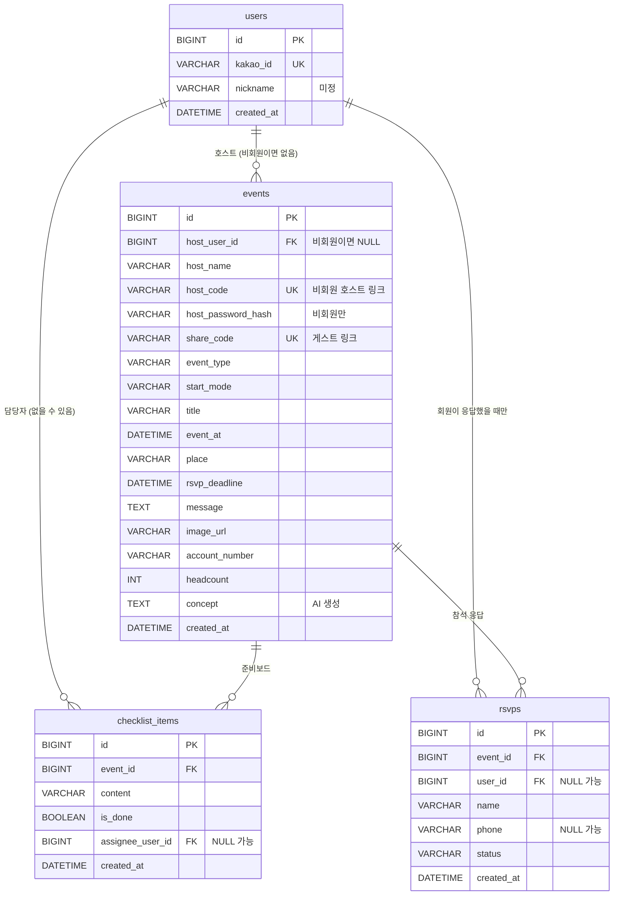

# 백엔드 기준 문서 (backend.md)

작성 중인 문서이며 완성본이 아니다. 꺾쇠 자리표시자가 남은 칸은 아직 묻지 않은 항목이다. 충족 조건과 필수 여부는 `backend-intake-protocol.md`를 따른다.

- 항목마다 한 줄에 결정 / 근거 / 정한 사람 / 상태를 쓴다. 정한 사람은 이름 대신 역할(백엔드, 백엔드+프론트엔드 등)이며, 비어 있으면 확정하지 않는다. 상태는 `미응답 · 제안 · 미정 · 확정 · 충돌 · 미적용` 중 하나다. 팀과 정할 것은 `미정`, 근거에 「팀과 정할 것(PM / 프론트엔드·앱 개발자)」. 테스트·배포·버그 수정처럼 실제 동작 확인이 필요한 항목은 끝에 `/ 확인: 미확인 · 확인 계획 있음 · 테스트로 확인됨 · 배포 환경에서 확인됨 (출처)`를 붙인다.
- 상세 값은 표에 한 번만 적고, 항목에는 결론과 표 위치만 적는다.
- 기능 ID(FN-01)는 prd.md 14절의 것을 그대로 쓴다. API ID(API-01)는 여기서 붙이고 client.md가 그대로 쓴다. 다른 문서의 항목 ID(prd.md D1 등)는 이 문서의 같은 글자 ID와 뜻이 다르다.
- **비밀 값(API 키, DB 비밀번호, 토큰)과 실제 사용자 데이터는 이 문서 어디에도 적지 않는다.**

## 00 문서 상태

- 서비스명: 미정 (PRD의 프로젝트명(가제)이 비어 있음)
- 서비스 종류: 웹
- 버전: v0.11
- 상태: 작성 중
- 현재 단계: 2주차 : DB 설계하고 서버 준비하기 (팀 빌딩~1주차 항목은 미정으로 남긴 채 넘어옴)
- 작성자와 결정권자: 백엔드
- 인터뷰 모드: 주니어, 영역별 조정: C5(스키마 변경·백업)는 신입 방식
- 팀 구성: PM 1 · 디자이너 2 · 클라이언트 개발자(웹 프론트엔드) 2 · 백엔드 3
- 이번 범위 밖: 대규모 트래픽 대비, MSA, 고가용성 클러스터, 웹 결제 PG 실연동, 법무 검토 (팀 조건 2절)
- 확정한 항목 수: 개발자가 원할 때만 셈

| 모듈 | 적용 여부 | 이유 |
| --- | --- | --- |
| W 웹 클라이언트 3개 | 적용 | 웹 서비스 (개발자 답변) |
| P 앱 클라이언트 7개 | 모듈 비활성 | 웹 서비스라 해당 없음 |
| X 서비스 안 AI 기능 4개 | 적용 | AI 체크리스트 생성에 외부 OpenAI API를 씀 (개발자 답변). 서버에서 호출하는지는 X2에서 확인 |

## 01 자료와 출처

| 자료 ID | 자료 (PRD, 화면 목록, 회의 메모 등) | 버전 | 제공자 | 열람 여부 | 활용 범위 |
| --- | --- | --- | --- | --- | --- |
| SRC-01 | PRD (대화에 붙여 넣은 본문: 1~6절 + TBD 안건 1~3) | 버전 표기 없음 | 백엔드(PM 작성본 전달) | 읽음 | A1·A2 후보, 15절 미정 안건. 기능 ID(FN-xx)는 없음 |
| SRC-02 | `build.gradle`, `compose.yaml`, `application.yml` | main 03ed755 | 저장소 | 읽음 | B1 기술 스택 |
| SRC-03 | `README.md` | main 03ed755 | 저장소 | 읽음 | B4 로컬 실행, 배포 환경 변수 이름 |
| SRC-04 | `docs/git-convention.md` | main 03ed755 | 저장소 | 읽음 | B3 브랜치·PR 규칙 |
| SRC-05 | `swyp-team-rules.md`, `backend-intake-protocol.md` v1.0 | - | 백엔드 | 읽음 | 단계·범위·작성 규칙 |
| SRC-06 | 피그마 레이어 CSS (대화에 붙여 넣음: 초대장·작성 1~8·홈 화면, 와이어프레임 프레임 이름, 논의 메모) | 버전 표기 없음, 작업 중인 시안 | 백엔드(디자이너 작업본 전달) | 레이어 이름과 글자만 읽음. 이미지로 들어간 와이어프레임 화면 속 내용은 못 봄 | A2 필요 데이터 후보, D1 API 후보, 15절 미정 안건. 화면 ID(S-xx)는 없음 |
| SRC-07 | 화면 구조도(IA) 이미지 (대화에 붙여 넣은 SVG 안의 그림: 랜딩 → 비회원·게스트·회원 메뉴) | 버전 표기 없음, 작업 중인 시안 | 백엔드(디자이너 작업본 전달) | 읽음. 그림 위 제목 글자는 도형으로 변환되어 못 읽음. 리마인더·공동호스트·알림 설정 칸은 배경색 사각형으로 가려져 있음 | 사용자 유형별 기능 구분(A1·A4), D1 API 후보, OPEN-05·09·10·12 |

## 02 서비스 범위와 필요한 데이터

- **A1** 필수 · 핵심 기능과 서버가 필요한 기능 — 결정: MVP 범위는 아래 표. 사진 갤러리는 넣지 않음. 개발 일정은 3주로 잡음. 범위 밖으로 둔 것은 00절 「이번 범위 밖」 / 근거: 개발자 답변, SRC-01, SRC-06. PM 합의 여부를 아직 확인하지 못함. 팀과 정할 것(PM) / 정한 사람: 미정 / 상태: 미정

| 기능 후보 (기능 ID 없음, 이름만) | PRD의 유저 우선순위 | 서버 필요 | 이번 범위 |
| --- | --- | --- | --- |
| AI 컨셉·준비물 체크리스트 생성 → 준비보드 | 1순위 | 필요 (추정, 확인 전) | 넣음 (백엔드 답변) |
| 준비보드 (체크리스트 항목마다 담당자 지정) | 1순위에 포함 | 필요 (추정, 확인 전) | 넣음. 호스트는 1명. 담당자는 회원으로 지정하는 쪽 (백엔드 답변 「회원일 거야」, 잠정) |
| 로그인 없는 RSVP (이름 + 참석/불참/미정) | 2순위 | 필요 (추정, 확인 전) | 넣음 (백엔드 답변) |
| 초대장 만들기 (배경 이미지 1장 + 텍스트) | 3순위 | 필요 (추정, 확인 전) | 넣음 (백엔드 답변) |
| 행사 후 사진 공유 갤러리 | 4순위 (최하위) | - | MVP에서 뺌 (백엔드 답변) |
| 알림·리마인더 (PRD에 없음, SRC-06 메모) | - | 필요 (추정, 확인 전) | 넣는 쪽으로 생각 중. 호스트가 참석 인원 중 체크한 사람에게 알림 (백엔드 답변 「할 듯」, 잠정). 발송 수단과 시점은 미정 (OPEN-09) |
| 보관함·참여 이력 (PRD에 없음, SRC-06 홈 화면) | - | 필요 (추정, 확인 전) | 회원 기능으로 넣음 (백엔드 답변) |
| 홈의 「내가 할 일」, 마이의 프로필 (PRD에 없음, SRC-07) | - | 필요 (추정, 확인 전) | 미정. 구조도에는 회원 전용 메뉴로 있음 (OPEN-12) |
- **A2** 필수 · 꼭 필요한 데이터와 뺀 데이터, 외부 데이터 — 결정: AI가 만든 체크리스트는 호스트가 고칠 수 있어야 함(개발자 답변). 디자인에서 찾은 입력 값 후보는 도메인 모델 표에 반영(초대장: 제목·일시·시간·장소·응답 마감일·문구·이미지, 이벤트: 유형·시작 방식, RSVP: 이름·전화번호(응답할 때 수집)). 뺄 데이터와 초대장 이미지의 출처는 미정 / 근거: 개발자 답변, SRC-06. 팀과 정할 것(PM) / 정한 사람: 미정 / 상태: 미정
- **A3** 필수 · 엔티티와 관계 → 도메인 모델 표 — 결정: 이벤트마다 호스트는 1명, 공동 호스트 없음. 엔티티와 관계는 아래 표의 AI 초안 검토 전 / 근거: 개발자 답변 / 정한 사람: 미정 / 상태: 미정
- **A4** 데이터별 생성·조회·수정·삭제 주체 — 결정: 미정. AI 초안은 도메인 모델 표의 「만들기 / 보기 / 고치기·지우기」 열 / 근거: 아직 답 없음. 팀과 정할 것(PM) / 정한 사람: 미정 / 상태: 미정
- **A5** 상태가 바뀌는 데이터 — 결정: 미정. 후보는 아래 상태 표 (RSVP 응답, 체크리스트 완료 여부) / 근거: SRC-01, SRC-06. 팀과 정할 것(PM) / 정한 사람: 미정 / 상태: 미정

### 도메인 모델

| 엔티티 | 설명 | 주요 속성 | 관계 | 만들기 / 보기 / 고치기·지우기 | 연결 기능 | 상태 |
| --- | --- | --- | --- | --- | --- | --- |
| 이벤트 (Event) | 호스트가 만드는 모임 하나 | 이벤트 유형(디자인에 11종 + 직접 입력), 날짜, 인원, AI가 만든 컨셉, 시작 방식(「준비까지 한 번에」 / 「초대장만」, 준비보드는 나중에 추가 가능) | 호스트 1명이 소유. 초대장 1개, 체크리스트 항목 여러 개, RSVP 여러 개를 가짐 | 호스트 / 호스트(게스트가 볼 범위는 미정) / 호스트 | AI 체크리스트, 초대장 만들기 | 제안 |
| 초대장 (Invitation) | 게스트에게 링크로 보내는 페이지 | 제목, 일시, 시간, 장소, 응답 마감일, 초대 문구, 이미지 1장, 계좌번호(호스트가 직접 적는 칸, OPEN-07), 공유 링크용 식별값 (이벤트와 초대장 중 어느 쪽에 둘지는 2주차 C2) | 이벤트와 1:1 | 호스트 / 링크를 가진 누구나 / 호스트 | 초대장 만들기 | 제안 |
| 체크리스트 항목 (ChecklistItem) | 준비보드의 준비물 한 줄 | 내용, 완료 여부, 담당자 | 이벤트 1 : 항목 N. 담당자는 회원을 가리키는 쪽(개발자 답변 「회원일 거야」, 잠정. v0.3의 「게스트 지정」에서 바뀜). 그 이벤트에 응답한 회원만 지정할 수 있는지는 미정 | AI 생성 또는 호스트 / 호스트, 담당 회원(홈의 「내가 할 일」) / 호스트 | AI 체크리스트, 준비보드 | 제안 |
| RSVP | 게스트 한 명의 참석 응답 | 이름, 전화번호(응답할 때 수집, OPEN-07), 응답(참석/불참/미정 — PRD 4절) | 이벤트 1 : RSVP N. 회원이 응답하면 보관함에 보이도록 회원과 이어야 함(OPEN-08) | 게스트(비회원도 가능) / 호스트(게스트끼리 볼지는 미정) / 미정 | 로그인 없는 RSVP | 제안 |
| 회원 (User) | 카카오 OAuth2로 로그인한 사람 | 카카오 회원 식별값만 저장(개발자 답변). 화면에 보이는 호스트 이름(「스위프님」)을 어디서 가져오는지는 미정 | 회원 1 : 이벤트 N(호스트로서). 회원 1 : RSVP N(참여자로서, 보관함) | 본인 / 본인 / 미정 | 보관함, 준비보드, 알림 | 제안 |
| 비회원 호스트 | 가입 없이 초대장을 만들어 보내는 사람 (SRC-07) | 저장할 계정 없음. 나중에 인원 현황을 다시 볼 때 본인임을 무엇으로 확인하는지 미정 (OPEN-05) | 비회원 호스트 1 : 이벤트 1 (초대장만, 준비보드 없음) | 본인 / 본인 / 미정 | 초대장 만들기, 로그인 없는 RSVP | 미정 |

위 표는 PRD와 답변으로 만든 AI 초안이다. 개발자가 검토하고 정하기 전까지 `제안`이다.

사용자 유형별 메뉴 (SRC-07 구조도 그대로 옮김, 팀 확정 전):

| 사용자 유형 | 로그인 | 구조도의 메뉴 |
| --- | --- | --- |
| 비회원 (호스트) | 없음 | 초대장 만들기, 링크 공유, 인원 현황 |
| 게스트 | 없음 | 초대장 보기, 참석 응답, 응답 완료, 행사 후 사진 |
| 회원 | SNS 로그인·회원가입 | 홈(다음 모임, 내가 할 일, 모임 목록), 내 모임(예정 모임, 히스토리), 이벤트(이벤트 만들기, 준비보드, 초대장, 참석현황), 마이(프로필, 로그아웃) |
| 가려진 칸 | - | 이벤트 > 리마인더, 이벤트 > 공동호스트(보류), 마이 > 알림 설정 |

| 엔티티 | 상태 목록 | 바뀌는 조건 | 바꿀 수 있는 사람 |
| --- | --- | --- | --- |
| RSVP | 참석 / 불참 / 미정 (PRD 4절) | 초대장에 응답 마감일이 있음(SRC-06). 마감 뒤 응답을 막는지, 낸 응답을 바꿀 수 있는지는 미정 | 미정 |
| 체크리스트 항목 | 미완료 / 완료 (제안) | 체크·해제 (제안) | 호스트 (제안) |

## 03 기술 스택과 개발 환경

- **B1** 필수 · 언어·프레임워크·DB와 팀 경험 — 결정: Java 21, Spring Boot 4.1.2 (Web MVC, Data JPA, Validation), MySQL 8.4, springdoc(Swagger UI), 테스트는 JUnit + Testcontainers. 백엔드 3명의 사용 경험은 보통 / 근거: 백엔드 3명 모두 이 스택 개발자 (개발자 답변), 저장소 세팅은 SRC-02 / 정한 사람: 백엔드 / 상태: 확정
- **B2** 인원·역할 분담·리뷰하는 사람 — 결정: 백엔드 3명. 담당 영역과 리뷰하는 사람은 아직 나누지 않음, 정할 시점도 보류 / 근거: 개발자 답변. 백엔드 3명이 정할 것 / 정한 사람: 미정 / 상태: 미정
- **B3** 저장소·브랜치 규칙·머지 전 조건 — 결정: 백엔드 저장소는 팀 조직(organization) 아래에 있고 프론트엔드 저장소와 분리. 컨벤션은 저장소마다 따로 둠. 백엔드 규칙은 `docs/git-convention.md`: `main` 직접 push 금지, 작업 브랜치 `<type>/<이슈번호>-<짧은-설명>`, 1명 이상 승인 + `./gradlew build` 통과 후 Squash merge / 근거: 개발자 답변, SRC-04. 저장소 공개 범위(공개·비공개)는 아직 답 없음 / 정한 사람: 미정 / 상태: 미정
- **B4** 로컬 실행 방법·환경 변수 예시 파일 위치 — 결정: 실행 순서는 `README.md`(JDK 21 + Docker, `./gradlew bootRun`이 MySQL 컨테이너를 자동 기동). 로컬·배포 환경 변수 모두 값 없이 이름만 적은 예시 파일을 저장소에 두기로 함. 파일은 아직 없고 이름·위치는 미정 / 근거: 개발자 답변(다른 팀원이 쉽게 구성하도록), SRC-03 / 정한 사람: 백엔드 / 상태: 미정

## 04 DB 설계

DB 설계는 사람이 판단한다. AI 초안은 개발자가 정하기 전까지 `제안`이다.

- **C1** 필수 · DB 종류와 선택 이유 — 결정: MySQL 8.4 (관계형), 운영은 AWS RDS에 올릴 것 같음. 이유는 백엔드 3명 모두 다뤄 본 스택(B1) / 근거: B1, SRC-02, 개발자 답변 / 정한 사람: 미정 / 상태: 미정
- **C2** 필수 · 테이블·컬럼 → 아래 표 — 결정: 미정. AI 초안 4개 테이블(users, events, checklist_items, rsvps)을 표에 올림. 초대장은 events에 합치는 안. 개발자 1차 검토에서 고칠 곳은 「일단 없음」, 정한다는 확인은 아직 / 근거: 도메인 모델(A3 초안), 개발자 답변 / 정한 사람: 미정 / 상태: 제안
- **C3** 필수 · 키·관계·삭제 정책 → 아래 표 — 결정: 미정. AI 초안을 관계 표에 올림 / 근거: 도메인 모델(A3 초안) / 정한 사람: 미정 / 상태: 제안
- **C4** 유니크 제약·인덱스 — 결정: 미정. 유니크 후보: users.kakao_id, events.share_code, events.host_code. 같은 이벤트에서 같은 이름의 응답을 막을지는 미정(A5). 인덱스는 외래 키 외에 따로 두지 않는 안 / 근거: AI 초안 / 정한 사람: 미정 / 상태: 제안
- **C5** 스키마 변경(마이그레이션)·백업·가짜 데이터 — 결정: 스키마 변경은 JPA `ddl-auto: update`로 함. Flyway 같은 마이그레이션 도구는 아직 이르다고 판단. 운영 DB 변경 절차, 백업, 가짜 데이터 결정은 아직 답 없음 / 근거: 개발자 답변. 한계: `update`는 컬럼 삭제·이름 변경을 하지 못하므로 그런 변경이 필요해지면 절차를 다시 정함 / 정한 사람: 백엔드 / 상태: 미정

| 테이블 | 컬럼 | 타입 | 제약 (필수·기본값·유니크·키) | 이유 | 상태 |
| --- | --- | --- | --- | --- | --- |
| users | id | BIGINT | PK, 자동 증가 | 회원 구분 | 제안 |
| users | kakao_id | VARCHAR(64) | 필수, 유니크 | 카카오 회원 식별값. 같은 카카오 계정의 중복 가입을 막음 | 제안 |
| users | nickname | VARCHAR(30) | 미정 | 로그인 뒤 닉네임을 입력받을지 고민 중(E4) | 제안 |
| users | created_at | DATETIME | 필수 | 가입 시각 | 제안 |
| events | id | BIGINT | PK, 자동 증가 | 이벤트 구분. 초대장 입력 값도 이 테이블에 합치는 안(이벤트와 초대장이 항상 1:1). 따로 나누는 안도 가능 | 제안 |
| events | host_user_id | BIGINT | FK → users.id, 비어 있을 수 있음 | 회원 호스트. 비회원 호스트면 비움 | 제안 |
| events | host_name | VARCHAR(30) | 필수 | 초대장에 보이는 호스트 이름 (비회원은 직접 입력, 회원은 닉네임) | 제안 |
| events | host_code | VARCHAR(64) | 유니크, 비어 있을 수 있음 | 비회원 호스트용 링크의 식별값. 추측할 수 없는 값이어야 함 (E1 확인 전) | 제안 |
| events | host_password_hash | VARCHAR(100) | 비어 있을 수 있음 | 비회원 호스트 비밀번호의 해시. 원문은 저장하지 않음 (E1·E4 확인 전) | 제안 |
| events | share_code | VARCHAR(64) | 필수, 유니크 | 게스트에게 보내는 초대장 링크의 식별값 | 제안 |
| events | event_type | VARCHAR(30) | 필수 | 이벤트 유형. 고정 값인지 자유 입력인지 미정(OPEN-11) | 제안 |
| events | start_mode | VARCHAR(20) | 필수 | 「준비까지 한 번에」 / 「초대장만」 | 제안 |
| events | title | VARCHAR(100) | 필수 | 초대장 제목 | 제안 |
| events | event_at | DATETIME | 필수 | 일시 + 시간 | 제안 |
| events | place | VARCHAR(200) | 비어 있을 수 있음 | 장소 | 제안 |
| events | rsvp_deadline | DATETIME | 비어 있을 수 있음 | 응답 마감일 | 제안 |
| events | message | TEXT | 비어 있을 수 있음 | 초대 문구 | 제안 |
| events | image_url | VARCHAR(500) | 비어 있을 수 있음 | 초대장 이미지. 이미지를 어디서 가져와 어디에 두는지 미정(A2) | 제안 |
| events | account_number | VARCHAR(50) | 비어 있을 수 있음 | 송금 안내용 계좌번호. 초대장 링크를 가진 사람에게 보임(OPEN-07) | 제안 |
| events | headcount | INT | 비어 있을 수 있음 | AI 생성 입력용 예상 인원 | 제안 |
| events | concept | TEXT | 비어 있을 수 있음 | AI가 만든 컨셉 | 제안 |
| events | created_at | DATETIME | 필수 | 만든 시각 | 제안 |
| checklist_items | id | BIGINT | PK, 자동 증가 | 항목 구분 | 제안 |
| checklist_items | event_id | BIGINT | 필수, FK → events.id | 어느 이벤트의 준비보드인지 | 제안 |
| checklist_items | content | VARCHAR(200) | 필수 | 준비물 내용. AI가 만들고 호스트가 고칠 수 있음 | 제안 |
| checklist_items | is_done | BOOLEAN | 필수, 기본값 false | 완료 여부 | 제안 |
| checklist_items | assignee_user_id | BIGINT | FK → users.id, 비어 있을 수 있음 | 담당 회원 (잠정, OPEN-12) | 제안 |
| checklist_items | created_at | DATETIME | 필수 | 만든 시각 | 제안 |
| rsvps | id | BIGINT | PK, 자동 증가 | 응답 구분 | 제안 |
| rsvps | event_id | BIGINT | 필수, FK → events.id | 어느 이벤트의 응답인지 | 제안 |
| rsvps | user_id | BIGINT | FK → users.id, 비어 있을 수 있음 | 회원이 응답했을 때만 채움. 보관함의 「참여자」 모임에 사용(OPEN-08) | 제안 |
| rsvps | name | VARCHAR(30) | 필수 | 게스트 이름 | 제안 |
| rsvps | phone | VARCHAR(20) | 비어 있을 수 있음 | 리마인더 발송용. 호스트만 조회(OPEN-07) | 제안 |
| rsvps | status | VARCHAR(20) | 필수 | 참석 / 불참 / 미정 | 제안 |
| rsvps | created_at | DATETIME | 필수 | 응답 시각 | 제안 |

| 관계 | 연결 키 | 종류 (1:1·1:N·N:M) | 삭제할 때 | 상태 |
| --- | --- | --- | --- | --- |
| 회원 1 : 이벤트 N | events.host_user_id | 1:N | 미정 (탈퇴 방침 E4에 달려 있음) | 제안 |
| 이벤트 1 : 체크리스트 항목 N | checklist_items.event_id | 1:N | 함께 삭제 | 제안 |
| 이벤트 1 : RSVP N | rsvps.event_id | 1:N | 함께 삭제 | 제안 |
| 회원 1 : RSVP N | rsvps.user_id | 1:N | 응답은 남기고 연결만 비움 | 제안 |
| 회원 1 : 담당 항목 N | checklist_items.assignee_user_id | 1:N | 항목은 남기고 담당자만 비움 | 제안 |

위 두 표는 AI 초안이다. 개발자가 검토하고 정했다고 밝히기 전까지 `제안`이며, 리마인더 발송 기록 테이블은 발송 수단(OPEN-09)이 정해질 때까지 만들지 않았다.

### ERD 초안 (AI 제안, 개발자가 다듬는 중)

## 05 API 설계

- **D1** 필수 · API 목록 → 아래 명세 표 — 결정: 미정. 디자인 화면에서 뽑은 목적별 후보만 표에 올림. 메서드·경로는 D2 공통 규칙을 정한 뒤 붙임. API-01~13의 번호는 프론트엔드 검토 전의 임시 번호이며 합치거나 나뉠 수 있음(예: API-08과 API-10) / 근거: SRC-06 와이어프레임 프레임 이름. prd.md에 기능 ID가 없어 기능 이름으로 연결. 팀과 정할 것(프론트엔드) / 정한 사람: 미정 / 상태: 미정
- **D2** 필수 · 공통 규칙 (경로 이름, 응답 형식, 날짜·시간, 페이지 나누기) — 결정: 미정. 프론트엔드와 정한 것이 아직 없음. 회의에 가져갈 AI 초안은 명세 표 아래 / 근거: 개발자 답변. 팀과 정할 것(프론트엔드) / 정한 사람: 미정 / 상태: 미정
- **D3** 필수 · 에러 응답 형식과 에러 코드 → 아래 표 — 결정: 미정 / 근거: 미정 / 정한 사람: 미정 / 상태: 미응답
- **D4** 필수 · 명세 공유 위치·변경 알림 — 결정: 미정 / 근거: 미정 / 정한 사람: 미정 / 상태: 미응답
- **D5** 임시 응답(목업) — 결정: 미정 / 근거: 미정 / 정한 사람: 미정 / 상태: 미응답
- **D6** 출시 후 API 변경 규칙 — 결정: 미정 / 근거: 미정 / 정한 사람: 미정 / 상태: 미응답

### API 명세

| API ID | 기능 ID | 메서드 | 경로 | 요청 | 응답 | 에러 코드 | 인증·권한 | 담당 | 상태 |
| --- | --- | --- | --- | --- | --- | --- | --- | --- | --- |
| API-01 | AI 체크리스트 / 초대장 만들기 | 미정 | 미정 | 미정 | 미정 | 미정 | 미정 | 미정 | 제안 (이벤트 만들기 (유형, 날짜, 시작 방식). 화면: 이벤트 만들기, 시작 방식 선택) |
| API-02 | AI 체크리스트 | 미정 | 미정 | 미정 | 미정 | 미정 | 미정 | 미정 | 제안 (AI 컨셉·준비물 생성. 화면: AI 컨셉·준비물) |
| API-03 | 준비보드 | 미정 | 미정 | 미정 | 미정 | 미정 | 미정 | 미정 | 제안 (준비보드 조회. 화면: 준비보드) |
| API-04 | 준비보드 | 미정 | 미정 | 미정 | 미정 | 미정 | 미정 | 미정 | 제안 (체크리스트 항목 추가·수정·삭제·체크. 화면: 준비보드, 항목 상세) |
| API-05 | 초대장 만들기 | 미정 | 미정 | 미정 | 미정 | 미정 | 미정 | 미정 | 제안 (초대장 저장·수정 (제목, 일시, 시간, 장소, 응답 마감일, 문구, 이미지). 화면: 초대장 만들기, 간단 초대장 만들기) |
| API-06 | 초대장 만들기 / RSVP | 미정 | 미정 | 미정 | 미정 | 미정 | 미정 | 미정 | 제안 (공유 링크로 초대장 조회 (게스트). 화면: 초대장) |
| API-07 | 로그인 없는 RSVP | 미정 | 미정 | 미정 | 미정 | 미정 | 미정 | 미정 | 제안 (RSVP 제출. 화면: 게스트 RSVP) |
| API-08 | 로그인 없는 RSVP | 미정 | 미정 | 미정 | 미정 | 미정 | 미정 | 미정 | 제안 (참석 현황 조회 (호스트). 화면: 참석 현황·호스트, 인원 파악 현황·호스트) |
| API-09 | (기능 이름 미정) | 미정 | 미정 | 미정 | 미정 | 미정 | 미정 | 미정 | 제안 (내 모임 목록(보관함) 조회. 화면: 홈·내 모임. 호스트 구분 방법(OPEN-05)에 달려 있음) |
| API-10 | (기능 이름 미정) | 미정 | 미정 | 미정 | 미정 | 미정 | 미정 | 미정 | 제안 (비회원 호스트의 인원 현황 조회. 화면: 비회원 > 인원 현황. API-08과 합칠지는 OPEN-05에 달려 있음) |
| API-11 | (기능 이름 미정) | 미정 | 미정 | 미정 | 미정 | 미정 | 미정 | 미정 | 제안 (홈 조회: 다음 모임, 내가 할 일. 화면: 홈. OPEN-12) |
| API-12 | (기능 이름 미정) | 미정 | 미정 | 미정 | 미정 | 미정 | 미정 | 미정 | 제안 (프로필 조회·수정. 화면: 마이 > 프로필) |
| API-13 | (기능 이름 미정) | 미정 | 미정 | 미정 | 미정 | 미정 | 미정 | 미정 | 제안 (SNS 로그인·회원가입·로그아웃. 방식은 2주차 E1·E2에서 정함) |

공통 규칙 초안 (AI 제안, 프론트엔드와 정하기 전까지 채택 아님):
- 경로: `/api/v1` 아래 복수형 명사, 소문자와 하이픈 (예: `/api/v1/events/{eventId}/rsvps`)
- 요청·응답: JSON, 필드 이름은 camelCase
- 날짜·시간: ISO 8601, 시간대 오프셋 포함 (예: `2027-01-01T18:00:00+09:00`)
- 목록: `page`·`size` 쿼리로 나눔. 체크리스트·RSVP처럼 한 이벤트 안의 작은 목록은 나누지 않음
- 응답 형식: 데이터를 그대로 주는 방식과 `data`로 한 번 감싸는 방식 중 프론트엔드와 고를 것
공통 에러 형식: <미정. 예: 에러 코드 + 사람이 읽을 메시지. 채택 전까지 제안>

### 에러 코드

| 에러 코드 | HTTP 상태 | 의미 | 클라이언트 처리·문구 담당 |
| --- | --- | --- | --- |
| 미정 | 미정 | 미정 | 미정 |

## 06 인증·권한·개인정보

보안은 사람이 판단한다. AI 초안은 개발자가 정하기 전까지 `제안`이다.

- **E1** 필수 · 로그인 필요 여부와 방식 — 결정: 회원은 카카오 OAuth2 로그인. 게스트는 로그인 없이 초대장 보기·참석 응답. 비회원 호스트는 로그인 없이 초대장을 만들고, 호스트용 링크 + 비밀번호로 관리 화면에 다시 들어가는 쪽(「할 것 같아」, 개발자 확인 전) / 근거: 개발자 답변, SRC-07. 팀과 정할 것(PM) / 정한 사람: 미정 / 상태: 미정
- **E2** 로그인 유지·만료·로그아웃 — 결정: 미정 / 근거: 미정 / 정한 사람: 미정 / 상태: 미응답
- **E3** 필수 · API별 권한 규칙 → API 명세 표의 인증·권한 열 — 결정: 미정. 비회원 호스트 확인 수단으로 「호스트 링크 + 비밀번호」 안이 나옴, 아직 개발자가 정하지 않음 → OPEN-05 / 근거: 개발자 답변. 3~5주차에 물을 항목 / 정한 사람: 미정 / 상태: 미정
- **E4** 필수 · 개인정보 수집 최소화·비밀번호 해시 저장·탈퇴 시 처리 — 결정: 미정. 수집 항목·이유·공개 범위는 아래 표. 보관·삭제 방침과 탈퇴 시 처리는 아직 정하지 않음(개발자 답변). 비회원 호스트 비밀번호는 해시로만 저장하는 안, 개발자 확인 전. 법률 판단은 팀 확인 / 근거: 개발자 답변. 팀과 정할 것(PM) / 정한 사람: 미정 / 상태: 미정
- **E5** 운영자(관리자) 기능 — 결정: 미정 / 근거: 미정 / 정한 사람: 미정 / 상태: 미응답

| 개인정보 항목 | 수집 이유 | 꼭 필요한가 | 보관·삭제 | 상태 |
| --- | --- | --- | --- | --- |
| 카카오 회원 식별값 | 회원을 구분해 로그인 처리 | 필요 | 미정 | 미정 |
| 회원 이름 | 초대장과 화면에 호스트 이름으로 표시 (개발자 답변 「회원 네임」) | 미정. 「카카오에서 식별값만 가져온다」는 답과 맞지 않음 — 카카오 닉네임을 받을지 직접 입력받을지 정해야 함 | 미정 | 미정 |
| 비회원 호스트 이름 | 초대장에 호스트 이름으로 표시. 초대장을 만들 때 직접 입력 | 필요 | 미정 | 미정 |
| 게스트 이름 | 참석 응답을 구분 (PRD 4절) | 필요 | 미정 | 미정 |
| 게스트 전화번호 | 리마인더 발송. 호스트(주최자)만 볼 수 있음 | 미정 (리마인더를 넣을 때만 필요, OPEN-09) | 미정 | 미정 |
| 호스트 계좌번호 | 초대장에 보여 주어 송금 안내 (PG 연동 없음). 게스트가 볼 수 있음 = 초대장 링크를 가진 사람 모두 | 미정 | 미정 | 미정 |
| 비회원 호스트 비밀번호 | 호스트용 링크의 관리 화면 접근 확인 | 미정 (E1 방식에 달려 있음) | 해시로만 저장하는 안, 확인 전 | 제안 |

## 07 서버 환경과 배포

- **F1** 필수 · 호스팅 서비스·요금제와 확인한 곳 — 결정: 서버는 AWS EC2, DB는 AWS RDS에 올릴 것 같음. AWS 프리 티어로 쓸 예정. 고른 이유와, 프리 티어 조건을 확인한 곳은 아직 답 없음 / 근거: 개발자 답변 / 정한 사람: 미정 / 상태: 미정
- **F2** 필수 · 환경 변수 이름 → 아래 표 — 결정: 미정. `README.md`에 적힌 배포 환경 변수 이름만 표에 옮김. 값은 문서와 대화에 적지 않음 / 근거: SRC-03. 2주차에 물을 항목 / 정한 사람: 미정 / 상태: 미정
- **F3** 개발·운영 환경 분리 — 결정: 서버·DB 환경은 나누지 않을 것 같음(로컬 + 운영 하나). 스프링 프로필은 `local`과 `prod`로 이미 나뉘어 있음. 하나로 두는 이유와 서버 주소는 아직 답 없음 / 근거: 개발자 답변, SRC-02 / 정한 사람: 미정 / 상태: 미정
- **F4** 필수 · 배포 순서·담당·배포 후 확인 — 결정: 미정 / 근거: 미정 / 정한 사람: 미정 / 상태: 미응답
- **F5** 되돌리기 방법 — 결정: 미정 / 근거: 미정 / 정한 사람: 미정 / 상태: 미응답

### 환경 변수 이름 (값은 적지 않음)

| 이름 | 용도 | 필요한 환경 | 값을 관리하는 곳 |
| --- | --- | --- | --- |
| SPRING_PROFILES_ACTIVE | 실행 프로필 선택 (배포는 `prod`) | 운영 | 미정 |
| SPRING_DATASOURCE_URL | DB 접속 주소 | 운영 | 미정 |
| SPRING_DATASOURCE_USERNAME | DB 사용자 이름 | 운영 | 미정 |
| SPRING_DATASOURCE_PASSWORD | DB 비밀번호 | 운영 | 미정 |

`.env` 파일은 저장소에 올리지 않는다. 값이 노출되면 새로 발급한다.

### 배포 정보

- 서버 주소: <개발 / 운영>
- 배포 방법: <수동 / 자동>, 담당: <역할>
- 배포 후 확인: <확인할 API와 화면>
- 되돌리기: <방법>

## 08 테스트

- **G1** 필수 · 핵심 API별 정상·실패 케이스 → 아래 표 — 결정: 미정 / 근거: 미정 / 정한 사람: 미정 / 상태: 미응답
- **G2** 테스트 도구·실행 방법·테스트 데이터 — 결정: 미정 / 근거: 미정 / 정한 사람: 미정 / 상태: 미응답
- **G3** 실행 시점·실패 시 머지 처리 — 결정: 미정 / 근거: 미정 / 정한 사람: 미정 / 상태: 미응답
- **G4** 출시 전 클라이언트와 함께 확인할 시나리오 — 결정: 미정 / 근거: 미정 / 정한 사람: 미정 / 상태: 미응답

| 테스트 ID | 대상 API | 상황 (정상 / 실패) | 입력 | 기대 결과 | 실행 결과 (개발자가 알려 준 것만) |
| --- | --- | --- | --- | --- | --- |
| T-01 | API-01 | 정상 | 미정 | 미정 | 미실행 |
| T-02 | API-01 | 실패 | 미정 | 미정 | 미실행 |

## 09 로그와 장애 대응

- **H1** 필수 · 로그에 남길 것·남기지 않을 것·보는 곳 — 결정: 미정 / 근거: 미정 / 정한 사람: 미정 / 상태: 미응답
- **H2** 필수 · 버그 보고 형식(증상·재현 절차·기대/실제·로그 위치)과 채널 — 결정: 미정 / 근거: 미정 / 정한 사람: 미정 / 상태: 미응답
- **H3** 장애 감지·1차 대응 담당·공유 채널 — 결정: 미정 / 근거: 미정 / 정한 사람: 미정 / 상태: 미응답
- **H4** 장애 대응 체크리스트 확정 — 결정: 미정 / 근거: 미정 / 정한 사람: 미정 / 상태: 미응답

### 장애 대응 체크리스트 (우리 서비스에 맞게 고쳐 쓴다)

- [ ] 증상과 처음 알게 된 경로를 팀 채널에 공유했다
- [ ] 재현 절차를 적었다 (다시 일으키는 순서)
- [ ] 서버 로그에서 관련 에러를 찾았다 (비밀 값·개인정보는 가리고 공유)
- [ ] 최근 바뀐 것(배포, 코드, 설정, 환경 변수)을 확인했다
- [ ] 서버·DB가 살아 있는지, 사용량 한도를 넘지 않았는지 확인했다
- [ ] 필요하면 이전 버전으로 되돌렸다
- [ ] 고친 뒤 재현 절차로 다시 확인하고, 같은 문제를 막는 테스트를 추가했다
- [ ] 원인과 조치를 변경 이력에 남겼다

## 10 보안 점검

- **I1** 필수 · 비밀 정보 보관 위치·접근자·노출 시 재발급 — 결정: 비밀 값은 저장소에 올리지 않고 AWS 서버의 `.env`로 관리할 생각. `.env`는 `.gitignore`에 있음(저장소에서 확인). 접근할 수 있는 사람과 노출 시 재발급 절차는 아직 답 없음 / 근거: 개발자 답변 / 정한 사람: 미정 / 상태: 미정
- **I2** 필수 · 입력값 검사 위치와 규칙 — 결정: 미정 / 근거: 미정 / 정한 사람: 미정 / 상태: 미응답
- **I3** 출시 전 보안 점검 (판단은 사람, AI 점검은 참고) — 결정: 미정 / 근거: 미정 / 정한 사람: 미정 / 상태: 미응답
- **I4** 외부 라이브러리 추가 시 확인 — 결정: 미정 / 근거: 미정 / 정한 사람: 미정 / 상태: 미응답

### 출시 전 보안 체크리스트 (I3, 우리 서비스에 맞게 고쳐 쓴다)

- [ ] `.env`가 `.gitignore`에 있고, 비밀 값이 저장소(커밋 기록 포함)에 올라간 적이 없다
- [ ] 비밀 값은 서버 환경 변수·호스팅 서비스 설정에만 있다 (I1)
- [ ] 모든 API에 인증·권한 확인이 있다 (E3)
- [ ] 사용자가 보낸 값을 서버에서 검사한다 (I2)
- [ ] 비밀번호는 해시로만 저장한다 (E4)
- [ ] 로그에 비밀번호·토큰·개인정보가 남지 않는다 (H1)
- [ ] 웹이면 CORS가 모든 주소를 허용하지 않는다 (W1)
- [ ] AI 코딩 도구의 파일 삭제·DB 명령은 자동 승인하지 않고 내용을 확인한 뒤 승인한다

## 11 성능과 비용

- **J1** 필수 · 쓰는 서비스의 한도(확인한 곳)와 넘을 때 대응 — 결정: 미정. EC2·RDS를 프리 티어로 쓸 예정이라는 답만 있음. 한도는 개발자가 AWS 사이트에서 확인한 값만 적음 / 근거: 개발자 답변 / 정한 사람: 미정 / 상태: 미정
- **J2** 예상 사용자 규모 (가설) — 결정: 소규모로 예상 (가설, 숫자 없음). 그 규모에서 필요한 수준은 서버 1대 + DB 1대의 프리 티어 구성으로 보는 안(AI 제안) / 근거: 개발자 답변. 팀과 정할 것(PM) / 정한 사람: 미정 / 상태: 미정
- **J3** 느려질 만한 곳과 대응 — 결정: 미정 / 근거: 미정 / 정한 사람: 미정 / 상태: 미응답
- **J4** 사용량·비용 확인 위치와 담당 — 결정: 미정 / 근거: 미정 / 정한 사람: 미정 / 상태: 미응답

| 서비스 | 쓰는 요금제 | 확인한 한도 | 확인한 곳 | 넘으면 |
| --- | --- | --- | --- | --- |
| AWS EC2 (서버) | 프리 티어 예정 | 미확인 | 미정 | 미정 |
| AWS RDS (MySQL) | 프리 티어 예정 | 미확인 | 미정 | 미정 |
| OpenAI API (AI 체크리스트) | 미정 | 미확인 | 미정 | 미정 (3~5주차 X4) |

## 12 출시 후 안정화

- **K1** 필수 · 고칠 순서 기준 — 결정: 미정 / 근거: 미정 / 정한 사람: 미정 / 상태: 미응답
- **K2** 에러 로그 확인 주기·담당·정리 방법 — 결정: 미정 / 근거: 미정 / 정한 사람: 미정 / 상태: 미응답
- **K3** 반영한 개선과 반영하지 않은 이유 기록 — 결정: 미정 / 근거: 미정 / 정한 사람: 미정 / 상태: 미응답
- **K4** 고친 뒤 확인·테스트 추가 — 결정: 미정 / 근거: 미정 / 정한 사람: 미정 / 상태: 미응답

| 문제 | 출처 (에러 로그 / 피드백) | 영향 | 우선순위 | 처리 | 결과 |
| --- | --- | --- | --- | --- | --- |
| 미정 | 미정 | 미정 | 미정 | 미정 | 미정 |

## 13 팀 AI 사용 규칙

- **L1** 사람별·용도별 AI 도구 — 결정: 미정. 팀이 합의한 규칙이 아직 없음 / 근거: 개발자 답변. 팀과 정할 것(팀 전체) / 정한 사람: 미정 / 상태: 미정
- **L2** 필수 · AI에 맡길 일과 사람이 정할 일 (DB 설계·보안은 사람) — 결정: 미정. 팀이 합의한 규칙이 아직 없음 / 근거: 개발자 답변. 팀과 정할 것(팀 전체) / 정한 사람: 미정 / 상태: 미정
- **L3** 필수 · PR의 AI 사용 표시·리뷰 확인·설명 못하는 코드 머지 금지 — 결정: 미정. 팀이 합의한 규칙이 아직 없음 / 근거: 개발자 답변. `docs/git-convention.md`가 커밋에 `Co-Authored-By` 트레일러를 금지하므로 표시는 PR 본문에 두는 안을 제안. 팀과 정할 것(프론트엔드) / 정한 사람: 미정 / 상태: 미정
- **L4** 필수 · AI에 넣지 않을 정보와 대안 — 결정: 미정. 팀이 합의한 규칙이 아직 없음 / 근거: 개발자 답변. `.env`가 `.gitignore`에 있는 것은 저장소에서 확인함. 팀과 정할 것(팀 전체) / 정한 사람: 미정 / 상태: 미정
- **L5** AI 코딩 도구에 요약을 주는 방법·갱신 담당 — 결정: 미정 / 근거: 미정 / 정한 사람: 미정 / 상태: 미응답

PR의 AI 사용 표시 형식: <예: AI 사용 있음·없음 / AI가 만든 부분 / 내가 직접 확인한 것. 팀이 정할 때까지 제안>

리뷰데이 AI 회고 메모 (매주): 이번 주 AI를 쓴 곳 / 사람이 직접 판단한 곳 / 시행착오 / 다음 주에 시도할 것

## 14 조건부 상세 규칙

### W 웹 클라이언트
- **W1** CORS 허용 주소 — 결정: 미정. 프론트엔드 도메인이 아직 없음 / 근거: 개발자 답변. 팀과 정할 것(프론트엔드) / 정한 사람: 미정 / 상태: 미정
- **W2** 서버 주소·HTTPS — 결정: 미정. 프론트엔드는 도메인을 따로 살 것 같음. 백엔드는 터널링을 쓸지 고민 중 / 근거: 개발자 답변. 팀과 정할 것(프론트엔드) / 정한 사람: 미정 / 상태: 미정
- **W3** 브라우저의 로그인 상태 저장 (쿠키 세션, 토큰 등) — 결정: 미정 / 근거: 미정 / 정한 사람: 미정 / 상태: 미응답

### P 앱 클라이언트

모듈 비활성 (웹 서비스). 아래 항목은 쓰지 않는다.

- **P1** 앱 토큰 저장·갱신, 소셜 로그인 — 결정: 미정 / 근거: 미정 / 정한 사람: 미정 / 상태: 미응답
- **P2** 필수 · 예전 버전 앱이 깨지지 않는 API 변경 규칙 — 결정: 미정 / 근거: 미정 / 정한 사람: 미정 / 상태: 미응답
- **P3** 이미지·파일 업로드와 저장 — 결정: 미정 / 근거: 미정 / 정한 사람: 미정 / 상태: 미응답
- **P4** 운영 지표용 데이터·이벤트 로그 — 결정: 미정 / 근거: 미정 / 정한 사람: 미정 / 상태: 미응답
- **P5** 푸시 알림 서버 (팀이 선택했을 때만) — 결정: 미정 / 근거: 미정 / 정한 사람: 미정 / 상태: 미응답
- **P6** 인앱 결제 영수증 검증·광고 (팀이 선택했을 때만) — 결정: 미정 / 근거: 미정 / 정한 사람: 미정 / 상태: 미응답
- **P7** 심사 기간 서버 유지·심사용 계정 (비밀번호는 적지 않음) — 결정: 미정 / 근거: 미정 / 정한 사람: 미정 / 상태: 미응답

### X 서비스 안 AI 기능
- **X1** 필수 · 부르는 AI API와 보내는 데이터 — 결정: 미정. AI 체크리스트 생성에 OpenAI API를 쓴다는 답만 있음. 보내는 데이터와 결과 처리는 묻지 않음 / 근거: 개발자 답변. 3~5주차에 물을 항목. 팀과 정할 것(PM) / 정한 사람: 미정 / 상태: 미정
- **X2** 필수 · AI API 키는 서버에만 — 결정: 미정 / 근거: 미정 / 정한 사람: 미정 / 상태: 미응답
- **X3** 실패·지연·이상한 결과 처리 — 결정: 미정 / 근거: 미정 / 정한 사람: 미정 / 상태: 미응답
- **X4** 호출 비용·횟수 제한 — 결정: 미정 / 근거: 미정 / 정한 사람: 미정 / 상태: 미응답

## 15 미정·가설

| ID | 미정 또는 가설 | 영향 | 임시 결정 | 담당 (팀과 정할 것이면 PM / 클라이언트) | 상태 |
| --- | --- | --- | --- | --- | --- |
| OPEN-01 | 사진 공유 갤러리를 이번 범위에 넣을지, 넣는다면 보안 방식(만료되는 Signed URL·TTL, PIN 진입) — PRD TBD 안건 1 | A1 범위, 파일 저장소 선택, 테이블·API 수, 일정 | MVP에 넣지 않음 (백엔드 답변, PM 합의 확인 전) | PM / 프론트엔드 | 미정 |
| OPEN-02 | 베스트 샷 투표(좋아요 수 상위 3장 노출) — PRD TBD 안건 2 | OPEN-01에 달려 있음. 좋아요 데이터와 집계 API 추가 | 갤러리와 함께 MVP에서 뺌 (백엔드 답변, PM 합의 확인 전) | PM | 미정 |
| OPEN-03 | 체크리스트 항목의 외부 링크(쿠팡·에어비앤비 등) 연동 방식과 범위 — PRD TBD 안건 3 | 프론트엔드 하드코딩이면 서버 변경 없음. 서버가 링크를 내려 주면 체크리스트 데이터와 API 응답에 필드 추가 | 없음. 어느 사이트로 보낼지 더 생각하기로 함 (백엔드 답변). 디자인 메모는 「네이버쇼핑 링크만」 | PM / 프론트엔드 | 미정 |
| OPEN-04 | 개발 일정: PRD 안건 3은 「3주 개발 일정」, 팀 단계표는 8주 기준 | 범위에 넣을 기능 수 | 3주로 잡음 (백엔드 답변, PM 합의 확인 전). 팀 단계표의 주차와 어떻게 맞출지는 미정 | PM | 미정 |
| OPEN-05 | 호스트를 무엇으로 구분하는지 (PRD는 「호스트용 링크 공유」, 게스트는 가입 없음). 로그인 여부는 2주차 E1에서 정함 | 도메인 모델(A3)에 사용자 엔티티가 있는지, 권한 규칙 전체 | 회원은 카카오 OAuth2. 비회원 호스트는 호스트용 링크 + 비밀번호로 가는 쪽(개발자 확인 전). 비밀번호 분실 시 복구 방식은 생각하지 못함(개발자 답변) — 문자 인증 복구 / 복구 없음 중 미정. 함께 정할 것: 해시 저장, 입력 시도 횟수 제한, 링크 식별값을 추측할 수 없게 만드는 방법 | 백엔드 / PM | 미정 |
| OPEN-06 | `compose.yaml`에 로컬 개발용 DB 접속 값이 커밋되어 있음 (값은 이 문서에 옮기지 않음). 운영에 같은 값을 쓰지 않는다는 결정이 필요 | I1 비밀 정보 관리 | 없음 | 백엔드 (2주차 I1) | 미정 |
| OPEN-07 | 개인정보 추가 수집: RSVP에 전화번호(선택), 초대장에 계좌번호 입력 칸 — 디자인 메모(SRC-06). PRD는 RSVP에 이름만 받음 | E4 개인정보 범위, 테이블 컬럼, 로그에 남기지 않을 값 | 전화번호는 리마인더 발송용으로 게스트가 응답할 때 수집, 계좌번호는 송금 안내용으로 호스트가 직접 적음, PG 연동은 하지 않음 (백엔드 답변). 필수 여부, 누구에게 보이는지, 보관·삭제는 미정. 법률 판단은 팀 확인 | PM / 디자이너 (2주차 E4) | 미정 |
| OPEN-08 | 홈 「보관함」에 호스트로 만든 모임과 참여자로 응답한 모임이 함께 보임(SRC-06). 가입 없는 게스트의 RSVP를 회원 계정과 어떻게 잇는지 | RSVP와 사용자의 관계, API-09 | 보관함은 회원 기능 (백엔드 답변). 회원이 낸 RSVP만 보관함에 이어지는 것으로 초안 작성, 확인 전 | PM / 프론트엔드 | 미정 |
| OPEN-09 | 홈의 알림·검색 아이콘과 메모의 「리마인더 기능」이 이번 범위인지(SRC-06) | 알림 데이터와 발송 수단, API 수 | 넣는 쪽으로 생각 중. 호스트가 참석 인원 중 체크한 사람에게 알림 (백엔드 답변, 잠정). 발송 수단(문자·카카오톡 등)과 비용, 시점은 미정. 구조도에서 칸이 가려진 이유는 미확인 | PM | 미정 |
| OPEN-10 | 범위 불일치: 와이어프레임에 「행사 후 사진 (4순위)」와 「항목 상세 · 담당자 지정」 화면이 남아 있음(SRC-06). 개발자 답변은 사진 갤러리 제외, 호스트 1명 | A1 범위, 체크리스트 항목의 담당자 속성 | 사진 갤러리는 MVP에서 뺌. 담당자 지정은 남기고 담당자는 회원으로 하는 쪽 (백엔드 답변, 잠정, PM 합의 확인 전). 구조도(SRC-07)에는 게스트 메뉴에 「행사 후 사진」이 아직 있음 | PM / 디자이너 | 미정 |
| OPEN-11 | 이벤트 유형 목록: 디자인에 11종 + 직접 입력. 한 시안에는 워크숍·피크닉 줄에 「보류」 표시, 메모에 연말파티·크리스마스파티 추가 의견(SRC-06) | 유형을 고정 값으로 둘지 자유 입력으로 둘지, AI 생성 입력 | 없음. 질문의 뜻을 다시 설명하고 묻기로 함 | PM / 디자이너 | 미정 |
| OPEN-12 | 홈의 「내가 할 일」이 무엇을 보여 주는지 (SRC-07). 담당자를 게스트로 지정하면 로그인 없는 게스트는 홈을 볼 수 없음 | 체크리스트 담당자가 회원을 가리키는지 게스트를 가리키는지, API-11 | 담당자는 회원으로 하는 쪽 (백엔드 답변, 잠정). 「내가 할 일」에 무엇이 나오는지는 구조도 완성 뒤 확인 | PM / 디자이너 | 미정 |

## 16 변경 이력

| 버전 | 바꾼 결정 | 이유 | 영향받는 테이블·API·클라이언트 | 결정한 사람 | 클라이언트에 알림 |
| --- | --- | --- | --- | --- | --- |
| v0.1 | 최초 작성. 서비스 종류(웹)·단계·모드, 자료에서 찾은 A1·B1·B3·B4·L4 후보, PRD TBD 안건을 15절에 등록 | - | - | 백엔드 | - |
| v0.2 | 피그마 레이어(SRC-06)에서 찾은 내용 반영: 도메인 모델 속성 후보, API 후보 9개, OPEN-07~11 추가, OPEN-03·05 보강. B1 확정 | 디자인 자료 전달 | 도메인 모델, API 명세 표 (모두 제안·미정) | 백엔드 | 아직 알리지 않음 |
| v0.3 | MVP 범위 답변 반영: 사진 갤러리 제외, 담당자는 게스트 지정 안, 알림·리마인더와 보관함 추가, 일정 3주, 전화번호·계좌번호 수집 방향. 도메인 모델에 회원 엔티티 추가 | 개발자 답변 | 도메인 모델, API 후보 (모두 제안·미정) | 백엔드 (PM 합의 확인 전) | 아직 알리지 않음 |
| v0.4 | 화면 구조도(SRC-07) 반영: 사용자 유형별 메뉴 표, 비회원 호스트 행, API 후보 4개(API-10~13), OPEN-12 추가 | 디자인 자료 전달 | 도메인 모델, API 명세 표 (모두 제안·미정) | 백엔드 | 아직 알리지 않음 |
| v0.5 | 담당자를 게스트에서 회원으로 바꾸는 쪽(잠정), 리마인더는 호스트가 참석 인원 중 체크해 알림(잠정), 비회원 호스트 확인 수단으로 「호스트 링크 + 비밀번호」 안 기록(미결정). 단계 밖 답변을 E1·E3·E4·X1에 미정으로 연결 | 개발자 답변 | 도메인 모델의 체크리스트 항목 (제안) | 백엔드 | 아직 알리지 않음 |
| v0.11 | C5: 스키마 변경은 ddl-auto update로 함(Flyway는 보류). 04절에 ERD 초안 추가 | 개발자 답변, 개발자 요청 | 없음 | 백엔드 | - |
| v0.10 | F3: 환경을 나누지 않는 쪽. J2: 소규모 예상(가설). C2: 1차 검토에서 고칠 곳 없음(확인 전) | 개발자 답변 | 없음 | 백엔드 | - |
| v0.9 | 테이블·관계·유니크 제약의 AI 초안 등록(C2~C4, 제안). I1: 비밀 값은 AWS 서버의 .env. W1·W2: 프론트엔드 도메인 구매 예정, 백엔드 터널링 고민 중 | 개발자 답변 | 테이블 표 (제안) | 백엔드 | 아직 알리지 않음 |
| v0.8 | E4: 호스트 이름 출처와 공개 범위(전화번호는 호스트만, 계좌번호는 게스트에게 공개) 반영. F1·C1: EC2·RDS 프리 티어 예정. J1 표에 서비스 3개 등록(한도 미확인) | 개발자 답변 | 없음 | 백엔드 | - |
| v0.7 | 2주차 시작. E1: 카카오 OAuth2, 비회원 호스트는 링크 + 비밀번호 쪽(확인 전). E4: 개인정보 항목 표 작성. F1: AWS | 개발자 답변 | 도메인 모델의 회원 행 (제안) | 백엔드 | 아직 알리지 않음 |
| v0.6 | B3: 조직 저장소, 프론트엔드와 분리, 컨벤션은 저장소별. B4: 환경 변수 예시 파일을 두기로 함. F2 표에 README의 변수 이름 4개 옮김 | 개발자 답변 | 없음 | 백엔드 | - |

## 17 다음 대화 인계 메모

- 서비스 종류와 현재 단계: 웹, 2주차 : DB 설계하고 서버 준비하기 (C1~C5, E1, E4, F1~F3, I1, J1~J2, W1~W2). 1주차 항목은 B1만 확정, 나머지는 팀과 정할 것으로 미정. 개발 일정은 3주로 잡음(OPEN-04)
- 마지막으로 확정한 것: B1 (Java 21, Spring Boot 4, MySQL 8.4). 모듈은 W·X 적용, P 모듈 비활성. 회원·비회원을 둘 다 둔다는 방향은 들었으나 E1은 2주차에 확정
- 이번 단계에 남은 필수 항목: A1, A2, A3, D1, D2, L2, L3, L4 — 모두 미정. 팀과 정할 시점은 아직 받지 못함
- 팀과 정할 것: A1·A2·A4·A5(PM), B3·D1·D2·L3(프론트엔드), L1·L2·L4(팀 전체), OPEN-01~05·07~12
- 이어갈 인터뷰 모드: 주니어
- 다음에 만들 것: 구조도 확정 뒤 범위(A1)·도메인 모델(A3) 확정 → 2주차 항목 중 로그인(E1)과 비회원 호스트 확인 수단(OPEN-05)부터 → 테이블 초안(C2·C3)

## 18 항목 상태표

확정한 항목 수는 이 표로 센다. 확정 행만 센다. 본문 항목을 바꾸면 이 표의 상태도 같이 바꾼다.

「적용」 열은 `적용 · 판정 대기 · 모듈 비활성` 중 하나다. 판정 대기 = 모듈 적용 여부 미정, 모듈 비활성 = 켜지 않은 모듈이며 상태 칸은 `-`로 두고 계산에서 뺀다.

| ID | 필수 | 적용 | 상태 | 남은 조건 |
| --- | --- | --- | --- | --- |
| A1 | 필수 | 적용 | 미정 | PM 합의 확인 (팀과 정할 것), 알림·리마인더의 발송 수단 |
| A2 | 필수 | 적용 | 미정 | 디자인에서 찾은 후보 확인, 뺀 데이터와 이유, 이미지 출처, PM 합의 (팀과 정할 것) |
| A3 | 필수 | 적용 | 미정 | 도메인 모델 초안 검토, 호스트 구분 방법 (OPEN-05) |
| A4 | 일반 | 적용 | 미정 | 도메인 모델 초안의 주체 열 검토, PM 합의 (팀과 정할 것) |
| A5 | 일반 | 적용 | 미정 | RSVP 응답 변경·마감 규칙, PM 합의 (팀과 정할 것) |
| B1 | 필수 | 적용 | 확정 | - |
| B2 | 일반 | 적용 | 미정 | 담당 영역, 리뷰하는 사람 |
| B3 | 일반 | 적용 | 미정 | 저장소 공개 범위 |
| B4 | 일반 | 적용 | 미정 | 예시 파일의 이름·위치를 정하고 저장소에 추가 |
| C1 | 필수 | 적용 | 미정 | RDS로 정하는지 개발자 확인 |
| C2 | 필수 | 적용 | 제안 | 개발자 검토와 결정. A3 도메인 모델 확정이 먼저 |
| C3 | 필수 | 적용 | 제안 | 개발자 검토와 결정. 회원 탈퇴 시 이벤트 처리 (E4) |
| C4 | 일반 | 적용 | 제안 | 개발자 검토와 결정. 같은 이름 응답 처리 (A5) |
| C5 | 일반 | 적용 | 미정 | 운영 DB를 바꿀 때의 순서, 백업 여부와 방법, 테스트는 가짜 데이터로 한다는 결정 |
| D1 | 필수 | 적용 | 미정 | 후보 검토, 메서드·경로, 우선순위, 프론트엔드 합의 (팀과 정할 것) |
| D2 | 필수 | 적용 | 미정 | 프론트엔드와 공통 규칙 합의 (팀과 정할 것) |
| D3 | 필수 | 적용 | 미응답 | 전체 |
| D4 | 필수 | 적용 | 미응답 | 전체 |
| D5 | 일반 | 적용 | 미응답 | 전체 |
| D6 | 일반 | 적용 | 미응답 | 전체 |
| E1 | 필수 | 적용 | 미정 | 비회원 호스트 방식의 개발자 확인(비밀번호 분실 처리 포함), 가입 때 추가로 받는 정보, PM 합의 |
| E2 | 일반 | 적용 | 미응답 | 전체 |
| E3 | 필수 | 적용 | 미정 | 3~5주차에 물음. API별 권한, 비회원 호스트 확인 수단 (OPEN-05) |
| E4 | 필수 | 적용 | 미정 | 회원 이름의 출처, 보관·삭제 방침, 탈퇴 시 처리, 해시 저장 확인, PM 합의 (OPEN-07) |
| E5 | 일반 | 적용 | 미응답 | 전체 |
| F1 | 필수 | 적용 | 미정 | 고른 이유, 개발자가 AWS 사이트에서 확인한 프리 티어 조건과 확인한 곳 |
| F2 | 필수 | 적용 | 미정 | 2주차에 물음. 전체 목록(OpenAI 키 이름 등), 값을 관리하는 곳 |
| F3 | 일반 | 적용 | 미정 | 하나로 운영하는 이유, 서버 주소 |
| F4 | 필수 | 적용 | 미응답 | 전체 |
| F5 | 일반 | 적용 | 미응답 | 전체 |
| G1 | 필수 | 적용 | 미응답 | 전체 |
| G2 | 일반 | 적용 | 미응답 | 전체 |
| G3 | 일반 | 적용 | 미응답 | 전체 |
| G4 | 일반 | 적용 | 미응답 | 전체 |
| H1 | 필수 | 적용 | 미응답 | 전체 |
| H2 | 필수 | 적용 | 미응답 | 전체 |
| H3 | 일반 | 적용 | 미응답 | 전체 |
| H4 | 일반 | 적용 | 미응답 | 전체 |
| I1 | 필수 | 적용 | 미정 | 접근할 수 있는 사람, 노출 시 재발급 절차, 운영에 로컬용 값을 쓰지 않는다는 결정 (OPEN-06) |
| I2 | 필수 | 적용 | 미응답 | 전체 |
| I3 | 일반 | 적용 | 미응답 | 전체 |
| I4 | 일반 | 적용 | 미응답 | 전체 |
| J1 | 필수 | 적용 | 미정 | 서비스별 확인한 한도와 확인한 곳, 넘을 때 대응, 비용을 누가 내는지 팀 합의 |
| J2 | 일반 | 적용 | 미정 | PM과 예상 범위 합의 (팀과 정할 것) |
| J3 | 일반 | 적용 | 미응답 | 전체 |
| J4 | 일반 | 적용 | 미응답 | 전체 |
| K1 | 필수 | 적용 | 미응답 | 전체 |
| K2 | 일반 | 적용 | 미응답 | 전체 |
| K3 | 일반 | 적용 | 미응답 | 전체 |
| K4 | 일반 | 적용 | 미응답 | 전체 |
| L1 | 일반 | 적용 | 미정 | 도구 목록 팀 합의 (팀과 정할 것) |
| L2 | 필수 | 적용 | 미정 | 맡길 일과 사람이 정할 일의 구분 팀 합의 (팀과 정할 것) |
| L3 | 필수 | 적용 | 미정 | 표시 형식, 리뷰 확인 항목 팀 합의 (팀과 정할 것) |
| L4 | 필수 | 적용 | 미정 | 금지 목록과 대안 팀 합의 (팀과 정할 것) |
| L5 | 일반 | 적용 | 미응답 | 전체 |
| W1 | 일반 | 적용 | 미정 | 프론트엔드 개발·운영 주소가 정해지면 허용 목록 작성 (팀과 정할 것) |
| W2 | 일반 | 적용 | 미정 | 서버 주소, HTTPS 적용 방법, 프론트엔드 합의 (팀과 정할 것) |
| W3 | 일반 | 적용 | 미응답 | 전체 |
| P1 | 일반 | 모듈 비활성 | - | 웹 서비스라 켜지 않음 |
| P2 | 적용 시 필수 | 모듈 비활성 | - | 웹 서비스라 켜지 않음 |
| P3 | 일반 | 모듈 비활성 | - | 웹 서비스라 켜지 않음 |
| P4 | 일반 | 모듈 비활성 | - | 웹 서비스라 켜지 않음 |
| P5 | 일반 | 모듈 비활성 | - | 웹 서비스라 켜지 않음 |
| P6 | 일반 | 모듈 비활성 | - | 웹 서비스라 켜지 않음 |
| P7 | 일반 | 모듈 비활성 | - | 웹 서비스라 켜지 않음 |
| X1 | 적용 시 필수 | 적용 | 미정 | 3~5주차에 물음. 보내는 데이터, 결과 처리, PM 합의 |
| X2 | 적용 시 필수 | 적용 | 미응답 | 전체 (3~5주차에 물음) |
| X3 | 일반 | 적용 | 미응답 | 전체 (3~5주차에 물음) |
| X4 | 일반 | 적용 | 미응답 | 전체 (3~5주차에 물음) |

## 19 AI 코딩 도구에 줄 요약

확정된 결정만 짧게 적는다. 제안·미정은 넣지 않는다. 확정 내용이 바뀌면 함께 고친다. 이 절만 떼어 프로젝트 루트의 규칙 파일(Claude Code는 CLAUDE.md, Codex는 AGENTS.md, Cursor는 .cursor/rules)에 넣으면 팀원 모두의 AI 코딩 도구가 같은 규칙을 자동으로 읽는다.

- 서비스와 클라이언트: 웹 서비스(클라이언트는 웹 프론트엔드). 소규모 모임의 초대장·RSVP·준비보드를 다루는 백엔드
- 기술 스택: Java 21, Spring Boot 4.1.2 (Web MVC, Data JPA, Validation), MySQL 8.4, springdoc, JUnit + Testcontainers (B1)
- 폴더·이름 규칙: 아직 확정한 것 없음
- API 공통 규칙과 에러 형식: 아직 확정한 것 없음
- 인증·권한 원칙: 아직 확정한 것 없음
- DB 규칙: 아직 확정한 것 없음
- 테스트 규칙: 아직 확정한 것 없음
- 작업 순서: 큰 변경은 어떤 파일을 어떻게 바꿀지 계획을 먼저 보여 주고, 확인받은 뒤 구현한다
- 완료 확인: 끝내기 전에 테스트를 돌려 통과를 확인하고, 돌리지 못했으면 그렇게 알린다
- 확인받을 것: 파일 삭제, DB 명령(스키마 변경·데이터 삭제), 배포 명령은 실행 전에 사람에게 확인받는다
- git: 작업은 작게 나눠 커밋한다. .env는 .gitignore에 넣고 저장소에 올리지 않는다
- 금지: 비밀 값을 코드에 직접 쓰지 않는다 / 로그에 비밀번호·토큰·개인정보를 남기지 않는다 / DB 설계·보안 변경은 사람이 결정한다 / 설명할 수 없는 코드는 머지하지 않는다 / PR에 AI 사용을 표시한다

— 문서 끝 —
