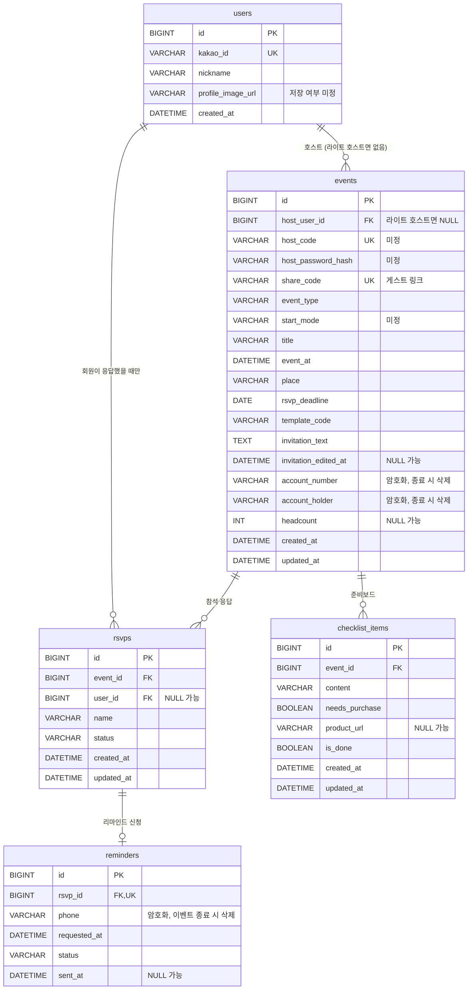

# 백엔드 기준 문서 (backend.md)

작성 중인 문서이며 완성본이 아니다. 꺾쇠 자리표시자가 남은 칸은 아직 묻지 않은 항목이다. 충족 조건과 필수 여부는 `backend-intake-protocol.md`를 따른다.

- 항목마다 한 줄에 결정 / 근거 / 정한 사람 / 상태를 쓴다. 정한 사람은 이름 대신 역할(백엔드, 백엔드+프론트엔드 등)이며, 비어 있으면 확정하지 않는다. 상태는 `미응답 · 제안 · 미정 · 확정 · 충돌 · 미적용` 중 하나다. 팀과 정할 것은 `미정`, 근거에 「팀과 정할 것(PM / 프론트엔드·앱 개발자)」. 테스트·배포·버그 수정처럼 실제 동작 확인이 필요한 항목은 끝에 `/ 확인: 미확인 · 확인 계획 있음 · 테스트로 확인됨 · 배포 환경에서 확인됨 (출처)`를 붙인다.
- 상세 값은 표에 한 번만 적고, 항목에는 결론과 표 위치만 적는다.
- 기능 ID(FN-01)는 prd.md 14절의 것을 그대로 쓴다. API ID(API-01)는 여기서 붙이고 client.md가 그대로 쓴다. 다른 문서의 항목 ID(prd.md D1 등)는 이 문서의 같은 글자 ID와 뜻이 다르다.
- **비밀 값(API 키, DB 비밀번호, 토큰)과 실제 사용자 데이터는 이 문서 어디에도 적지 않는다.**

## 00 문서 상태

- 서비스명: 모임집(Zip) (SRC-08 PRD 루트). 다만 PRD 1-1은 「서비스명과 핵심 가치 문구는 기획자가 별도로 확정」이라 적어 PM 확인 전
- 서비스 종류: 웹
- 버전: v0.14
- 상태: 작성 중
- 현재 단계: 2주차 : DB 설계하고 서버 준비하기 (팀 빌딩~1주차 항목은 미정으로 남긴 채 넘어옴)
- 작성자와 결정권자: 백엔드
- 인터뷰 모드: 주니어, 영역별 조정: C5(스키마 변경·백업)는 신입 방식
- 팀 구성: PM 1 · 디자이너 2 · 클라이언트 개발자(웹 프론트엔드) 2 · 백엔드 3
- 이번 범위 밖: 대규모 트래픽 대비, MSA, 고가용성 클러스터, 웹 결제 PG 실연동, 법무 검토 (팀 조건 2절)
- 확정한 항목 수: 개발자가 원할 때만 셈

| 모듈 | 적용 여부 | 이유 |
| --- | --- | --- |
| W 웹 클라이언트 3개 | 적용 | 웹 서비스 (개발자 답변) |
| P 앱 클라이언트 7개 | 모듈 비활성 | 웹 서비스라 해당 없음 |
| X 서비스 안 AI 기능 4개 | 적용 | AI 체크리스트 생성에 외부 OpenAI API를 씀 (개발자 답변). 서버에서 호출하는지는 X2에서 확인 |

## 01 자료와 출처

| 자료 ID | 자료 (PRD, 화면 목록, 회의 메모 등) | 버전 | 제공자 | 열람 여부 | 활용 범위 |
| --- | --- | --- | --- | --- | --- |
| SRC-01 | PRD (대화에 붙여 넣은 본문: 1~6절 + TBD 안건 1~3) | 버전 표기 없음. SRC-08이 나온 뒤로는 예전 본문 | 백엔드(PM 작성본 전달) | 읽음 | v0.11까지의 A1·A2 후보. v0.12부터는 SRC-08을 기준으로 하고, SRC-08에 없는 내용(TBD 안건 등)만 참고 |
| SRC-02 | `build.gradle`, `compose.yaml`, `application.yml` | main 03ed755 | 저장소 | 읽음 | B1 기술 스택 |
| SRC-03 | `README.md` | main 03ed755 | 저장소 | 읽음 | B4 로컬 실행, 배포 환경 변수 이름 |
| SRC-04 | `docs/git-convention.md` | main 03ed755 | 저장소 | 읽음 | B3 브랜치·PR 규칙 |
| SRC-05 | `swyp-team-rules.md`, `backend-intake-protocol.md` v1.0 | - | 백엔드 | 읽음 | 단계·범위·작성 규칙 |
| SRC-06 | 피그마 레이어 CSS (대화에 붙여 넣음: 초대장·작성 1~8·홈 화면, 와이어프레임 프레임 이름, 논의 메모) | 버전 표기 없음, 작업 중인 시안 | 백엔드(디자이너 작업본 전달) | 레이어 이름과 글자만 읽음. 이미지로 들어간 와이어프레임 화면 속 내용은 못 봄 | A2 필요 데이터 후보, D1 API 후보, 15절 미정 안건. 화면 ID(S-xx)는 없음 |
| SRC-07 | 화면 구조도(IA) 이미지 (대화에 붙여 넣은 SVG 안의 그림: 랜딩 → 비회원·게스트·회원 메뉴) | 버전 표기 없음, 작업 중인 시안 | 백엔드(디자이너 작업본 전달) | 읽음. 그림 위 제목 글자는 도형으로 변환되어 못 읽음. 리마인더·공동호스트·알림 설정 칸은 배경색 사각형으로 가려져 있음 | 사용자 유형별 기능 구분(A1·A4), D1 API 후보, OPEN-05·09·10·12 |
| SRC-08 | PRD • 기능명세서 (Notion 페이지. 루트 1 + 프로덕트 정책 2 + 기능 영역 7 + 세부 기능 16 + 세부 동작 3 = 29쪽) | 버전 표기 없음. 2026-11-17에 읽음 | 백엔드(PM 작성본을 개인 워크스페이스에 복제해 전달) | 복제본 29쪽을 모두 읽음. 원본 페이지는 열지 못해 복제 뒤 바뀐 내용은 모름. 루트의 외부 연동 블록 1개와 Figma 링크 안의 내용은 못 봄 | v0.12부터 범위·데이터·권한의 기준(개발자 요청 「PRD 기준으로」). 기능 ID(FN-xx)는 없고 PRD 자체 번호(1-1 ~ 7-3)만 있어 「PRD 3-1」처럼 적음 |

## 02 서비스 범위와 필요한 데이터

- **A1** 필수 · 핵심 기능과 서버가 필요한 기능 — 결정: MVP 범위는 아래 표(SRC-08 PRD의 기능 16개). 사용자는 게스트·라이트 호스트(비회원)·회원 호스트 세 권한으로 나뉨(PRD 정책 1). 사진 갤러리와 베스트 샷 투표는 SRC-08에 없어 넣지 않음. 개발 일정은 3주로 잡았으나 SRC-08에는 일정이 없음(OPEN-04). 범위 밖으로 둔 것은 00절 「이번 범위 밖」 / 근거: SRC-08, 개발자 답변. 서버 필요 여부는 AI가 추정하고 개발자가 확인함(v0.14). 팀과 정할 것(PM) / 정한 사람: 미정 / 상태: 미정

| 기능 (PRD 번호. 기능 ID 없음) | 쓰는 사람 | 서버 필요 | 이번 범위 |
| --- | --- | --- | --- |
| PRD 1-1 메인 랜딩 페이지 | 모든 방문자 | 필요 없음 (화면만) | 넣음 |
| PRD 1-2 카카오 SNS 로그인·회원가입 | 회원 호스트 | 필요 | 넣음. 카카오 외 로그인과 이메일 가입은 범위 밖 |
| PRD 2-1 로그인 없는 초대장 조회와 참석/불참 응답 | 게스트 | 필요 | 넣음 |
| PRD 2-2 행사 리마인드 알림 신청, 2-2-1 행사 전날 발송 | 게스트 | 필요 (예약 발송 작업과 문자 발송 서비스 연동) | 넣음. 호스트에게 가는 알림은 범위 밖. 발송 수단 표기가 PRD 안에서 다름(OPEN-09) |
| PRD 3-1 이벤트 생성 | 라이트 호스트, 회원 호스트 | 필요 | 넣음 |
| PRD 3-2 템플릿 기반 초대장 제작 | 라이트 호스트, 회원 호스트 | 필요 | 넣음. 템플릿 밖 자유 디자인 편집은 범위 밖. 템플릿을 누가 관리하는지는 OPEN-16 |
| PRD 4-1 초대장 링크 공유 (카카오톡 공유, 링크 복사) | 라이트 호스트, 회원 호스트 | 공유용 URL 발급은 필요, 공유 동작은 화면 쪽 | 넣음. SMS 일괄 발송 등 다른 수단은 범위 밖 |
| PRD 4-2 참석자 응답 현황 대시보드 | 라이트 호스트, 회원 호스트 | 필요 | 넣음. 라이트 호스트는 이벤트 날짜까지만 조회 |
| PRD 5-1 회원 홈 대시보드 | 회원 호스트 | 필요 | 넣음. 「내가 할 일」 요약은 PRD 쪽마다 다름(OPEN-12) |
| PRD 5-2 내 모임 목록 (5-2-1 예정, 5-2-2 히스토리) | 회원 호스트 | 필요 | 넣음 |
| PRD 5-3 마이페이지 (프로필 확인, 로그아웃, 회원 탈퇴) | 회원 호스트 | 필요 | 넣음. 프로필 수정은 PRD에 없음 |
| PRD 6-1 초대장 수정 | 회원 호스트 | 필요 | 넣음. 라이트 호스트에게는 제공하지 않음 |
| PRD 6-2 상세 참석 현황 관리 | 회원 호스트 | 필요 | 넣음 |
| PRD 7-1 AI 준비물 체크리스트 자동 구성 | 회원 호스트 | 필요 (외부 AI API 호출) | 넣음. 라이트 호스트에게는 제공하지 않음 |
| PRD 7-2 네이버 쇼핑 검색 링크 | 회원 호스트 | 필요 없음 (화면이 항목 이름으로 검색 주소를 만듦) | 넣음. 서비스 안 결제와 다른 쇼핑몰 연동은 범위 밖 |
| PRD 7-3 구매 상품 URL 저장 | 회원 호스트 | 필요 | 넣음. 상품 정보 자동 수집과 가격 비교는 범위 밖 |
| 행사 후 사진 공유 갤러리, 베스트 샷 투표 (SRC-01의 TBD 안건) | - | - | 뺌. SRC-08에 없음 (백엔드 답변과 같음) |
| 체크리스트 항목의 담당자 지정 (SRC-06 와이어프레임) | - | - | SRC-08에 없어 뺌. 와이어프레임에 화면이 남아 있어 디자이너 확인 필요(OPEN-10) |
| 시작 방식 선택 「준비까지 한 번에 / 초대장만」 (SRC-06) | - | - | SRC-08에 없음. PRD는 로그인 여부로 준비보드 제공을 나눔. 화면을 남길지 미정(OPEN-19) |
| 공동 호스트 | - | - | 뺌. 이벤트마다 호스트 1명 (백엔드 답변, SRC-08에도 없음) |

- **A2** 필수 · 꼭 필요한 데이터와 뺀 데이터, 외부 데이터 — 결정: 기능별 필요 데이터는 도메인 모델 표(SRC-08의 각 기능 「데이터」 줄을 옮김). 뺀 데이터: 체크리스트 담당자, RSVP의 「미정」 응답, 사진·좋아요(모두 SRC-08에 없음). 외부 데이터: 카카오 로그인에서 닉네임과 프로필 이미지를 받아옴(PRD 1-2), AI API가 만든 체크리스트(PRD 7-1). 카카오·AI API의 사용 조건은 확인 전. 초대장 배경은 템플릿으로 제공(PRD 3-2)하며 템플릿 원본을 어디에 두는지는 미정(OPEN-16). AI 입력에 쓰는 「인원 수」를 어디서 받는지 PRD에 없음(OPEN-14) / 근거: SRC-08, 개발자 답변. 팀과 정할 것(PM) / 정한 사람: 미정 / 상태: 미정
- **A3** 필수 · 엔티티와 관계 → 도메인 모델 표 — 결정: 이벤트마다 호스트는 1명, 공동 호스트 없음. 엔티티는 이벤트·초대장·체크리스트 항목·RSVP·리마인드 신청·회원·라이트 호스트. 아래 표는 SRC-08에 맞춰 다시 쓴 AI 초안이며 개발자 검토 전 / 근거: 개발자 답변, SRC-08 / 정한 사람: 미정 / 상태: 미정
- **A4** 데이터별 생성·조회·수정·삭제 주체 — 결정: 미정. SRC-08의 「권한 & 접근」 줄을 도메인 모델 표의 「만들기 / 보기 / 고치기·지우기」 열에 옮김. 게스트는 다른 사람의 응답 현황을 볼 수 없고(PRD 2-1), 초대장 수정과 상세 참석 현황은 그 이벤트를 만든 회원 호스트만 가능(PRD 6-1, 6-2). 이벤트 삭제와 히스토리 삭제의 범위는 PRD에 뚜렷하지 않음(OPEN-15) / 근거: SRC-08. 팀과 정할 것(PM) / 정한 사람: 미정 / 상태: 미정
- **A5** 상태가 바뀌는 데이터 — 결정: 상태가 바뀌는 데이터는 RSVP 응답(참석/불참, 마감일 전까지 변경, 마감 뒤 응답 차단), 체크리스트 완료 여부, 리마인드 발송, 모임의 예정·히스토리 구분. 상세는 아래 상태 표. 구현 방법으로 남은 것: 게스트가 응답을 바꿀 때의 본인 확인(OPEN-13), 리마인드 신청 대상과 날짜 변경 시 처리(OPEN-09) / 근거: SRC-08, 개발자 답변(「PRD와 겹치는 값은 PRD 기준으로」) / 정한 사람: PM(SRC-08 작성) + 백엔드 / 상태: 확정

### 도메인 모델

| 엔티티 | 설명 | 주요 속성 | 관계 | 만들기 / 보기 / 고치기·지우기 | 연결 기능 | 상태 |
| --- | --- | --- | --- | --- | --- | --- |
| 이벤트 (Event) | 호스트가 만드는 모임 하나 | 모임 유형(11종 + 직접 입력), 이벤트명, 이벤트 날짜, 이벤트 시간, 장소(주소/장소명, 자유 텍스트), 응답 마감일 — 모두 필수. 계좌번호·예금주(선택) (PRD 3-1). 인원 수(AI 입력, 받는 곳 미정 OPEN-14) | 호스트 1명이 소유. 초대장 1개, 체크리스트 항목 여러 개, RSVP 여러 개를 가짐 | 라이트 호스트 또는 회원 호스트 / 호스트 / 그 이벤트를 만든 회원 호스트(PRD 6-1). 라이트 호스트는 수정 불가 | PRD 3-1, 6-1 | 제안 |
| 초대장 (Invitation) | 게스트에게 링크로 보내는 페이지 | 선택한 템플릿, 템플릿에 입력한 텍스트, 공유용 URL의 식별값(초대장을 완성하면 발급). 이벤트 기본 정보를 자동 반영하고 호스트가 수정 가능 (PRD 3-2). 핵심 정보를 수정하면 수정 사실 표시(PRD 6-1) | 이벤트와 1:1 | 호스트 / 링크를 가진 누구나, 로그인 없이(PRD 2-1) / 그 이벤트를 만든 회원 호스트. 수정해도 공유 링크는 그대로 | PRD 3-2, 2-1, 4-1, 6-1 | 제안 |
| 체크리스트 항목 (ChecklistItem) | AI 준비보드의 준비물 한 줄 | 항목명, 구매 필요 여부(O/X), 완료 여부, 최종 구매 상품 URL(구매 필요 항목만) (PRD 7-1, 7-3) | 이벤트 1 : 항목 N. 담당자는 두지 않음(SRC-08에 없음, OPEN-10) | AI 생성 또는 회원 호스트 / 회원 호스트 / 회원 호스트(추가·수정·삭제·완료 체크, AI 재생성) | PRD 7-1, 7-2, 7-3 | 제안 |
| RSVP | 게스트 한 명의 참석 응답 | 이름(필수), 참여 여부(참석/불참, 필수), 응답 시각 (PRD 2-1, 6-2) | 이벤트 1 : RSVP N. 히스토리에 「게스트로 응답한 모임」이 보이려면 회원과 이어야 하는데 방법이 PRD에 없음(OPEN-08) | 게스트(로그인 없음) / 호스트. 게스트는 다른 응답을 볼 수 없음 / 게스트 본인이 마감일 전까지 변경(본인 확인 방법 OPEN-13) | PRD 2-1, 4-2, 6-2 | 제안 |
| 리마인드 신청 (Reminder) | 게스트가 행사 전날 문자를 받겠다고 신청한 것 | 이벤트, 응답한 게스트, 전화번호, 신청 시각, 발송 결과(성공/실패) (PRD 2-2, 2-2-1). 수집·이용 동의와 수신 거부(PRD 정책 2) | RSVP 1 : 리마인드 신청 0~1. 참석 응답자에게만 신청 화면을 보여 줌 | 참석 응답을 마친 게스트 / 호스트의 상세 참석 현황에 신청 여부를 보여 줌(PRD 6-2). 번호 자체를 호스트가 보는지는 SRC-08에 없음(OPEN-07) / 게스트가 수신 거부. 전화번호는 이벤트 종료 시 삭제 | PRD 2-2, 2-2-1 | 제안 |
| 회원 (User) | 카카오 로그인으로 가입한 회원 호스트 | 카카오 계정 식별자, 닉네임, 가입일(PRD 1-2 데이터). 프로필 이미지도 카카오에서 받아오나 저장 항목에는 없음(E4) | 회원 1 : 이벤트 N(호스트로서). 회원 1 : RSVP N(참여자로서, OPEN-08) | 본인(카카오 로그인) / 본인 / 본인이 탈퇴(PRD 5-3). 탈퇴 시 데이터 처리는 미정(E4) | PRD 1-2, 5-1 ~ 5-3 | 제안 |
| 라이트 호스트 | 로그인 없이 초대장을 만들어 보내는 호스트 (v0.11까지 「비회원 호스트」) | 저장할 계정 없음. 인원 현황에 다시 들어올 때 본인임을 무엇으로 확인하는지 PRD에 없음(OPEN-05) | 라이트 호스트 1 : 이벤트 1. AI 준비보드 없음. 만든 이벤트는 로그인해도 회원 계정으로 이어받을 수 없음(PRD 정책 1) | 본인 / 본인, 이벤트 날짜까지만 인원 수와 응답자 이름 목록(PRD 4-2) / 수정 불가 | PRD 3-1, 3-2, 4-1, 4-2 | 미정 |

위 표는 SRC-08과 답변으로 만든 AI 초안이다. 개발자가 검토하고 정하기 전까지 `제안`이다.

사용자 권한별 기능 (SRC-08 PRD 정책 1. SRC-07 구조도와 다른 곳은 괄호로 적음):

| 권한 | 로그인 | 제공 기능 |
| --- | --- | --- |
| 게스트 (비회원) | 없음 | 초대장 보기, 참석 응답, 응답 완료, 리마인드 신청 (구조도의 「행사 후 사진」은 SRC-08에 없음) |
| 라이트 호스트 (비회원) | 없음 | 초대장 만들기, 링크 공유, 인원 현황 조회(일회성, 이벤트 날짜까지). AI 준비보드 없음 |
| 회원 호스트 | 카카오 로그인 | 홈 대시보드, 내 모임(예정/히스토리), 이벤트 생성·초대장·참석 현황·초대장 수정, AI 준비보드, 마이페이지(프로필 확인, 로그아웃, 탈퇴) |
| 권한 밖 접근 | - | 비회원이 회원 전용 기능(AI 준비보드, 내 모임, 마이페이지)에 접근하면 막고 로그인을 안내 |

| 엔티티 | 상태 목록 | 바뀌는 조건 | 바꿀 수 있는 사람 |
| --- | --- | --- | --- |
| RSVP | 참석 / 불참 (PRD 2-1. v0.11의 「미정」은 SRC-08에 없어 뺌) | 응답 마감일 전까지 변경 가능. 마감일이 지나면 초대장은 보이되 응답 버튼을 막고 마감 안내 | 응답한 게스트 본인 (확인 방법 OPEN-13) |
| 체크리스트 항목 | 미완료 / 완료 (PRD 7-1) | 완료 체크·해제 | 회원 호스트 |
| 리마인드 신청 | 신청됨 → 발송 성공 / 발송 실패, 또는 수신 거부 (PRD 2-2-1, 정책 2) | 행사 전날 정오에 발송. 실패하면 1회 재시도 후 실패로 기록. 수신 거부 링크로 중단. 이벤트 날짜가 수정되어도 원래 예약 시점에 발송한다고 적혀 있음(OPEN-09에서 확인) | 시스템(발송), 게스트(수신 거부) |
| 모임 (회원의 목록에서) | 예정 → 히스토리 (PRD 5-2) | 이벤트 날짜·시간이 지나면 히스토리로 이동. 저장하는 상태가 아니라 날짜로 계산하는 안(AI 제안) | 시스템. 회원 호스트는 히스토리의 모임을 삭제할 수 있음(범위 OPEN-15) |

## 03 기술 스택과 개발 환경

- **B1** 필수 · 언어·프레임워크·DB와 팀 경험 — 결정: Java 21, Spring Boot 4.1.2 (Web MVC, Data JPA, Validation), MySQL 8.4, springdoc(Swagger UI), 테스트는 JUnit + Testcontainers. 백엔드 3명의 사용 경험은 보통 / 근거: 백엔드 3명 모두 이 스택 개발자 (개발자 답변), 저장소 세팅은 SRC-02 / 정한 사람: 백엔드 / 상태: 확정
- **B2** 인원·역할 분담·리뷰하는 사람 — 결정: 백엔드 3명. 담당 영역과 리뷰하는 사람은 아직 나누지 않음, 정할 시점도 보류 / 근거: 개발자 답변. 백엔드 3명이 정할 것 / 정한 사람: 미정 / 상태: 미정
- **B3** 저장소·브랜치 규칙·머지 전 조건 — 결정: 백엔드 저장소는 팀 조직(organization) 아래에 있고 프론트엔드 저장소와 분리. 컨벤션은 저장소마다 따로 둠. 백엔드 규칙은 `docs/git-convention.md`: `main` 직접 push 금지, 작업 브랜치 `<type>/<이슈번호>-<짧은-설명>`, 1명 이상 승인 + `./gradlew build` 통과 후 Squash merge / 근거: 개발자 답변, SRC-04. 저장소는 공개 / 근거: 개발자 답변(질문 목록), SRC-04 / 정한 사람: 백엔드 / 상태: 확정
- **B4** 로컬 실행 방법·환경 변수 예시 파일 위치 — 결정: 실행 순서는 `README.md`(JDK 21 + Docker, `./gradlew bootRun`이 MySQL 컨테이너를 자동 기동). 로컬·배포 환경 변수 모두 값 없이 이름만 적은 예시 파일을 저장소 루트의 `.env.example`로 둠. 파일은 아직 저장소에 없음 / 근거: 개발자 답변(다른 팀원이 쉽게 구성하도록, 질문 목록), SRC-03 / 정한 사람: 백엔드 / 상태: 확정 / 확인: 미확인 (파일 추가 전)

## 04 DB 설계

DB 설계는 사람이 판단한다. AI 초안은 개발자가 정하기 전까지 `제안`이다.

- **C1** 필수 · DB 종류와 선택 이유 — 결정: MySQL 8.4 (관계형). 이유는 백엔드 3명 모두 다뤄 본 스택(B1). 운영 DB를 AWS RDS에 둘지 EC2 안에서 Docker로 띄울지는 비용 차이가 커서 비교안이 나올 때까지 미정(v0.13의 「RDS에 올릴 것 같음」에서 바뀜) / 근거: B1, SRC-02, 개발자 답변(v0.13 리뷰) / 정한 사람: 미정 / 상태: 미정
- **C2** 필수 · 테이블·컬럼 → 아래 표 — 결정: 미정. SRC-08에 맞춰 AI 초안을 다시 씀: 테이블 5개(users, events, checklist_items, rsvps, reminders). 초대장 값(템플릿, 텍스트, 공유 코드, 수정 시각)은 따로 테이블을 두지 않고 events에 합침(개발자 결정, v0.14. 이벤트와 초대장이 항상 1:1). v0.11의 「1차 검토에서 고칠 곳 없음」은 예전 초안에 대한 답이라 지움. 새 초안은 개발자 검토 전 / 근거: 도메인 모델(A3 초안), SRC-08 / 정한 사람: 미정 / 상태: 제안
- **C3** 필수 · 키·관계·삭제 정책 → 아래 표 — 결정: 회원이 탈퇴하면 그 회원의 이벤트를 지움. 연쇄 삭제는 JPA cascade가 아니라 DB 외래 키의 `ON DELETE CASCADE`로 하고(`V1__init.sql`에 적음), `rsvps.user_id`는 `ON DELETE SET NULL`이며, 탈퇴 서비스 코드가 회원 행을 지우기 직전에 그 회원이 게스트로 낸 응답의 이름을 「탈퇴한 회원」으로 바꾸고 그 응답에 달린 `reminders`(전화번호)를 지움(익명 처리. 호스트의 인원 수는 그대로). Hibernate가 알도록 엔티티에 `@OnDelete(action = OnDeleteAction.CASCADE)`를 붙이는 안(정확한 동작은 Hibernate 공식 문서 확인 필요). 응답을 회원과 잇지 않기로 하면(OPEN-08) `rsvps.user_id`와 익명 처리는 필요 없어짐 / 근거: 개발자 답변(질문 목록, v0.14 채팅) / 정한 사람: 백엔드 / 상태: 확정
- **C4** 유니크 제약·인덱스 — 결정: 미정. 유니크 후보: users.kakao_id, events.share_code, events.host_code, reminders.rsvp_id. 같은 이벤트에서 같은 이름의 응답을 막을지는 미정(OPEN-13). 인덱스는 외래 키 외에 따로 두지 않는 안 / 근거: AI 초안 / 정한 사람: 미정 / 상태: 제안
- **C5** 스키마 변경(마이그레이션)·백업·가짜 데이터 — 결정: 스키마 변경은 지금부터 Flyway로 함. 첫 스키마는 `V1__init.sql` 하나로 시작하고, 로컬·운영 모두 `ddl-auto: validate`로 둠. 출시 전에는 V1을 고치고 DB를 초기화해도 되고, 출시 후에는 이미 적용한 파일을 고치지 않고 새 버전 파일만 추가함. v0.11의 「`ddl-auto: update`로 함」을 뒤집음: `update`는 `local` 프로필에만 있고 `prod`에는 설정이 없어 운영 DB에 테이블이 만들어지지 않음(v0.13 리뷰). 운영 DB 변경도 Flyway 마이그레이션 파일로 함(개발자 답변 「flyway로」). 로컬·테스트 데이터는 모두 가짜 데이터(`user1@example.com` 같은 값)로 만들고, 운영 DB에서는 테스트하지 않음. 백업: 출시 전에는 데이터를 버려도 되므로 백업 없이 감. 출시 후에는 운영 DB에 마이그레이션을 적용하기 직전에 배포 담당이 백업을 받음(RDS면 스냅샷, EC2 안 MySQL이면 `mysqldump` 파일. DB 위치는 C1, 배포 담당은 F4) / 근거: 개발자 답변(v0.13 리뷰, 채팅) / 정한 사람: 백엔드 / 상태: 확정 / 확인: 미확인 (Flyway 의존성·`V1__init.sql`·프로필 설정을 아직 저장소에 넣지 않음)

| 테이블 | 컬럼 | 타입 | 제약 (필수·기본값·유니크·키) | 이유 | 상태 |
| --- | --- | --- | --- | --- | --- |
| users | id | BIGINT | PK, 자동 증가 | 회원 구분 | 제안 |
| users | kakao_id | VARCHAR(64) | 필수, 유니크 | 카카오 계정 식별자. 같은 카카오 계정의 중복 가입을 막음 (PRD 1-2) | 제안 |
| users | nickname | VARCHAR(30) | 필수 | 카카오에서 받아온 닉네임 (PRD 1-2) | 제안 |
| users | profile_image_url | VARCHAR(500) | 비어 있을 수 있음 | 카카오에서 받아오는 프로필 이미지. PRD 1-2의 「데이터」 줄에는 없어 저장할지 미정(E4) | 제안 |
| users | created_at | DATETIME | 필수 | 가입일 (PRD 1-2) | 제안 |
| events | id | BIGINT | PK, 자동 증가 | 이벤트 구분. 초대장 값도 이 테이블에 합침(개발자 결정, v0.14) | 제안 |
| events | host_user_id | BIGINT | FK → users.id, 비어 있을 수 있음 | 회원 호스트. 라이트 호스트면 비움 | 제안 |
| events | host_code | VARCHAR(64) | 유니크, 비어 있을 수 있음 | 라이트 호스트가 인원 현황에 다시 들어오는 링크의 식별값. SRC-08에 재접근 방법이 없어 미정(OPEN-05) | 제안 |
| events | host_password_hash | VARCHAR(100) | 비어 있을 수 있음 | 라이트 호스트 비밀번호의 해시. SRC-08에 없음. 비밀번호를 쓸지부터 미정(OPEN-05) | 제안 |
| events | share_code | VARCHAR(64) | 유니크, 초대장을 완성하기 전에는 비어 있음 | 게스트에게 보내는 초대장 링크의 식별값. 초대장을 완성하면 발급(PRD 3-2) | 제안 |
| events | event_type | VARCHAR(30) | 필수 | 모임 유형. 11종 중 하나 또는 직접 입력한 글자(PRD 3-1) | 제안 |
| events | start_mode | VARCHAR(20) | 미정 | 「준비까지 한 번에」 / 「초대장만」(SRC-06). SRC-08에 없음. 남길지 미정(OPEN-19) | 제안 |
| events | title | VARCHAR(100) | 필수 | 이벤트명 (PRD 3-1) | 제안 |
| events | event_at | DATETIME | 필수 | 이벤트 날짜 + 시간. 과거 날짜는 받지 않음(PRD 3-1) | 제안 |
| events | place | VARCHAR(200) | 필수 | 장소. 주소와 장소명을 자유 텍스트로(PRD 3-1) | 제안 |
| events | rsvp_deadline | DATE | 필수 | 응답 마감일. 이벤트 날짜 이전(당일 포함)까지만(PRD 3-1) | 제안 |
| events | template_code | VARCHAR(50) | 초대장을 완성하기 전에는 비어 있음 | 선택한 초대장 템플릿(PRD 3-2). 템플릿 목록을 서버가 가질지는 OPEN-16 | 제안 |
| events | invitation_text | TEXT | 비어 있을 수 있음 | 템플릿에 입력한 텍스트(PRD 3-2). v0.11의 message·image_url을 대신함 | 제안 |
| events | invitation_edited_at | DATETIME | 비어 있을 수 있음 | 초대장 핵심 정보를 수정한 시각. 「수정 사실 표시」에 사용(PRD 6-1) | 제안 |
| events | account_number | VARCHAR(255) | 비어 있을 수 있음 | 정산 정보: 계좌번호(선택, PRD 3-1). 암호화해서 저장하고 이벤트가 끝나면 비움(개발자 결정, v0.14). 암호문이 원문보다 길어 길이를 늘림. 암호화 방식과 키는 E4. 누구에게 보이는지는 PRD에 없음(OPEN-07) | 제안 |
| events | account_holder | VARCHAR(255) | 비어 있을 수 있음 | 정산 정보: 예금주(선택, PRD 3-1). 계좌번호와 같이 암호화해서 저장하고 이벤트가 끝나면 비움(개발자 결정, v0.14) | 제안 |
| events | headcount | INT | 비어 있을 수 있음 | AI 체크리스트 입력용 인원 수(PRD 7-1). 어디서 입력받는지 PRD에 없음(OPEN-14) | 제안 |
| events | created_at | DATETIME | 필수 | 만든 시각 | 제안 |
| events | updated_at | DATETIME | 필수 | 마지막으로 바꾼 시각(개발자 결정, v0.14) | 제안 |
| checklist_items | id | BIGINT | PK, 자동 증가 | 항목 구분 | 제안 |
| checklist_items | event_id | BIGINT | 필수, FK → events.id | 어느 이벤트의 준비보드인지 | 제안 |
| checklist_items | content | VARCHAR(200) | 필수 | 항목명. AI가 만들고 호스트가 고칠 수 있음(PRD 7-1) | 제안 |
| checklist_items | needs_purchase | BOOLEAN | 필수, 기본값 false | 구매 필요 여부 O/X (PRD 7-1) | 제안 |
| checklist_items | product_url | VARCHAR(1000) | 비어 있을 수 있음 | 최종 구매 상품 URL. 형식만 검사하고 모든 사이트 주소를 저장(PRD 7-3) | 제안 |
| checklist_items | is_done | BOOLEAN | 필수, 기본값 false | 완료 여부 (PRD 7-1) | 제안 |
| checklist_items | created_at | DATETIME | 필수 | 만든 시각 | 제안 |
| checklist_items | updated_at | DATETIME | 필수 | 마지막으로 바꾼 시각(개발자 결정, v0.14) | 제안 |
| rsvps | id | BIGINT | PK, 자동 증가 | 응답 구분 | 제안 |
| rsvps | event_id | BIGINT | 필수, FK → events.id | 어느 이벤트의 응답인지 | 제안 |
| rsvps | user_id | BIGINT | FK → users.id, 비어 있을 수 있음 | 회원이 응답했을 때만 채우는 안. 히스토리의 「게스트로 응답한 모임」에 사용(OPEN-08) | 제안 |
| rsvps | name | VARCHAR(30) | 필수 | 게스트 이름 (PRD 2-1) | 제안 |
| rsvps | status | VARCHAR(20) | 필수 | 참석 / 불참 (PRD 2-1) | 제안 |
| rsvps | created_at | DATETIME | 필수 | 응답 시각. 상세 참석 현황에 표시(PRD 6-2) | 제안 |
| rsvps | updated_at | DATETIME | 필수 | 응답을 바꾼 시각(PRD 2-1의 응답 변경) | 제안 |
| reminders | id | BIGINT | PK, 자동 증가 | 리마인드 신청 구분 | 제안 |
| reminders | rsvp_id | BIGINT | 필수, 유니크, FK → rsvps.id | 신청한 게스트의 응답. 이벤트는 응답을 거쳐 알 수 있음(PRD 2-2) | 제안 |
| reminders | phone | VARCHAR(255) | 비어 있을 수 있음 | 발송할 전화번호. 계좌번호와 같은 방식으로 암호화해서 저장(개발자 결정, v0.14). 이벤트 종료 시 삭제하므로 그 뒤에는 비움(PRD 정책 2) | 제안 |
| reminders | requested_at | DATETIME | 필수 | 신청 시각. 수집·이용 동의를 해야 신청되므로 동의 시각으로도 씀(PRD 2-2, 정책 2) | 제안 |
| reminders | status | VARCHAR(20) | 필수 | 신청됨 / 발송 성공 / 발송 실패 / 수신 거부 (PRD 2-2-1, 정책 2). 실패하면 1회 재시도 후 발송 실패로 기록(개발자 확인, PRD 2-2-1). 재시도했는지 기록할 방법(`retry_count` 컬럼 또는 재시도 중 상태)은 미정 | 제안 |
| reminders | sent_at | DATETIME | 비어 있을 수 있음 | 발송한 시각 | 제안 |

v0.11 초안에서 뺀 컬럼: checklist_items.assignee_user_id(담당자, SRC-08에 없음), rsvps.phone(reminders로 옮김), events.message·image_url(템플릿 방식으로 바뀜), events.concept(「AI가 만든 컨셉」은 SRC-06에만 있고 SRC-08에 없음). v0.14에서 뺀 컬럼: events.host_name(초대장의 호스트 이름, SRC-08에 없음, 개발자 결정). 체크리스트 순서 컬럼은 두지 않음(개발자 결정, 순서 바꾸기 기능 없음). events.start_mode·headcount는 PM 답을 기다리며 표에 남겨 둠(OPEN-19·14).

| 관계 | 연결 키 | 종류 (1:1·1:N·N:M) | 삭제할 때 | 상태 |
| --- | --- | --- | --- | --- |
| 회원 1 : 이벤트 N | events.host_user_id | 1:N | `ON DELETE CASCADE` (개발자 답변: 회원이 탈퇴하면 그 회원의 이벤트를 지움). 이벤트에 딸린 체크리스트 항목·응답·리마인드 신청도 아래 행에 따라 함께 지워짐 | 확정 |
| 이벤트 1 : 체크리스트 항목 N | checklist_items.event_id | 1:N | `ON DELETE CASCADE` | 확정 |
| 이벤트 1 : RSVP N | rsvps.event_id | 1:N | `ON DELETE CASCADE` | 확정 |
| 회원 1 : RSVP N | rsvps.user_id | 1:N | `ON DELETE SET NULL`. 탈퇴 코드가 먼저 이름을 「탈퇴한 회원」으로 바꾸고 달린 reminders를 지움(익명 처리). OPEN-08에 따라 없어질 수 있음 | 확정 |
| RSVP 1 : 리마인드 신청 0~1 | reminders.rsvp_id | 1:1 | `ON DELETE CASCADE` (전화번호도 함께 지워짐) | 확정 |

위 두 표는 AI 초안이다. 개발자가 검토하고 정했다고 밝히기 전까지 `제안`이다. 게스트가 응답을 바꿀 때 쓸 본인 확인 값(OPEN-13)은 방법이 정해지면 rsvps에 컬럼을 더한다.

### ERD 초안 (AI 제안, 개발자가 다듬는 중)

## 05 API 설계

- **D1** 필수 · API 목록 → 아래 명세 표 — 결정: 미정. SRC-08의 기능에서 뽑은 목적별 후보 18개를 표에 올림. 메서드·경로는 D2 공통 규칙을 정한 뒤 붙임. API-01~13의 번호는 그대로 두고 API-14~18을 더함. 번호는 프론트엔드 검토 전의 임시 번호이며 합치거나 나뉠 수 있음(예: API-08과 API-10) / 근거: SRC-08, SRC-06 와이어프레임 프레임 이름. PRD에 기능 ID가 없어 PRD 자체 번호로 연결. 팀과 정할 것(프론트엔드) / 정한 사람: 미정 / 상태: 미정
- **D2** 필수 · 공통 규칙 (경로 이름, 응답 형식, 날짜·시간, 페이지 나누기) — 결정: 미정. 프론트엔드와 정한 것이 아직 없음. 회의에 가져갈 AI 초안은 명세 표 아래 / 근거: 개발자 답변. 팀과 정할 것(프론트엔드) / 정한 사람: 미정 / 상태: 미정
- **D3** 필수 · 에러 응답 형식과 에러 코드 → 아래 표 — 결정: 미정. SRC-08의 「예외」 줄에서 뽑은 실패 상황 후보만 에러 코드 표에 올림 / 근거: SRC-08 / 정한 사람: 미정 / 상태: 미응답
- **D4** 필수 · 명세 공유 위치·변경 알림 — 결정: 미정 / 근거: 미정 / 정한 사람: 미정 / 상태: 미응답
- **D5** 임시 응답(목업) — 결정: 미정 / 근거: 미정 / 정한 사람: 미정 / 상태: 미응답
- **D6** 출시 후 API 변경 규칙 — 결정: 미정 / 근거: 미정 / 정한 사람: 미정 / 상태: 미응답

### API 명세

| API ID | 기능 ID | 메서드 | 경로 | 요청 | 응답 | 에러 코드 | 인증·권한 | 담당 | 상태 |
| --- | --- | --- | --- | --- | --- | --- | --- | --- | --- |
| API-01 | PRD 3-1 | 미정 | 미정 | 미정 | 미정 | 미정 | 미정 | 미정 | 제안 (이벤트 만들기: 모임 유형, 이벤트명, 날짜, 시간, 장소, 응답 마감일, 계좌번호·예금주(선택). 라이트 호스트와 회원 호스트 모두) |
| API-02 | PRD 7-1 | 미정 | 미정 | 미정 | 미정 | 미정 | 미정 | 미정 | 제안 (AI 체크리스트 생성·재생성. 회원 호스트만. 재생성 횟수 제한 없음 — OPEN-17) |
| API-03 | PRD 7-1 | 미정 | 미정 | 미정 | 미정 | 미정 | 미정 | 미정 | 제안 (준비보드 조회. 회원 호스트만) |
| API-04 | PRD 7-1, 7-3 | 미정 | 미정 | 미정 | 미정 | 미정 | 미정 | 미정 | 제안 (체크리스트 항목 추가·수정·삭제·완료 체크, 구매 상품 URL 저장. 회원 호스트만) |
| API-05 | PRD 3-2, 6-1 | 미정 | 미정 | 미정 | 미정 | 미정 | 미정 | 미정 | 제안 (초대장 저장: 템플릿 선택과 텍스트, 완성하면 공유용 URL 발급. 수정은 그 이벤트를 만든 회원 호스트만, 공유 링크는 그대로) |
| API-06 | PRD 2-1 | 미정 | 미정 | 미정 | 미정 | 미정 | 미정 | 미정 | 제안 (공유 링크로 초대장 조회. 로그인 없음. 없는 링크는 「초대장을 찾을 수 없습니다」) |
| API-07 | PRD 2-1 | 미정 | 미정 | 미정 | 미정 | 미정 | 미정 | 미정 | 제안 (RSVP 제출·변경: 이름, 참석/불참. 마감일 뒤에는 막음. 변경할 때 본인 확인은 OPEN-13) |
| API-08 | PRD 4-2, 6-2 | 미정 | 미정 | 미정 | 미정 | 미정 | 미정 | 미정 | 제안 (회원 호스트의 참석 현황 조회: 인원 수 요약과, 응답자 이름·참석/불참·응답 시각·리마인드 신청 여부. 그 이벤트를 만든 회원만) |
| API-09 | PRD 5-2 | 미정 | 미정 | 미정 | 미정 | 미정 | 미정 | 미정 | 제안 (내 모임 목록: 예정(날짜 가까운 순), 히스토리(최근에 끝난 순, 호스트한 모임과 게스트로 응답한 모임). 회원만) |
| API-10 | PRD 4-2 | 미정 | 미정 | 미정 | 미정 | 미정 | 미정 | 미정 | 제안 (라이트 호스트의 인원 현황 조회: 참석·불참 인원 수와 응답자 이름 목록, 이벤트 날짜까지만. 본인 확인 수단과 API-08과 합칠지는 OPEN-05) |
| API-11 | PRD 5-1 | 미정 | 미정 | 미정 | 미정 | 미정 | 미정 | 미정 | 제안 (홈 조회: 다음 예정 모임 카드, 진행 중인 전체 모임 목록(날짜 가까운 순). 「내가 할 일」 요약은 OPEN-12) |
| API-12 | PRD 5-3 | 미정 | 미정 | 미정 | 미정 | 미정 | 미정 | 미정 | 제안 (프로필 확인. PRD에 수정은 없음) |
| API-13 | PRD 1-2, 5-3 | 미정 | 미정 | 미정 | 미정 | 미정 | 미정 | 미정 | 제안 (카카오 로그인·회원가입·로그아웃. 유지 방식은 E2에서 정함) |
| API-14 | PRD 2-2 | 미정 | 미정 | 미정 | 미정 | 미정 | 미정 | 미정 | 제안 (리마인드 신청: 전화번호, 수집·이용 동의. 참석 응답을 마친 게스트만) |
| API-15 | PRD 정책 2 | 미정 | 미정 | 미정 | 미정 | 미정 | 미정 | 미정 | 제안 (리마인드 수신 거부. 문자 안의 링크로 들어옴) |
| API-16 | PRD 5-3 | 미정 | 미정 | 미정 | 미정 | 미정 | 미정 | 미정 | 제안 (회원 탈퇴. 탈퇴 시 데이터 처리는 E4) |
| API-17 | PRD 5-2-2 | 미정 | 미정 | 미정 | 미정 | 미정 | 미정 | 미정 | 제안 (히스토리의 모임 삭제. 무엇을 지우는지는 OPEN-15) |
| API-18 | PRD 3-2 | 미정 | 미정 | 미정 | 미정 | 미정 | 미정 | 미정 | 제안 (모임 유형별 초대장 템플릿 목록. 서버가 줄지 화면이 가질지는 OPEN-16) |

API가 아닌 서버 작업: 행사 전날 정오에 리마인드 문자를 보내는 예약 작업(PRD 2-2-1), 이벤트 종료 시 게스트 전화번호 삭제(PRD 정책 2)와 계좌번호 삭제(E4, v0.14). 「종료」가 언제인지는 OPEN-09 (3)과 같이 정함.

API를 두지 않는 안: 네이버 쇼핑 검색 링크(PRD 7-2)는 화면이 항목 이름으로 검색 주소를 만들고, 카카오톡 공유와 링크 복사(PRD 4-1)는 화면에서 처리(AI 제안, 프론트엔드 확인 전).

공통 규칙 초안 (AI 제안, 프론트엔드와 정하기 전까지 채택 아님):
- 경로: `/api/v1` 아래 복수형 명사, 소문자와 하이픈 (예: `/api/v1/events/{eventId}/rsvps`)
- 요청·응답: JSON, 필드 이름은 camelCase
- 날짜·시간: ISO 8601, 시간대 오프셋 포함 (예: `2027-01-01T18:00:00+09:00`)
- 목록: `page`·`size` 쿼리로 나눔. 체크리스트·RSVP처럼 한 이벤트 안의 작은 목록은 나누지 않음
- 응답 형식: 데이터를 그대로 주는 방식과 `data`로 한 번 감싸는 방식 중 프론트엔드와 고를 것
공통 에러 형식: <미정. 예: 에러 코드 + 사람이 읽을 메시지. 채택 전까지 제안>

### 에러 코드

코드 이름과 HTTP 상태는 D3에서 프론트엔드와 정한다. 아래는 SRC-08의 「예외」 줄에서 뽑은 실패 상황 후보다.

| 에러 코드 | HTTP 상태 | 의미 | 클라이언트 처리·문구 담당 |
| --- | --- | --- | --- |
| 미정 | 미정 | 없거나 삭제된 초대장 링크 (PRD 2-1) | 「초대장을 찾을 수 없습니다」 안내 화면 |
| 미정 | 미정 | 응답 마감일이 지난 뒤의 응답 (PRD 2-1) | 초대장은 보여 주고 응답 버튼을 막음, 마감 안내 |
| 미정 | 미정 | 잘못된 형식의 전화번호 (PRD 2-2) | 형식 오류 안내, 다시 입력 |
| 미정 | 미정 | 과거 날짜를 이벤트 날짜로 입력, 이벤트 날짜보다 늦은 응답 마감일 (PRD 3-1) | 입력을 막고 안내 |
| 미정 | 미정 | 비회원이 회원 전용 기능에 접근 (PRD 정책 1) | 접근을 막고 로그인 안내 |
| 미정 | 미정 | 카카오 인증 취소·실패 (PRD 1-2) | 재시도 버튼과 안내 문구 |
| 미정 | 미정 | AI 체크리스트 생성 실패 (PRD 7-1) | 오류 안내와 재시도 버튼 |
| 미정 | 미정 | URL 형식이 아닌 구매 상품 주소 (PRD 7-3) | 미정 |

## 06 인증·권한·개인정보

보안은 사람이 판단한다. AI 초안은 개발자가 정하기 전까지 `제안`이다.

- **E1** 필수 · 로그인 필요 여부와 방식 — 결정: 회원 호스트는 카카오 로그인(카카오 외 소셜 로그인과 이메일 가입은 범위 밖, PRD 1-2). 게스트는 로그인 없이 초대장 보기·참석 응답·리마인드 신청. 라이트 호스트는 로그인 없이 이벤트 생성·초대장 제작·링크 공유·인원 현황 조회. 회원 전용 기능은 AI 준비보드, 내 모임, 마이페이지, 초대장 수정, 상세 참석 현황. 라이트 호스트가 인원 현황에 다시 들어올 때의 확인 수단은 SRC-08에 없음. 개발자의 잠정 답은 「호스트용 링크 + 비밀번호」(「할 것 같아」, 확인 전) → OPEN-05 / 근거: SRC-08, 개발자 답변. 팀과 정할 것(PM) / 정한 사람: 미정 / 상태: 미정
- **E2** 로그인 유지·만료·로그아웃 — 결정: 미정. 로그아웃은 마이페이지에서 제공(PRD 5-3). 이미 로그인한 회원이 랜딩에 오면 홈으로 보냄(PRD 1-1). 유지 방식과 만료는 답 없음 / 근거: SRC-08 / 정한 사람: 미정 / 상태: 미응답
- **E3** 필수 · API별 권한 규칙 → API 명세 표의 인증·권한 열 — 결정: 미정. SRC-08에 적힌 규칙은 API 명세 표의 설명에 옮김: 초대장 수정과 상세 참석 현황은 그 이벤트를 만든 회원 호스트만, 게스트는 다른 응답을 볼 수 없음, 비회원이 회원 전용 기능에 오면 막고 로그인 안내. 서버가 본인 데이터인지 확인하는 방식과 라이트 호스트 확인 수단(OPEN-05)은 개발자가 정하지 않음 / 근거: SRC-08, 개발자 답변. 3~5주차에 물을 항목 / 정한 사람: 미정 / 상태: 미정
- **E4** 필수 · 개인정보 수집 최소화·비밀번호 해시 저장·탈퇴 시 처리 — 결정: 미정. 수집 항목·이유·보관은 아래 표. 게스트 전화번호는 선택 입력이고 수집·이용 동의를 받으며 이벤트 종료 시 바로 삭제(PRD 정책 2). 회원 탈퇴를 마이페이지에서 제공(PRD 5-3)하고, 탈퇴하면 그 회원이 만든 이벤트는 지움(개발자 답변). 탈퇴하면 회원 행을 지우고, 그 회원이 게스트로 낸 응답은 이름을 「탈퇴한 회원」으로 바꾸고 전화번호(reminders)를 지움(C3, 개발자 답변). 계좌번호·예금주와 게스트 전화번호는 암호화해서 저장하고 이벤트가 끝나면 지움. 암호화는 JPA `AttributeConverter`로 저장·조회할 때 AES-GCM 암복호화, 키는 환경 변수 `PII_ENCRYPTION_KEY`(개발자 결정, v0.14. 필요하면 나중에 바꿈). 「이벤트가 끝남」의 시점은 백엔드 회의에서 정함(OPEN-09 (3)). 라이트 호스트 이름은 받지 않음. 라이트 호스트 비밀번호를 쓴다면 해시로만 저장하는 안, 개발자 확인 전(OPEN-05). 법률 판단은 팀 확인 / 근거: SRC-08, 개발자 답변. 팀과 정할 것(PM) / 정한 사람: 미정 / 상태: 미정
- **E5** 운영자(관리자) 기능 — 결정: 미정. SRC-08에 관리자 기능은 없음 / 근거: SRC-08 / 정한 사람: 미정 / 상태: 미응답

| 개인정보 항목 | 수집 이유 | 꼭 필요한가 | 보관·삭제 | 상태 |
| --- | --- | --- | --- | --- |
| 카카오 계정 식별자 | 회원을 구분해 로그인 처리 (PRD 1-2) | 필요 | 탈퇴 시 회원 행을 지움. 만든 이벤트도 지움(C3) | 미정 |
| 회원 닉네임 | 카카오에서 받아옴(PRD 1-2). v0.11의 「식별값만 저장」에서 바뀜 | 필요 (SRC-08) | 탈퇴 시 회원 행과 함께 지움(C3) | 미정 |
| 회원 프로필 이미지 | 카카오에서 받아온다고 적혀 있으나 「데이터」 줄에는 없음(PRD 1-2) | 미정 (저장할지부터 확인) | 미정 | 미정 |
| 라이트 호스트 이름 | 받지 않음. events.host_name을 뺌(개발자 결정, v0.14. SRC-08에 없음) | 필요 없음 | 저장하지 않음 | 확정 |
| 게스트 이름 | 참석 응답을 구분. 응답할 때 필수 입력(PRD 2-1) | 필요 | 이벤트를 지우면 함께 지워짐. 회원이 탈퇴하면 그 회원의 응답 이름을 「탈퇴한 회원」으로 바꿈(C3). 그 밖의 보관 기간은 미정 | 미정 |
| 게스트 전화번호 | 행사 전날 리마인드 발송. 응답 완료 페이지에서만 선택 입력, 수집·이용 동의 필요(PRD 2-2, 정책 2). 상세 참석 현황에는 신청 여부를 보여 줌(PRD 6-2). 번호 자체를 호스트가 볼 수 있는지는 SRC-08에 없음. 백엔드의 이전 답은 「호스트만 볼 수 있음」(OPEN-07) | 선택 (입력하지 않아도 응답은 완료) | 암호화해서 저장(v0.14). 이벤트 종료 시 바로 삭제. 「종료」가 언제인지는 OPEN-09 | 미정 |
| 호스트 계좌번호·예금주 | 정산 정보. 이벤트를 만들 때 선택 입력(PRD 3-1). PG 연동 없음 | 선택 | 둘 다 암호화해서 저장하고 이벤트가 끝나면 지움(개발자 결정, 종료 시점은 회의). 누구에게 보이는지는 OPEN-07 | 미정 |
| 라이트 호스트 비밀번호 | 인원 현황 재접근 확인. SRC-08에 없음(OPEN-05) | 미정 | 쓴다면 해시로만 저장하는 안, 확인 전 | 제안 |

## 07 서버 환경과 배포

- **F1** 필수 · 호스팅 서비스·요금제와 확인한 곳 — 결정: 서버는 AWS EC2. DB는 RDS와 EC2 안 Docker MySQL 중 미정(C1). AWS 계정은 12개월 프리 티어가 아니라 크레딧 방식이며, 잔액은 담당자가 콘솔에서 다시 확인함(v0.8의 「프리 티어 예정」을 고침). AWS 구성은 백엔드 1명(v0.13 리뷰 작성자)이 맡음. 고른 이유는 아직 답 없음 / 근거: 개발자 답변(v0.13 리뷰) / 정한 사람: 미정 / 상태: 미정
- **F2** 필수 · 환경 변수 이름 → 아래 표 — 결정: `README.md`의 DB 변수 4개에 카카오 로그인·OpenAI·문자 발송 변수를 더함(이름은 개발자가 AI에게 정하도록 맡김). 값은 로컬은 저장소 밖의 각자 `.env`, 운영은 서버 `.env`에 두고(I1), 이름만 루트의 `.env.example`에 적음(B4). 남은 것: 문자 발송 서비스를 고르면(OPEN-09) 그 서비스에 맞게 `SMS_*` 이름을 고침, 로그인 유지 방식(E2)에 따라 서명 키 같은 변수가 더 생길 수 있음 / 근거: SRC-03, SRC-08, 개발자 답변 / 정한 사람: 백엔드 / 상태: 미정
- **F3** 개발·운영 환경 분리 — 결정: 서버·DB 환경은 나누지 않을 것 같음(로컬 + 운영 하나). 스프링 프로필은 `local`과 `prod`로 이미 나뉘어 있음. 운영 DB에서는 테스트하지 않음(C5, 개발자 답변). 하나로 두는 이유와 서버 주소는 아직 답 없음 / 근거: 개발자 답변, SRC-02 / 정한 사람: 미정 / 상태: 미정
- **F4** 필수 · 배포 순서·담당·배포 후 확인 — 결정: 미정 / 근거: 미정 / 정한 사람: 미정 / 상태: 미응답
- **F5** 되돌리기 방법 — 결정: 미정 / 근거: 미정 / 정한 사람: 미정 / 상태: 미응답

### 환경 변수 이름 (값은 적지 않음)

| 이름 | 용도 | 필요한 환경 | 값을 관리하는 곳 |
| --- | --- | --- | --- |
| SPRING_PROFILES_ACTIVE | 실행 프로필 선택 (배포는 `prod`) | 운영 | 운영 서버 `.env` |
| SPRING_DATASOURCE_URL | DB 접속 주소 | 운영 | 운영 서버 `.env` |
| SPRING_DATASOURCE_USERNAME | DB 사용자 이름 | 운영 | 운영 서버 `.env` |
| SPRING_DATASOURCE_PASSWORD | DB 비밀번호 | 운영 | 운영 서버 `.env` |
| KAKAO_CLIENT_ID | 카카오 로그인 앱의 REST API 키 (PRD 1-2) | 로컬, 운영 | 각자 `.env` / 운영 서버 `.env` |
| KAKAO_CLIENT_SECRET | 카카오 로그인 Client Secret (카카오 앱에서 켰을 때만) | 로컬, 운영 | 각자 `.env` / 운영 서버 `.env` |
| KAKAO_REDIRECT_URI | 카카오 로그인 후 돌아올 주소. 비밀 값은 아니나 환경마다 다름 | 로컬, 운영 | 각자 `.env` / 운영 서버 `.env` |
| PII_ENCRYPTION_KEY | 개인정보(계좌번호·예금주·게스트 전화번호) 암호화 키 (E4. v0.14에 ACCOUNT_ENCRYPTION_KEY에서 이름을 바꿈) | 로컬, 운영 | 각자 `.env` / 운영 서버 `.env` |
| OPENAI_API_KEY | AI 체크리스트 생성 (PRD 7-1, X2) | 로컬, 운영 | 각자 `.env` / 운영 서버 `.env` |
| SMS_API_KEY | 문자 발송 서비스 키 (PRD 2-2-1). 서비스 미정(OPEN-09) | 운영 (로컬은 발송하지 않는 안) | 운영 서버 `.env` |
| SMS_API_SECRET | 문자 발송 서비스 시크릿. 서비스에 따라 필요 없을 수 있음 | 운영 | 운영 서버 `.env` |
| SMS_SENDER_NUMBER | 발신 번호. 비밀 값은 아님 | 운영 | 운영 서버 `.env` |

`.env` 파일은 저장소에 올리지 않는다. 값이 노출되면 새로 발급한다.

### 배포 정보

- 서버 주소: <개발 / 운영>
- 배포 방법: <수동 / 자동>, 담당: <역할>
- 배포 후 확인: <확인할 API와 화면>
- 되돌리기: <방법>

## 08 테스트

- **G1** 필수 · 핵심 API별 정상·실패 케이스 → 아래 표 — 결정: 미정 / 근거: 미정 / 정한 사람: 미정 / 상태: 미응답
- **G2** 테스트 도구·실행 방법·테스트 데이터 — 결정: 미정 / 근거: 미정 / 정한 사람: 미정 / 상태: 미응답
- **G3** 실행 시점·실패 시 머지 처리 — 결정: 미정 / 근거: 미정 / 정한 사람: 미정 / 상태: 미응답
- **G4** 출시 전 클라이언트와 함께 확인할 시나리오 — 결정: 미정 / 근거: 미정 / 정한 사람: 미정 / 상태: 미응답

| 테스트 ID | 대상 API | 상황 (정상 / 실패) | 입력 | 기대 결과 | 실행 결과 (개발자가 알려 준 것만) |
| --- | --- | --- | --- | --- | --- |
| T-01 | API-01 | 정상 | 미정 | 미정 | 미실행 |
| T-02 | API-01 | 실패 | 미정 | 미정 | 미실행 |

## 09 로그와 장애 대응

- **H1** 필수 · 로그에 남길 것·남기지 않을 것·보는 곳 — 결정: 미정 / 근거: 미정 / 정한 사람: 미정 / 상태: 미응답
- **H2** 필수 · 버그 보고 형식(증상·재현 절차·기대/실제·로그 위치)과 채널 — 결정: 미정 / 근거: 미정 / 정한 사람: 미정 / 상태: 미응답
- **H3** 장애 감지·1차 대응 담당·공유 채널 — 결정: 미정 / 근거: 미정 / 정한 사람: 미정 / 상태: 미응답
- **H4** 장애 대응 체크리스트 확정 — 결정: 미정 / 근거: 미정 / 정한 사람: 미정 / 상태: 미응답

### 장애 대응 체크리스트 (우리 서비스에 맞게 고쳐 쓴다)

- [ ] 증상과 처음 알게 된 경로를 팀 채널에 공유했다
- [ ] 재현 절차를 적었다 (다시 일으키는 순서)
- [ ] 서버 로그에서 관련 에러를 찾았다 (비밀 값·개인정보는 가리고 공유)
- [ ] 최근 바뀐 것(배포, 코드, 설정, 환경 변수)을 확인했다
- [ ] 서버·DB가 살아 있는지, 사용량 한도를 넘지 않았는지 확인했다
- [ ] 필요하면 이전 버전으로 되돌렸다
- [ ] 고친 뒤 재현 절차로 다시 확인하고, 같은 문제를 막는 테스트를 추가했다
- [ ] 원인과 조치를 변경 이력에 남겼다

## 10 보안 점검

- **I1** 필수 · 비밀 정보 보관 위치·접근자·노출 시 재발급 — 결정: 비밀 값은 저장소에 올리지 않고 운영 서버(AWS)의 `.env`로 관리함. `.env`는 `.gitignore`에 있음(저장소에서 확인). 운영 `.env`는 백엔드 3명 모두 볼 수 있음. 노출되면(저장소에 올라감, 채팅에 붙여 넣음 등) 발견한 사람이 팀 채널에 알리고, 그 키를 발급한 사람이 바로 재발급해 서버 `.env`를 바꿈. `compose.yaml`에 커밋된 로컬용 DB 접속 값은 운영에서 쓰지 않음(OPEN-06) / 근거: 개발자 답변 / 정한 사람: 백엔드 / 상태: 확정
- **I2** 필수 · 입력값 검사 위치와 규칙 — 결정: 미정. SRC-08에 적힌 규칙 후보: 이벤트명·날짜·시간·장소·응답 마감일 필수, 과거 날짜 불가, 응답 마감일은 이벤트 날짜 이전(당일 포함), RSVP의 이름과 참석/불참 필수, 전화번호 형식, 구매 상품 주소는 URL 형식만 검사(PRD 3-1, 2-1, 2-2, 7-3). 검사 위치와 길이 제한은 답 없음 / 근거: SRC-08 / 정한 사람: 미정 / 상태: 미응답
- **I3** 출시 전 보안 점검 (판단은 사람, AI 점검은 참고) — 결정: 미정 / 근거: 미정 / 정한 사람: 미정 / 상태: 미응답
- **I4** 외부 라이브러리 추가 시 확인 — 결정: 미정 / 근거: 미정 / 정한 사람: 미정 / 상태: 미응답

### 출시 전 보안 체크리스트 (I3, 우리 서비스에 맞게 고쳐 쓴다)

- [ ] `.env`가 `.gitignore`에 있고, 비밀 값이 저장소(커밋 기록 포함)에 올라간 적이 없다
- [ ] 비밀 값은 서버 환경 변수·호스팅 서비스 설정에만 있다 (I1)
- [ ] 모든 API에 인증·권한 확인이 있다 (E3)
- [ ] 사용자가 보낸 값을 서버에서 검사한다 (I2)
- [ ] 비밀번호는 해시로만 저장한다 (E4)
- [ ] 로그에 비밀번호·토큰·개인정보가 남지 않는다 (H1)
- [ ] 웹이면 CORS가 모든 주소를 허용하지 않는다 (W1)
- [ ] AI 코딩 도구의 파일 삭제·DB 명령은 자동 승인하지 않고 내용을 확인한 뒤 승인한다

## 11 성능과 비용

- **J1** 필수 · 쓰는 서비스의 한도(확인한 곳)와 넘을 때 대응 — 결정: 미정. AWS는 크레딧 방식 계정이며 잔액은 담당자가 콘솔에서 확인할 예정(프리 티어 아님). SRC-08의 리마인드 때문에 문자 발송 서비스가 더해짐(어느 서비스인지 미정). 한도와 요금은 개발자가 각 사이트에서 확인한 값만 적음 / 근거: 개발자 답변, SRC-08 / 정한 사람: 미정 / 상태: 미정
- **J2** 예상 사용자 규모 (가설) — 결정: 소규모로 예상 (가설, 숫자 없음. 질문 목록에도 같은 답). 그 규모에서 필요한 수준은 서버 1대 + DB 1대 구성으로 보는 안(AI 제안) / 근거: 개발자 답변. 팀과 정할 것(PM) / 정한 사람: 미정 / 상태: 미정
- **J3** 느려질 만한 곳과 대응 — 결정: 미정 / 근거: 미정 / 정한 사람: 미정 / 상태: 미응답
- **J4** 사용량·비용 확인 위치와 담당 — 결정: 미정 / 근거: 미정 / 정한 사람: 미정 / 상태: 미응답

| 서비스 | 쓰는 요금제 | 확인한 한도 | 확인한 곳 | 넘으면 |
| --- | --- | --- | --- | --- |
| AWS EC2 (서버) | 크레딧 방식 계정 (프리 티어 아님) | 미확인 (크레딧 잔액은 콘솔에서 확인 예정) | AWS 콘솔 (확인 전) | 미정 |
| AWS RDS 또는 EC2 안 Docker MySQL (C1 미정) | 크레딧 방식 계정 (프리 티어 아님) | 미확인 | AWS 콘솔 (확인 전) | 미정 |
| OpenAI API (AI 체크리스트) | 미정 | 미확인 | 미정 | 미정 (3~5주차 X4. 재생성 횟수 제한 없음은 OPEN-17) |
| 문자 발송 서비스 (리마인드, PRD 2-2-1) | 미정 (서비스 미정) | 미확인 | 미정 | 미정 (OPEN-09) |

## 12 출시 후 안정화

- **K1** 필수 · 고칠 순서 기준 — 결정: 미정 / 근거: 미정 / 정한 사람: 미정 / 상태: 미응답
- **K2** 에러 로그 확인 주기·담당·정리 방법 — 결정: 미정 / 근거: 미정 / 정한 사람: 미정 / 상태: 미응답
- **K3** 반영한 개선과 반영하지 않은 이유 기록 — 결정: 미정 / 근거: 미정 / 정한 사람: 미정 / 상태: 미응답
- **K4** 고친 뒤 확인·테스트 추가 — 결정: 미정 / 근거: 미정 / 정한 사람: 미정 / 상태: 미응답

| 문제 | 출처 (에러 로그 / 피드백) | 영향 | 우선순위 | 처리 | 결과 |
| --- | --- | --- | --- | --- | --- |
| 미정 | 미정 | 미정 | 미정 | 미정 | 미정 |

## 13 팀 AI 사용 규칙

- **L1** 사람별·용도별 AI 도구 — 결정: 미정. 팀이 합의한 규칙이 아직 없음 / 근거: 개발자 답변. 팀과 정할 것(팀 전체) / 정한 사람: 미정 / 상태: 미정
- **L2** 필수 · AI에 맡길 일과 사람이 정할 일 (DB 설계·보안은 사람) — 결정: 미정. 팀이 합의한 규칙이 아직 없음 / 근거: 개발자 답변. 팀과 정할 것(팀 전체) / 정한 사람: 미정 / 상태: 미정
- **L3** 필수 · PR의 AI 사용 표시·리뷰 확인·설명 못하는 코드 머지 금지 — 결정: 미정. 팀이 합의한 규칙이 아직 없음 / 근거: 개발자 답변. `docs/git-convention.md`가 커밋에 `Co-Authored-By` 트레일러를 금지하므로 표시는 PR 본문에 두는 안을 제안. 팀과 정할 것(프론트엔드) / 정한 사람: 미정 / 상태: 미정
- **L4** 필수 · AI에 넣지 않을 정보와 대안 — 결정: 미정. 팀이 합의한 규칙이 아직 없음 / 근거: 개발자 답변. `.env`가 `.gitignore`에 있는 것은 저장소에서 확인함. 팀과 정할 것(팀 전체) / 정한 사람: 미정 / 상태: 미정
- **L5** AI 코딩 도구에 요약을 주는 방법·갱신 담당 — 결정: 미정 / 근거: 미정 / 정한 사람: 미정 / 상태: 미응답

PR의 AI 사용 표시 형식: <예: AI 사용 있음·없음 / AI가 만든 부분 / 내가 직접 확인한 것. 팀이 정할 때까지 제안>

리뷰데이 AI 회고 메모 (매주): 이번 주 AI를 쓴 곳 / 사람이 직접 판단한 곳 / 시행착오 / 다음 주에 시도할 것

## 14 조건부 상세 규칙

### W 웹 클라이언트
- **W1** CORS 허용 주소 — 결정: 미정. 프론트엔드 도메인이 아직 없음 / 근거: 개발자 답변. 팀과 정할 것(프론트엔드) / 정한 사람: 미정 / 상태: 미정
- **W2** 서버 주소·HTTPS — 결정: 미정. 프론트엔드는 도메인을 따로 살 것 같음. 백엔드는 터널링을 쓸지 고민 중 / 근거: 개발자 답변. 팀과 정할 것(프론트엔드) / 정한 사람: 미정 / 상태: 미정
- **W3** 브라우저의 로그인 상태 저장 (쿠키 세션, 토큰 등) — 결정: 미정 / 근거: 미정 / 정한 사람: 미정 / 상태: 미응답

### P 앱 클라이언트

모듈 비활성 (웹 서비스). 아래 항목은 쓰지 않는다.

- **P1** 앱 토큰 저장·갱신, 소셜 로그인 — 결정: 미정 / 근거: 미정 / 정한 사람: 미정 / 상태: 미응답
- **P2** 필수 · 예전 버전 앱이 깨지지 않는 API 변경 규칙 — 결정: 미정 / 근거: 미정 / 정한 사람: 미정 / 상태: 미응답
- **P3** 이미지·파일 업로드와 저장 — 결정: 미정 / 근거: 미정 / 정한 사람: 미정 / 상태: 미응답
- **P4** 운영 지표용 데이터·이벤트 로그 — 결정: 미정 / 근거: 미정 / 정한 사람: 미정 / 상태: 미응답
- **P5** 푸시 알림 서버 (팀이 선택했을 때만) — 결정: 미정 / 근거: 미정 / 정한 사람: 미정 / 상태: 미응답
- **P6** 인앱 결제 영수증 검증·광고 (팀이 선택했을 때만) — 결정: 미정 / 근거: 미정 / 정한 사람: 미정 / 상태: 미응답
- **P7** 심사 기간 서버 유지·심사용 계정 (비밀번호는 적지 않음) — 결정: 미정 / 근거: 미정 / 정한 사람: 미정 / 상태: 미응답

### X 서비스 안 AI 기능
- **X1** 필수 · 부르는 AI API와 보내는 데이터 — 결정: 미정. AI 체크리스트 생성에 OpenAI API를 씀(개발자 답변). AI는 모임 유형, 이벤트명, 인원 수를 근거로 체크리스트를 만들고, 결과는 항목명과 구매 필요 여부(O/X)이며 호스트가 고칠 수 있음(PRD 7-1). 이 세 값 외에 보내는 데이터가 있는지와 결과를 그대로 저장하는지는 묻지 않음 / 근거: 개발자 답변, SRC-08. 3~5주차에 물을 항목. 팀과 정할 것(PM) / 정한 사람: 미정 / 상태: 미정
- **X2** 필수 · AI API 키는 서버에만 — 결정: 미정 / 근거: 미정 / 정한 사람: 미정 / 상태: 미응답
- **X3** 실패·지연·이상한 결과 처리 — 결정: 미정. AI 생성이 실패하면 오류 안내와 재시도 버튼을 보여 줌(PRD 7-1). 시간 제한과 이상한 결과의 처리는 답 없음 / 근거: SRC-08 / 정한 사람: 미정 / 상태: 미응답
- **X4** 호출 비용·횟수 제한 — 결정: 미정. SRC-08은 호스트가 횟수 제한 없이 재생성할 수 있다고 적음(PRD 7-1). 비용 제한과 맞는지 확인 필요(OPEN-17) / 근거: SRC-08 / 정한 사람: 미정 / 상태: 미응답

## 15 미정·가설

| ID | 미정 또는 가설 | 영향 | 임시 결정 | 담당 (팀과 정할 것이면 PM / 클라이언트) | 상태 |
| --- | --- | --- | --- | --- | --- |
| OPEN-01 | 사진 공유 갤러리를 이번 범위에 넣을지 — SRC-01 TBD 안건 1 | A1 범위, 파일 저장소, 테이블·API 수 | 넣지 않음 (SRC-08에 없음, 백엔드도 같은 답) | PM(SRC-08) + 백엔드 | 확정 |
| OPEN-02 | 베스트 샷 투표 — SRC-01 TBD 안건 2 | OPEN-01에 달려 있음 | 넣지 않음 (SRC-08에 없음, 백엔드도 같은 답) | PM(SRC-08) + 백엔드 | 확정 |
| OPEN-03 | 체크리스트 항목의 외부 링크 연동 방식 — SRC-01 TBD 안건 3 | 체크리스트 데이터와 API | 네이버 쇼핑 검색 링크 한 가지로 제한하고, 구매한 상품 URL을 항목에 저장(PRD 7-2, 7-3). 검색 주소를 화면이 만드는지 서버가 주는지만 남음 | 프론트엔드 | 미정 |
| OPEN-04 | 개발 일정: SRC-01 안건은 「3주 개발 일정」, 팀 단계표는 8주 기준. SRC-08에는 일정이 없음 | 범위에 넣을 기능 수. SRC-08 기준으로 기능이 16개로 늘어남 | 3주로 잡음 (백엔드 답변, PM 합의 확인 전). 팀 단계표의 주차와 어떻게 맞출지는 미정 | PM | 미정 |
| OPEN-05 | 라이트 호스트가 인원 현황에 다시 들어올 때 본인임을 무엇으로 확인하는지. SRC-08은 「일회성으로 제공」(정책 1, 4-2)과 「이벤트 날짜까지만 조회」(4-2)를 함께 적고 재접근 방법은 없음 | 권한 규칙, events의 host_code·host_password_hash, API-10 | 개발자 잠정 답은 호스트용 링크 + 비밀번호(확인 전). 「일회성」이 만든 직후 한 번만이라는 뜻이면 재접근 수단이 필요 없음 — PM에게 뜻을 확인. 재접근을 둔다면 함께 정할 것: 해시 저장, 입력 시도 횟수 제한, 추측할 수 없는 링크 식별값, 분실 시 처리 | PM / 백엔드 | 미정 |
| OPEN-06 | `compose.yaml`에 로컬 개발용 DB 접속 값이 커밋되어 있음 (값은 이 문서에 옮기지 않음). 운영에 같은 값을 쓰지 않는다는 결정이 필요 | I1 비밀 정보 관리 | 로컬용 값은 운영에서 쓰지 않음(개발자 답변) | 백엔드 | 확정 |
| OPEN-07 | 개인정보의 공개 범위. (1) 계좌번호·예금주: SRC-08은 「정산 정보 선택 입력」(3-1)만 적고 초대장에 보여 주는지는 없음. (2) 게스트 전화번호: 상세 참석 현황에 「리마인드 신청 여부」를 보여 준다(6-2)고만 적고 번호 자체를 호스트가 보는지는 없음 | E4 개인정보 범위, 초대장 조회 응답, API-08 응답 | 계좌번호는 초대장에 보여 주어 송금 안내, PG 연동 없음. 전화번호는 호스트만 볼 수 있음 (둘 다 백엔드 답변, SRC-08로는 확인 안 됨). 전화번호의 수집·삭제는 PRD 정책 2로 정리됨(E4 표). 법률 판단은 팀 확인 | PM / 디자이너 | 미정 |
| OPEN-08 | 히스토리에 「게스트로 응답한 모임」도 포함(PRD 5-2)인데 게스트는 로그인 없이 응답함. 응답을 회원 계정과 잇는 방법이 SRC-08에 없음 | rsvps와 users의 관계, API-07·API-09 | 로그인한 상태로 응답했을 때만 이어지는 것으로 초안 작성, 확인 전 | PM / 프론트엔드 | 미정 |
| OPEN-09 | 리마인드 발송. (1) 수단 표기가 다름: 루트·정책 2·2-2-1 설명은 「SMS/알림톡 등」, 2-2-1 비즈니스 규칙은 「SMS로만」. (2) 「이벤트 날짜가 수정되어도 원래 예약된 시점에 발송」(2-2-1 예외)대로면 바뀐 날짜의 전날이 아닌 때에 문자가 감. (3) 전화번호와 계좌번호·예금주를 지우는 「이벤트 종료」가 언제인지(백엔드 회의에서 정함, v0.14). (4) 문자 발송 서비스와 비용, 누가 내는지. (5) 신청 대상: 2-2는 「참석 응답을 마친 게스트 누구나」와 「참석 응답자에게만 보여 준다」를 함께 적어 불참 응답자가 신청할 수 있는지 불분명하고, 참석을 불참으로 바꾸면 신청이 어떻게 되는지도 없음 | reminders 테이블, 예약 작업, J1 비용 | 게스트가 응답 완료 화면에서 신청, 행사 전날 정오 발송, 실패 시 1회 재시도, 수신 거부 링크(SRC-08). 신청 방식은 SRC-08 기준으로 정함(개발자 답변). 왼쪽 (1)~(5)만 남음 | PM / 백엔드 | 미정 |
| OPEN-10 | 와이어프레임에 「행사 후 사진」과 「항목 상세 · 담당자 지정」 화면이, 구조도에 게스트 메뉴 「행사 후 사진」이 남아 있음(SRC-06, SRC-07). SRC-08에는 둘 다 없음 | A1 범위, 체크리스트 항목의 담당자 속성 | SRC-08 기준으로 둘 다 뺌(개발자 답변). 디자인에서 화면을 지우는지만 남음 | PM / 디자이너 | 미정 |
| OPEN-11 | 모임 유형 목록 | events.event_type, AI 생성 입력 | 11종(생일, 홈파티·집들이, 졸업전시회·졸업식, 동호회, 브라이덜 샤워, 송별회·환영회, 스터디·세미나, 돌잔치, 크리스마스 파티, 연말파티, 발표회) + 직접 입력(PRD 3-1) | PM(SRC-08) + 백엔드 | 확정 |
| OPEN-12 | 홈의 「내가 할 일」. 루트 STEP 04와 7-1 결과에는 「준비보드 연동 요약」으로 있고, 5-1 세부 기능에는 없음 | API-11의 응답 | 무엇을 보여 주는지(미완료 항목 수, 항목 목록 등) PM에게 확인 | PM / 디자이너 | 미정 |
| OPEN-13 | 게스트가 응답을 바꿀 때 본인임을 무엇으로 확인하는지. SRC-08은 「마감일 전까지 변경 가능」(2-1)만 적음. 같은 이름으로 다시 응답하면 새 응답인지 변경인지도 없음 | rsvps 컬럼, API-07, 중복 응답 | 없음. AI 제안: 응답할 때 서버가 발급한 값을 그 브라우저에 보관하고, 같은 브라우저에서만 변경. 채택 전 | PM / 프론트엔드 / 백엔드 | 미정 |
| OPEN-14 | AI 체크리스트가 근거로 쓰는 「인원 수」(PRD 7-1)를 어디서 받는지. 이벤트 생성 입력(3-1)에는 인원 수가 없음 | events.headcount, API-01·API-02 | 없음 | PM | 미정 |
| OPEN-15 | 삭제의 범위. 「회원 호스트는 히스토리의 모임을 삭제할 수 있다」(5-2-2)가 이벤트 자체를 지우는지 목록에서만 감추는지, 게스트로 응답한 모임도 지울 수 있는지. 예정 모임의 삭제는 적혀 있지 않으나 2-1은 「삭제된 초대장 링크」를 언급 | 삭제 정책(C3), API-17 | 없음. 이벤트를 지우면 응답과 리마인드 전화번호도 DB에서 함께 지워짐(C3) — PM과 이 점을 맞출 것 | PM | 미정 |
| OPEN-16 | 초대장 템플릿. 모임 유형별 템플릿(3-2)의 목록과 배경 이미지를 서버가 가질지 화면이 가질지. 카카오톡 공유 미리보기의 「초대장 이미지」(4-1)를 누가 만드는지. 초대장에 호스트 이름을 보여 주는지(백엔드는 v0.14에서 host_name을 뺌. 디자인에 호스트 이름이 있으면 다시 논의) | events.template_code, API-18, 파일 저장소 필요 여부 | 없음 | 프론트엔드 / 디자이너 | 미정 |
| OPEN-17 | AI 체크리스트를 「횟수 제한 없이」 재생성(7-1). 호출 비용 제한(X4)과 맞지 않을 수 있음. 재생성하면 호스트가 고친 항목·완료 체크·구매 상품 URL이 어떻게 되는지도 없음 | X4 비용, API-02 | 없음 | PM / 백엔드 | 미정 |
| OPEN-18 | 초대장 수정(6-1). 수정 사실을 표시하는 「핵심 정보」가 무엇인지, 날짜나 응답 마감일을 바꾸면 이미 낸 응답과 리마인드는 어떻게 되는지 | events.invitation_edited_at, API-05 | 없음 | PM | 미정 |
| OPEN-20 | 링크에 들어가는 값을 만드는 방식. 초대장 링크(`share_code`), 라이트 호스트 링크(`host_code`), 리마인드 수신 거부 링크(API-15, `reminders`에 컬럼 없음), 게스트 응답 수정용 값(OPEN-13). 순번 id를 링크에 쓰면 남의 초대장 현황·수신 거부·응답을 바꿀 수 있음(v0.13 리뷰) | events·reminders·rsvps 컬럼과 유니크 제약(C4), API-06·07·10·15 | 없음. 리뷰 제안: 모두 추측할 수 없는 무작위 값 + 유니크. 개발자가 아직 정하지 않음 | 백엔드 3명 (회의) | 미정 |
| OPEN-21 | 시간대 기준. API 초안(D2)은 `+09:00` 오프셋을 쓰지만 `events.event_at`의 저장 기준(KST/UTC), JVM·MySQL 시간대, `rsvp_deadline`(DATE)의 마감 시각(예: 그날 23:59:59 KST)이 없음 | events.event_at·rsvp_deadline, 리마인드 예약 작업(행사 전날 정오), 마감 판정, D2 | 없음. 개발자가 아직 정하지 않음 | 백엔드 3명 (회의), D2는 프론트엔드와 | 미정 |
| OPEN-19 | 디자인에만 있는 화면. 시작 방식 선택 「준비까지 한 번에 / 초대장만」(SRC-06)은 SRC-08에 없고, 준비보드 제공을 로그인 여부로 나눔. 「AI 컨셉」 화면(SRC-06)도 SRC-08에는 준비물 체크리스트만 있고 컨셉 결과는 없음 | events.start_mode, v0.11에서 뺀 events.concept, API-01·API-02 | 없음. SRC-08대로면 두 컬럼 모두 필요 없음 | PM / 디자이너 | 미정 |

## 16 변경 이력

| 버전 | 바꾼 결정 | 이유 | 영향받는 테이블·API·클라이언트 | 결정한 사람 | 클라이언트에 알림 |
| --- | --- | --- | --- | --- | --- |
| v0.1 | 최초 작성. 서비스 종류(웹)·단계·모드, 자료에서 찾은 A1·B1·B3·B4·L4 후보, PRD TBD 안건을 15절에 등록 | - | - | 백엔드 | - |
| v0.2 | 피그마 레이어(SRC-06)에서 찾은 내용 반영: 도메인 모델 속성 후보, API 후보 9개, OPEN-07~11 추가, OPEN-03·05 보강. B1 확정 | 디자인 자료 전달 | 도메인 모델, API 명세 표 (모두 제안·미정) | 백엔드 | 아직 알리지 않음 |
| v0.3 | MVP 범위 답변 반영: 사진 갤러리 제외, 담당자는 게스트 지정 안, 알림·리마인더와 보관함 추가, 일정 3주, 전화번호·계좌번호 수집 방향. 도메인 모델에 회원 엔티티 추가 | 개발자 답변 | 도메인 모델, API 후보 (모두 제안·미정) | 백엔드 (PM 합의 확인 전) | 아직 알리지 않음 |
| v0.4 | 화면 구조도(SRC-07) 반영: 사용자 유형별 메뉴 표, 비회원 호스트 행, API 후보 4개(API-10~13), OPEN-12 추가 | 디자인 자료 전달 | 도메인 모델, API 명세 표 (모두 제안·미정) | 백엔드 | 아직 알리지 않음 |
| v0.5 | 담당자를 게스트에서 회원으로 바꾸는 쪽(잠정), 리마인더는 호스트가 참석 인원 중 체크해 알림(잠정), 비회원 호스트 확인 수단으로 「호스트 링크 + 비밀번호」 안 기록(미결정). 단계 밖 답변을 E1·E3·E4·X1에 미정으로 연결 | 개발자 답변 | 도메인 모델의 체크리스트 항목 (제안) | 백엔드 | 아직 알리지 않음 |
| v0.6 | B3: 조직 저장소, 프론트엔드와 분리, 컨벤션은 저장소별. B4: 환경 변수 예시 파일을 두기로 함. F2 표에 README의 변수 이름 4개 옮김 | 개발자 답변 | 없음 | 백엔드 | - |
| v0.7 | 2주차 시작. E1: 카카오 OAuth2, 비회원 호스트는 링크 + 비밀번호 쪽(확인 전). E4: 개인정보 항목 표 작성. F1: AWS | 개발자 답변 | 도메인 모델의 회원 행 (제안) | 백엔드 | 아직 알리지 않음 |
| v0.8 | E4: 호스트 이름 출처와 공개 범위(전화번호는 호스트만, 계좌번호는 게스트에게 공개) 반영. F1·C1: EC2·RDS 프리 티어 예정. J1 표에 서비스 3개 등록(한도 미확인) | 개발자 답변 | 없음 | 백엔드 | - |
| v0.9 | 테이블·관계·유니크 제약의 AI 초안 등록(C2~C4, 제안). I1: 비밀 값은 AWS 서버의 .env. W1·W2: 프론트엔드 도메인 구매 예정, 백엔드 터널링 고민 중 | 개발자 답변 | 테이블 표 (제안) | 백엔드 | 아직 알리지 않음 |
| v0.10 | F3: 환경을 나누지 않는 쪽. J2: 소규모 예상(가설). C2: 1차 검토에서 고칠 곳 없음(확인 전) | 개발자 답변 | 없음 | 백엔드 | - |
| v0.11 | C5: 스키마 변경은 ddl-auto update로 함(Flyway는 보류). 04절에 ERD 초안 추가 | 개발자 답변, 개발자 요청 | 없음 | 백엔드 | - |
| v0.12 | SRC-08(PRD • 기능명세서, Notion 29쪽)을 기준으로 다시 맞춤. 서비스명 모임집(Zip). A1 기능 표를 PRD 기능 16개로 교체. 도메인 모델·테이블 초안·ERD·API 후보를 다시 씀(reminders 테이블 추가, API-14~18 추가). OPEN-13~19 추가. **SRC-08에 따라 뒤집은 이전 잠정 답**: ① 체크리스트 담당자(회원 지정) → 없음 ② 리마인더는 호스트가 체크해 알림 → 게스트가 응답 완료 화면에서 직접 신청, 호스트 알림은 범위 밖 ③ 회원 정보는 카카오 식별값만 → 식별자 + 닉네임(프로필 이미지는 저장 여부 미정) ④ 전화번호를 받는 때는 응답할 때 → 응답 완료 화면에서 선택 입력 (호스트가 번호를 보는지는 SRC-08에 없어 이전 답을 둔 채 OPEN-07로 남김) ⑤ RSVP 응답 참석/불참/미정 → 참석/불참 ⑥ 프로필 조회·수정 → 확인만 ⑦ 「비회원 호스트」 → 「라이트 호스트」. C2의 「1차 검토에서 고칠 곳 없음」은 예전 초안에 대한 답이라 지움 | 개발자 요청(「PRD 기준으로」), SRC-08 | 도메인 모델, 테이블 표, API 명세 표 (모두 제안·미정). 확정으로 바꾼 항목은 없음 | 백엔드 (항목별 확인 전) | 아직 알리지 않음 |
| v0.13 | 개발자 답변 반영. ① 「PRD와 겹치는 값은 PRD 기준으로」: v0.12에서 SRC-08에 따라 뒤집은 일곱 가지(담당자 없음, 리마인드는 게스트 신청, 회원 정보는 식별자 + 닉네임, 전화번호는 응답 완료 화면에서 선택 입력, RSVP는 참석/불참, 프로필은 확인만, 호칭 라이트 호스트)를 그대로 정함. A5, OPEN-01·02·11 확정 ② B3: 저장소 공개 → 확정 ③ B4: 예시 파일은 루트의 `.env.example` → 확정 ④ C3·E4: 회원이 탈퇴하면 그 회원의 이벤트를 지움 ⑤ J2: 소규모(숫자 없음, 그대로) | 개발자 답변(질문 목록 문서, 채팅) | 관계 표의 회원–이벤트 삭제 정책 | 백엔드, PM(SRC-08) + 백엔드 | 아직 알리지 않음 |
| v0.14 | 개발자 답변 반영(v0.13 리뷰 이어서). ① C5: 스키마 변경을 `ddl-auto: update`에서 Flyway(`V1__init.sql`, 모든 프로필 `ddl-auto: validate`)로 바꿈. 운영 프로필에 ddl-auto가 없어 테이블이 만들어지지 않는 문제 때문 ② F1·J1: AWS 계정은 프리 티어가 아니라 크레딧 방식으로 고침, AWS 구성 담당은 백엔드 1명(리뷰 작성자) ③ C1: RDS와 EC2 안 Docker MySQL 중 미정으로 되돌림 C5에 가짜 데이터 사용, 운영 DB 테스트 금지(F3에도 적음), 출시 후 마이그레이션 직전 백업 규칙을 더해 C5 확정 ④ OPEN-20(링크 값 생성 방식)·OPEN-21(시간대 기준) 추가, 둘 다 미정 ⑤ I1 확정(운영 `.env`는 백엔드 3명 열람, 노출 시 발급자가 재발급, 로컬 DB 값 운영 사용 금지), OPEN-06 확정 ⑥ F2: 카카오·OpenAI·문자 발송 환경 변수 이름 추가(문자 발송은 서비스 선택 뒤 고침) ⑦ A1: 서버 필요 여부를 개발자가 확인 ⑧ C2: 초대장을 events에 합침 ⑨ C3 확정: 연쇄 삭제는 DB `ON DELETE CASCADE`, `rsvps.user_id`는 `SET NULL` + 탈퇴 시 익명 처리(이름 바꿈, 전화번호 삭제). E4의 탈퇴 처리도 같이 고침 ⑩ C2: events.host_name 뺌, account_number는 암호화해서 저장(VARCHAR(255))하고 이벤트 종료 시 삭제. start_mode·headcount는 보류 ⑪ E4: 계좌번호·예금주 모두 AES-GCM(`AttributeConverter`)으로 암호화, 키는 PII_ENCRYPTION_KEY(F2에 추가). 종료 시점은 회의 ⑫ 게스트 전화번호도 암호화(reminders.phone VARCHAR(255)), 암호화 키 이름을 PII_ENCRYPTION_KEY로 바꿈 ⑬ 체크리스트 순서 컬럼 두지 않음 ⑭ 리마인드 1회 재시도 후 실패 기록(기록 방법 미정) ⑮ events·checklist_items에 updated_at 추가 ⑯ 변경 이력을 버전 순으로 정리 | 개발자 답변(v0.13 리뷰, 채팅) | 스키마 관리 방식(코드 반영 전), events·reminders·rsvps 링크 컬럼 후보 | 백엔드 | 아직 알리지 않음 (Flyway는 백엔드 내부 변경) |

## 17 다음 대화 인계 메모

- 서비스 종류와 현재 단계: 웹, 2주차 : DB 설계하고 서버 준비하기 (C1~C5, E1, E4, F1~F3, I1, J1~J2, W1~W2). 1주차 항목은 B1만 확정, 나머지는 팀과 정할 것으로 미정. 개발 일정은 3주로 잡음(OPEN-04). v0.12에서 SRC-08(PRD • 기능명세서)을 기준으로 전체를 다시 맞췄고, v0.13에서 개발자가 「PRD와 겹치는 값은 PRD 기준」으로 정함
- v0.14에서 바뀐 것: C5 확정(Flyway, 가짜 데이터, 운영 DB 테스트 금지, 출시 후 마이그레이션 직전 백업). F1·J1은 크레딧 방식 계정으로 고침, C1은 RDS/EC2 내 MySQL 미정. 링크 값 생성(OPEN-20)과 시간대(OPEN-21)는 개발자가 아직 정하지 않아 백엔드 회의 안건으로 둠
- 마지막으로 확정한 것: v0.13에서 A5(상태 규칙), B3(저장소 공개), B4(루트의 `.env.example`), OPEN-01·02·11. 그 전에는 B1 (Java 21, Spring Boot 4, MySQL 8.4). 모듈은 W·X 적용, P 모듈 비활성. 권한은 게스트·라이트 호스트·회원 호스트 세 가지(SRC-08)로 적었으나 E1은 개발자 확인 전
- 이번 단계에 남은 필수 항목: 1주차 A1, A2, A3, D1, D2, L2, L3, L4 / 2주차 C1, C2, C3, E1, E4, F1, F2, I1, J1 — 모두 미정 또는 제안. A1은 서버 필요 여부 확인, A2는 OPEN-14·16이 남음. 팀과 정할 시점은 아직 받지 못함
- 팀과 정할 것: A1·A2·A4(PM), B3·D1·D2·L3(프론트엔드), L1·L2·L4(팀 전체), OPEN-03~05·07~10·12~19. PM에게 먼저 물을 것은 SRC-08 안에서 서로 다르거나 빠진 곳: OPEN-05(일회성의 뜻), 08(게스트 응답과 회원 연결), 09(발송 수단), 12(내가 할 일), 13(응답 변경 본인 확인), 14(인원 수)
- 이어갈 인터뷰 모드: 주니어
- v0.14에서 I1·OPEN-06 확정, F2 이름 초안 추가(문자 발송·E2 대기)
- v0.14에서 A1 서버 필요 여부 확인, C2 초대장 events 합침, C3 확정(DB CASCADE + 탈퇴 회원 응답 익명 처리)
- v0.14 C2 진행: host_name 뺌, 계좌번호 암호화 + 종료 시 삭제. start_mode·headcount는 넘어감
- v0.14 C2 진행: 전화번호 암호화, 순서 컬럼 없음, events·checklist_items updated_at 추가. 남은 C2: 재시도 기록 방법, 프로필 이미지 저장 여부, 나머지 컬럼 타입·길이 확인
- 다음에 만들 것: C2 남은 것 → E1. 백엔드 회의 안건: OPEN-20(링크 값), OPEN-21(시간대), 「이벤트 종료」 시점(OPEN-09 (3)) → A1의 서버 필요 여부 확인 → 도메인 모델(A3)과 새 테이블 초안(C2·C3, reminders 포함) 검토 → 로그인(E1)과 라이트 호스트 확인 수단(OPEN-05)
- 원본 PRD가 바뀌면 복제본을 다시 받아 SRC-08을 갱신해야 함 (원본 페이지는 열지 못함)

## 18 항목 상태표

확정한 항목 수는 이 표로 센다. 확정 행만 센다. 본문 항목을 바꾸면 이 표의 상태도 같이 바꾼다.

「적용」 열은 `적용 · 판정 대기 · 모듈 비활성` 중 하나다. 판정 대기 = 모듈 적용 여부 미정, 모듈 비활성 = 켜지 않은 모듈이며 상태 칸은 `-`로 두고 계산에서 뺀다.

| ID | 필수 | 적용 | 상태 | 남은 조건 |
| --- | --- | --- | --- | --- |
| A1 | 필수 | 적용 | 미정 | PM 합의(팀과 정할 것), 일정(OPEN-04), 리마인드 발송 수단(OPEN-09). 서버 필요 여부는 개발자가 확인함 |
| A2 | 필수 | 적용 | 미정 | SRC-08로 채운 데이터를 개발자가 확인, 카카오·AI API 사용 조건 확인, 템플릿 원본 위치(OPEN-16), 인원 수(OPEN-14) |
| A3 | 필수 | 적용 | 미정 | 다시 쓴 도메인 모델 초안을 개발자가 검토, 라이트 호스트 확인 수단(OPEN-05), 게스트 응답과 회원 연결(OPEN-08) |
| A4 | 일반 | 적용 | 미정 | SRC-08로 채운 주체 열을 개발자가 확인, 삭제 범위(OPEN-15), E3와 맞추기 |
| A5 | 일반 | 적용 | 확정 | - |
| B1 | 필수 | 적용 | 확정 | - |
| B2 | 일반 | 적용 | 미정 | 담당 영역, 리뷰하는 사람 |
| B3 | 일반 | 적용 | 확정 | - |
| B4 | 일반 | 적용 | 확정 | - (확인: `.env.example` 파일을 저장소에 추가) |
| C1 | 필수 | 적용 | 미정 | RDS와 EC2 안 Docker MySQL의 비용 비교 뒤 결정 |
| C2 | 필수 | 적용 | 제안 | 초대장을 events에 합침, host_name 뺌, account_number 암호화는 정함. start_mode·headcount는 PM 답 대기(OPEN-19·14). 나머지 컬럼 초안의 개발자 검토와 결정. A3 도메인 모델 확정이 먼저 |
| C3 | 필수 | 적용 | 확정 | - (OPEN-15 삭제 범위가 정해지면 API-17에 반영. OPEN-08에 따라 rsvps.user_id가 없어질 수 있음) |
| C4 | 일반 | 적용 | 제안 | 개발자 검토와 결정. 같은 이름 응답 처리 (OPEN-13), 링크 값 생성 방식 (OPEN-20) |
| C5 | 일반 | 적용 | 확정 | - (확인: Flyway 설정을 저장소에 넣기 전. 백업 방법은 C1이 정해지면 그에 맞춤) |
| D1 | 필수 | 적용 | 미정 | 후보 18개 검토, 메서드·경로, 우선순위, 프론트엔드 합의 (팀과 정할 것) |
| D2 | 필수 | 적용 | 미정 | 프론트엔드와 공통 규칙 합의 (팀과 정할 것) |
| D3 | 필수 | 적용 | 미응답 | 전체. SRC-08에서 뽑은 실패 상황 후보만 있음 |
| D4 | 필수 | 적용 | 미응답 | 전체 |
| D5 | 일반 | 적용 | 미응답 | 전체 |
| D6 | 일반 | 적용 | 미응답 | 전체 |
| E1 | 필수 | 적용 | 미정 | SRC-08로 채운 권한 구분을 개발자가 확인, 라이트 호스트의 재접근 수단(OPEN-05) |
| E2 | 일반 | 적용 | 미응답 | 유지 방식, 만료와 갱신 |
| E3 | 필수 | 적용 | 미정 | 3~5주차에 물음. API별 인증 필요 여부, 본인 데이터 확인 방식, 라이트 호스트 확인 수단 (OPEN-05) |
| E4 | 필수 | 적용 | 미정 | SRC-08로 채운 표를 개발자가 확인, 프로필 이미지 저장 여부, 「이벤트 종료」 시점(회의), 계좌번호·전화번호 공개 범위(OPEN-07), 해시 저장 확인(OPEN-05) |
| E5 | 일반 | 적용 | 미응답 | 전체. SRC-08에 관리자 기능 없음 — 「없음」으로 정할지 확인 |
| F1 | 필수 | 적용 | 미정 | 고른 이유, 콘솔에서 확인한 크레딧 잔액과 확인한 곳, DB 위치(C1) |
| F2 | 필수 | 적용 | 미정 | 문자 발송 서비스가 정해지면 `SMS_*` 이름 확정(OPEN-09), 로그인 유지 방식(E2)에 따른 추가 변수 |
| F3 | 일반 | 적용 | 미정 | 하나로 운영하는 이유, 서버 주소 |
| F4 | 필수 | 적용 | 미응답 | 전체 |
| F5 | 일반 | 적용 | 미응답 | 전체 |
| G1 | 필수 | 적용 | 미응답 | 전체 |
| G2 | 일반 | 적용 | 미응답 | 전체 |
| G3 | 일반 | 적용 | 미응답 | 전체 |
| G4 | 일반 | 적용 | 미응답 | 전체 |
| H1 | 필수 | 적용 | 미응답 | 전체 |
| H2 | 필수 | 적용 | 미응답 | 전체 |
| H3 | 일반 | 적용 | 미응답 | 전체 |
| H4 | 일반 | 적용 | 미응답 | 전체 |
| I1 | 필수 | 적용 | 확정 | - |
| I2 | 필수 | 적용 | 미응답 | 검사 위치, 길이 제한, 잘못된 값의 에러 응답. 규칙 후보는 SRC-08에서 옮김 |
| I3 | 일반 | 적용 | 미응답 | 전체 |
| I4 | 일반 | 적용 | 미응답 | 전체 |
| J1 | 필수 | 적용 | 미정 | 서비스별 확인한 한도와 확인한 곳(문자 발송 서비스 포함), 넘을 때 대응, 비용을 누가 내는지 팀 합의 |
| J2 | 일반 | 적용 | 미정 | PM과 예상 범위 합의 (팀과 정할 것) |
| J3 | 일반 | 적용 | 미응답 | 전체 |
| J4 | 일반 | 적용 | 미응답 | 전체 |
| K1 | 필수 | 적용 | 미응답 | 전체 |
| K2 | 일반 | 적용 | 미응답 | 전체 |
| K3 | 일반 | 적용 | 미응답 | 전체 |
| K4 | 일반 | 적용 | 미응답 | 전체 |
| L1 | 일반 | 적용 | 미정 | 도구 목록 팀 합의 (팀과 정할 것) |
| L2 | 필수 | 적용 | 미정 | 맡길 일과 사람이 정할 일의 구분 팀 합의 (팀과 정할 것) |
| L3 | 필수 | 적용 | 미정 | 표시 형식, 리뷰 확인 항목 팀 합의 (팀과 정할 것) |
| L4 | 필수 | 적용 | 미정 | 금지 목록과 대안 팀 합의 (팀과 정할 것) |
| L5 | 일반 | 적용 | 미응답 | 전체 |
| W1 | 일반 | 적용 | 미정 | 프론트엔드 개발·운영 주소가 정해지면 허용 목록 작성 (팀과 정할 것) |
| W2 | 일반 | 적용 | 미정 | 서버 주소, HTTPS 적용 방법, 프론트엔드 합의 (팀과 정할 것) |
| W3 | 일반 | 적용 | 미응답 | 전체 |
| P1 | 일반 | 모듈 비활성 | - | 웹 서비스라 켜지 않음 |
| P2 | 적용 시 필수 | 모듈 비활성 | - | 웹 서비스라 켜지 않음 |
| P3 | 일반 | 모듈 비활성 | - | 웹 서비스라 켜지 않음 |
| P4 | 일반 | 모듈 비활성 | - | 웹 서비스라 켜지 않음 |
| P5 | 일반 | 모듈 비활성 | - | 웹 서비스라 켜지 않음 |
| P6 | 일반 | 모듈 비활성 | - | 웹 서비스라 켜지 않음 |
| P7 | 일반 | 모듈 비활성 | - | 웹 서비스라 켜지 않음 |
| X1 | 적용 시 필수 | 적용 | 미정 | 3~5주차에 물음. SRC-08의 세 입력 값 외에 보내는 데이터, 결과 저장 방식, 인원 수(OPEN-14) |
| X2 | 적용 시 필수 | 적용 | 미응답 | 전체 (3~5주차에 물음) |
| X3 | 일반 | 적용 | 미응답 | 시간 제한, 이상한 결과 처리 (3~5주차에 물음) |
| X4 | 일반 | 적용 | 미응답 | 요금 확인, 호출 제한. 재생성 횟수 제한 없음과 맞추기(OPEN-17) (3~5주차에 물음) |

## 19 AI 코딩 도구에 줄 요약

확정된 결정만 짧게 적는다. 제안·미정은 넣지 않는다. 확정 내용이 바뀌면 함께 고친다. 이 절만 떼어 프로젝트 루트의 규칙 파일(Claude Code는 CLAUDE.md, Codex는 AGENTS.md, Cursor는 .cursor/rules)에 넣으면 팀원 모두의 AI 코딩 도구가 같은 규칙을 자동으로 읽는다.

- 서비스와 클라이언트: 웹 서비스(클라이언트는 웹 프론트엔드). 소규모 모임의 초대장·RSVP·준비보드를 다루는 백엔드
- 기술 스택: Java 21, Spring Boot 4.1.2 (Web MVC, Data JPA, Validation), MySQL 8.4, springdoc, JUnit + Testcontainers (B1)
- 폴더·이름 규칙: 아직 확정한 것 없음
- API 공통 규칙과 에러 형식: 아직 확정한 것 없음
- 인증·권한 원칙: 아직 확정한 것 없음
- DB 규칙: 스키마는 Flyway 마이그레이션 파일(`src/main/resources/db/migration`, Flyway 기본 위치)로만 바꾸고 모든 프로필은 `ddl-auto: validate`. 출시 후에는 적용된 마이그레이션 파일을 고치지 않고 새 버전을 추가한다. 테스트와 로컬 데이터는 가짜 값만 쓰고 운영 DB에서 테스트하지 않는다 (C5). 연쇄 삭제는 JPA cascade가 아니라 DB 외래 키 `ON DELETE CASCADE`로 하고, 회원 탈퇴 시 그 회원이 게스트로 낸 응답은 이름을 「탈퇴한 회원」으로 바꾸고 reminders를 지운 뒤 회원을 지운다 (C3)
- 테스트 규칙: 아직 확정한 것 없음
- 작업 순서: 큰 변경은 어떤 파일을 어떻게 바꿀지 계획을 먼저 보여 주고, 확인받은 뒤 구현한다
- 완료 확인: 끝내기 전에 테스트를 돌려 통과를 확인하고, 돌리지 못했으면 그렇게 알린다
- 확인받을 것: 파일 삭제, DB 명령(스키마 변경·데이터 삭제), 배포 명령은 실행 전에 사람에게 확인받는다
- git: 작업은 작게 나눠 커밋한다. .env는 .gitignore에 넣고 저장소에 올리지 않는다
- 비밀 값: 운영은 서버 `.env`에만 두고 저장소에 올리지 않는다. 노출되면 발급한 사람이 바로 재발급한다. `compose.yaml`의 로컬 DB 값은 운영에 쓰지 않는다 (I1)
- 금지: 비밀 값을 코드에 직접 쓰지 않는다 / 로그에 비밀번호·토큰·개인정보를 남기지 않는다 / DB 설계·보안 변경은 사람이 결정한다 / 설명할 수 없는 코드는 머지하지 않는다 / PR에 AI 사용을 표시한다

— 문서 끝 —
