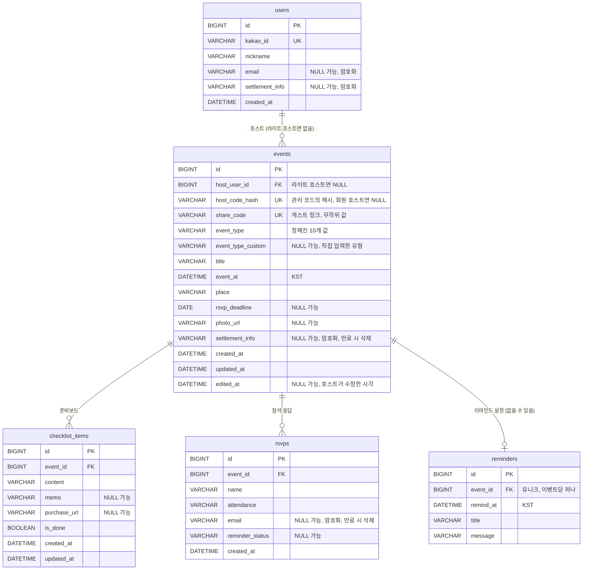

# 백엔드 기준 문서 (backend.md)

작성 중인 문서이며 완성본이 아니다. 꺾쇠 자리표시자가 남은 칸은 아직 묻지 않은 항목이다. 충족 조건과 필수 여부는 `backend-intake-protocol.md`를 따른다.

- 항목마다 한 줄에 결정 / 근거 / 정한 사람 / 상태를 쓴다. 정한 사람은 이름 대신 역할(백엔드, 백엔드+프론트엔드 등)이며, 비어 있으면 확정하지 않는다. 상태는 `미응답 · 제안 · 미정 · 확정 · 충돌 · 미적용` 중 하나다. 팀과 정할 것은 `미정`, 근거에 「팀과 정할 것(PM / 프론트엔드·앱 개발자)」. 테스트·배포·버그 수정처럼 실제 동작 확인이 필요한 항목은 끝에 `/ 확인: 미확인 · 확인 계획 있음 · 테스트로 확인됨 · 배포 환경에서 확인됨 (출처)`를 붙인다.
- 상세 값은 표에 한 번만 적고, 항목에는 결론과 표 위치만 적는다.
- 기능 ID(FN-01)는 prd.md 14절의 것을 그대로 쓴다. API ID(API-01)는 여기서 붙이고 client.md가 그대로 쓴다. 다른 문서의 항목 ID(prd.md D1 등)는 이 문서의 같은 글자 ID와 뜻이 다르다.
- **비밀 값(API 키, DB 비밀번호, 토큰)과 실제 사용자 데이터는 이 문서 어디에도 적지 않는다.**

## 00 문서 상태

- 서비스명: 모임집(Zip) (SRC-09 PRD 루트)
- 서비스 종류: 웹
- 버전: v0.25
- 상태: 작성 중(2주차 범위 완료)
- 현재 단계: 3~5주차 : API 만들고 테스트하기 (2주차 범위를 마치고 넘어옴. 팀 빌딩~2주차의 미정 항목은 3주차 회의에서 정함)
- 작성자와 결정권자: 백엔드
- 인터뷰 모드: 주니어, 영역별 조정: C5(스키마 변경·백업)는 신입 방식
- 팀 구성: PM 1 · 디자이너 2 · 클라이언트 개발자(웹 프론트엔드) 2 · 백엔드 3
- 이번 범위 밖: 대규모 트래픽 대비, MSA, 고가용성 클러스터, 웹 결제 PG 실연동, 법무 검토 (팀 조건 2절)
- 확정한 항목 수: 개발자가 원할 때만 셈

| 모듈 | 적용 여부 | 이유 |
| --- | --- | --- |
| W 웹 클라이언트 3개 | 적용 | 웹 서비스 (개발자 답변) |
| P 앱 클라이언트 7개 | 모듈 비활성 | 웹 서비스라 해당 없음 |
| X 서비스 안 AI 기능 4개 | 적용 | AI 체크리스트 생성에 외부 OpenAI API를 씀 (개발자 답변). 서버에서 호출하는지는 X2에서 확인 |

## 01 자료와 출처

| 자료 ID | 자료 (PRD, 화면 목록, 회의 메모 등) | 버전 | 제공자 | 열람 여부 | 활용 범위 |
| --- | --- | --- | --- | --- | --- |
| SRC-01 | PRD (대화에 붙여 넣은 본문: 1~6절 + TBD 안건 1~3) | 버전 표기 없음. SRC-08이 나온 뒤로는 예전 본문 | 백엔드(PM 작성본 전달) | 읽음 | v0.11까지의 A1·A2 후보. v0.12부터는 SRC-08을 기준으로 하고, SRC-08에 없는 내용(TBD 안건 등)만 참고 |
| SRC-02 | `build.gradle`, `compose.yaml`, `application.yml` | main 03ed755 | 저장소 | 읽음 | B1 기술 스택 |
| SRC-03 | `README.md` | main 03ed755 | 저장소 | 읽음 | B4 로컬 실행, 배포 환경 변수 이름 |
| SRC-04 | `docs/git-convention.md` | main 03ed755 | 저장소 | 읽음 | B3 브랜치·PR 규칙 |
| SRC-05 | `swyp-team-rules.md`, `backend-intake-protocol.md` v1.0 | - | 백엔드 | 읽음 | 단계·범위·작성 규칙 |
| SRC-06 | 피그마 레이어 CSS (대화에 붙여 넣음: 초대장·작성 1~8·홈 화면, 와이어프레임 프레임 이름, 논의 메모) | 버전 표기 없음, 작업 중인 시안 | 백엔드(디자이너 작업본 전달) | 레이어 이름과 글자만 읽음. 이미지로 들어간 와이어프레임 화면 속 내용은 못 봄 | A2 필요 데이터 후보, D1 API 후보, 15절 미정 안건. 화면 ID(S-xx)는 없음 |
| SRC-07 | 화면 구조도(IA) 이미지 (대화에 붙여 넣은 SVG 안의 그림: 랜딩 → 비회원·게스트·회원 메뉴) | 버전 표기 없음, 작업 중인 시안 | 백엔드(디자이너 작업본 전달) | 읽음. 그림 위 제목 글자는 도형으로 변환되어 못 읽음. 리마인더·공동호스트·알림 설정 칸은 배경색 사각형으로 가려져 있음 | 사용자 유형별 기능 구분(A1·A4), D1 API 후보, OPEN-05·09·10·12 |
| SRC-08 | PRD • 기능명세서 (Notion 페이지. 루트 1 + 프로덕트 정책 2 + 기능 영역 7 + 세부 기능 16 + 세부 동작 3 = 29쪽) | 버전 표기 없음. 2026-11-17에 읽음 | 백엔드(PM 작성본을 개인 워크스페이스에 복제해 전달) | 복제본 29쪽을 모두 읽음. 원본 페이지는 열지 못해 복제 뒤 바뀐 내용은 모름. 루트의 외부 연동 블록 1개와 Figma 링크 안의 내용은 못 봄 | v0.12~v0.14의 기준. v0.15부터는 SRC-09를 기준으로 하고, 이 판의 번호는 「옛 4-2」처럼 적음 |
| SRC-09 | PRD • 기능명세서 11-18판 (Notion 페이지. 루트 1 + 프로덕트 정책 2 + 기능 영역 7 + 세부 화면 20 = 30쪽) | 버전 표기 없음. 30쪽의 수정 시각이 모두 2026-11-18 09:51~09:52(KST)로 이어져 있어 그때 한꺼번에 복제된 사본으로 보임. 그 뒤 원본에서 바뀐 내용은 들어 있지 않음 | 백엔드(개발자의 Notion에 연결된 페이지를 AI가 직접 읽음) | 30쪽을 모두 읽음. PM의 원본은 열지 못함. 루트의 외부 연동 블록 1개와 Figma 링크 안의 내용은 못 봄. 3-3·4-2가 가리키는 「템플릿 기반 초대장 제작」「2-3. 리마인드 설정」 쪽은 없음 | v0.15부터 범위·데이터·권한의 기준(개발자 요청 「다시 맞추고 2주차 시작」). 기능 ID(FN-xx)는 없고 PRD 자체 번호(1-1 ~ 7-3)만 있어 「PRD 3-2」처럼 적음. SRC-11 회의록이 이 사본에 없는 화면 번호(2-3 리마인드 설정, 3-3 템플릿 선택, 4-3 참석자 대시보드)를 말하고 있어 원본은 더 바뀐 것으로 보임 |
| SRC-10 | `docs/requirements.md` 요구사항 정의서 초안 (회의용, REQ-01~43, NFR-01~11) | 처음에는 11-18판 PRD 기준. v0.15에 맞춰 다시 씀 | 백엔드 | 읽음 | 이 문서의 결정을 요구사항 문장으로 옮긴 회의용 정리본. 결정의 기준은 이 문서이고, 정리본은 따라 맞춤. |
| SRC-11 | 팀 회의록 (대화에 붙여 넣음. 참여 인원 전원. 안건: 진행상황 공유, 기능명세서·Figma·웹플로우 피드백, 기능 구현 계획) | 날짜 표기 없음. 2026-11-19에 받음 | 백엔드 | 읽음. 회의록이 가리키는 Figma와 기능명세서 시트는 못 봄 | v0.15부터 SRC-09와 다른 곳은 이 회의 결정을 따름(팀 전원 합의). 「회의록 4-3」처럼 적음 |
| SRC-12 | 피그마 「ui 2차」 레이어 CSS (대화에 붙여 넣음: 1-1, 1-3, 1-4, 1-5, 2-1, 2-2, 2-3, 3-1, 3-2, 3-4, 3-5, 4-1, 4-2, 4-3, 5-1, 5-2, 6-1, 준비보드) | 버전 표기 없음. 2026-11-19에 받음 | 백엔드(디자이너 작업본 전달) | 레이어 이름과 화면에 적힌 글자만 읽음. 버튼 글자는 레이어 이름이 복사된 채라 못 읽었고 이미지 안 내용도 못 봄 | v0.15부터 화면 구성의 기준. 이 시안에 화면이 없는 기능은 범위에서 뺌(개발자 결정 「사라진 것 지워」). 「피그마 4-3」처럼 적음 |
| SRC-13 | 기능명세 시트 (대화에 붙여 넣은 표: 화면 영역 7개, 세부 화면 20개, 기능 단위별 설명과 정책·예외) | 버전·날짜 표기 없음. 2026-11-23에 받음 | 백엔드(PM 작성본 전달) | 읽음. 표의 담당자·상태 칸은 비어 있음 | v0.18. 시트 전체를 기준으로 삼지 않고 개발자가 항목별로 정한 것만 반영함(개발자 답변 「내 판단에 따라」). 그 밖의 내용은 「시트에 적힌 것」으로만 옮김. 「시트 3-4」처럼 적음 |
| SRC-14 | 피그마 「ui 2차」 구역의 현재 화면 (① 대화에 붙여 넣은 레이어 CSS ② PRD 페이지에 걸린 피그마 링크로 AI가 읽기 전용으로 연 파일) | 버전·날짜 표기 없음. 2026-11-23에 본 상태. SRC-12와 같은 구역이며 그 뒤 화면이 늘고 번호가 바뀜 | 백엔드(디자이너 작업본) | 프레임 이름과 메모는 구역 전체를 읽음. 화면에 적힌 글자는 17개 화면만 이미지로 읽음(1-1, 2-1 두 개, 2-3 두 개, 3-2, 3-4, 4-1 두 개, 4-2, 5-1, 5-2, 5-3 두 개, 6-1, 7-1, 7-2). 나머지 화면은 프레임 이름과 레이어 글자만 봄 | v0.18. SRC-13과 같은 번호 체계. 개발자가 항목별로 정한 것만 반영함. 「피그마 현재 4-2」처럼 적음 |

SRC-13·SRC-14의 화면 번호는 SRC-12 때와 다르다: 이벤트 준비 관리 3-4 → 3-3, 완성 전 확인 3-5 → 3-4, 참석현황 4-3 → 4-2, 1-4 진행 중인 이벤트는 6-1로 합쳐짐. 이 문서의 예전 문장에 남은 「피그마 3-4」「PRD 3-5」「피그마 4-3」은 그때의 번호다.

## 02 서비스 범위와 필요한 데이터

- **A1** 필수 · 핵심 기능과 서버가 필요한 기능 — 결정: MVP 범위는 아래 표(SRC-09 PRD 11-18판의 화면 20개). 사용자는 게스트·라이트 호스트(비회원)·회원 호스트 세 권한으로 나뉨(PRD 정책 1). v0.14 표에 있던 참석 현황 대시보드(옛 4-2), 상세 참석 현황(옛 6-2), 리마인드 신청·발송 세부(옛 2-2, 2-2-1), 히스토리 삭제(옛 5-2-2)는 11-18판에 화면 쪽이 없어 넣을지 미정(OPEN-24·09·15). 새로 생긴 것은 비회원 보관함(1-2~1-4), 시작 방식 선택(3-3), 항목 상세의 담당자·마감일·메모(7-2), 회원 호스트의 리마인드 설정(4-2), 초대장 사진(PRD 「미정」, OPEN-23). 사진 갤러리와 베스트 샷 투표는 넣지 않음. 개발 일정은 3주로 잡았으나 SRC-09에도 일정이 없음(OPEN-04). 범위 밖으로 둔 것은 00절 「이번 범위 밖」. **v0.15 팀 회의(SRC-11)로 바뀐 것**: 비회원 보관함(1-2)은 삭제, 참석자 대시보드(회의록 4-3)는 넣고 라이트 호스트는 관리자용 입장 코드로 봄, 초대장 사진을 넣음(AI 사진 추천은 없음), 리마인드는 이메일로 보내고 라이트·회원 호스트 모두 시각을 정함, 수정은 회원 호스트만 3-2 전부, 내 모임은 주최한 이벤트만 최대 1년, 이벤트는 모임 시작 이틀 뒤 자동 만료. **v0.15 피그마 ui 2차(SRC-12)에 화면이 없어 뺀 것(개발자 결정)**: 템플릿 선택 화면과 초대장 문구 입력, 마이페이지, 홈의 「내가 할 일」, 「수정됨」 표시, 수집·이용 동의 체크박스와 수신 거부, 인원 수 입력, 응답 변경, 이벤트 삭제. 모임 유형은 9종으로 줄고, 계좌번호·예금주는 「정산 정보」 한 칸이 됨. 준비보드는 빈 프레임만 있어 세부(담당자·마감일·메모)를 보류. **v0.18(SRC-13·14를 보고 개발자가 정한 것)**: 마이페이지(프로필 조회·수정, 로그아웃, 탈퇴)를 화면대로 넣음, 준비보드의 메모와 구매링크를 넣고 구매 필요 여부를 뺌, 「수정됨」 표시를 다시 넣음, 라이트 호스트도 리마인드를 설정함. 내 모임은 화면에 「참여자」 뱃지가 있으나 팀 결정대로 주최한 이벤트만 보여 줌(OPEN-08) / 근거: SRC-09, SRC-11(팀 전원 회의), SRC-12, SRC-13, SRC-14, 개발자 답변(「11-18판으로 다시 맞춤」, 「사라진 것 지워」, v0.18의 항목별 답). 아래 표의 서버 필요 열(백엔드 API가 필요한지)은 개발자가 확인함(v0.15): API가 필요 없는 것은 랜딩 화면 자체, 응답 완료 화면, 3-4 옵션 선택, 링크 복사·카카오톡 공유. 팀과 정할 것(PM) / 정한 사람: 미정 / 상태: 미정

| 기능 (PRD 11-18판 번호. 기능 ID 없음) | 쓰는 사람 | 서버 필요 | 이번 범위 |
| --- | --- | --- | --- |
| PRD 1-1 메인 랜딩 페이지 | 모든 방문자 | 필요 없음 (화면만) | 넣음 |
| PRD 1-2 메인 이벤트 보관함 | - | - | 뺌. 팀 회의에서 삭제(SRC-11) |
| 피그마 1-3 완료된 이벤트, 1-4 진행 중인 이벤트 | 회원 호스트 | 필요 (이벤트 조회, 완료된 이벤트는 참석 인원 수) | 넣음. 회원이 완료된 이벤트까지 볼 수 있음(개발자 결정, v0.15). 1-3은 「총 5명이 함께했어요」를 보여 줌(SRC-12) |
| PRD 1-5 카카오 SNS 로그인 | 회원 호스트 | 필요 | 넣음. 카카오 외 로그인과 이메일 가입은 범위 밖 |
| PRD 2-1 초대장 조회 및 참석/불참 응답 | 게스트 | 필요 | 넣음. 이름(필수)과 이메일(선택), 참석/불참(SRC-11, SRC-12). 초대장은 제목·날짜·시간·장소로 만든 문장과 사진 |
| PRD 2-2 초대장 응답 완료 | 게스트 | 필요 없음 (화면만) | 넣음 |
| PRD 3-1 유형 선택, 3-2 기본 정보 폼 | 라이트 호스트, 회원 호스트 | 필요 (저장은 3-5에서 한 번에. 사진 올리기) | 넣음. 유형 9종 + 직접 입력. 필수는 제목·일시·시간·장소, 선택은 응답마감일·정산 정보(SRC-12). 사진은 제목 칸의 사진 버튼으로 썸네일 9칸 선택 창을 띄움(세부는 OPEN-23) |
| 피그마 3-4 이벤트 준비 관리 (옵션 선택: 준비까지 한 번에 / 초대장만. PRD 사본에서는 3-3) | 라이트 호스트, 회원 호스트 | 필요 없음 (화면 이동에만 쓰는 값, 저장하지 않음. 개발자 결정 v0.15) | 넣음 |
| 템플릿 선택 화면, 초대장 문구 입력 | - | - | 뺌. 피그마에 화면 없음(SRC-12, 개발자 결정 v0.15). 초대장 문구는 입력값으로 자동 생성 |
| PRD 3-5 완성 전 확인 | 라이트 호스트, 회원 호스트 | 필요 (입력한 모든 이벤트 데이터 저장, 공유용 URL 생성) | 넣음 |
| PRD 4-1 비회원 링크 공유 (복사, 공유) | 라이트 호스트 | 필요 (배포용 URL과 관리 코드 발급. 공유 동작은 화면 쪽) | 넣음. 복사 칸이 두 개(SRC-12. 배포 링크와 관리 코드로 보이나 글자는 못 읽음) |
| PRD 4-2 회원 링크 공유, 피그마 2-3 리마인드 설정 | 회원 호스트, 라이트 호스트(개발자 결정, v0.18. 시트 2-3·4-2, 피그마 현재 4-2·3-4에 라이트 호스트의 진입 버튼이 있음) | 필요 (설정 저장, 정한 시각에 이메일 발송) | 넣음. 「언제 보낼까요」 칩 4개(시트와 피그마 현재 2-3: 7일 전, 3일 전, 1일 전, 당일), 「몇 시에 보낼까요」 오전/오후와 시, 분은 10분 단위, 「보낼 문구」는 제목과 본문 두 칸이며 둘 다 필수(v0.18). 만들 때는 3-4에서, 만든 뒤에는 4-2와 4-1에서 설정 화면으로 들어감(SRC-14) |
| PRD 5-1 회원 홈 대시보드 | 회원 호스트 | 필요 | 넣음. 새 이벤트 만들기와 보관함(이벤트 카드, 더보기)(SRC-12). 「내가 할 일」 요약은 뺌(화면 없음, v0.15) |
| PRD 5-2 내 모임 목록 (전체 목록) | 회원 호스트 | 필요 | 넣음. 주최한 이벤트만(참여한 이벤트 없음), 최대 1년까지 열람(SRC-11). 시트와 피그마 현재 5-2에는 「주최자」/「참여자」 뱃지가 있어 이 결정과 다름. 팀 결정대로 감(개발자, v0.18. OPEN-08) |
| PRD 5-3 마이페이지 | 회원 호스트 | 필요 | 넣음. 피그마 현재 5-3대로 프로필(이름·이메일·정산정보) 조회와 수정, 로그아웃, 회원탈퇴(개발자 결정 「지금 화면대로 해줘」, v0.18. v0.15에는 화면이 없어 탈퇴만 넣었음). 프로필 그림은 화면에 기본 그림만 있고 바꾸는 버튼이 없어 저장하지 않음 |
| PRD 6-1 초대장 수정 (진행중 이벤트) | 회원 호스트 | 필요 | 넣음. 수정 범위는 3-2 기본 정보 폼의 전부(SRC-11). 라이트 호스트는 수정 불가. 수정한 초대장에는 「수정됨」을 보여 줌(개발자 결정, v0.18. OPEN-18) |
| PRD 7-1 AI 준비물 체크리스트 자동 구성 | 회원 호스트 | 필요 (외부 AI API 호출) | 넣음. 라이트 호스트에게는 제공하지 않음. 이벤트를 저장하기 전 화면이라 생성은 이벤트 없이 동작(v0.18, OPEN-19). 시트와 피그마 현재 7-1은 한 번에 8개 |
| PRD 7-2 항목 상세 설정, 7-3 항목 추가하기 | 회원 호스트 | 필요 | 넣음(개발자 결정, v0.18. v0.15에는 프레임이 비어 보류). 항목명, 메모, 구매링크(피그마 현재 7-2·7-3). 담당자·마감일은 화면에 없어 넣지 않음. 「네이버쇼핑 검색 바로가기」와 「저장링크 바로가기」는 화면이 처리 |
| 피그마 4-3 참석현황 | 회원 호스트, 라이트 호스트(관리 코드) | 필요 | 넣음. 참석·불참석 인원 수와, 응답자 이름·이메일·참석 여부 목록(SRC-12) |
| 이벤트 삭제 | - | - | 뺌. PRD 사본과 피그마 모두 화면 없음(개발자 결정 v0.15). 1년이 지난 이벤트는 서버가 삭제 |
| 행사 후 사진 공유 갤러리, 베스트 샷 투표 (SRC-01의 TBD 안건) | - | - | 뺌. SRC-09에도 없음 (백엔드 답변과 같음) |
| 공동 호스트 | - | - | 뺌. 이벤트마다 호스트 1명 (백엔드 답변, SRC-09에도 없음) |

- **A2** 필수 · 꼭 필요한 데이터와 뺀 데이터, 외부 데이터 — 결정: 기능별 필요 데이터는 도메인 모델 표(SRC-09의 각 화면에서 옮김). 11-18판에서 생긴 데이터: 체크리스트 항목의 담당자·마감일·메모(7-2), 응답 폼의 이메일(리마인드용·선택, SRC-11에서 전화번호 대신), 시작 방식(3-3), 초대장 사진 1장(SRC-11), 라이트 호스트의 관리자용 입장 코드(SRC-11). 뺀 데이터: RSVP의 「미정」 응답, 사진 갤러리·좋아요(SRC-09에 없음). 외부 데이터: 카카오 로그인에서 닉네임과 프로필 이미지를 받아옴(PRD 1-5), AI API가 만든 체크리스트(PRD 7-1). 카카오·AI API의 사용 조건은 확인 전. 초대장 템플릿 원본을 어디에 두는지는 미정(OPEN-16). AI 입력의 「인원 수」는 받는 화면이 없어 뺌(v0.15). v0.18에 더한 데이터: 회원의 이메일·정산정보(마이페이지), 체크리스트 항목의 메모·구매링크, 초대장을 수정한 시각, 리마인드 제목. 뺀 데이터: 체크리스트 항목의 구매 필요 여부(쓰는 화면이 없음) / 근거: SRC-09, SRC-14, 개발자 답변. 팀과 정할 것(PM) / 정한 사람: 미정 / 상태: 미정
- **A3** 필수 · 엔티티와 관계 → 도메인 모델 표 — 결정: 이벤트마다 호스트는 1명, 공동 호스트 없음. 엔티티는 이벤트·초대장·체크리스트 항목·RSVP·회원·라이트 호스트. 리마인드 신청은 RSVP에 합침(개발자 결정, v0.15). 개발자가 표의 내용을 확인함(v0.15): 초대장은 이벤트와 같은 테이블, 응답은 회원 계정과 잇지 않음 / 근거: 개발자 답변, SRC-09, SRC-11, SRC-12 / 정한 사람: 백엔드 / 상태: 확정
- **A4** 데이터별 생성·조회·수정·삭제 주체 — 결정: 미정. SRC-09의 「역할」「권한 & 접근」 줄을 도메인 모델 표의 「만들기 / 보기 / 고치기·지우기」 열에 옮김. 초대장 수정은 그 이벤트를 만든 회원 호스트만, 행사일이 지나기 전까지(PRD 6-1). 준비보드는 회원 호스트만(PRD 7-1~7-3). 이벤트 삭제는 11-18판에 기능이 없음(OPEN-15). 참석 현황은 회원 호스트와, 입장 코드를 넣은 라이트 호스트가 봄(SRC-11). 리마인드 설정은 회원 호스트와 라이트 호스트가 함(개발자 결정, v0.18). 회원은 자기 프로필을 고침(v0.18) / 근거: SRC-09, SRC-14. 팀과 정할 것(PM) / 정한 사람: 미정 / 상태: 미정
- **A5** 상태가 바뀌는 데이터 — 결정: 아래 상태 표. 응답은 마감일이 지나면 막고 마감일이 없으면 행사 당일이 지난 뒤부터 막음(PRD 2-1). 이벤트는 진행 중 → 완료(행사일이 지남) → 만료(시작 이틀 뒤) → 삭제(1년 뒤)이며 상태를 저장하지 않고 날짜로 계산함. 리마인드는 대기 → 발송됨 / 실패(재시도 없음). 체크리스트 항목은 미완료 / 완료. v0.13의 확정은 근거 PRD가 바뀌어 되돌렸다가, 회의 결정과 개발자 답변으로 다시 정함(v0.15) / 근거: SRC-09, SRC-11, SRC-12, 개발자 답변 / 정한 사람: 팀 전체(SRC-11) + 백엔드 / 상태: 확정

### 도메인 모델

| 엔티티 | 설명 | 주요 속성 | 관계 | 만들기 / 보기 / 고치기·지우기 | 연결 기능 | 상태 |
| --- | --- | --- | --- | --- | --- | --- |
| 이벤트 (Event) | 호스트가 만드는 모임 하나 | 모임 유형(9종 + 직접 입력, SRC-12). 제목·장소(각각 최대 16자), 날짜, 시작 시각 — 필수. 응답 마감일, 정산 정보(한 칸) — 선택(SRC-12). 사진 1장(OPEN-23). 리마인드 설정: 보낼 시각, 제목, 본문(피그마 2-3. 저장은 reminders 테이블, v0.17. 제목은 v0.18). 호스트가 수정한 시각(「수정됨」 표시, v0.18). 라이트 호스트의 관리 코드(SRC-11). 모임 시작 이틀 뒤 자동 만료(SRC-11) | 호스트 1명이 소유. 초대장 1개, 체크리스트 항목 여러 개, RSVP 여러 개를 가짐 | 라이트 호스트 또는 회원 호스트 / 회원 호스트는 내 모임에서 주최한 이벤트만, 최대 1년. 라이트 호스트는 관리 코드로 참석현황을 보고 리마인드를 설정(v0.18) / 그 이벤트를 만든 회원 호스트, 3-2의 모든 항목. 삭제 기능 없음(1년 뒤 서버가 삭제) | PRD 3-1, 3-2, 3-5, 6-1, 피그마 3-4 | 확정 |
| 초대장 (Invitation) | 게스트에게 링크로 보내는 페이지 | 따로 저장하는 문구 없음. 제목·날짜·시간·장소로 만든 문장과 사진 1장(SRC-12), 공유용 URL의 식별값(3-5에서 생성) | 이벤트와 1:1 | 호스트 / 링크를 가진 누구나, 로그인 없이(PRD 2-1) / 그 이벤트를 만든 회원 호스트. 수정해도 공유 링크는 그대로 | PRD 3-5, 2-1, 4-1, 4-2, 6-1 | 확정 |
| 체크리스트 항목 (ChecklistItem) | AI 준비보드의 준비물 한 줄 | 항목명, 메모, 구매링크, 완료 여부(피그마 현재 7-1·7-2. 개발자 결정, v0.18). 구매 필요 여부(O/X)는 쓰는 화면이 없어 뺌(v0.18). 담당자·마감일은 화면에 없어 넣지 않음 | 이벤트 1 : 항목 N | AI 생성 또는 회원 호스트 / 회원 호스트 / 회원 호스트 | PRD 7-1, 7-2, 7-3 | 확정 |
| RSVP | 게스트 한 명의 참석 응답 | 이름(필수), 참여 여부(참석/불참), 응답 시각, 리마인드용 이메일(선택. 없으면 리마인드를 받지 않음), 리마인드 발송 상태(SRC-11, SRC-12) | 이벤트 1 : RSVP N. 회원 계정과 잇지 않음(개발자 확정, v0.15) | 게스트(로그인 없음) / 회원 호스트와, 관리 코드를 넣은 라이트 호스트가 참석현황에서. 이메일도 보임(피그마 4-3) / 응답 변경 없음(화면 없음, v0.15). 이메일은 모임 시작 이틀 뒤 만료 때 삭제 | PRD 2-1, 2-2, 피그마 4-3 | 확정 |
| 회원 (User) | 카카오 로그인으로 가입한 회원 호스트 | 카카오 계정 식별자, 이름(닉네임), 이메일, 정산정보, 가입일. 이름·이메일·정산정보는 마이페이지에서 보고 고침(피그마 현재 5-3. 개발자 결정, v0.18). 프로필 이미지는 저장하지 않음(개발자 결정, v0.15. v0.18에도 그대로) | 회원 1 : 이벤트 N(호스트로서). 응답과는 잇지 않음 | 본인(카카오 로그인) / 본인 / 본인이 프로필을 고치거나 탈퇴. 탈퇴는 C3의 연쇄 삭제를 따름 | PRD 1-5, 5-1, 5-2, 5-3 | 확정 |
| 라이트 호스트 | 로그인 없이 초대장을 만들어 보내는 호스트 | 저장할 계정 없음. 초대장을 만들면 배포용 링크와 관리 코드를 받고, 랜딩(1-1)의 「비회원 초대장 관리 코드」 칸에 코드를 넣어 참석현황을 봄. 호스트용 링크는 따로 두지 않고 코드 입력으로 통일, 코드를 잃어버리면 복구 없음(개발자 결정, v0.15). 코드의 길이·형식·저장 방식·시도 제한은 따로 빼 둠(OPEN-05) | 관리 코드 하나에 이벤트 하나. 권한은 초대장 생성, 링크 배포, 참석현황 보기, 리마인드 설정(개발자 결정, v0.18). 수정과 AI 준비보드 없음 | 본인 / 관리 코드를 가진 사람 / 수정 불가 | PRD 1-1, 3-1 ~ 3-5, 4-1, 피그마 4-3 | 확정 |

위 표는 개발자가 내용을 확인함(v0.15).

사용자 권한별 기능 (SRC-09 PRD 정책 1과 각 화면의 「역할」 줄):

| 권한 | 로그인 | 제공 기능 |
| --- | --- | --- |
| 게스트 (비회원) | 없음 | 초대장 보기, 참석 응답(이름 필수, 이메일 선택, 참석/불참), 응답 완료 |
| 라이트 호스트 (비회원) | 없음 | 초대장 만들기, 링크 배포, 리마인드 설정, 관리 코드로 참석현황 보기. 수정·AI 준비보드 없음 |
| 회원 호스트 | 카카오 로그인 | 홈, 내 모임(주최한 이벤트만, 최대 1년), 완료된·진행 중인 이벤트 보기, 이벤트 생성·링크 공유·리마인드 설정·참석현황·초대장 수정(3-2 전부), AI 준비보드, 마이페이지(프로필 조회·수정, 로그아웃, 탈퇴. v0.18) |
| 권한 밖 접근 | - | 비회원이 회원 전용 기능(AI 준비보드, 내 모임, 마이페이지)에 접근하면 막고 로그인을 안내. 「준비까지 한 번에」를 고른 비회원은 로그인 화면으로 보냄(PRD 3-3) |

| 엔티티 | 상태 목록 | 바뀌는 조건 | 바꿀 수 있는 사람 |
| --- | --- | --- | --- |
| RSVP | 참석 / 불참 (PRD 2-1) | 응답 마감일이 지났거나, 마감일이 없고 행사 당일이 지나면 입력칸을 숨기고 [응답 마감]으로 바꿈(PRD 2-1). 낸 응답을 바꾸는 기능은 없음(v0.15) | 게스트 |
| 체크리스트 항목 | 미완료 / 완료 (PRD 7-1) | 완료 체크·해제 | 회원 호스트 |
| RSVP의 리마인드 발송 상태 | 대기 → 발송됨 / 실패 (이메일이 있는 응답만) | 호스트가 정한 시각에 이메일 발송(SRC-11, 피그마 2-3). 호스트가 설정하지 않으면 보내지 않음. 실패하면 재시도 없이 실패로 기록(개발자 결정, v0.15) | 시스템(발송), 호스트(설정) |
| 이벤트 | 진행 중 → 완료 → 만료 → 삭제 | 행사일이 지나면 완료. 모임 시작 이틀 뒤 만료: 게스트 이메일과 정산 정보를 지우고 응답자 이름과 참석 여부는 남김. 1년이 지나면 이벤트를 삭제(개발자 결정, v0.15). 상태는 저장하지 않고 날짜로 계산함 | 시스템 |

## 03 기술 스택과 개발 환경

- **B1** 필수 · 언어·프레임워크·DB와 팀 경험 — 결정: Java 21, Spring Boot 4.1.2 (Web MVC, Data JPA, Validation, Security, OAuth2 Client), MySQL 8.4, springdoc(Swagger UI), 테스트는 JUnit + Testcontainers. 인증·인가에 Spring Security를 씀(개발자 결정, v0.19. E2). 카카오 로그인은 Spring Security의 OAuth2 로그인 기능으로 만들어 OAuth2 Client를 더함(v0.19에 방식을 정하고 v0.22에 넣음. API-13). 백엔드 3명의 사용 경험은 보통 / 근거: 백엔드 3명 모두 이 스택 개발자 (개발자 답변), 저장소 세팅은 SRC-02 / 정한 사람: 백엔드 / 상태: 확정
- **B2** 인원·역할 분담·리뷰하는 사람 — 결정: 담당 영역은 나눴고 쓰이지 않은 사진 정리 담당이 남아 미정. 백엔드 3명이 담당 영역을 셋으로 나눔(개발자 답변, v0.16). 이 문서에는 이름 대신 백엔드 A·B·C로 적음. 백엔드 A: 스키마와 프로젝트 뼈대, 인증·회원, 이벤트 만들기·수정, 관리 코드 참석현황, AI 체크리스트 생성. 백엔드 B: AWS 구성과 배포(F1), 리마인드 설정과 발송, 만료·삭제 예약 작업, 사진 올리기, 참석 응답. 백엔드 C: 초대장 조회, 회원 참석현황, 내 모임, 체크리스트 조회·항목 관리. API별 담당은 05절 명세 표의 담당 열. 리뷰하는 사람은 당분간 두지 않음(개발자 결정, v0.23. B3). 남은 것(정해지지 않음): 쓰이지 않은 사진 정리(API-19)를 누가 맡는지 / 근거: 개발자 답변(v0.16, v0.23) / 정한 사람: 백엔드 3명(담당 영역), 백엔드(리뷰) / 상태: 미정
- **B3** 저장소·브랜치 규칙·머지 전 조건 — 결정: 백엔드 저장소는 팀 조직(organization) 아래에 있고 프론트엔드 저장소와 분리. 컨벤션은 저장소마다 따로 둠. 백엔드 규칙은 `docs/git-convention.md`: `main` 직접 push 금지, 작업 브랜치 `<type>/<이슈번호>-<짧은-설명>`, `./gradlew build` 통과 후 Squash merge. 리뷰 승인은 당분간 필수로 두지 않고 자동 빌드 통과만 보고 병합함(개발자 결정, v0.23. v0.22까지는 1명 이상 승인도 조건이었음. 뒤집은 확정). 빌드에는 코드 모양 검사가 들어 있음(v0.21. 포매터는 Spotless의 Palantir 스타일이며 쓰는 방법은 `docs/architecture.md`). 이 문서만 고치는 PR은 제목을 버전으로 짓고(`docs: backend.md v0.NN`) 한 번에 하나만 엶. 에러 코드 표와 테이블 표는 코드와 같은 PR에서 고침(개발자 결정, v0.22) / 근거: 개발자 답변, SRC-04. 저장소는 공개 / 근거: 개발자 답변(질문 목록), SRC-04 / 정한 사람: 백엔드 / 상태: 확정
- **B4** 로컬 실행 방법·환경 변수 예시 파일 위치 — 결정: 실행 순서는 `README.md`(JDK 21 + Docker, `./gradlew bootRun`이 MySQL 컨테이너를 자동 기동). 로컬·배포 환경 변수 모두 값 없이 이름만 적은 예시 파일을 저장소 루트의 `.env.example`로 둠. 파일을 v0.17에 추가함(지금 쓰는 PII_ENCRYPTION_KEY만 적음. 다른 변수는 그 기능을 넣을 때 더함) / 근거: 개발자 답변(다른 팀원이 쉽게 구성하도록, 질문 목록), SRC-03 / 정한 사람: 백엔드 / 상태: 확정 / 확인: 테스트로 확인됨 (v0.17. `.env`를 만든 뒤 `./gradlew bootRun`과 Docker 실행이 뜨고, 키가 없으면 뜨지 않음. Claude Code가 로컬에서 실행)

## 04 DB 설계

DB 설계는 사람이 판단한다. AI 초안은 개발자가 정하기 전까지 `제안`이다.

- **C1** 필수 · DB 종류와 선택 이유 — 결정: MySQL 8.4 (관계형), 운영 DB는 AWS RDS. 이유는 백엔드 3명 모두 다뤄 본 스택(B1)이고 RDS 비용은 크레딧으로 감당할 수 있음(개발자 답변, v0.15). v0.14의 「RDS와 EC2 안 Docker MySQL 중 미정」에서 바뀜 / 근거: B1, SRC-02, 개발자 답변 / 정한 사람: 백엔드 / 상태: 확정
- **C2** 필수 · 테이블·컬럼 → 아래 표 — 결정: 아래 표. SRC-09(11-18판)에 맞춰 AI 초안을 다시 씀: 테이블 4개(users, events, checklist_items, rsvps). reminders는 rsvps에 합쳐 email과 reminder_status 두 컬럼으로 둠(개발자 결정, v0.15). 초대장 값은 events에 합침(개발자 결정, v0.14). 11-18판 때문에 바뀐 초안: checklist_items에 담당자·마감일·메모 추가, events의 제목·장소 16자 제한과 시간 형식·응답 마감일 필수 여부(OPEN-22), start_mode가 PRD에 생김(OPEN-19), 전화번호를 응답과 함께 받는 문제(OPEN-09). v0.14에서 개발자가 정한 것(초대장 합침, host_name 뺌, 계좌번호·예금주·전화번호 암호화, 순서 컬럼 없음, updated_at)은 그대로 둠. v0.15(SRC-11 팀 회의): rsvps.user_id와 events.host_password_hash를 빼고, reminders.phone을 email로 바꾸고, events에 photo_url·reminder_at을 더함. v0.15(SRC-12, 개발자 결정): 피그마에 화면이 없는 값의 컬럼(template_code, invitation_text, invitation_edited_at, headcount, rsvps.updated_at, checklist_items의 assignee·due_date·memo, users.profile_image_url)을 빼고, 계좌번호·예금주를 settlement_info 한 칸으로 바꾸고, reminder_message를 더함. 게스트 이메일은 암호화로 정함. 개발자가 표 전체를 검토함(v0.15): rsvps.status를 attendance로 바꾸고, start_mode는 화면 이동에만 쓰는 값이라 빼고, reminder_message는 500자로 둠. 관리 코드는 해시만 저장(host_code_hash), title·place는 VARCHAR(50)으로 정함. v0.16(개발자 결정): 직접 입력한 유형 글자를 담는 events.event_type_custom을 더하고 event_type에는 정해진 10개 값만 저장함(v0.15의 「event_type 한 칸에 9종 또는 직접 입력한 글자」를 바꿈). DB 저장 값 이름도 정함(표 아래). v0.17(개발자 결정): 암호화해서 저장하는 events.settlement_info와 rsvps.email을 VARCHAR(255)에서 VARCHAR(512)로 넓히고, events.share_code를 필수로 함(표 아래). 리마인드 설정(보낼 시각, 문구)을 events의 두 컬럼에서 reminders 테이블로 나눠 테이블이 5개가 됨: 리마인드 기능이 자기 데이터를 갖게 하고, 한 이벤트에 여러 번 보내게 될 때 고칠 곳을 줄이려는 것. 게스트 이메일과 발송 상태는 rsvps에 그대로 둠(이메일은 참석현황에도 보이는 값). v0.18(개발자 결정. SRC-13·14를 보고 정함): reminders에 title을 더하고 title과 message를 필수로 함, checklist_items에 memo와 purchase_url을 더하고 needs_purchase를 뺌, events에 edited_at을 더함(「수정됨」 표시), users에 email과 settlement_info를 더함(마이페이지, 암호화). 테이블은 그대로 5개. 새 컬럼의 이름과 길이는 AI 안을 개발자가 그대로 정함 / 근거: 도메인 모델(A3 초안), SRC-09, SRC-11, SRC-12, SRC-13, SRC-14, 개발자 답변 / 정한 사람: 백엔드 / 상태: 확정
- **C3** 필수 · 키·관계·삭제 정책 → 아래 표 — 결정: 회원이 탈퇴하면 그 회원의 이벤트를 지움. 연쇄 삭제는 JPA cascade가 아니라 DB 외래 키의 `ON DELETE CASCADE`로 하고(`V1__init.sql`에 적음), Hibernate가 알도록 엔티티에 `@OnDelete(action = OnDeleteAction.CASCADE)`를 붙이는 안(정확한 동작은 Hibernate 공식 문서 확인 필요). v0.14에 정했던 `rsvps.user_id`(`ON DELETE SET NULL`)와 탈퇴 시 응답 익명 처리는 뺌: 팀 회의에서 참여한 이벤트를 회원과 잇지 않기로 함(SRC-11, 개발자 확정 v0.15). reminders 테이블도 rsvps에 합쳐 관계가 셋으로 줄어듦. 탈퇴는 범위에 넣음(화면은 피그마 현재 5-3에 생김, v0.18) / 근거: 개발자 답변(질문 목록, v0.14 채팅, v0.15) / 정한 사람: 백엔드 / 상태: 확정
- **C4** 유니크 제약·인덱스 — 결정: 유니크는 users.kakao_id, events.share_code, events.host_code_hash(관리 코드의 해시), reminders.event_id(이벤트당 리마인드 하나, v0.17). 같은 이벤트에 같은 이름의 응답이 여러 개 들어와도 막지 않고 그대로 둠: 이름만으로는 같은 사람인지 알 수 없고 응답 변경 기능도 없음(개발자 결정, v0.15). 인덱스는 외래 키 외에 따로 두지 않고 느려지면 다시 봄. 이벤트의 주인은 회원(events.host_user_id)과 라이트 호스트(events.host_code_hash) 중 정확히 하나만 채우도록 CHECK 제약(`ck_events_one_host`)을 둠: 둘 다 비면 누구도 관리할 수 없는 이벤트가 되고, 둘 다 차면 주인이 둘이 됨(개발자 결정, v0.17) / 근거: 개발자 답변 / 정한 사람: 백엔드 / 상태: 확정
- **C5** 스키마 변경(마이그레이션)·백업·가짜 데이터 — 결정: 스키마 변경은 지금부터 Flyway로 함. 첫 스키마는 `V1__init.sql` 하나로 시작하고, 로컬·운영 모두 `ddl-auto: validate`로 둠. 출시 전에는 V1을 고치고 DB를 초기화해도 되고, 출시 후에는 이미 적용한 파일을 고치지 않고 새 버전 파일만 추가함. v0.11의 「`ddl-auto: update`로 함」을 뒤집음: `update`는 `local` 프로필에만 있고 `prod`에는 설정이 없어 운영 DB에 테이블이 만들어지지 않음(v0.13 리뷰). 운영 DB 변경도 Flyway 마이그레이션 파일로 함(개발자 답변 「flyway로」). 로컬·테스트 데이터는 모두 가짜 데이터(`user1@example.com` 같은 값)로 만들고, 운영 DB에서는 테스트하지 않음. 백업: 출시 전에는 데이터를 버려도 되므로 백업 없이 감. 출시 후에는 운영 DB에 마이그레이션을 적용하기 직전에 배포 담당이 백업을 받음(RDS면 스냅샷, EC2 안 MySQL이면 `mysqldump` 파일. DB 위치는 C1, 배포 담당은 F4) / 근거: 개발자 답변(v0.13 리뷰, 채팅) / 정한 사람: 백엔드 / 상태: 확정 / 확인: 테스트로 확인됨 (v0.17. Testcontainers의 MySQL 8.4에 V1을 적용하고 엔티티 검증과 제약 테스트를 통과, `./gradlew build`. v0.18에 V1을 고친 뒤 다시 실행해 테스트 32개 통과, 이 가운데 하나는 04절 테이블 표의 컬럼 이름과 실제 컬럼이 같은지 비교함. 로컬 DB를 초기화한 뒤 `./gradlew bootRun`으로 서버가 뜨고 고친 V1이 적용되는 것도 확인. Claude Code가 로컬에서 실행. Docker 실행 경로는 v0.18에 다시 돌리지 않았고 운영 DB 적용은 미확인)

| 테이블 | 컬럼 | 타입 | 제약 (필수·기본값·유니크·키) | 이유 | 상태 |
| --- | --- | --- | --- | --- | --- |
| users | id | BIGINT | PK, 자동 증가 | 회원 구분 | 확정 |
| users | kakao_id | VARCHAR(64) | 필수, 유니크 | 카카오 계정 식별자. 같은 카카오 계정의 중복 가입을 막음 (PRD 1-5) | 확정 |
| users | nickname | VARCHAR(30) | 필수 | 이름. 가입할 때 카카오에서 받아온 닉네임을 넣고(PRD 1-5), 마이페이지에서 고칠 수 있음(피그마 현재 5-3. 개발자 결정, v0.18). 화면은 「이름」이라 부르고 컬럼 이름은 그대로 둠 | 확정 |
| users | email | VARCHAR(512) | 비어 있을 수 있음 | 마이페이지의 이메일(피그마 현재 5-3). 암호화해서 저장(개발자 결정, v0.18. rsvps.email과 같은 방식이라 길이도 같음). 가입할 때 카카오에서 받아 채울지 본인이 넣을지와 어디에 쓰는지는 정하지 않음(OPEN-27) | 확정 |
| users | settlement_info | VARCHAR(512) | 비어 있을 수 있음 | 마이페이지의 정산정보(피그마 현재 5-3). 암호화해서 저장(개발자 결정, v0.18. events.settlement_info와 같은 방식이라 길이도 같음). 이벤트의 정산 정보와 어떻게 이어지는지는 정하지 않음(OPEN-27) | 확정 |
| users | created_at | DATETIME | 필수 | 가입일 (PRD 1-5) | 확정 |
| events | id | BIGINT | PK, 자동 증가 | 이벤트 구분. 초대장 값도 이 테이블에 합침(개발자 결정, v0.14) | 확정 |
| events | host_user_id | BIGINT | FK → users.id, 비어 있을 수 있음 | 회원 호스트. 라이트 호스트면 비움. host_code_hash와 둘 중 정확히 하나만 채움(DB의 CHECK 제약, C4. 개발자 결정, v0.17) | 확정 |
| events | host_code_hash | VARCHAR(64) | 유니크, 비어 있을 수 있음 | 라이트 호스트 관리 코드의 해시. 코드 원문은 저장하지 않음(개발자 결정, v0.15). 랜딩에서 코드만 넣고 들어오므로 입력값을 해시해 이 컬럼으로 이벤트를 찾음 — 그래서 값마다 결과가 달라지는 솔트 해시는 쓸 수 없고, 대신 코드를 추측하기 어렵게 길게 만듦. 해시 방식과 코드 길이는 구현할 때 정함(OPEN-05). 회원 호스트의 이벤트면 비움(host_user_id와 둘 중 하나만, v0.17) | 확정 |
| events | share_code | VARCHAR(64) | 필수, 유니크 | 게스트에게 보내는 초대장 링크의 식별값. 추측할 수 없는 무작위 값으로 만들고 순번 id를 링크에 쓰지 않음(개발자 결정, v0.15). 값은 소문자와 숫자로만 만듦(v0.23. OPEN-20). 이벤트 행을 넣을 때 함께 만들어 비워 두지 않음(개발자 결정, v0.17. v0.16까지는 유니크만 적음. 표 아래). [초대장 완성하기]에서 생성(PRD 3-5) | 확정 |
| events | event_type | VARCHAR(30) | 필수 | 모임 유형. 정해진 10개 값(9종 + CUSTOM) 중 하나만 저장(값 이름은 표 아래). 직접 입력한 글자는 event_type_custom에 둠(개발자 결정, v0.16. v0.15까지는 이 칸에 함께 저장하는 안) | 확정 |
| events | event_type_custom | VARCHAR(30) | 비어 있을 수 있음 | event_type이 CUSTOM일 때 사용자가 직접 입력한 유형 글자(피그마 3-1). 그 밖에는 비움. 정해진 값과 사용자가 쓴 글자를 한 칸에 섞지 않으려고 나눔(개발자 결정, v0.16). 입력 글자 수 제한은 피그마 3-1 확인 전 | 확정 |
| events | title | VARCHAR(50) | 필수 | 제목. 입력은 최대 16자이고 서버에서 16자를 검사(PRD 3-2). 컬럼은 여유를 둠(개발자 결정, v0.15) | 확정 |
| events | event_at | DATETIME | 필수 | 날짜 + 시작 시각. DATETIME으로 받고 KST 기준으로 저장(개발자 결정, v0.15). 리마인드와 이틀 뒤 만료 계산에 시각이 필요해 PM에게 「시간」을 자유 텍스트가 아닌 선택형으로 요청(OPEN-22). 피그마 현재 3-2의 「시간」은 글자를 직접 넣는 칸이라, 정한 형식만 받아 시각으로 바꿔 이 컬럼에 저장함(개발자 결정, v0.18. 허용 형식과 화면·서버 중 어디서 바꾸는지는 프론트엔드와 정함) | 확정 |
| events | place | VARCHAR(50) | 필수 | 장소. 입력은 최대 16자이고 서버에서 16자를 검사(PRD 3-2). 컬럼은 여유를 둠(개발자 결정, v0.15) | 확정 |
| events | rsvp_deadline | DATE | 비어 있을 수 있음 | 응답 마감일. 피그마 3-2에 필수 표시가 없음(SRC-12). 없으면 행사 당일까지 응답(PRD 2-1) | 확정 |
| events | photo_url | VARCHAR(500) | 비어 있을 수 있음 | 초대장 사진 1장의 주소. 파일은 AWS S3에 두고 DB에는 주소만 저장. 5MB 이하, jpg·png. 1년 뒤 이벤트를 삭제할 때 사진도 같이 지움 — 그 전까지는 내 모임(히스토리)에 남기 때문(개발자 결정, v0.15) | 확정 |
| events | settlement_info | VARCHAR(512) | 비어 있을 수 있음 | 정산 정보(선택). 피그마 3-2에서 한 칸(SRC-12. v0.14까지 account_number·account_holder 두 컬럼). 암호화해서 저장하고 만료 때 비움(개발자 결정, v0.14). 암호화한 값이 원문보다 길어 길이를 512로 둠(개발자 결정, v0.17. v0.16까지 255. 계산은 표 아래). 게스트 초대장에는 보이지 않아 누구에게 보여 주는 값인지 확인 필요(OPEN-07) | 확정 |
| events | created_at | DATETIME | 필수 | 만든 시각. 내 모임의 열람 기간 1년은 이 값이 아니라 행사일(event_at)부터 셈(개발자 결정, v0.23. OPEN-25) | 확정 |
| events | updated_at | DATETIME | 필수 | 마지막으로 바꾼 시각(개발자 결정, v0.14) | 확정 |
| events | edited_at | DATETIME | 비어 있을 수 있음 | 호스트가 초대장을 수정한 시각. 비어 있으면 수정한 적 없음. 초대장의 「수정됨」 표시에 씀(피그마 현재 2-1. 개발자 결정, v0.18. v0.15에는 화면이 없어 invitation_edited_at을 뺐음). updated_at은 호스트의 수정이 아닌 변경(만료 때 정산 정보를 비우는 것 등)에도 바뀔 수 있어 따로 둠 | 확정 |
| checklist_items | id | BIGINT | PK, 자동 증가 | 항목 구분 | 확정 |
| checklist_items | event_id | BIGINT | 필수, FK → events.id | 어느 이벤트의 준비보드인지 | 확정 |
| checklist_items | content | VARCHAR(200) | 필수 | 항목명. AI가 만들고 호스트가 고칠 수 있음(PRD 7-1). 시트 7-2는 입력을 최대 22자로 적음 | 확정 |
| checklist_items | memo | VARCHAR(200) | 비어 있을 수 있음 | 항목의 메모(피그마 현재 7-2. 개발자 결정, v0.18. v0.15에 보류). 길이 200은 content와 같게 여유를 둠(시트 7-2는 입력을 최대 22자로 적음) | 확정 |
| checklist_items | purchase_url | VARCHAR(2000) | 비어 있을 수 있음 | 호스트가 붙여 넣는 구매링크(피그마 현재 7-2). `http://` 또는 `https://`로 시작하고 2,000자 이하인지만 서버가 검사하고 상품 페이지인지는 보지 않음(개발자 결정, v0.18. 시트 7-2) | 확정 |
| checklist_items | is_done | BOOLEAN | 필수, 기본값 false | 완료 여부 (PRD 7-1) | 확정 |
| checklist_items | created_at | DATETIME | 필수 | 만든 시각 | 확정 |
| checklist_items | updated_at | DATETIME | 필수 | 마지막으로 바꾼 시각(개발자 결정, v0.14) | 확정 |
| rsvps | id | BIGINT | PK, 자동 증가 | 응답 구분 | 확정 |
| rsvps | event_id | BIGINT | 필수, FK → events.id | 어느 이벤트의 응답인지 | 확정 |
| rsvps | name | VARCHAR(30) | 필수 | 게스트 이름 (PRD 2-1) | 확정 |
| rsvps | attendance | VARCHAR(20) | 필수 | 참석 / 불참 (PRD 2-1). reminder_status와 헷갈리지 않게 status에서 이름을 바꿈(개발자 결정, v0.15) | 확정 |
| rsvps | email | VARCHAR(512) | 비어 있을 수 있음 | 리마인드를 받을 이메일(선택 입력). 비어 있으면 리마인드를 받지 않음. 암호화해서 저장하고 모임 시작 이틀 뒤 만료 때 비움(개발자 결정, v0.15). 암호화한 값이 원문보다 길어 길이를 512로 둠(개발자 결정, v0.17. v0.16까지 255. 계산은 표 아래) | 확정 |
| rsvps | reminder_status | VARCHAR(20) | 비어 있을 수 있음 | 대기 / 발송됨 / 실패. 이메일이 없으면 비워 둠. 중복 발송을 막고 실패를 구분함. 실패해도 다시 보내지 않음. 보낸 시각은 따로 두지 않고 서버 로그로 봄(개발자 결정, v0.15) | 확정 |
| rsvps | created_at | DATETIME | 필수 | 응답 시각 | 확정 |
| reminders | id | BIGINT | PK, 자동 증가 | 리마인드 설정 구분. 호스트가 리마인드를 설정한 이벤트에만 행이 있음(개발자 결정, v0.17. v0.16까지는 events의 두 컬럼) | 확정 |
| reminders | event_id | BIGINT | 필수, 유니크, FK → events.id | 어느 이벤트의 리마인드인지. 지금은 이벤트당 하나라 유니크를 둠. 한 이벤트에 여러 번 보내게 되면 유니크만 뺌(개발자 결정, v0.17) | 확정 |
| reminders | remind_at | DATETIME | 필수 | 리마인드 발송 시각. 화면의 「언제」 칩과 시·분으로 계산한 시각을 저장하는 안(피그마 2-3). v0.16까지 events.reminder_at | 확정 |
| reminders | title | VARCHAR(50) | 필수 | 리마인드 메일의 제목(피그마 현재 2-3 「보낼 문구」의 첫 칸. 화면의 글자 수 표시는 28자). 필수(개발자 결정, v0.18). 길이 50은 events.title처럼 여유를 둠 | 확정 |
| reminders | message | VARCHAR(500) | 필수 | 리마인드 메일의 본문(피그마 현재 2-3 「보낼 문구」의 둘째 칸. 화면의 글자 수 표시는 81자). v0.18에 필수로 바꿈(개발자 결정. v0.17까지 비어 있을 수 있음). 기본 문구는 화면이 미리 채워 보내고 서버는 빈 값을 받지 않음. 길이 500은 v0.15 그대로. v0.16까지 events.reminder_message | 확정 |

v0.11 초안에서 뺀 컬럼: rsvps.phone(reminders로 옮김. 11-18판 때문에 다시 볼 것, OPEN-09), events.message·image_url(템플릿 방식으로 바뀜. 사진 첨부가 정해지면 사진 컬럼이 다시 필요, OPEN-23), events.concept(「AI가 만든 컨셉」은 SRC-06에만 있고 PRD에 없음). v0.14에서 뺀 컬럼: events.host_name(초대장의 호스트 이름, PRD에 없음, 개발자 결정). 체크리스트 순서 컬럼은 두지 않음(개발자 결정, 순서 바꾸기 기능 없음). v0.15에서 되살린 컬럼: checklist_items의 담당자(v0.11의 assignee_user_id를 뺐으나 11-18판 7-2에 담당자가 생김. 회원을 가리키는 키가 아니라 텍스트 초안). events.start_mode·headcount는 PM 답을 기다리며 표에 남겨 둠(OPEN-19·14). v0.15(SRC-11 팀 회의)에서 뺀 컬럼: rsvps.user_id(참여한 이벤트를 회원과 잇지 않음), events.host_password_hash(비밀번호 대신 입장 코드). 바꾼 컬럼: reminders.phone → email. 더한 컬럼: events.photo_url, events.reminder_at. 그 뒤 reminders 테이블을 없애고 rsvps.email·reminder_status로 합침(개발자 결정, v0.15). v0.15(SRC-12, 개발자 결정)에서 뺀 컬럼: events.template_code·invitation_text·invitation_edited_at·headcount, rsvps.updated_at, users.profile_image_url. 보류한 컬럼: checklist_items의 assignee·due_date·memo·product_url. 뺀 컬럼: events.start_mode(화면 이동에만 쓰는 값). 이름을 바꾼 컬럼: rsvps.status → attendance. 바꾼 컬럼: events.account_number·account_holder → settlement_info. 더한 컬럼: events.reminder_message. v0.16(개발자 결정)에서 더한 컬럼: events.event_type_custom(직접 입력한 유형 글자. event_type에는 정해진 값만 저장).

저장 값 이름(개발자 결정, v0.16. DB에 저장하는 값이며, API로 주고받는 값을 같은 이름으로 쓸지는 D1에서 프론트엔드와 정함): `rsvps.attendance`는 ATTENDING / DECLINED, `rsvps.reminder_status`는 PENDING / SENT / FAILED, `events.event_type`은 BIRTHDAY, HOUSE_PARTY, GRADUATION, BRIDAL_SHOWER, CLUB, FAREWELL_WELCOME, FIRST_BIRTHDAY, STUDY_SEMINAR, RECITAL, CUSTOM. 직접 입력한 유형 글자는 `events.event_type_custom`에 저장하고 API 초안은 `customEventType`으로 주고받음. `event_type`이 CUSTOM이 아니면 `event_type_custom`은 비움. `events.photo_url`에는 화면이 보낸 주소를 그대로 넣지 않고, 서버가 발급한 photoKey로 올라간 파일의 주소만 넣음(S3 공개 읽기 주소, OPEN-23. v0.25에 올리는 쪽이 서버에서 화면으로 바뀜).

v0.17에서 바꾼 것(개발자 결정): ① 암호화해서 저장하는 `events.settlement_info`와 `rsvps.email`을 VARCHAR(255)에서 VARCHAR(512)로 넓힘. 암호화한 값은 원문보다 길어지기 때문. AI 계산(암호문 형식은 E4: IV 12바이트와 태그 16바이트를 암호문에 붙여 Base64로 저장. 형식을 바꾸면 다시 계산): VARCHAR(255)에는 원문 161바이트(한글 약 53자)까지, VARCHAR(512)에는 원문 356바이트(한글 약 118자)까지 담김. 두 값의 입력 글자 수 제한은 정하지 않았고(I2) 이 길이 안에서 정함. ② `events.share_code`를 필수로 함(v0.16까지는 유니크만 적음). 이벤트 행을 넣을 때 값을 함께 만들어 비워 두지 않음. 저장 순서(OPEN-19)가 어떻게 정해져도 행을 넣는 시점에 값이 있어야 함. ③ `events.host_user_id`와 `events.host_code_hash`는 둘 중 정확히 하나만 채움(CHECK 제약, C4). v0.16까지는 둘 다 비어 있는 이벤트를 DB가 막지 못했음. ④ 리마인드 설정을 `reminders` 테이블로 나눔. `events.reminder_at`·`reminder_message`를 빼고 `reminders.remind_at`·`message`로 옮김. 호스트가 설정하지 않은 이벤트에는 행이 없음. 지금은 이벤트당 하나라 `event_id`에 유니크를 둠. 이 `reminders`는 이벤트별 설정이며, v0.15에 없애고 rsvps에 합친 `reminders`(게스트별 연락처와 발송 상태를 두던 테이블)와 다른 것임. 게스트별 값은 지금도 rsvps에 있음.

v0.18에서 바꾼 것(개발자 결정. 기능명세 시트 SRC-13과 피그마 현재 화면 SRC-14를 보고 정함): ① `reminders.title`을 더하고 `title`과 `message`를 필수로 함. 화면의 「보낼 문구」가 제목과 본문 두 칸이고, 기본 문구는 화면이 미리 채워 보냄. 비워 보내면 서버가 기본 문구를 채우는 안은 고르지 않음(호스트가 실제로 나갈 글을 보지 못함). ② `checklist_items.memo`와 `purchase_url`을 더하고 `needs_purchase`를 뺌. 구매 필요 여부는 PRD의 「구매가 필요한 항목에만 네이버 쇼핑 검색을 보여 준다」 때문에 두었는데, 시트는 모든 항목에 검색과 구매링크 칸을 보여 준다고 적었고 연 화면(7-1, 7-2)에도 쓰는 곳이 없음. ③ `events.edited_at`을 더함. 호스트가 초대장을 수정할 때만 시각을 넣고 초대장의 「수정됨」 표시에 씀. ④ `users.email`과 `users.settlement_info`를 더함. 마이페이지에서 보고 고치는 값이며 `rsvps.email`, `events.settlement_info`와 같은 방식으로 암호화함. 프로필 그림 컬럼은 두지 않음. ⑤ 출시 전이라 새 버전 파일을 더하지 않고 `V1__init.sql`을 고침(C5). 이미 V1을 적용한 로컬 DB는 한 번 초기화해야 함. 검토하고 넣지 않은 것: `rsvps.user_id`(참여한 이벤트. OPEN-08은 팀 결정대로 둠), 시작 시간을 글자로 저장하는 컬럼(`events.event_at`을 그대로 두고 형식 검사 뒤 시각으로 바꿈, OPEN-22). 새 컬럼 이름 여섯 개(title, memo, purchase_url, edited_at, email, settlement_info)와 `reminders.title` VARCHAR(50), `checklist_items.memo` VARCHAR(200)의 길이는 AI 안을 개발자가 그대로 정함.

| 관계 | 연결 키 | 종류 (1:1·1:N·N:M) | 삭제할 때 | 상태 |
| --- | --- | --- | --- | --- |
| 회원 1 : 이벤트 N | events.host_user_id | 1:N | `ON DELETE CASCADE` (개발자 답변: 회원이 탈퇴하면 그 회원의 이벤트를 지움). 이벤트에 딸린 체크리스트 항목·응답도 아래 행에 따라 함께 지워짐 | 확정 |
| 이벤트 1 : 체크리스트 항목 N | checklist_items.event_id | 1:N | `ON DELETE CASCADE` | 확정 |
| 이벤트 1 : RSVP N | rsvps.event_id | 1:N | `ON DELETE CASCADE` | 확정 |
| 이벤트 1 : 리마인드 0 또는 1 | reminders.event_id (유니크) | 1:1 | `ON DELETE CASCADE` (v0.17) | 확정 |

테이블 표는 개발자가 표 전체를 보고 정함(v0.15). 게스트가 응답을 바꿀 때 쓸 본인 확인 값(OPEN-13)은 방법이 정해지면 rsvps에 컬럼을 더한다.

### ERD (위 테이블 표를 그린 그림. 내용은 C2를 따름)

## 05 API 설계

- **D1** 필수 · API 목록 → 아래 명세 표 — 결정: 미정. v0.16에 백엔드 제안 초안으로 메서드·경로·요청·응답·에러·권한 칸을 채움(프론트엔드 검토 전, 3주차 회의에 가져갈 안). 개발자가 이 v0.16 초안을 3주차 회의에 가져갈 백엔드 기준안으로 삼음. 행을 하나씩 검토해 정한 것은 아니어서 명세 표 각 행의 상태는 제안 그대로 둠. 목적별 후보 18개의 번호는 그대로 두고 설명을 SRC-09(11-18판)와 SRC-11(팀 회의)에 맞춤. v0.15에서 API-19(초대장 사진 올리기)를 더해 19개. v0.15에서 피그마에 화면이 없는 API-12·15·17·18을 뺌(번호는 남겨 둠). 탈퇴(API-16)는 화면이 없어도 넣기로 함. v0.18에 내 정보 조회(API-12)를 되살리고 내 정보 수정(API-20)과 로그아웃(API-21)을 더해 살아 있는 행이 17개. 저장 순서를 정해 API-01·02·14를 고치고(OPEN-19), 컬럼이 바뀐 API-03·04·06을 맞춤. 고친 행도 모두 제안 그대로임. v0.22: 카카오 로그인(API-13)은 개발자가 만들기 전에 선택지를 보고 정했으므로 그 행만 미정(백엔드가 정함, 프론트엔드 합의 전)으로 올림. v0.24: 내 정보 조회와 수정(API-12·20)도 만들기 전에 정해 미정으로 올림. v0.25: 만들 때 정한 리마인드를 API-01에 함께 받기로 해 API-01·14를 고침(v0.18에 정한 저장 순서를 뒤집음. OPEN-19. 두 행의 상태는 제안 그대로). 사진은 화면이 presigned URL로 S3에 직접 올리기로 해 API-19를 고치고 미정으로 올림(v0.16의 백엔드 안을 뒤집음. OPEN-23). 번호는 프론트엔드 검토 전의 임시 번호이며 합치거나 나뉠 수 있음(예: 3-5에서 한 번에 저장하므로 API-01과 API-05). 회의록의 2-3·3-3·4-3 쪽은 원본 PRD를 받아 확인 / 근거: SRC-09, SRC-06 와이어프레임 프레임 이름. PRD에 기능 ID가 없어 PRD 자체 번호로 연결. 팀과 정할 것(프론트엔드) / 정한 사람: 미정 / 상태: 미정
- **D2** 필수 · 공통 규칙 (경로 이름, 응답 형식, 날짜·시간, 페이지 나누기) — 결정: 미정. 명세 표 아래에 백엔드 제안 초안을 둠(v0.16). 프론트엔드와 정한 것이 아직 없음. 회의에 가져갈 AI 초안은 명세 표 아래 / 근거: 개발자 답변. 팀과 정할 것(프론트엔드) / 정한 사람: 미정 / 상태: 미정
- **D3** 필수 · 에러 응답 형식과 에러 코드 → 아래 표 — 결정: 미정. 공통 에러 형식과 에러 코드 14개를 백엔드 제안 초안으로 채움(v0.16, 프론트엔드 검토 전). v0.19에 CSRF_TOKEN_INVALID(403)를 더해 15개(개발자가 넣기로 함. 프론트엔드 합의 전이라 제안 그대로. E2). v0.22: KAKAO_AUTH_FAILED는 응답으로 주지 않고 실패 화면 주소의 값으로 넘김(API-13). v0.24에 USER_NOT_FOUND(401)를 더해 16개(개발자가 넣기로 함. 프론트엔드 합의 전이라 제안 그대로. API-12·20. 표의 행은 코드와 함께 PR #33에서 들어감). 화면 문구를 누가 정하는지는 code를 보고 화면이 정하는 안 / 근거: SRC-09, SRC-11, SRC-12 / 정한 사람: 미정 / 상태: 제안
- **D4** 필수 · 명세 공유 위치·변경 알림 — 결정: 미정 / 근거: 미정 / 정한 사람: 미정 / 상태: 미응답
- **D5** 임시 응답(목업) — 결정: 미정 / 근거: 미정 / 정한 사람: 미정 / 상태: 미응답
- **D6** 출시 후 API 변경 규칙 — 결정: 미정 / 근거: 미정 / 정한 사람: 미정 / 상태: 미응답

### API 명세

| API ID | 기능 ID | 메서드 | 경로 | 요청 | 응답 | 에러 코드 | 인증·권한 | 담당 | 상태 |
| --- | --- | --- | --- | --- | --- | --- | --- | --- | --- |
| API-01 | PRD 3-1, 3-2, 3-5 | POST | `/api/v1/events` | eventType, customEventType(직접 입력일 때), title, eventAt, place, rsvpDeadline(선택), settlementInfo(선택), photoKey(선택, API-19가 준 값), checklistItems(선택, 회원만. 배열: content, memo, purchaseUrl, isDone), reminder(선택, 라이트 호스트도 보냄. 객체: reminderAt, title, message. 보낼 때는 셋 다 필수) | 201. eventId, shareCode, hostCode(라이트 호스트일 때만, 이 응답에서 한 번만 줌) | VALIDATION_FAILED, UNAUTHENTICATED, FILE_TOO_LARGE, UNSUPPORTED_FILE_TYPE | 공개 또는 회원 | 백엔드 A | 제안 (이벤트 만들기. 로그인 정보가 있으면 회원 호스트의 이벤트, 없으면 라이트 호스트의 이벤트. 로그인 정보가 잘못됐거나 만료됐으면 익명으로 넘기지 않고 401을 줌 — 넘기면 주인을 찾을 수 없는 이벤트가 생김. 관리 코드는 해시만 저장하므로 이 응답 뒤에는 다시 줄 수 없음. v0.18(개발자 결정): 「준비까지 한 번에」로 만든 체크리스트는 이 요청에 함께 받아 이벤트와 한 번에 저장함 — 연 화면에는 만든 뒤 준비보드로 들어가는 길이 없어, 따로 저장하다 실패하면 다시 넣을 방법이 없음(OPEN-26). v0.25(개발자 결정. v0.18의 「리마인드는 함께 받지 않고 이 응답 뒤에 API-14를 따로 부름」을 뒤집음): 만들 때 정한 리마인드도 이 요청의 reminder로 함께 받아 이벤트·체크리스트와 한 번에(한 트랜잭션으로) 저장함 — 따로 부르면 이벤트만 만들어지고 리마인드 저장이 실패하는 경우가 생기고, 라이트 호스트는 API-14의 경로가 미정이라 만든 직후 부를 수 없음. reminder를 보내지 않으면 리마인드를 만들지 않음. reminder의 값이 검사에 걸리면 이벤트도 만들지 않고 VALIDATION_FAILED를 줌. 만든 뒤의 설정과 수정은 API-14. v0.25(개발자 결정): 사진을 화면이 S3에 직접 올리게 되어(API-19), photoKey를 받으면 서버가 S3에 올라간 그 파일의 크기(5MB 이하)와 형식(jpg·png)을 확인하고 어긋나면 이벤트를 만들지 않음. 어긋났을 때 FILE_TOO_LARGE·UNSUPPORTED_FILE_TYPE로, S3에 없는 photoKey일 때 VALIDATION_FAILED로 답하는 것은 AI 안이며 개발자가 따로 정하지 않음. eventAt은 화면의 「시간」 글자를 정한 형식으로 읽어 만든 시각(OPEN-22)) |
| API-02 | PRD 7-1 | POST | `/api/v1/checklist/generate` | eventType, customEventType(직접 입력일 때), title | 200. items 배열(content). 저장하지 않음 | AI_GENERATION_FAILED, VALIDATION_FAILED, UNAUTHENTICATED | 회원 | 백엔드 A | 제안 (AI 체크리스트 생성·재생성. v0.18(개발자 결정): 7-1이 이벤트를 저장하기 전 화면이라, 이벤트 없이 유형과 제목만 받아 항목을 만들어 돌려주고 저장하지 않음. 저장은 API-01에서 함. v0.17까지는 저장된 이벤트의 경로(`/events/{eventId}/checklist/generate`)였음. 시트와 피그마 현재 7-1은 8개. 재생성 제한은 OPEN-17) |
| API-03 | PRD 7-1 | GET | `/api/v1/events/{eventId}/checklist` | 없음 | 200. items 배열(itemId, content, memo, purchaseUrl, isDone) | EVENT_NOT_FOUND, FORBIDDEN | 회원 + 본인 이벤트 | 백엔드 C | 제안 (준비보드 조회. 만든 뒤 준비보드를 여는 화면을 찾지 못해 어디서 부르는지 확인 필요(OPEN-26)) |
| API-04 | PRD 7-1, 7-2, 7-3 | POST / PATCH / DELETE | `/api/v1/events/{eventId}/checklist/items` (추가), `/api/v1/events/{eventId}/checklist/items/{itemId}` (수정·삭제) | 추가: content, memo(선택), purchaseUrl(선택). 수정: content, memo, purchaseUrl, isDone 중 바꿀 것 | 추가 201, 수정 200(바뀐 항목), 삭제 204 | VALIDATION_FAILED, EVENT_NOT_FOUND, FORBIDDEN | 회원 + 본인 이벤트 | 백엔드 C | 제안 (체크리스트 항목 추가·수정·삭제·완료 체크. v0.18: 메모와 구매링크를 넣고 구매 필요 여부를 뺌. 담당자·마감일은 화면에 없음. 이벤트를 만들기 전(7-1~7-3)의 추가·수정·삭제는 화면 안에서만 일어나고 API-01로 한 번에 옴. 이 API는 만든 뒤에 쓰는 것이라 OPEN-26에 달림) |
| API-05 | PRD 6-1 | PATCH | `/api/v1/events/{eventId}` | API-01의 항목 중 바꿀 것. reminder는 받지 않음 | 200. 바뀐 이벤트 | VALIDATION_FAILED, EVENT_NOT_FOUND, FORBIDDEN, EVENT_ENDED, FILE_TOO_LARGE, UNSUPPORTED_FILE_TYPE | 회원 + 본인 이벤트 | 백엔드 A | 제안 (초대장 수정. 행사일이 지나면 막음. shareCode는 바뀌지 않음. v0.25: API-01에 reminder가 생겼으나 만든 뒤의 리마인드는 API-14로 바꾸므로 이 요청은 reminder를 받지 않음. photoKey를 바꿀 때 API-01처럼 S3에 올라간 파일을 확인하고 같은 에러 코드로 답하는 것은 AI 안이며 개발자가 따로 정하지 않음. 날짜를 바꿀 때 리마인드 시각과 만료가 어떻게 되는지는 OPEN-18. 수정에 성공하면 서버가 events.edited_at에 시각을 넣음(v0.18. 「수정됨」 표시)) |
| API-06 | PRD 2-1 | GET | `/api/v1/invitations/{shareCode}` | 없음 | 200. eventType, customEventType, title, eventAt, place, photoUrl, rsvpDeadline, rsvpOpen(서버가 계산한 응답 가능 여부), edited(호스트가 수정한 적이 있는지) | INVITATION_NOT_FOUND, EVENT_EXPIRED | 공개 | 백엔드 C | 제안 (초대장 조회. 정산 정보, 게스트 이메일, 호스트 쪽 값은 주지 않음. 응답 마감 규칙은 서버 한 곳에서 계산. v0.18: 「수정됨」 표시에 쓸 edited를 더함. 시트 2-1은 초대장에 정산 정보를 보여 준다고 적었으나 연 화면에는 없어 그대로 주지 않음(OPEN-07)) |
| API-07 | PRD 2-1 | POST | `/api/v1/invitations/{shareCode}/rsvps` | name, attendance(ATTENDING 또는 DECLINED), email(선택) | 201 | VALIDATION_FAILED, INVITATION_NOT_FOUND, RSVP_CLOSED | 공개 | 백엔드 B | 제안 (참석 응답. 같은 이름의 중복 응답은 막지 않음(C4)) |
| API-08 | 피그마 4-3 | GET | `/api/v1/events/{eventId}/rsvps` | 없음 | 200. attendingCount, declinedCount, rsvps 배열(name, email, attendance, respondedAt) | EVENT_NOT_FOUND, FORBIDDEN | 회원 + 본인 이벤트 | 백엔드 C | 제안 (회원 호스트의 참석현황. 만료 뒤에는 email이 비어 있음) |
| API-09 | PRD 5-1, 5-2, 피그마 1-3·1-4 | GET | `/api/v1/events` (목록), `/api/v1/events/{eventId}` (단일 상세) | 목록: status(IN_PROGRESS 또는 DONE, 선택), page, size | 목록: 카드 배열(eventId, eventType, customEventType, title, eventAt, status). 상세: 이벤트의 값 전체와, 완료된 이벤트는 attendingCount | EVENT_NOT_FOUND, FORBIDDEN | 회원 (상세는 본인 이벤트) | 백엔드 C | 제안 (내 모임 목록과 단일 상세. 주최한 이벤트만. 1년이 지난 이벤트는 나오지 않음. 홈(5-1)도 이 목록을 size로 줄여 씀. 시트와 피그마 현재 5-2의 「참여자」 뱃지에 줄 값은 없음: 팀 결정대로 주최한 이벤트만 주므로 모든 카드가 주최자임(OPEN-08)) |
| API-10 | 피그마 1-1, 4-3 | POST | `/api/v1/host/rsvps` | hostCode (URL이 아니라 본문으로 받음) | 200. API-08과 같은 모양에 title, eventAt을 더함 | HOST_CODE_INVALID, TOO_MANY_ATTEMPTS | 관리 코드 | 백엔드 A | 제안 (라이트 호스트의 참석현황. 코드가 주소나 접속 기록에 남지 않게 POST 본문으로 받음. 틀린 입력은 횟수 제한(OPEN-05)) |
| API-11 | PRD 5-1 | - | - | - | - | - | - | - | API-09로 합침 (홈 조회는 API-09의 목록을 size로 줄여 씀. v0.16 초안) |
| API-12 | PRD 5-3 | GET | `/api/v1/users/me` | 없음 | 200. nickname, email, settlementInfo. 값이 없는 항목도 빼지 않고 null로 줌 | UNAUTHENTICATED, USER_NOT_FOUND | 회원 | 백엔드 A | 미정 (내 정보 조회. 백엔드가 정함, 프론트엔드 합의 전. 피그마 현재 5-3에 화면이 생겨 다시 넣음(개발자 결정, v0.18. v0.15에 뺌). 화면이 로그인 여부를 아는 데 쓸지는 프론트엔드와 정함(17절). v0.24(개발자 결정): 세션은 있는데 그 회원 행이 없으면 401 USER_NOT_FOUND로 답함. UNAUTHENTICATED로 합치는 안과 404는 고르지 않음) |
| API-13 | PRD 1-5 | GET | `/api/v1/auth/login/kakao` | 없음. 화면이 요청을 보내는 것이 아니라 브라우저를 이 주소로 이동시킴 | 302. 카카오 로그인 화면으로 보냄. 로그인이 끝나면 서버가 세션 쿠키를 내려주고(E2) 화면의 `/login/callback`으로 보냄. 응답 본문과 isNewUser는 없음 | KAKAO_AUTH_FAILED (응답으로 주지 않고 화면의 `/login/failed?error=KAKAO_AUTH_FAILED`로 보냄) | 공개 | 백엔드 A | 미정 (카카오 로그인·회원가입. 백엔드가 정함, 프론트엔드 합의 전. v0.19(개발자 결정): 카카오가 인가 코드를 붙여 브라우저를 돌려보내는 곳을 화면이 아니라 서버로 함(Spring Security의 OAuth2 로그인 기능). 화면이 코드를 받아 서버로 넘기는 안은 카카오 호출과 세션 저장을 서버 코드로 직접 써야 해 고르지 않음. v0.22에 이 행의 메서드·경로·요청·응답을 그 방식에 맞게 고침(v0.21까지는 `POST /api/v1/auth/kakao`에 인가 코드를 넘기고 isNewUser를 받는 모양이었음). 개발자가 선택지를 보고 정한 것(v0.22): ① 주소 — 로그인 시작은 이 행의 경로이고, 카카오가 돌아오는 곳은 `GET /api/v1/auth/callback/kakao`(화면이 부르지 않음). 둘 다 `/api` 아래에 둬 프론트엔드의 rewrites 규칙 하나로 끝나게 함(W2). Spring Security의 기본 주소(`/oauth2/authorization/kakao`, `/login/oauth2/code/kakao`)는 규칙이 더 필요하고 `/login`이 화면 주소와 겹칠 수 있어 고르지 않음 ② 카카오에 등록하는 돌아올 주소는 `{FRONTEND_URL}/api/v1/auth/callback/kakao`(07절 환경 변수 표). 프록시가 헤더로 알려 주는 원래 주소를 믿는 설정은, 프록시를 거치지 않은 요청이 주소를 속일 여지가 있어 고르지 않음 ③ 성공하면 항상 정해진 화면 하나로 보내고, 홈으로 갈지 7-1로 돌아갈지는 그 화면이 고름(OPEN-19). 화면이 넘겨 준 주소로 보내는 안은 주소 검사를 빠뜨리면 다른 사이트로 보내는 데 쓰일 수 있어 고르지 않음 ④ 실패하면 정해진 실패 화면으로 보내고 주소에 `error=KAKAO_AUTH_FAILED`를 붙임. 사용자가 카카오에서 취소한 경우와 카카오나 서버에 오류가 난 경우가 모두 여기에 해당함 ⑤ 처음 로그인하면 가입시킴. 이름은 가입할 때만 카카오 닉네임을 넣고(앞뒤 공백을 떼고 30자까지) 다시 로그인할 때는 덮어쓰지 않아 마이페이지에서 고친 이름이 유지됨. 카카오 앱에서 닉네임을 필수 동의로 두고, 그래도 닉네임이 없으면 가입시키지 않고 실패로 처리함. 기본 이름으로 가입시키는 안은 고르지 않음 ⑥ isNewUser는 주지 않음. 화면은 로그인 뒤 내 정보 조회(API-12)로 로그인 여부를 확인함. 구현 설계 스펙에 AI가 더했고 개발자가 스펙을 승인한 것(v0.22): 성공 화면과 실패 화면의 경로(`/login/callback`, `/login/failed`)를 서버 설정값으로 둠 — 프론트엔드가 경로를 정해 주면 맞춤(17절). 카카오 키(07절)가 없어도 서버는 뜨고 카카오 로그인만 실패함. 만든 뒤 개발자가 정한 것(v0.22): 로그인이 실패하면 이유를 서버 로그에 남김(화면에는 `KAKAO_AUTH_FAILED`만 감). 회원을 찾거나 만들다 난 오류는 로그에 종류만 남김 — 같은 카카오 계정의 첫 로그인이 겹치면 DB 오류 문구에 카카오 회원번호가 들어가서, 로그에 개인정보를 남기지 않는 규칙(19절)에 맞춤. 그래서 이 단계에서 예기치 않은 오류가 나면 종류만 알 수 있고 난 위치는 로그에 남지 않음. 로그를 남기지 않는 안은 실패한 이유를 볼 곳이 없어 고르지 않음. 회원을 찾거나 만들다 난 예외는 종류와 상관없이 실패 화면으로 보냄(만들면서 둔 것을 개발자가 그대로 쓰기로 정함, v0.23. 예기치 않은 오류를 500으로 드러내는 안은 사용자가 JSON 오류 화면을 보게 되어 고르지 않음). 세션과 보호에 관한 것(카카오 토큰을 남기지 않음, PKCE, 로그인 전 세션)은 E2. 로그아웃은 API-21) |
| API-14 | 피그마 2-3 | PUT, GET | `/api/v1/events/{eventId}/reminder` (회원). 라이트 호스트가 쓰는 경로와 관리 코드를 싣는 방법은 미정 | PUT: reminderAt(화면이 「언제」 칩과 시·분으로 계산한 시각), title, message. 셋 다 필수 | PUT 200. GET 200: reminderAt, title, message(설정한 적이 없으면 없다고 알림) | VALIDATION_FAILED, EVENT_NOT_FOUND, FORBIDDEN, HOST_CODE_INVALID | 회원 + 본인 이벤트, 또는 관리 코드 | 백엔드 B | 제안 (리마인드 설정과 조회. 시각을 절대값으로 받아 칩 4개의 값을 서버가 몰라도 됨. 저장은 reminders 테이블에 행을 넣거나 고침(v0.17). v0.18(개발자 결정): ① 만든 뒤 4-2·4-1에서 부름. 만들 때 정한 값은 API-01에 함께 받음(v0.25에 뒤집음. v0.24까지는 이벤트 생성과 따로 불러, 화면이 값을 들고 있다가 API-01이 끝나면 이어서 부르는 순서였고 이유는 「저장만 실패해도 4-2에서 다시 설정할 수 있음」이었음. 피그마 메모 「초대장 데이터와 함께 한 번에 전송」과 같아짐). 만들 때 리마인드를 정하지 않은 호스트가 처음 설정할 때도 이 API를 씀 ② 제목과 본문은 필수이고 기본 문구는 화면이 미리 채움 ③ 라이트 호스트도 관리 코드로 씀 ④ 현재 값을 돌려주는 GET을 둠(4-1의 「게스트 리마인드 알림 수정하기」)) |
| API-15 | PRD 정책 2 | 미정 | 미정 | 미정 | 미정 | 미정 | 미정 | 미정 | 뺌 (리마인드 수신 거부. 피그마에 화면·링크 없음, v0.15) |
| API-16 | PRD 5-3 | DELETE | `/api/v1/users/me` | 없음 | 204 | UNAUTHENTICATED | 회원 | 백엔드 A | 제안 (회원 탈퇴. 만든 이벤트와 응답·체크리스트가 함께 지워지고(C3) S3의 사진도 지움. v0.24(개발자 답변): 탈퇴 과정에 카카오 연결 해제를 넣고, 그때 쓸 토큰은 탈퇴 직전에 카카오 로그인을 한 번 더 거쳐 받는 방향으로 잡음. 그러면 DELETE 요청 한 번이 아니라 카카오를 거쳐 돌아오는 이동이 되어 이 행의 모양이 바뀜. 탈퇴를 설계할 때 고침) |
| API-17 | 근거 화면 없음 | 미정 | 미정 | 미정 | 미정 | 미정 | 미정 | 미정 | 뺌 (이벤트 삭제. 화면 없음, v0.15. 1년 지난 이벤트는 서버가 삭제) |
| API-18 | 회의록 3-3 | 미정 | 미정 | 미정 | 미정 | 미정 | 미정 | 미정 | 뺌 (템플릿 목록. 피그마에 템플릿 선택 화면 없음, v0.15. 썸네일 9장은 OPEN-23) |
| API-19 | PRD 3-2 (SRC-11) | POST | `/api/v1/images` | contentType(image/jpeg 또는 image/png), size(파일 크기, 바이트. 5MB 이하). 파일은 보내지 않음 | 201. uploadUrl(화면이 파일을 PUT으로 올릴 S3 주소. 잠시 동안만 쓸 수 있음), photoKey, photoUrl(올린 뒤 사진이 보이는 주소) | VALIDATION_FAILED, FILE_TOO_LARGE, UNSUPPORTED_FILE_TYPE, TOO_MANY_ATTEMPTS | 공개 | 백엔드 B | 미정 (초대장 사진 올리기. 올리는 방식은 프론트엔드와 합의함, 요청·응답의 모양은 백엔드가 정함(프론트엔드 합의 전). 이벤트를 만들기 전이고 라이트 호스트도 올리므로 로그인을 요구할 수 없음 — 요청 수 제한과 쓰이지 않은 사진 정리가 필요(미정). API-01은 주소가 아니라 이 응답의 photoKey만 받음(아무 주소나 넣지 못하게). v0.25(v0.16의 「서버가 파일을 받아 S3에 올림」을 뒤집음): 서버는 파일을 받지 않고, 화면이 S3에 직접 올릴 주소(presigned URL)를 발급함. 화면은 uploadUrl에 파일을 PUT으로 올린 뒤 photoKey를 API-01에 보냄. 이 방식은 프론트엔드와 합의한 것이라고 개발자가 알림. 개발자가 선택지를 보고 정한 것(v0.25): ① 경로는 그대로 두고 요청을 파일에서 JSON으로 바꿈(공개 경로 설정을 건드리지 않음) ② 5MB와 형식은 두 번 막음 — 발급할 때는 화면이 알린 크기·형식으로 거절하고, API-01에서 서버가 S3에 올라간 파일을 다시 확인함. presigned PUT 주소에는 크기 범위 조건을 걸 수 없기 때문. S3가 크기를 직접 막는 POST 정책 방식은 고르지 않음(Java SDK가 지원하는지 확인하지 않음). 남은 것(정하지 않음): 화면이 알린 size를 서명에 넣어 그 크기로만 올라가게 묶을 수 있는지(SDK 공식 문서 확인 필요), uploadUrl의 유효 시간, 형식을 파일 내용으로 볼지 Content-Type으로 볼지, 확인에서 걸린 파일을 언제 지우는지, 버킷의 CORS 설정, S3가 거절했을 때 화면이 받는 응답은 이 문서의 에러 형식이 아님. photoUrl은 S3 공개 읽기 주소(개발자 결정, v0.16). 남은 확인은 OPEN-23) |
| API-20 | PRD 5-3 | PUT | `/api/v1/users/me` | nickname(필수, 1~30자), email(선택, 이메일 형식, 80자 이하), settlementInfo(선택, 40자 이하). 세 값을 항상 함께 보냄 | 200. nickname, email, settlementInfo (API-12와 같은 모양) | VALIDATION_FAILED, UNAUTHENTICATED, USER_NOT_FOUND, CSRF_TOKEN_INVALID | 회원 | 백엔드 A | 미정 (내 정보 수정. 백엔드가 정함, 프론트엔드 합의 전. 피그마 현재 5-3 「프로필 설정」(개발자 결정, v0.18). 칸마다 지우기 버튼이 있어 값을 비우는 것도 받음. v0.24(개발자 결정): 바꿀 칸만 보내는 PATCH에서 세 값을 항상 함께 보내는 PUT으로 바꿈. 「보내지 않음」과 「지움」을 구분하는 코드가 필요 없어지는 대신, 한 칸만 고쳐도 세 값을 다 보내야 하고 두 기기에서 동시에 고치면 나중 요청이 다른 칸까지 덮어씀. 값은 앞뒤 공백을 떼고, 비어 있으면 지운 것으로 저장함. 이름은 비울 수 없음. 글자 수는 요청 칸에 적은 대로이며 서버가 검사함(I2). 이름 30자는 컬럼 길이와 같고, 이메일 80자는 암호화 컬럼에 담기는 범위 안에서 정함) |
| API-21 | PRD 5-3 | POST | `/api/v1/auth/logout` | 없음 | 204 | CSRF_TOKEN_INVALID | 회원 | 백엔드 A | 제안 (로그아웃. 피그마 현재 5-3에 있어 넣음(개발자 결정, v0.18). 서버가 세션을 지움(E2). v0.19에 구현함. 로그인하지 않은 요청에도 401이 아니라 204를 줌(개발자 결정, v0.19. 세션이 풀린 뒤 로그아웃을 눌러도 에러가 나지 않게 함. 그래서 에러 칸의 UNAUTHENTICATED를 뺌). 값을 바꾸는 요청이라 CSRF 토큰이 필요함) |

초대장 사진을 넣기로 해(SRC-11) 사진 올리기 API(API-19)와 파일 저장소가 필요하다(OPEN-23).

API가 아닌 서버 작업: 호스트가 정한 시각에 리마인드 이메일을 보내는 예약 작업(세부는 OPEN-09), 모임 시작 이틀 뒤 게스트 이메일과 정산 정보를 지우는 작업(응답자 이름과 참석 여부는 남김), 1년이 지난 이벤트를 삭제하는 작업(개발자 결정, v0.15). 세 작업의 담당은 백엔드 B(B2).

API를 두지 않는 안: 네이버 쇼핑 검색(PRD 7-2)은 화면이 항목 이름으로 검색 주소를 만들고, 「저장링크 바로가기」(피그마 현재 7-2)는 화면이 저장된 구매링크를 열고, 카카오톡 공유와 링크 복사(PRD 4-1, 4-2)는 화면에서 처리(AI 제안, 프론트엔드 확인 전).

공통 규칙 초안 (백엔드 제안, v0.16. 프론트엔드와 정하기 전까지 채택 아님):
- 경로: `/api/v1` 아래 복수형 명사, 소문자와 하이픈
- 요청·응답: JSON, 필드 이름은 camelCase. 성공 응답은 감싸지 않고 데이터를 그대로 줌
- 날짜·시간: ISO 8601, 시간대 오프셋 포함 (예: `2027-01-01T18:00:00+09:00`). 날짜만 있는 값은 `2027-01-01`
- 목록: `page`·`size` 쿼리로 나눔. 체크리스트·응답처럼 한 이벤트 안의 목록은 나누지 않음
- 인증·권한 열의 뜻: 공개 = 로그인 없이 호출 / 회원 = 로그인한 회원 / 회원 + 본인 이벤트 = 그 이벤트를 만든 회원인지 서버가 확인 / 관리 코드 = 라이트 호스트의 관리 코드로 확인. 로그인한 요청인지는 세션 쿠키로 확인함(E2. 프론트엔드와 합의, v0.16). 화면이 요청에 쿠키를 싣는 설정은 W1. v0.19에 구현한 것(E2·E3): 서버는 공개로 적힌 경로만 열어 두고 나머지는 모두 로그인을 요구하며, 로그인하지 않은 요청은 401(UNAUTHENTICATED)을 공통 에러 형식으로 받음. 쿠키로 회원을 확인하면서 값을 바꾸는 요청(POST·PUT·PATCH·DELETE)은 CSRF 토큰이 없거나 틀리면 403(CSRF_TOKEN_INVALID)을 받으며, 이 에러는 표의 에러 칸에 행마다 적지 않음. 쿠키로 회원을 확인하지 않는 공개 API(API-06·07·10·19)는 토큰 없이 부름

공통 에러 형식 초안 (백엔드 제안, v0.16): `{ "code": "RSVP_CLOSED", "message": "사람이 읽을 설명" }`. 화면에 보여 줄 문구는 code를 보고 화면이 정함. 입력 오류는 어느 필드가 틀렸는지 `errors` 배열로 더 줄 수 있음

### 에러 코드

아래 코드 이름과 HTTP 상태는 백엔드 제안이다(v0.16). D3에서 프론트엔드와 정한다. 아래는 SRC-09의 「예외」「비즈니스 규칙」 줄에서 뽑은 실패 상황 후보다.

| 에러 코드 | HTTP 상태 | 의미 | 클라이언트 처리·문구 담당 |
| --- | --- | --- | --- |
| VALIDATION_FAILED | 400 | 필수 값 없음, 제목·장소 16자 초과, 이메일 형식 오류, 지난 리마인드 시각, 구매링크 형식, 시작 시간 형식 등 입력 오류 (PRD 2-1, 3-2. 뒤의 둘은 v0.18) | 「이름을 입력해 주세요」처럼 필드별 안내 |
| UNAUTHENTICATED | 401 | 로그인이 필요한데 로그인 정보가 없거나 만료됨 (PRD 정책 1, 피그마 3-4) | 접근을 막고 로그인 안내 |
| KAKAO_AUTH_FAILED | 401 | 카카오 인증 취소·실패 (PRD 1-5). v0.22: 응답으로 주지 않고 실패 화면 주소의 `error` 값으로 넘김(API-13). 그래서 HTTP 상태 401은 실제 응답에 쓰이지 않음 | 실패 화면에서 재시도 버튼과 안내 문구 |
| HOST_CODE_INVALID | 401 | 맞지 않는 관리 코드 (SRC-11) | 코드 확인 안내 |
| USER_NOT_FOUND | 401 | 세션은 있는데 그 회원이 없음. 탈퇴한 회원의 세션이 남은 경우 | 로그인 상태를 지우고 로그인 안내 |
| FORBIDDEN | 403 | 본인이 만든 이벤트가 아님 | 접근을 막음 |
| CSRF_TOKEN_INVALID | 403 | 값을 바꾸는 요청에 CSRF 토큰이 없거나 맞지 않음 (E2. v0.19) | 토큰을 다시 받아 한 번 더 시도 |
| INVITATION_NOT_FOUND | 404 | 없거나 지워진 초대장 링크 (PRD 2-1) | 「존재하지 않는 초대장입니다」 전용 안내 화면 |
| EVENT_NOT_FOUND | 404 | 없는 이벤트 | 미정 |
| RSVP_CLOSED | 409 | 응답 기한이 지난 뒤의 응답 (PRD 2-1). 보통은 rsvpOpen으로 화면이 먼저 막음 | 입력칸을 숨기고 [응답 마감] |
| EVENT_ENDED | 409 | 행사일이 지난 이벤트를 수정 (PRD 6-1) | 미정 |
| EVENT_EXPIRED | 410 | 모임 시작 이틀 뒤 만료된 초대장에 접근 (SRC-11) | 안내 문구 필요(SRC-11) |
| FILE_TOO_LARGE | 413 | 5MB를 넘는 사진 | 미정 |
| UNSUPPORTED_FILE_TYPE | 415 | jpg·png가 아닌 파일 | 미정 |
| TOO_MANY_ATTEMPTS | 429 | 관리 코드를 여러 번 틀림, 사진을 너무 많이 올림 (OPEN-05) | 잠시 뒤 다시 시도 안내 |
| AI_GENERATION_FAILED | 502 | AI 체크리스트 생성 실패 (PRD 7-1) | 오류 안내와 재시도 버튼 |

v0.14 표에 있던 「과거 날짜를 이벤트 날짜로 입력, 이벤트 날짜보다 늦은 응답 마감일」은 11-18판에 규칙이 없어 뺌(OPEN-22에서 PM 확인).

## 06 인증·권한·개인정보

보안은 사람이 판단한다. AI 초안은 개발자가 정하기 전까지 `제안`이다.

- **E1** 필수 · 로그인 필요 여부와 방식 — 결정: 회원 호스트는 카카오 로그인(카카오 외 소셜 로그인과 이메일 가입은 범위 밖, PRD 1-5). 게스트는 로그인 없이 초대장 보기·참석 응답. 라이트 호스트는 로그인 없이 초대장 생성·링크 배포·리마인드 설정을 하고, 초대장을 만들 때 받은 관리자용 입장 코드를 메인 페이지에 넣어 참석 현황을 봄(SRC-11 팀 회의. 보관함 1-2는 삭제. 라이트 호스트의 리마인드 설정은 시트와 피그마 현재 4-2·3-4에도 있어 넣음. 개발자 결정, v0.18). 회원 전용 기능은 AI 준비보드, 내 모임, 마이페이지, 초대장 수정. 호스트용 링크는 따로 두지 않고 코드 입력으로 통일하며, 코드를 잃어버렸을 때의 복구는 두지 않음(개발자 결정, v0.15). 마이페이지는 피그마 현재 5-3대로 넣음(개발자 결정, v0.18. v0.15에는 화면이 없어 뺌). 관리 코드는 무작위 값, 해시만 저장, 틀린 입력 횟수 제한(OPEN-05) / 근거: SRC-09, SRC-11(팀 전원 회의), 개발자 답변. 방식은 팀이 정했고 세부는 백엔드가 정할 것 개발자가 권한 구분 표를 확인함(v0.15) / 정한 사람: 팀 전체(SRC-11) + 백엔드 / 상태: 확정
- **E2** 로그인 유지·만료·로그아웃 — 결정: 방식, 만료 시간, CSRF 대비, 로그아웃은 정했고 쿠키 속성과 같은 사이트 조건이 남아 미정. 서버 세션 방식이며 세션은 쿠키로 넘기고 서버 메모리에 둠(개발자 결정, 프론트엔드와 합의함. v0.16). 로그인하면 서버가 세션을 만들어 로그인 상태를 기억하고 세션 쿠키를 내려주며, 요청마다 그 쿠키의 세션으로 회원을 확인함. 카카오 로그인(OAuth)은 로그인할 때 회원을 확인하는 데만 쓰고 그 뒤 요청은 우리 서버의 세션만 보므로, 세션을 서버 메모리에 두는 것과 부딪히지 않음. 서버 메모리의 한계: 서버를 다시 띄우면(배포 포함) 로그인이 풀릴 수 있고 서버가 2대 이상이 되면 그대로 쓸 수 없음 — 서버 1대로 운영하는 동안은 받아들이고, 문제가 되면 세션을 DB 같은 바깥 저장소에 두는 쪽으로 바꿈. 서버가 세션을 지우면 로그인이 바로 끊김(탈퇴할 때 세션을 지우는 처리는 구현할 때 정함). 카카오가 준 토큰은 로그인할 때 회원을 확인하는 데만 쓰고 서버에 남기지 않음(개발자 결정, v0.22. v0.21까지는 AI 제안이었음. 서버 메모리에 두는 Spring Security의 기본 동작은 고르지 않음. 탈퇴할 때 카카오 연결 끊기에 토큰이 필요하면 그때 카카오 로그인을 다시 거쳐 받는 방향이며, 탈퇴를 설계할 때 정함). v0.19에 정한 것(개발자 결정): ① 인증·인가는 Spring Security로 만듦(세션 확인을 직접 만드는 안은 고르지 않음) ② 만료 시간은 14일 ③ CSRF 대비는 토큰 방식 ④ 로그아웃 — 피그마 현재 5-3에 있어 넣음(v0.18). 서버가 세션을 지우고 204를 줌(API-21). v0.19에 구현한 방식. (가)와 (다)는 개발자가 그대로 쓰기로 정함(v0.19). (나)의 토큰을 주는 방법도 그대로 두기로 함(개발자 결정, v0.19. 프론트엔드가 rewrites로 `/api`를 넘겨 주기로 해 화면과 API의 주소가 같아지는 것을 전제로 함. 헤더에 토큰을 싣는 것은 프론트엔드에 전달 전. W2): (가) 14일 — 서버의 세션은 14일 동안 요청이 없으면 만료되고, 세션 쿠키의 수명도 14일. 쿠키의 수명은 로그인할 때 한 번 정해지고 요청마다 늘어나지 않아, 실제로는 로그인한 때부터 14일 뒤에 다시 로그인해야 함(「마지막 요청 뒤 14일」과 다름). 쿠키에 수명을 두지 않으면 브라우저를 닫을 때 로그인이 풀릴 수 있음 (나) CSRF 토큰 — 서버가 응답에 `XSRF-TOKEN` 쿠키로 토큰을 주고, 화면은 값을 바꾸는 요청에 그 값을 `X-XSRF-TOKEN` 헤더로 실음(Spring Security의 단일 페이지 앱용 설정). 토큰이 없거나 틀리면 403(CSRF_TOKEN_INVALID)이고 그 응답에도 토큰 쿠키가 실려 있어 다시 시도할 수 있음. 화면의 스크립트가 이 쿠키를 읽을 수 있어야 하므로, 프론트엔드와 백엔드가 서로 다른 하위 도메인이면 쿠키의 도메인 설정이 필요하거나 토큰을 응답 본문으로 주는 방식으로 바꿔야 함(W2의 주소가 정해지면 다시 봄) (다) 쿠키로 회원을 확인하지 않는 공개 API(초대장 조회와 참석 응답, 관리 코드 참석현황, 사진 올리기)는 CSRF 토큰 없이 받음. 이벤트 만들기(API-01)는 로그인한 요청도 받으므로 토큰이 필요함 (라) 로그인하지 않은 요청에는 서버가 세션을 만들지 않음 (마) 서버가 모르는 세션 쿠키(만료됐거나 서버를 다시 띄운 경우)가 실린 요청은 로그인하지 않은 요청으로 받음. 회원 API면 401, 공개 API면 그대로 통과함(Spring Security의 기본 동작). 이벤트 만들기(API-01)에서 이것을 401로 막을지는 정하지 않음(17절). v0.22에 카카오 로그인을 만들며 정한 것(개발자 결정): (바) PKCE를 씀(개발자 결정, v0.23. v0.22의 「PKCE 값을 카카오에 보내지 않음」을 뒤집음). Spring Security 7의 기본 동작대로 인가 요청에 `code_challenge`를, 토큰 요청에 `code_verifier`를 실음. 뒤집은 이유: 인가 코드는 리다이렉트 주소에 실려 브라우저를 거치는데, 가로챈 남의 코드를 자기 브라우저의 돌아오는 주소에 끼워 넣으면 서버가 비밀 키와 함께 대신 내 주므로 `KAKAO_CLIENT_SECRET`과 확인값(`state`)으로는 막지 못함. PKCE는 코드를 받은 쪽과 내는 쪽이 같은지를 카카오가 확인하게 해 이것을 막음. 카카오 문서의 인가 코드 요청과 토큰 요청 값 목록에는 이 값이 없음(Claude Code가 읽음. 개발자 확인 전). 그래서 실제 키로 실험함: 서버가 일부러 틀린 `code_verifier`를 내면 카카오가 `invalid_grant`(PKCE validation failed)로 거절하고, 맞는 값이면 로그인됨. 문서에 없는 동작에 기대는 점은 남음 — 카카오가 동작을 바꿔 로그인이 실패하면 설정 한 줄로 끌 수 있음. v0.22에는 문서에 없다는 이유로 보내지 않기로 하고 비밀 키와 `state`만으로 보호하기로 했었음 (사) (라)의 예외 — 로그인 시작(API-13)은 카카오에서 돌아왔을 때 확인할 값을 담으려고 로그인하지 않은 사람에게도 세션을 만듦. 이 로그인 전 세션은 10분 동안 요청이 없으면 사라지게 하고, 로그인에 성공하면 14일로 늘림. 이미 로그인한 세션으로 로그인 시작을 불러도 그 세션은 짧아지지 않음. 14일 그대로 두는 안은 로그인 시작을 반복해서 부르면 세션이 서버 메모리에 쌓여 고르지 않았고, 세션 대신 쿠키에 담는 안은 직접 만드는 코드가 많아 고르지 않음. 카카오 화면에서 10분 넘게 머무는 동안 그 브라우저의 다른 요청이 없었으면, 돌아왔을 때 실패로 처리되며 다시 누르면 됨 (아) 정한 것이 아니라 본 것 — 로그인에 성공한 응답에 `XSRF-TOKEN` 쿠키가 다시 실림(Claude Code가 로컬에서 한 번 확인. 테스트로 고정하지 않음). 로그인하면 토큰이 바뀌는 것이 Spring Security의 기본 동작으로 알고 있으나 공식 문서 확인 필요. 화면은 토큰을 보관해 두지 말고 요청할 때마다 쿠키에서 읽으면 됨. 남은 것(정해지지 않음): ① 쿠키 속성 — 지금 세션 쿠키에는 스크립트가 읽지 못하게 하는 속성(HttpOnly)만 붙고 SameSite와 Secure는 따로 설정하지 않음 ② 프론트엔드와 백엔드가 같은 사이트여야 한다는 조건 — 다른 사이트면 브라우저가 쿠키를 막을 수 있음(W2. 브라우저 공식 문서 확인 필요). 검토하고 고르지 않은 안: 세션 값을 응답으로 주고 화면이 보관했다가 헤더로 보내는 방식, 세션을 DB에 두는 방식(테이블이 늘어남), 액세스 토큰 하나(JWT. 서버가 기억할 것이 없지만 발급한 토큰을 서버가 바로 끊을 수 없음), 액세스 + 리프레시 토큰(refresh_tokens 테이블과 갱신·로그아웃 API가 늘어남). API 명세 표의 인증·권한 열은 방식이 바뀌어도 맞게 적음. 로그인에 성공하면 서버는 정해진 화면 하나로 보내고 그 화면이 홈 등 갈 곳을 고름(v0.22. API-13. PRD 1-5는 홈) / 근거: SRC-09, 개발자 답변(v0.16, v0.19, v0.22, v0.23) / 정한 사람: 백엔드+프론트엔드(방식), 백엔드(Spring Security, 만료 시간, CSRF 대비, 카카오 토큰, PKCE, 로그인 전 세션) / 상태: 미정 / 확인: 테스트로 확인됨 (v0.19. 위 (가)~(마)와 401·403 응답, 로그아웃. 저장소의 `SecurityConfigTest`와, 서버를 실제로 띄우는 `SecurityServerTest`. Claude Code가 로컬에서 실행. 브라우저와 프론트엔드 화면으로는 확인하지 않음). v0.22: 카카오 로그인의 흐름(가입, 다시 로그인, 취소와 실패, 토큰을 남기지 않음, 로그인 전후의 세션 수명)은 가짜 카카오 서버를 띄운 `KakaoLoginTest`로 확인됨(PR #24. Claude Code가 로컬에서 실행함). v0.23: PKCE 값이 인가 요청과 토큰 요청에서 짝이 맞는 것도 같은 테스트로 확인됨. 실제 카카오로 확인한 것(로컬 서버에 실제 키. 개발자가 브라우저에서 로그인하고 Claude Code가 서버 로그와 DB로 확인): 가입(닉네임을 받아 회원 행이 생김), PKCE(틀린 값은 카카오가 거절하고 맞는 값은 로그인됨). 확인하지 않은 것: 실제 카카오에서 취소했을 때, 로그인한 브라우저의 다음 요청에서 세션이 유지되는 것, 프론트엔드의 프록시를 거친 쿠키 전달, 카카오톡 안의 브라우저
- **E3** 필수 · API별 권한 규칙 → API 명세 표의 인증·권한 열 — 결정: 미정. API 명세 표의 인증·권한 열을 백엔드 제안 초안으로 채움(v0.16): 공개 / 회원 / 회원 + 본인 이벤트 / 관리 코드. SRC-09에 적힌 규칙은 API 명세 표의 설명에 옮김: 초대장 수정은 그 이벤트를 만든 회원 호스트만, 준비보드는 회원 호스트만, 비회원이 회원 전용 기능에 오면 막고 로그인 안내. 라이트 호스트 확인 수단은 관리 코드로 정함(OPEN-05). 남의 이벤트를 요청하면 404가 아니라 403(FORBIDDEN)으로 답함(개발자 결정, v0.19). 서버는 공개로 적힌 경로만 열어 두고 나머지는 로그인을 요구함(개발자 결정, v0.19. 공개 API를 더하면 서버 설정의 공개 목록에도 더해야 하고, 빠뜨리면 401이 됨. `docs/architecture.md`). 서버가 본인 데이터인지 확인하는 방식(개발자 결정, v0.23): 회원이 누구인지는 서버 세션에서만 꺼내고, 그 회원이 이벤트의 주인(`events.host_user_id`)인지 서버가 확인함. 비회원(라이트) 호스트는 회원 API로 자기 이벤트를 열 수 없고 입장 코드로만 접근함(API-10·14). 게스트는 공유 링크로 초대장을 보고 응답만 함. 남은 것: API 명세 표의 인증·권한 열을 개발자가 행별로 확인 / 근거: SRC-09, 개발자 답변(v0.19, v0.23) / 정한 사람: 백엔드(403, 본인 이벤트 확인 방식) / 상태: 미정
- **E4** 필수 · 개인정보 수집 최소화·비밀번호 해시 저장·탈퇴 시 처리 — 결정: 미정. 수집 항목·이유·보관은 아래 표. 리마인드용 연락처는 전화번호 대신 이메일을 응답 폼에서 선택 입력으로 받음(SRC-11). 수집·이용 동의를 어디서 받는지는 미정(OPEN-09). 이벤트가 끝나면 삭제하며, 끝나는 시점은 모임 시작 이틀 뒤(SRC-11). 회원 탈퇴를 마이페이지에서 제공(PRD 5-3)하고, 탈퇴하면 그 회원이 만든 이벤트는 지움(개발자 답변). 탈퇴하면 회원 행을 지움. 응답을 회원과 잇지 않기로 해(SRC-11) 탈퇴 시 응답 익명 처리는 필요 없어짐(C3, 개발자 확정 v0.15). 정산 정보와 게스트 이메일은 암호화해서 저장하고 이벤트가 끝나면 지움(이메일 암호화는 개발자 결정, v0.15). 암호화는 JPA `AttributeConverter`로 저장·조회할 때 AES-GCM 암복호화, 키는 환경 변수 `PII_ENCRYPTION_KEY`(개발자 결정, v0.14. 필요하면 나중에 바꿈). 암호문 형식(개발자 결정, v0.17): 값을 저장할 때마다 새로 만든 무작위 IV 12바이트, 인증 태그 16바이트, 키 32바이트(AES-256)를 쓰고 `IV + 암호문 + 태그`를 Base64 글자로 바꿔 한 컬럼에 저장함. 같은 원문도 암호문이 매번 달라 이메일로 찾거나 중복을 막을 수 없음. 값 앞에 버전 표시를 두지 않아 키나 형식을 바꾸면 전체를 다시 암호화해야 함. 원문에서 계산한 고정 IV, 16진수 저장, 바이너리 컬럼, AES-128, 버전 표시는 검토하고 고르지 않음. 「이벤트가 끝남」은 모임 시작 이틀 뒤 자동 만료(SRC-11). 만료 때 이메일과 정산 정보만 지우고 응답자 이름과 참석 여부는 남기며, 1년이 지나면 이벤트를 삭제(개발자 결정, v0.15). 프로필 이미지는 저장하지 않음(v0.15. 피그마 현재 5-3에 그림 자리가 있으나 기본 그림이고 바꾸는 버튼이 없어 v0.18에도 그대로). 회원의 이메일과 정산정보를 마이페이지에서 받아 암호화해서 저장함(피그마 현재 5-3. 개발자 결정, v0.18. 어디에 쓰는 값인지는 OPEN-27). 게스트 이메일은 참석현황에서 호스트에게 보임(피그마 4-3) — 수집 안내 문구는 PM 확인. 라이트 호스트 이름은 받지 않음. 라이트 호스트의 관리 코드는 원문 대신 해시만 저장(OPEN-05, 개발자 결정 v0.15). 개발자가 개인정보 표를 확인함(v0.15). 탈퇴는 범위에 넣기로 함(개발자 결정, v0.15). 화면은 피그마 현재 5-3 「프로필 설정」에 생김(v0.18). 남은 것은 PM 확인: 이메일이 호스트에게 보인다는 안내(피그마 현재 2-1의 안내문은 「리마인드 발송에만 사용되며 행사 종료 2일 후 자동 삭제돼요」라 호스트에게 보이는 것과 맞지 않음), 정산 정보의 쓰임(OPEN-07), 회원 이메일·정산정보의 쓰임(OPEN-27), 1-5의 「로그인 시 개인정보 처리 안내에 동의하게 됩니다」가 가리키는 안내 페이지. 법률 판단은 팀 확인 / 근거: SRC-09, 개발자 답변. 팀과 정할 것(PM) / 정한 사람: 미정 / 상태: 미정
- **E5** 운영자(관리자) 기능 — 결정: 미정. SRC-09에 관리자 기능은 없음 / 근거: SRC-09 / 정한 사람: 미정 / 상태: 미응답

| 개인정보 항목 | 수집 이유 | 꼭 필요한가 | 보관·삭제 | 상태 |
| --- | --- | --- | --- | --- |
| 카카오 계정 식별자 | 회원을 구분해 로그인 처리 (PRD 1-5) | 필요 | 탈퇴 시 회원 행을 지우고 만든 이벤트도 지움(C3). 탈퇴는 넣기로 함(v0.15). 화면은 피그마 현재 5-3(v0.18) | 미정 |
| 회원 이름(닉네임) | 카카오에서 받아오고(PRD 1-5) 마이페이지에서 고침(피그마 현재 5-3, v0.18). 가입할 때 한 번만 받아 오고 다시 로그인할 때는 덮어쓰지 않음(v0.22. API-13) | 필요 (SRC-09) | 탈퇴 시 회원 행과 함께 지움(C3) | 미정 |
| 회원 이메일 | 마이페이지에 보이고 고칠 수 있음(피그마 현재 5-3). 어디에 쓰는지는 화면에서 확인하지 못함(OPEN-27) | 미정 (PM 확인) | 암호화해서 저장(개발자 결정, v0.18). 탈퇴 시 회원 행과 함께 지움(C3) | 미정 |
| 회원 정산정보 | 마이페이지에 보이고 고칠 수 있음(피그마 현재 5-3). 어디에 쓰는지는 화면에서 확인하지 못함(OPEN-27) | 미정 (PM 확인) | 암호화해서 저장(개발자 결정, v0.18). 탈퇴 시 회원 행과 함께 지움(C3) | 미정 |
| 회원 프로필 이미지 | 받지 않음. 피그마 현재 5-3에 그림 자리가 있으나 기본 그림이고 바꾸는 버튼이 없음(개발자 결정, v0.15. v0.18에도 그대로) | 필요 없음 | 저장하지 않음 | 확정 |
| 라이트 호스트 이름 | 받지 않음. events.host_name을 뺌(개발자 결정, v0.14. PRD에 없음) | 필요 없음 | 저장하지 않음 | 확정 |
| 게스트 이름 | 참석 응답을 구분. 응답할 때 필수 입력(PRD 2-1) | 필요 | 만료 뒤에도 남김(완료된 이벤트의 인원 수와 참석현황). 1년 뒤 이벤트와 함께 삭제(개발자 결정, v0.15) | 미정 |
| 게스트 이메일 | 리마인드 발송. 응답 폼에서 선택 입력. 참석현황에서 호스트에게 보임(피그마 4-3) | 선택 | 암호화해서 저장(개발자 결정, v0.15). 모임 시작 이틀 뒤 만료 때 삭제 | 미정 |
| 호스트 정산 정보 | 3-2에서 선택 입력하는 한 칸(SRC-12. PRD 사본은 계좌번호·예금주). PG 연동 없음 | 선택 | 암호화해서 저장하고 만료 때 지움(개발자 결정). 게스트 초대장에는 보이지 않아 누구에게 보여 주는지 확인 필요(OPEN-07) | 미정 |
| 초대장 사진 | 초대장에 보여 줌. 호스트가 올림(선택) | 선택 | AWS S3에 저장. 1년 뒤 이벤트를 삭제할 때 같이 지움(개발자 결정, v0.15) | 미정 |
| 라이트 호스트 관리 코드 | 참석현황 접근 확인. 개인정보는 아니지만 비밀 값처럼 다룸 | 필요 | 해시만 저장하고 로그에 남기지 않음. 분실 시 복구 없음(개발자 결정, v0.15) | 확정 |

## 07 서버 환경과 배포

- **F1** 필수 · 호스팅 서비스·요금제와 확인한 곳 — 결정: 모두 AWS. 서버는 EC2, DB는 RDS(C1), 초대장 사진은 S3(OPEN-23). 고른 이유는 AWS 크레딧이 있어서(개발자 답변, v0.15). 계정은 12개월 프리 티어가 아니라 크레딧 방식이고 크레딧으로 감당 가능(개발자 답변). 잔액과 만료일은 이 문서에서 따로 확인하지 않기로 함(개발자 답변 「이건 고려하지마」). AWS 구성은 백엔드 1명이 맡음(B2의 백엔드 B) / 근거: 개발자 답변 / 정한 사람: 백엔드 / 상태: 확정
- **F2** 필수 · 환경 변수 이름 → 아래 표 — 결정: `README.md`의 DB 변수 4개에 카카오 로그인·OpenAI·개인정보 암호화·이메일 발송·S3 변수를 더함(이름은 개발자가 AI에게 정하도록 맡김). 리마인드 메일은 Gmail의 SMTP로 보냄(개발자 결정, v0.15. 보내는 계정을 누구 것으로 할지와 하루 발송 한도는 확인 전)이라 스프링 메일 설정에 맞춘 `SPRING_MAIL_*` 이름을 씀. 값은 로컬은 저장소 밖의 각자 `.env`, 운영은 서버 `.env`에 두고(I1), 이름만 루트의 `.env.example`에 적음(B4). 개인정보 암호화 키(PII_ENCRYPTION_KEY)는 코드와 실행 파일에 기본값을 두지 않아 값이 없으면 서버가 뜨지 않게 하고, 테스트에는 테스트를 돌릴 때만 쓰는 가짜 키를 줌(개발자 결정, v0.17. 로컬 전용 키를 저장소의 실행 설정이나 `local` 프로필에 두는 안은 고르지 않음). S3에는 접근 키를 `.env`에 두지 않고 EC2에 권한을 주어 접근함(개발자 결정, v0.15. 설정 방법은 AWS 공식 문서 확인 필요). / 근거: SRC-03, SRC-09, 개발자 답변 / 정한 사람: 백엔드 / 상태: 확정
- **F3** 개발·운영 환경 분리 — 결정: 로컬 + 운영 하나로 감. 개발용 서버와 DB를 따로 두지 않는 이유는 비용(개발자 답변, v0.15). 스프링 프로필은 `local`과 `prod`로 나뉘어 있고, 운영 DB에서는 테스트하지 않음(C5). 운영 서버 주소는 아직 없음(W2) / 근거: 개발자 답변, SRC-02 / 정한 사람: 백엔드 / 상태: 확정
- **F4** 필수 · 배포 순서·담당·배포 후 확인 — 결정: 미정 / 근거: 미정 / 정한 사람: 미정 / 상태: 미응답
- **F5** 되돌리기 방법 — 결정: 미정 / 근거: 미정 / 정한 사람: 미정 / 상태: 미응답

### 환경 변수 이름 (값은 적지 않음)

| 이름 | 용도 | 필요한 환경 | 값을 관리하는 곳 |
| --- | --- | --- | --- |
| SPRING_PROFILES_ACTIVE | 실행 프로필 선택 (배포는 `prod`) | 운영 | 운영 서버 `.env` |
| SPRING_DATASOURCE_URL | DB 접속 주소 | 운영 | 운영 서버 `.env` |
| SPRING_DATASOURCE_USERNAME | DB 사용자 이름 | 운영 | 운영 서버 `.env` |
| SPRING_DATASOURCE_PASSWORD | DB 비밀번호 | 운영 | 운영 서버 `.env` |
| KAKAO_CLIENT_ID | 카카오 로그인 앱의 REST API 키 (PRD 1-5). 없어도 서버는 뜨고 카카오 로그인만 실패함(v0.22) | 로컬(실제로 로그인해 볼 때), 운영 | 각자 `.env` / 운영 서버 `.env` |
| KAKAO_CLIENT_SECRET | 카카오 로그인 Client Secret. 카카오 앱에서 켜고 씀(v0.22). PKCE와 함께 씀(v0.23. E2). 없어도 서버는 뜸 | 로컬(실제로 로그인해 볼 때), 운영 | 각자 `.env` / 운영 서버 `.env` |
| FRONTEND_URL | 사용자가 브라우저에서 보는 프론트엔드 주소(끝에 `/`를 붙이지 않음). 카카오가 돌아올 주소와 로그인 뒤 보낼 화면 주소를 이 값으로 만듦(API-13). 비밀 값은 아니나 환경마다 다름. 비우면 `http://localhost:3000`. v0.22에 KAKAO_REDIRECT_URI를 없애고 이것으로 바꿈(v0.19에 서버가 인가 코드를 받기로 해, 돌아올 주소 말고 로그인 뒤 보낼 화면 주소도 필요해짐) | 로컬(프론트엔드 없이 볼 때는 서버 주소), 운영 | 각자 `.env` / 운영 서버 `.env` |
| PII_ENCRYPTION_KEY | 개인정보(이벤트의 정산 정보, 게스트 이메일, 회원의 이메일·정산정보) 암호화 키 (E4. v0.14에 ACCOUNT_ENCRYPTION_KEY에서 이름을 바꿈) | 로컬, 운영 | 각자 `.env` / 운영 서버 `.env` |
| OPENAI_API_KEY | AI 체크리스트 생성 (PRD 7-1, X2) | 로컬, 운영 | 각자 `.env` / 운영 서버 `.env` |
| SPRING_MAIL_HOST | 리마인드 메일을 보낼 SMTP 서버 주소. Gmail SMTP | 운영 (로컬은 발송하지 않는 안) | 운영 서버 `.env` |
| SPRING_MAIL_PORT | SMTP 포트 | 운영 | 운영 서버 `.env` |
| SPRING_MAIL_USERNAME | 보내는 Gmail 계정 | 운영 | 운영 서버 `.env` |
| SPRING_MAIL_PASSWORD | Gmail 계정의 앱 비밀번호(발급 방법은 Google 공식 도움말 확인 필요). 계정의 로그인 비밀번호를 넣지 않음 | 운영 | 운영 서버 `.env` |
| S3_BUCKET | 초대장 사진을 올릴 S3 버킷 이름. 비밀 값은 아님 | 운영 (로컬은 미정) | 운영 서버 `.env` |

`.env` 파일은 저장소에 올리지 않는다. 값이 노출되면 새로 발급한다.

### 배포 정보

- 서버 주소: <개발 / 운영>
- 배포 방법: <수동 / 자동>, 담당: <역할>
- 배포 후 확인: <확인할 API와 화면>
- 되돌리기: <방법>

## 08 테스트

- **G1** 필수 · 핵심 API별 정상·실패 케이스 → 아래 표 — 결정: 미정 / 근거: 미정 / 정한 사람: 미정 / 상태: 미응답
- **G2** 테스트 도구·실행 방법·테스트 데이터 — 결정: 미정 / 근거: 미정 / 정한 사람: 미정 / 상태: 미응답
- **G3** 실행 시점·실패 시 머지 처리 — 결정: PR을 올리거나 고칠 때와 `main`에 들어갈 때 GitHub Actions가 `./gradlew build`를 자동으로 돌림(개발자 결정, v0.20. 설정은 `.github/workflows/build.yml`). 그 전에 각자 로컬에서도 돌림. 실패하면 병합하지 않음(B3의 규칙). GitHub이 실패한 PR의 병합을 막도록 하는 저장소 설정은 지금 걸지 않고, 자동 빌드가 안정적으로 도는 것을 본 뒤에 정하기로 함(개발자 결정, v0.20) / 근거: 개발자 답변(v0.20), B3 / 정한 사람: 백엔드 / 상태: 미정 / 확인: GitHub에서 실행해 확인됨 (v0.20. PR #16에서 자동 빌드가 돌아 컴파일과 테스트를 실행하고 통과함. Claude Code가 실행 기록을 확인. `main`에 들어갈 때 도는 것은 병합 뒤에 확인됨)
- **G4** 출시 전 클라이언트와 함께 확인할 시나리오 — 결정: 미정 / 근거: 미정 / 정한 사람: 미정 / 상태: 미응답

| 테스트 ID | 대상 API | 상황 (정상 / 실패) | 입력 | 기대 결과 | 실행 결과 (개발자가 알려 준 것만) |
| --- | --- | --- | --- | --- | --- |
| T-01 | API-01 | 정상 | 미정 | 미정 | 미실행 |
| T-02 | API-01 | 실패 | 미정 | 미정 | 미실행 |

## 09 로그와 장애 대응

- **H1** 필수 · 로그에 남길 것·남기지 않을 것·보는 곳 — 결정: 미정 / 근거: 미정 / 정한 사람: 미정 / 상태: 미응답
- **H2** 필수 · 버그 보고 형식(증상·재현 절차·기대/실제·로그 위치)과 채널 — 결정: 미정 / 근거: 미정 / 정한 사람: 미정 / 상태: 미응답
- **H3** 장애 감지·1차 대응 담당·공유 채널 — 결정: 미정 / 근거: 미정 / 정한 사람: 미정 / 상태: 미응답
- **H4** 장애 대응 체크리스트 확정 — 결정: 미정 / 근거: 미정 / 정한 사람: 미정 / 상태: 미응답

### 장애 대응 체크리스트 (우리 서비스에 맞게 고쳐 쓴다)

- [ ] 증상과 처음 알게 된 경로를 팀 채널에 공유했다
- [ ] 재현 절차를 적었다 (다시 일으키는 순서)
- [ ] 서버 로그에서 관련 에러를 찾았다 (비밀 값·개인정보는 가리고 공유)
- [ ] 최근 바뀐 것(배포, 코드, 설정, 환경 변수)을 확인했다
- [ ] 서버·DB가 살아 있는지, 사용량 한도를 넘지 않았는지 확인했다
- [ ] 필요하면 이전 버전으로 되돌렸다
- [ ] 고친 뒤 재현 절차로 다시 확인하고, 같은 문제를 막는 테스트를 추가했다
- [ ] 원인과 조치를 변경 이력에 남겼다

## 10 보안 점검

- **I1** 필수 · 비밀 정보 보관 위치·접근자·노출 시 재발급 — 결정: 비밀 값은 저장소에 올리지 않고 운영 서버(AWS)의 `.env`로 관리함. `.env`는 `.gitignore`에 있음(저장소에서 확인). 운영 `.env`는 백엔드 3명 모두 볼 수 있음. 노출되면(저장소에 올라감, 채팅에 붙여 넣음 등) 발견한 사람이 팀 채널에 알리고, 그 키를 발급한 사람이 바로 재발급해 서버 `.env`를 바꿈. `compose.yaml`에 커밋된 로컬용 DB 접속 값은 운영에서 쓰지 않음(OPEN-06) / 근거: 개발자 답변 / 정한 사람: 백엔드 / 상태: 확정
- **I2** 필수 · 입력값 검사 위치와 규칙 — 결정: 일부만 정해 미정. 개발자가 정한 것(v0.18): 구매링크는 값이 있을 때 `http://` 또는 `https://`로 시작하고 2,000자 이하인지만 서버가 검사함(상품 페이지인지는 보지 않음). 시작 시간은 정한 형식의 글자만 받아 시각으로 바꾸고 맞지 않으면 입력 오류로 돌려보냄(허용 형식과 바꾸는 곳은 프론트엔드와 정함, OPEN-22). 리마인드의 제목과 본문은 비어 있으면 받지 않음. 시트(SRC-13)에 적힌 규칙 후보(정한 것 아님): 게스트 이름 1~20자, 제목·장소·시간 16자, 정산 정보 40자, 체크리스트 항목명과 메모 22자, 리마인드 제목 28자와 본문 81자, 사진은 jpg·png·webp. SRC-09에 적힌 규칙 후보: 제목·장소·시간은 각각 최대 16자(PRD 3-2), RSVP의 이름 필수, 리마인드용 이메일은 형식 검사(SRC-11. PRD 2-1은 전화번호 11자리 기준), 구매 상품 주소는 http/https 형식만 검사(PRD 7-2, 7-3). 필수 입력 항목과 날짜 규칙은 11-18판에서 불분명(OPEN-22). PRD는 검사를 프론트엔드 쪽으로 적었으나 서버도 검사함(개발자 결정, v0.23): 요청 DTO에 Bean Validation을 붙여 검사하고 걸린 필드는 `VALIDATION_FAILED`의 `errors`로 돌려줌(`docs/architecture.md`). 길이 제한의 숫자는 위 시트의 값을 씀(개발자 결정, v0.23): 게스트 이름 1~20자, 제목·장소 16자, 정산 정보 40자, 체크리스트 항목명과 메모 22자, 리마인드 제목 28자와 본문 81자. 시트에 없는 둘은 직접 입력한 유형 30자(컬럼 길이), 게스트 이메일 80자로 둠. 회원의 이름 30자, 이메일 80자, 정산정보 40자는 API-20(v0.24). 남은 것: 시작 시간의 허용 형식(OPEN-22), 사진 형식에 webp를 넣을지(OPEN-23) / 근거: SRC-09, SRC-13, 개발자 답변(v0.18, v0.23) / 정한 사람: 백엔드(구매링크, 시작 시간, 리마인드 필수, 검사 위치, 길이 제한) / 상태: 미정
- **I3** 출시 전 보안 점검 (판단은 사람, AI 점검은 참고) — 결정: 미정 / 근거: 미정 / 정한 사람: 미정 / 상태: 미응답
- **I4** 외부 라이브러리 추가 시 확인 — 결정: 미정 / 근거: 미정 / 정한 사람: 미정 / 상태: 미응답

### 출시 전 보안 체크리스트 (I3, 우리 서비스에 맞게 고쳐 쓴다)

- [ ] `.env`가 `.gitignore`에 있고, 비밀 값이 저장소(커밋 기록 포함)에 올라간 적이 없다
- [ ] 비밀 값은 서버 환경 변수·호스팅 서비스 설정에만 있다 (I1)
- [ ] 모든 API에 인증·권한 확인이 있다 (E3)
- [ ] 사용자가 보낸 값을 서버에서 검사한다 (I2)
- [ ] 비밀번호는 해시로만 저장한다 (E4)
- [ ] 로그에 비밀번호·토큰·개인정보가 남지 않는다 (H1)
- [ ] 웹이면 CORS가 모든 주소를 허용하지 않는다 (W1)
- [ ] AI 코딩 도구의 파일 삭제·DB 명령은 자동 승인하지 않고 내용을 확인한 뒤 승인한다

## 11 성능과 비용

- **J1** 필수 · 쓰는 서비스의 한도(확인한 곳)와 넘을 때 대응 — 결정: 미정. AWS는 크레딧 방식 계정이며 잔액은 담당자가 콘솔에서 확인할 예정(프리 티어 아님). 리마인드를 이메일로 보내기로 해(SRC-11) 문자 발송 서비스 대신 메일 발송이 필요하고 Gmail SMTP를 씀(하루 발송 한도 확인 전). AWS 크레딧 잔액은 따로 확인하지 않기로 함(개발자 답변). 초대장 사진을 넣기로 해 파일 저장소도 필요함(OPEN-23). 한도와 요금은 개발자가 각 사이트에서 확인한 값만 적음 / 근거: 개발자 답변, SRC-09 / 정한 사람: 미정 / 상태: 미정
- **J2** 예상 사용자 규모 (가설) — 결정: 소규모로 예상 (가설, 숫자 없음. 질문 목록에도 같은 답). 그 규모에서 필요한 수준은 서버 1대 + DB 1대 구성으로 보는 안(AI 제안) / 근거: 개발자 답변. 팀과 정할 것(PM) / 정한 사람: 미정 / 상태: 미정
- **J3** 느려질 만한 곳과 대응 — 결정: 미정 / 근거: 미정 / 정한 사람: 미정 / 상태: 미응답
- **J4** 사용량·비용 확인 위치와 담당 — 결정: 미정 / 근거: 미정 / 정한 사람: 미정 / 상태: 미응답

| 서비스 | 쓰는 요금제 | 확인한 한도 | 확인한 곳 | 넘으면 |
| --- | --- | --- | --- | --- |
| AWS EC2 (서버) | 크레딧 방식 계정 (프리 티어 아님) | 따로 확인하지 않음 (개발자: 크레딧으로 감당 가능) | - | 미정 |
| AWS RDS (DB, 개발자 답변 v0.15) | 크레딧 방식 계정 (프리 티어 아님) | 미확인 | AWS 콘솔 (확인 전) | 미정 |
| OpenAI API (AI 체크리스트) | 미정 | 미확인 | 미정 | 미정 (3~5주차 X4. 재생성 횟수 제한 없음은 OPEN-17) |
| Gmail SMTP (리마인드 메일) | 무료 | 미확인 (하루 발송 한도) | Google 도움말 (확인 전) | 미정 (OPEN-09) |
| AWS S3 (초대장 사진, 개발자 결정 v0.15) | 크레딧 방식 계정 | 미확인 | AWS 콘솔 (확인 전) | 미정 |

## 12 출시 후 안정화

- **K1** 필수 · 고칠 순서 기준 — 결정: 미정 / 근거: 미정 / 정한 사람: 미정 / 상태: 미응답
- **K2** 에러 로그 확인 주기·담당·정리 방법 — 결정: 미정 / 근거: 미정 / 정한 사람: 미정 / 상태: 미응답
- **K3** 반영한 개선과 반영하지 않은 이유 기록 — 결정: 미정 / 근거: 미정 / 정한 사람: 미정 / 상태: 미응답
- **K4** 고친 뒤 확인·테스트 추가 — 결정: 미정 / 근거: 미정 / 정한 사람: 미정 / 상태: 미응답

| 문제 | 출처 (에러 로그 / 피드백) | 영향 | 우선순위 | 처리 | 결과 |
| --- | --- | --- | --- | --- | --- |
| 미정 | 미정 | 미정 | 미정 | 미정 | 미정 |

## 13 팀 AI 사용 규칙

- **L1** 사람별·용도별 AI 도구 — 결정: 미정. 팀이 합의한 규칙이 아직 없음 / 근거: 개발자 답변. 팀과 정할 것(팀 전체) / 정한 사람: 미정 / 상태: 미정
- **L2** 필수 · AI에 맡길 일과 사람이 정할 일 (DB 설계·보안은 사람) — 결정: 미정. 팀이 합의한 규칙이 아직 없음 / 근거: 개발자 답변. 팀과 정할 것(팀 전체) / 정한 사람: 미정 / 상태: 미정
- **L3** 필수 · PR의 AI 사용 표시·리뷰 확인·설명 못하는 코드 머지 금지 — 결정: 미정. 팀이 합의한 규칙이 아직 없음 / 근거: 개발자 답변. `docs/git-convention.md`가 커밋에 `Co-Authored-By` 트레일러를 금지하므로 표시는 PR 본문에 두는 안을 제안. 팀과 정할 것(프론트엔드) / 정한 사람: 미정 / 상태: 미정
- **L4** 필수 · AI에 넣지 않을 정보와 대안 — 결정: 미정. 팀이 합의한 규칙이 아직 없음 / 근거: 개발자 답변. `.env`가 `.gitignore`에 있는 것은 저장소에서 확인함. 팀과 정할 것(팀 전체) / 정한 사람: 미정 / 상태: 미정
- **L5** AI 코딩 도구에 요약을 주는 방법·갱신 담당 — 결정: 미정 / 근거: 미정 / 정한 사람: 미정 / 상태: 미응답

PR의 AI 사용 표시 형식: <예: AI 사용 있음·없음 / AI가 만든 부분 / 내가 직접 확인한 것. 팀이 정할 때까지 제안>

리뷰데이 AI 회고 메모 (매주): 이번 주 AI를 쓴 곳 / 사람이 직접 판단한 곳 / 시행착오 / 다음 주에 시도할 것

## 14 조건부 상세 규칙

### W 웹 클라이언트
- **W1** CORS 허용 주소 — 결정: 미정. 프론트엔드 도메인이 아직 없음. 세션 쿠키를 쓰기로 해(E2, v0.16) 프론트엔드와 백엔드의 출처가 다르면 화면이 요청에 쿠키를 싣도록 설정해야 하고 서버의 CORS 설정도 쿠키를 싣는 요청을 허용해야 함(설정 방법은 공식 문서 확인 필요). v0.19: 프론트엔드가 rewrites로 `/api`를 넘겨 주기로 해(W2) 화면과 API의 주소가 같아지므로 CORS 설정을 넣지 않음(개발자 결정). 화면이 백엔드 주소를 직접 부르는 구성으로 바뀌면 다시 봄 / 근거: 개발자 답변. 팀과 정할 것(프론트엔드) / 정한 사람: 미정 / 상태: 미정
- **W2** 서버 주소·HTTPS — 결정: 미정. 프론트엔드는 도메인을 따로 살 것 같음. 백엔드는 터널링을 쓸지 고민 중. 프론트엔드에게 물을 것(v0.16): 백엔드가 프론트엔드 도메인의 하위 도메인(예: `api.`)을 쓸 수 있는지. 로그인을 세션 쿠키로 하기로 해(E2, v0.16) 프론트엔드와 백엔드가 같은 사이트인 것이 선행 조건임. 따로 산 도메인이나 터널링 주소처럼 다른 사이트면 브라우저가 쿠키를 막을 수 있음(브라우저 공식 문서 확인 필요). v0.19: 프론트엔드는 Vercel에 올려 백엔드와 도메인이 다름(개발자 답변). 두 주소를 그대로 두면 세션 쿠키가 다른 사이트의 쿠키가 되어 로그인 유지가 안 될 수 있음. 같은 사이트로 만드는 방법 두 가지(AI 제안, 정해지지 않음. 프론트엔드와 정할 것): ① Vercel의 rewrites로 `/api` 요청과 카카오 로그인 경로를 백엔드로 넘겨, 브라우저가 Vercel 주소하고만 통신하게 함. 쿠키가 같은 사이트의 것이 되고 CORS 설정(W1)이 필요 없으며 CSRF 토큰 쿠키도 화면이 읽을 수 있음(E2). Vercel 문서에서 읽은 것(Claude Code가 읽음. 개발자 확인 전): 바깥 주소로 가는 rewrites는 리버스 프록시처럼 동작하고 브라우저의 주소는 바뀌지 않음, 넘긴 요청의 응답 대기 한도는 120초, 방문자가 요청한 호스트를 `x-forwarded-host`로 넘겨 줌. 이 내용은 Vercel 설정 파일(`vercel.json`)의 rewrites 문서에서 읽은 것이고, 프론트엔드가 쓰기로 한 Next.js 설정의 rewrites가 같은 동작과 한도를 갖는지는 확인 전임. 문서에 적혀 있지 않아 실제로 붙여 확인해야 하는 것: 쿠키가 그대로 오가는지, 요청 본문 크기 한도(사진 올리기는 5MB. v0.25: 사진은 화면이 S3에 직접 올리게 되어 이 한도는 확인하지 않아도 됨. 대신 화면의 주소에서 S3로 보내는 요청이라 버킷에 CORS 설정이 필요함), 백엔드 주소가 HTTPS여야 하는지 ② 도메인을 사서 프론트엔드와 백엔드를 그 하위 도메인으로 둠. CORS 설정과 백엔드의 HTTPS가 필요하고 CSRF 토큰을 주는 방법을 바꿔야 함(E2). ①로 하기로 함: 프론트엔드가 Next.js 설정의 rewrites로 `/api`를 백엔드에 넘겨 주기로 했다고 개발자가 전함(v0.19). 백엔드 주소는 저장소에 적지 않고 Vercel의 환경 변수로 두는 안. 실제로 붙여 확인하기 전임. v0.22: 카카오 로그인의 주소 둘을 `/api` 아래에 둬 rewrites 규칙을 더 넣지 않아도 됨. 카카오에는 프론트엔드 주소로 된 돌아올 주소를 등록함(API-13). 카카오로 가는 이동과 세션 쿠키가 프록시를 거쳐 브라우저까지 그대로 전달되는지는 붙여서 확인해야 함 / 근거: 개발자 답변. 팀과 정할 것(프론트엔드) / 정한 사람: 미정 / 상태: 미정
- **W3** 브라우저의 로그인 상태 저장 (쿠키 세션, 토큰 등) — 결정: 세션 쿠키. 브라우저가 쿠키를 보관하고 화면이 따로 보관하는 값은 없음(E2. 개발자 결정, 프론트엔드와 합의함. v0.16). CSRF 대비는 토큰 방식으로 정함(개발자 결정, v0.19. 토큰을 주는 방법은 E2). 쿠키 속성은 정하지 않음(E2). 고르지 않은 안: 값을 화면이 보관했다가 헤더로 보내는 방식(메모리, sessionStorage, localStorage 중 어디에 두든 스크립트가 읽을 수 있음) / 근거: 개발자 답변(v0.16) / 정한 사람: 백엔드+프론트엔드(방식) / 상태: 미정

### P 앱 클라이언트

모듈 비활성 (웹 서비스). 아래 항목은 쓰지 않는다.

- **P1** 앱 토큰 저장·갱신, 소셜 로그인 — 결정: 미정 / 근거: 미정 / 정한 사람: 미정 / 상태: 미응답
- **P2** 필수 · 예전 버전 앱이 깨지지 않는 API 변경 규칙 — 결정: 미정 / 근거: 미정 / 정한 사람: 미정 / 상태: 미응답
- **P3** 이미지·파일 업로드와 저장 — 결정: 미정 / 근거: 미정 / 정한 사람: 미정 / 상태: 미응답
- **P4** 운영 지표용 데이터·이벤트 로그 — 결정: 미정 / 근거: 미정 / 정한 사람: 미정 / 상태: 미응답
- **P5** 푸시 알림 서버 (팀이 선택했을 때만) — 결정: 미정 / 근거: 미정 / 정한 사람: 미정 / 상태: 미응답
- **P6** 인앱 결제 영수증 검증·광고 (팀이 선택했을 때만) — 결정: 미정 / 근거: 미정 / 정한 사람: 미정 / 상태: 미응답
- **P7** 심사 기간 서버 유지·심사용 계정 (비밀번호는 적지 않음) — 결정: 미정 / 근거: 미정 / 정한 사람: 미정 / 상태: 미응답

### X 서비스 안 AI 기능
- **X1** 필수 · 부르는 AI API와 보내는 데이터 — 결정: 미정. AI 체크리스트 생성에 OpenAI API를 씀(개발자 답변). AI는 모임 유형, 이벤트명, 인원 수를 근거로 체크리스트를 만들고, 결과는 항목명이며 호스트가 고칠 수 있음(PRD 7-1. 구매 필요 여부는 v0.18에 뺌). 인원 수는 받는 화면이 없어 보내지 않음(OPEN-14). 시트 7-1은 「3-1 모임 유형과 3-2 이벤트 정보」를 보낸다고 적음. 이 세 값 외에 보내는 데이터가 있는지와 결과를 그대로 저장하는지는 묻지 않음 / 근거: 개발자 답변, SRC-09. 3~5주차에 물을 항목. 팀과 정할 것(PM) / 정한 사람: 미정 / 상태: 미정
- **X2** 필수 · AI API 키는 서버에만 — 결정: 미정 / 근거: 미정 / 정한 사람: 미정 / 상태: 미응답
- **X3** 실패·지연·이상한 결과 처리 — 결정: 미정. AI 생성이 실패하면 오류 안내와 재시도 버튼을 보여 줌(PRD 7-1). 시간 제한과 이상한 결과의 처리는 답 없음 / 근거: SRC-09 / 정한 사람: 미정 / 상태: 미응답
- **X4** 호출 비용·횟수 제한 — 결정: 미정. SRC-09은 호스트가 횟수 제한 없이 재생성할 수 있다고 적음(PRD 7-1). 비용 제한과 맞는지 확인 필요(OPEN-17) / 근거: SRC-09 / 정한 사람: 미정 / 상태: 미응답

## 15 미정·가설
미정으로 남은 항목은 모두 3주차 회의(2026-11-19 기준 다음 주)에서 정한다(개발자 답변, v0.15). 백엔드 3명이 정할 것, PM·디자이너에게 물을 것, 프론트엔드와 정할 것을 같은 주에 다룬다.

| ID | 미정 또는 가설 | 영향 | 임시 결정 | 담당 (팀과 정할 것이면 PM / 클라이언트) | 상태 |
| --- | --- | --- | --- | --- | --- |
| OPEN-01 | 사진 공유 갤러리를 이번 범위에 넣을지 — SRC-01 TBD 안건 1 | A1 범위, 파일 저장소, 테이블·API 수 | 넣지 않음 (SRC-08에 없음, 백엔드도 같은 답) | PM(SRC-08) + 백엔드 | 확정 |
| OPEN-02 | 베스트 샷 투표 — SRC-01 TBD 안건 2 | OPEN-01에 달려 있음 | 넣지 않음 (SRC-08에 없음, 백엔드도 같은 답) | PM(SRC-08) + 백엔드 | 확정 |
| OPEN-03 | 체크리스트 항목의 외부 링크 연동 방식 — SRC-01 TBD 안건 3 | 체크리스트 데이터와 API | 네이버 쇼핑 검색 한 가지로 제한하고, 최종 구매 URL을 항목에 저장(PRD 7-2, 7-3). 11-18판은 화면이 항목을 검색어로 새 창을 띄운다고 적음. 프론트엔드 확인만 남음. 피그마 현재 7-2에 「네이버쇼핑 검색 바로가기」, 「저장링크 바로가기」, 구매링크 칸이 있고 구매링크는 checklist_items.purchase_url에 저장함(v0.18) | 프론트엔드 | 미정 |
| OPEN-04 | 개발 일정: SRC-01 안건은 「3주 개발 일정」, 팀 단계표는 8주 기준. SRC-09에도 일정이 없음 | 범위에 넣을 기능 수. 11-18판 기준 화면 20개 | 3주로 잡음 (백엔드 답변, PM 합의 확인 전). 팀 단계표의 주차와 어떻게 맞출지는 미정 | PM | 미정 |
| OPEN-05 | 라이트 호스트의 관리 코드 | events.host_code_hash, API-01·10 | 랜딩(1-1)의 코드 입력 칸으로만 접근, 호스트용 링크 없음, 분실 시 복구 없음. 코드는 추측하기 어려운 무작위 값으로 만들고 서버에는 해시만 저장하며 로그에 남기지 않음. 틀린 입력은 횟수를 제한함(개발자 결정, v0.15). 코드 길이, 해시 방식, 제한 횟수의 구체적인 값은 구현할 때 정함(AI 제안: 영문·숫자 12자 이상, 여러 번 틀리면 잠시 막기) | 백엔드 | 확정 |
| OPEN-06 | `compose.yaml`에 로컬 개발용 DB 접속 값이 커밋되어 있음 (값은 이 문서에 옮기지 않음). 운영에 같은 값을 쓰지 않는다는 결정이 필요 | I1 비밀 정보 관리 | 로컬용 값은 운영에서 쓰지 않음(개발자 답변) | 백엔드 | 확정 |
| OPEN-07 | 개인정보의 공개 범위. (1) 정산 정보: 3-2에서 받지만 게스트 초대장(2-1)에는 보이지 않음. 누구에게 보여 주려는 값인지 (2) 게스트 이메일: 참석현황(4-3)에서 호스트에게 보임 — 응답 폼에 그 안내가 필요한지. v0.18에 더 본 것: (1) 시트 2-1은 초대장에 정산 정보를 보여 준다고 적었으나 연 화면(2-1, 3-4, 4-1, 6-1)의 초대장에는 없음. 3-2의 예시 값은 계좌번호가 아니라 자유롭게 쓴 글 (2) 피그마 현재 2-1의 이메일 칸 안내문은 「리마인드 발송에만 사용되며 행사 종료 2일 후 자동 삭제돼요」인데 참석현황에서는 호스트에게 보임 (3) 1-5에 「로그인 시 개인정보 처리 안내에 동의하게 됩니다」가 있어 그 안내 페이지를 누가 만드는지 | E4, 초대장 조회 응답, API-08·10 응답 | 이메일은 피그마대로 호스트에게 보여 줌. 정산 정보는 없음. 법률 판단은 팀 확인 | PM / 디자이너 | 미정 |
| OPEN-08 | 회원이 게스트로 참여한 이벤트를 회원 계정과 잇는지 | rsvps.user_id, C3의 익명 처리, API-07·09·11 | 잇지 않음. 내 모임(5-2)은 주최한 이벤트만 보여 줌(SRC-11 팀 회의). 홈(5-1)도 같은지만 확인. v0.18: 시트(5-1, 5-2, 6-1)와 피그마 현재 5-2에는 「주최자」/「참여자」 뱃지가 있어 이 결정과 다름. 5-2는 SRC-12에도 있던 화면이나 그때는 뱃지 글자를 읽지 못해, 디자인이 바뀐 것인지 그때도 있었는지는 모름. 개발자: 팀 결정대로 감(「일단 팀결정대로 가자」). 3주차 회의에 올릴 것 | 팀 전체(SRC-11) | 확정 |
| OPEN-09 | 리마인드. 정해진 것: 이메일로 발송, 게스트는 응답할 때 이메일을 선택 입력, 호스트가 보낼 시각(「언제」 칩 4개 + 시·분 10분 단위)과 문구를 정함, 이메일을 넣은 참석자에게만 발송(SRC-11, SRC-12). 만료 때 이메일 삭제(개발자 결정). 남은 것: (1) 정해짐(개발자 결정, v0.18): 라이트 호스트도 설정함 — 시트 2-3·4-2, 피그마 현재 4-2(로그인 전 화면에 「참석자에게 리마인드 알림 보내기」)와 3-4(「게스트 리마인드 알림 설정하기」) (2) 정해짐: 호스트가 설정하지 않으면 보내지 않음 (3) 「언제」 칩 4개의 값 — 시트와 피그마 현재 2-3은 7일 전, 3일 전, 1일 전, 당일. 시각은 오전/오후, 1~12시, 00~50분 (4) 정해짐: 재시도 없이 실패로 기록 (5) 정해짐: Gmail SMTP로 발송(하루 발송 한도 확인 필요) (6) 정해짐: reminders 테이블을 rsvps에 합쳐 email과 reminder_status만 둠(개발자 결정, v0.15) (7) 회의록의 「이메일 번호」는 피그마가 이메일 입력 칸이라 이메일 주소로 확인됨 (8) 정해짐(개발자 결정, v0.18): 문구는 제목과 본문 두 칸이고 둘 다 필수(reminders.title·message). 기본 문구는 화면이 미리 채움 — 피그마 현재 2-3의 처음 상태는 빈 칸이라 프론트엔드·디자이너에게 요청 (9) 시트에만 있고 정하지 않은 것: 실패하면 1회 재시도(기존 결정은 재시도 없음), 불참 응답자는 이메일을 넣었어도 보내지 않음, 지난 날짜의 칩을 막고 저장 전에 발송 시각을 검사, 행사 종료 후 이메일 즉시 삭제(피그마 현재 2-1 안내문과 기존 결정은 이틀 뒤) | rsvps.email·reminder_status, reminders.remind_at·title·message(v0.16까지 events.reminder_at·reminder_message), 예약 작업, API-07·14, F2, J1 | 수집·이용 동의 체크박스와 수신 거부는 화면이 없어 뺌(v0.15) | PM / 디자이너 / 백엔드 | 미정 |
| OPEN-10 | 준비보드 세부. v0.15에는 피그마의 「준비보드」 프레임이 비어 있어 담당자·마감일·메모·네이버 쇼핑·구매 URL을 보류함. 피그마 현재 7-1~7-3에 화면이 생김(v0.18) | checklist_items 컬럼, API-01~04 | 항목명, 메모, 구매링크, 완료 여부를 둠. 구매 필요 여부는 쓰는 화면이 없어 뺌. 담당자·마감일은 화면에 없어 넣지 않음(개발자 결정, v0.18) | 백엔드 | 확정 |
| OPEN-11 | 모임 유형 목록 | events.event_type, AI 생성 입력 | 9종(생일, 홈파티·집들이, 졸업전시회·졸업식, 브라이덜 샤워, 동호회, 송별회·환영회, 돌잔치, 스터디·세미나, 발표회) + 직접 입력(피그마 3-1, SRC-12). v0.14까지의 11종에서 크리스마스 파티와 연말파티가 빠짐. `requirements.md` REQ-01과 같음. 시트 3-1은 11가지로 적었으나 피그마 현재 3-1은 카드 10장(9종 + 직접 입력)이라 그대로 둠(v0.18) | 디자이너(SRC-12) + 백엔드 | 확정 |
| OPEN-12 | 홈의 「내가 할 일」 | API-11의 응답 | 뺌. 피그마 5-1에 없음(개발자 결정, v0.15) | 백엔드 | 확정 |
| OPEN-13 | 게스트의 응답 변경 | rsvps 컬럼, API-07 | 뺌. PRD 사본과 피그마 모두 없음(개발자 결정, v0.15). 같은 이름으로 다시 제출하면 새 응답으로 쌓이며 막지 않음(개발자 결정, C4). 시트 2-1도 응답 수정 불가이며, 같은 브라우저에서 이미 응답했으면 화면이 입력칸을 숨긴다고 적음(화면 쪽 처리) | 백엔드 | 확정 |
| OPEN-14 | AI 체크리스트 입력의 「인원 수」 | API-02 | 뺌. 받는 화면이 없음(개발자 결정, v0.15). AI 입력은 모임 유형과 제목 | 백엔드 | 확정 |
| OPEN-15 | 이벤트 삭제 기능 | API-17 | 뺌. 화면 없음(개발자 결정, v0.15). 1년이 지난 이벤트는 서버가 삭제 | 백엔드 | 확정 |
| OPEN-16 | 초대장 템플릿 | API-18 | 템플릿 선택 화면과 문구 입력을 뺌. 초대장은 제목·날짜·시간·장소로 만든 문장과 사진 1장(SRC-12, 개발자 결정 v0.15). 썸네일 9장은 OPEN-23 | 백엔드 | 확정 |
| OPEN-17 | AI 체크리스트를 「횟수 제한 없이」 재생성(7-1). 호출 비용 제한(X4)과 맞지 않을 수 있음. 재생성하면 호스트가 고친 항목·담당자·메모·완료 체크·구매 상품 URL이 어떻게 되는지도 없음. 한 번에 만드는 개수는 시트와 피그마 현재 7-1에 8개로 나옴(v0.18에 옮겨 적음). 생성이 이벤트 저장 전으로 옮겨져(API-02, v0.18) 만들기 전의 재생성은 화면이 들고 있는 목록을 바꾸는 일이 됨 | X4 비용, API-02 | 없음 | PM / 백엔드 | 미정 |
| OPEN-18 | 초대장 수정(6-1). 수정 범위는 3-2 전부(SRC-11). 「수정됨」 표시는 v0.15에 뺐다가 다시 넣음(개발자 결정, v0.18. 피그마 현재 2-1, events.edited_at). 남은 것: 날짜나 응답 마감일을 바꾸면 리마인드 시각과 이틀 뒤 만료가 어떻게 되는지 | API-05·06, events.edited_at, reminders.remind_at | 없음 | PM / 백엔드 | 미정 |
| OPEN-19 | 시작 방식 선택 「준비까지 한 번에 / 초대장만」이 11-18판 3-3에 생김. (1) 고른 값은 저장하지 않음, 화면 이동에만 씀(개발자 결정, v0.15). (2) 「준비까지 한 번에」는 7-1(AI 체크리스트)로 바로 가는데, 저장은 3-5 [초대장 완성하기]에서 한 번에 하고 7-1의 선행 조건은 「이벤트가 생성된 상태」라 순서가 맞지 않음. (3) 비회원이 고르면 로그인 화면으로 보내는데 입력하던 내용을 어떻게 유지하는지(3-3은 로그인 화면을 「1-2」로 잘못 가리킴, 실제는 1-5). (4) 「AI 컨셉」 화면(SRC-06)은 PRD에 없음. (5) 피그마에서는 이 화면이 3-4이고 남아 있음(SRC-12). **백엔드 안으로 정한 것(개발자 결정, v0.18)**: (2) AI 생성은 이벤트 없이 유형과 제목만 받아 항목을 돌려주고 저장하지 않음(API-02). 체크리스트는 [초대장 완성하기]의 이벤트 생성 요청에 함께 받아 한 번에 저장함(API-01). 리마인드는 이벤트를 만든 뒤 따로 부름(API-14) — 피그마 메모는 「초대장 데이터와 함께 DB로 한 번에 전송」이라 적혀 있어 프론트엔드에 알릴 것. v0.25(개발자 결정): 리마인드를 따로 부르는 것을 뒤집어, 만들 때 정한 리마인드도 이벤트 생성 요청에 함께 받음(API-01의 reminder). 피그마 메모와 같아짐. (3) 피그마 메모: 로그인에 성공하면 작성하던 내용을 유지한 채 7-1로 감. 내용은 화면이 들고 있는 것으로 보고 프론트엔드에 확인. v0.22(개발자 결정): 서버는 로그인 뒤 정해진 화면 하나로 보냄(API-13). 7-1로 돌아가는 것과 작성하던 내용은 화면이 브라우저에 보관해 처리하는 것을 전제로 함(프론트엔드 확인 전). (5) 시트와 피그마 현재 화면에서는 번호가 3-3 | API-01·API-02의 호출 순서. events.share_code가 필수라(v0.17) 이벤트 행을 언제 넣든 그때 값을 만듦. API-01이 reminders에도 행을 넣음(v0.25) | 백엔드 안은 왼쪽 칸(v0.18, 리마인드는 v0.25). 프론트엔드 합의 전 | PM / 프론트엔드 / 디자이너 | 미정 |
| OPEN-20 | 링크에 들어가는 값을 만드는 방식 | events.share_code·host_code_hash | 초대장 링크는 추측할 수 없는 무작위 값 + 유니크, 순번 id는 링크에 쓰지 않음(개발자 결정, v0.15). 값은 소문자와 숫자로만 만듦(개발자 결정, v0.23): MySQL의 기본 콜레이션이 대소문자를 구분하지 않아, 대소문자를 섞으면 서로 다른 코드가 유니크 제약에 걸리고 추측할 경우의 수도 늘지 않음. 컬럼을 대소문자 구분으로 바꾸는 안은 테이블을 고쳐야 해 고르지 않음. 같은 안전도를 내려면 길이를 조금 늘림(길이는 구현할 때 정함). 사람이 직접 입력하는 관리 코드에도 같은 규칙을 쓰는 안(관리 코드를 설계할 때 정함). 관리 코드 세부는 OPEN-05. 수신 거부 링크와 응답 수정용 값은 기능이 빠져 필요 없음 | 백엔드 | 확정 |
| OPEN-21 | 시간대 기준 | events.event_at·rsvp_deadline, 리마인드 예약, 마감 판정, D2 | KST로 통일(저장, JVM, DB)(개발자 결정, v0.15). API의 날짜·시간 형식은 D2에서 프론트엔드와 정함 | 백엔드 | 확정 |
| OPEN-22 | 날짜·시간·응답 마감일. 정해진 것: 시작 시각은 DATETIME으로 받음(개발자 결정, v0.15), 응답 마감일은 선택(피그마 3-2). 남은 것: PM에게 「시간」을 16자 자유 텍스트가 아닌 선택형으로 요청, 과거 날짜와 마감일이 행사일보다 늦는 입력을 막을지. v0.18: 피그마 현재 3-2의 「시간」은 일반 키보드로 글자를 넣는 칸(화면 예시 「18시 30분」)이고 시트 3-2도 16자 글자 입력. 개발자 결정: events.event_at은 그대로 두고 정한 형식의 글자만 받아 시각으로 바꿈. 맞지 않으면 입력 오류. 허용 형식과, 화면이 바꿔 보낼지 서버가 글자를 받아 바꿀지는 프론트엔드와 정함(백엔드 안: 화면이 바꿔 eventAt으로 보냄). 선택형 요청은 그대로 둠 — 시트 2-3의 「행사 시작 시각 이후면 저장 차단」에는 비교할 수 있는 시각이 필요함 | events.event_at·rsvp_deadline, I2, API-01·05 | event_at 유지, 형식 검사 뒤 시각으로 변환(개발자 결정, v0.18) | PM / 프론트엔드 | 미정 |
| OPEN-23 | 초대장 사진. 정해진 것(개발자 결정, v0.15): 사용자가 사진을 올림, 파일은 AWS S3에 두고 DB에는 주소만 저장, 5MB 이하 jpg·png, 이틀 뒤 만료 때는 남기고 1년 뒤 이벤트를 삭제할 때 같이 지움(히스토리에 남기 때문). 정해진 것(개발자 결정, v0.16): 업로드는 서버가 파일을 받아 S3에 올리는 것을 백엔드 안으로 함(API-19. 검사와 요청 수 제한이 서버 한 곳에 모이고 화면은 요청 한 번으로 끝남. 화면이 S3에 직접 올리는 안은 업로드 때문에 서버가 느려지면 다시 봄). 정해진 것(v0.25. v0.16의 위 결정을 뒤집음): 업로드는 화면이 서버에서 받은 presigned URL로 S3에 직접 올림 — 프론트엔드와 합의한 것이라고 개발자가 알림. 서버는 올릴 주소를 발급하고(API-19), 5MB와 형식은 발급할 때와 이벤트를 만들 때(API-01) 두 번 확인함(개발자 결정). 사진 주소는 S3 공개 읽기로 내려주고 파일 이름은 추측할 수 없는 무작위 값으로 만듦(초대장이 링크를 가진 누구에게나 공개이기 때문. 주소를 아는 사람은 초대장이 만료된 뒤에도 1년 뒤 삭제 전까지 볼 수 있음. 버킷 설정은 AWS 공식 문서 확인 필요). 남은 것: 업로드가 맞는지 디자이너 확인, 준비된 템플릿 사진 9장을 어디에 두는지(프론트엔드 정적 파일로 요청하는 안), 아이폰 사진 형식(HEIC)을 화면에서 바꿔 올릴지, API-19의 요청·응답 모양에 대한 프론트엔드 합의(업로드 경로는 v0.25에 합의함), uploadUrl의 유효 시간과 버킷의 CORS 설정, 확인에서 걸린 파일을 언제 지우는지, 화면이 직접 올리면 서버가 확인하기 전에도 파일이 공개 읽기 주소로 열리고 이벤트에 쓰이지 않은 파일은 끝까지 확인되지 않는 점(AI가 알림. 크기를 서명으로 묶을 수 있는지와 쓰이지 않은 사진 정리가 그만큼 중요해짐. 정하지 않음), 올리기 전에 화면에서 크기를 줄이는지, 카카오톡 공유 미리보기에 사진을 쓰는지(쓰면 공개 주소가 필요함), 로컬과 테스트에서 API-19를 어떻게 돌릴지(서버는 EC2 권한으로 S3에 접근하는데 로컬에는 그 권한이 없음. 방법은 정하지 않음). 시트 3-2는 WEBP도 받는다고 적음(기존 결정은 jpg·png. 정하지 않음, v0.18) | 파일 저장소, API-19, events.photo_url, 비용(J1) | S3 + 주소 저장으로 진행. 화면이 presigned URL로 직접 올리고 공개 읽기 주소로 내려줌(v0.25. v0.16의 백엔드 안은 서버가 받아 올리는 것이었음) | 백엔드 / 프론트엔드 / 디자이너 | 미정 |
| OPEN-24 | 호스트가 참석 응답을 어디서 보는지 | API-08·API-10 | 참석자 대시보드(회의록의 4-3)를 둠. 회원 호스트는 로그인으로, 라이트 호스트는 입장 코드로 봄(SRC-11 팀 회의). 대시보드가 보여 주는 항목은 원본 PRD의 4-3 쪽을 받아 확인 | 팀 전체(SRC-11) | 확정 |
| OPEN-25 | 회원이 완료된 이벤트(1-3)를 볼 수 있는지, 만료와 1년 열람의 관계 | API-09, 만료 작업 | 볼 수 있음. 만료 때는 이메일과 정산 정보만 지우고 응답자 이름과 참석 여부를 남겨 「총 N명이 함께했어요」를 만듦. 1년이 지나면 이벤트를 삭제(개발자 결정, v0.15). 1년은 행사일부터 셈(개발자 결정, v0.23. 모든 모임이 행사 뒤 똑같이 1년 남음. 만든 날부터 세는 안은 미리 만든 모임일수록 남는 기간이 짧아져 고르지 않음). 행사일을 아주 먼 미래로 넣으면 지워지지 않으므로 날짜 상한이 필요함(날짜 규칙은 OPEN-22에서 PM 확인) | 백엔드 | 확정 |
| OPEN-26 | 이벤트를 만든 뒤 준비보드를 다시 여는 길. 연 화면 가운데 6-1 「나의 초대장」에는 「수정하기」와 「참석 현황 확인하기」뿐이고, 5-1·5-2의 카드는 6-1과 1-3으로 감. 시트 6-1에도 준비보드로 가는 버튼이 없음. 구역의 화면을 모두 이미지로 본 것은 아님(SRC-14) | API-03·04(만든 뒤에 쓰는 API), checklist_items를 읽는 곳. 길이 없으면 저장한 체크리스트를 다시 보여 줄 곳이 없음 | 체크리스트는 이벤트를 만들 때 함께 저장해 둠(API-01, v0.18) | PM / 디자이너 | 미정 |
| OPEN-27 | 회원의 이메일과 정산정보. 피그마 현재 5-3에 이름·이메일·정산정보가 있고 「프로필 설정」에서 고칠 수 있음(시트 5-3에는 로그아웃과 탈퇴만 적혀 있음). 정해지지 않은 것: 어디에 쓰는 값인지(이벤트를 만들 때 정산 정보를 채워 주는지 등), 이메일을 가입할 때 카카오에서 받는지 본인이 넣는지(카카오에서 받는 조건은 카카오 공식 문서 확인 필요) | users.email·settlement_info, API-12·20, E4 | 화면대로 받아 암호화해서 저장하고 조회와 수정만 제공(개발자 결정, v0.18) | PM | 미정 |

## 16 변경 이력

| 버전 | 바꾼 결정 | 이유 | 영향받는 테이블·API·클라이언트 | 결정한 사람 | 클라이언트에 알림 |
| --- | --- | --- | --- | --- | --- |
| v0.1 | 최초 작성. 서비스 종류(웹)·단계·모드, 자료에서 찾은 A1·B1·B3·B4·L4 후보, PRD TBD 안건을 15절에 등록 | - | - | 백엔드 | - |
| v0.2 | 피그마 레이어(SRC-06)에서 찾은 내용 반영: 도메인 모델 속성 후보, API 후보 9개, OPEN-07~11 추가, OPEN-03·05 보강. B1 확정 | 디자인 자료 전달 | 도메인 모델, API 명세 표 (모두 제안·미정) | 백엔드 | 아직 알리지 않음 |
| v0.3 | MVP 범위 답변 반영: 사진 갤러리 제외, 담당자는 게스트 지정 안, 알림·리마인더와 보관함 추가, 일정 3주, 전화번호·계좌번호 수집 방향. 도메인 모델에 회원 엔티티 추가 | 개발자 답변 | 도메인 모델, API 후보 (모두 제안·미정) | 백엔드 (PM 합의 확인 전) | 아직 알리지 않음 |
| v0.4 | 화면 구조도(SRC-07) 반영: 사용자 유형별 메뉴 표, 비회원 호스트 행, API 후보 4개(API-10~13), OPEN-12 추가 | 디자인 자료 전달 | 도메인 모델, API 명세 표 (모두 제안·미정) | 백엔드 | 아직 알리지 않음 |
| v0.5 | 담당자를 게스트에서 회원으로 바꾸는 쪽(잠정), 리마인더는 호스트가 참석 인원 중 체크해 알림(잠정), 비회원 호스트 확인 수단으로 「호스트 링크 + 비밀번호」 안 기록(미결정). 단계 밖 답변을 E1·E3·E4·X1에 미정으로 연결 | 개발자 답변 | 도메인 모델의 체크리스트 항목 (제안) | 백엔드 | 아직 알리지 않음 |
| v0.6 | B3: 조직 저장소, 프론트엔드와 분리, 컨벤션은 저장소별. B4: 환경 변수 예시 파일을 두기로 함. F2 표에 README의 변수 이름 4개 옮김 | 개발자 답변 | 없음 | 백엔드 | - |
| v0.7 | 2주차 시작. E1: 카카오 OAuth2, 비회원 호스트는 링크 + 비밀번호 쪽(확인 전). E4: 개인정보 항목 표 작성. F1: AWS | 개발자 답변 | 도메인 모델의 회원 행 (제안) | 백엔드 | 아직 알리지 않음 |
| v0.8 | E4: 호스트 이름 출처와 공개 범위(전화번호는 호스트만, 계좌번호는 게스트에게 공개) 반영. F1·C1: EC2·RDS 프리 티어 예정. J1 표에 서비스 3개 등록(한도 미확인) | 개발자 답변 | 없음 | 백엔드 | - |
| v0.9 | 테이블·관계·유니크 제약의 AI 초안 등록(C2~C4, 제안). I1: 비밀 값은 AWS 서버의 .env. W1·W2: 프론트엔드 도메인 구매 예정, 백엔드 터널링 고민 중 | 개발자 답변 | 테이블 표 (제안) | 백엔드 | 아직 알리지 않음 |
| v0.10 | F3: 환경을 나누지 않는 쪽. J2: 소규모 예상(가설). C2: 1차 검토에서 고칠 곳 없음(확인 전) | 개발자 답변 | 없음 | 백엔드 | - |
| v0.11 | C5: 스키마 변경은 ddl-auto update로 함(Flyway는 보류). 04절에 ERD 초안 추가 | 개발자 답변, 개발자 요청 | 없음 | 백엔드 | - |
| v0.12 | SRC-08(PRD • 기능명세서, Notion 29쪽)을 기준으로 다시 맞춤. 서비스명 모임집(Zip). A1 기능 표를 PRD 기능 16개로 교체. 도메인 모델·테이블 초안·ERD·API 후보를 다시 씀(reminders 테이블 추가, API-14~18 추가). OPEN-13~19 추가. **SRC-08에 따라 뒤집은 이전 잠정 답**: ① 체크리스트 담당자(회원 지정) → 없음 ② 리마인더는 호스트가 체크해 알림 → 게스트가 응답 완료 화면에서 직접 신청, 호스트 알림은 범위 밖 ③ 회원 정보는 카카오 식별값만 → 식별자 + 닉네임(프로필 이미지는 저장 여부 미정) ④ 전화번호를 받는 때는 응답할 때 → 응답 완료 화면에서 선택 입력 (호스트가 번호를 보는지는 SRC-08에 없어 이전 답을 둔 채 OPEN-07로 남김) ⑤ RSVP 응답 참석/불참/미정 → 참석/불참 ⑥ 프로필 조회·수정 → 확인만 ⑦ 「비회원 호스트」 → 「라이트 호스트」. C2의 「1차 검토에서 고칠 곳 없음」은 예전 초안에 대한 답이라 지움 | 개발자 요청(「PRD 기준으로」), SRC-08 | 도메인 모델, 테이블 표, API 명세 표 (모두 제안·미정). 확정으로 바꾼 항목은 없음 | 백엔드 (항목별 확인 전) | 아직 알리지 않음 |
| v0.13 | 개발자 답변 반영. ① 「PRD와 겹치는 값은 PRD 기준으로」: v0.12에서 SRC-08에 따라 뒤집은 일곱 가지(담당자 없음, 리마인드는 게스트 신청, 회원 정보는 식별자 + 닉네임, 전화번호는 응답 완료 화면에서 선택 입력, RSVP는 참석/불참, 프로필은 확인만, 호칭 라이트 호스트)를 그대로 정함. A5, OPEN-01·02·11 확정 ② B3: 저장소 공개 → 확정 ③ B4: 예시 파일은 루트의 `.env.example` → 확정 ④ C3·E4: 회원이 탈퇴하면 그 회원의 이벤트를 지움 ⑤ J2: 소규모(숫자 없음, 그대로) | 개발자 답변(질문 목록 문서, 채팅) | 관계 표의 회원–이벤트 삭제 정책 | 백엔드, PM(SRC-08) + 백엔드 | 아직 알리지 않음 |
| v0.14 | 개발자 답변 반영(v0.13 리뷰 이어서). ① C5: 스키마 변경을 `ddl-auto: update`에서 Flyway(`V1__init.sql`, 모든 프로필 `ddl-auto: validate`)로 바꿈. 운영 프로필에 ddl-auto가 없어 테이블이 만들어지지 않는 문제 때문 ② F1·J1: AWS 계정은 프리 티어가 아니라 크레딧 방식으로 고침, AWS 구성 담당은 백엔드 1명(리뷰 작성자) ③ C1: RDS와 EC2 안 Docker MySQL 중 미정으로 되돌림 C5에 가짜 데이터 사용, 운영 DB 테스트 금지(F3에도 적음), 출시 후 마이그레이션 직전 백업 규칙을 더해 C5 확정 ④ OPEN-20(링크 값 생성 방식)·OPEN-21(시간대 기준) 추가, 둘 다 미정 ⑤ I1 확정(운영 `.env`는 백엔드 3명 열람, 노출 시 발급자가 재발급, 로컬 DB 값 운영 사용 금지), OPEN-06 확정 ⑥ F2: 카카오·OpenAI·문자 발송 환경 변수 이름 추가(문자 발송은 서비스 선택 뒤 고침) ⑦ A1: 서버 필요 여부를 개발자가 확인 ⑧ C2: 초대장을 events에 합침 ⑨ C3 확정: 연쇄 삭제는 DB `ON DELETE CASCADE`, `rsvps.user_id`는 `SET NULL` + 탈퇴 시 익명 처리(이름 바꿈, 전화번호 삭제). E4의 탈퇴 처리도 같이 고침 ⑩ C2: events.host_name 뺌, account_number는 암호화해서 저장(VARCHAR(255))하고 이벤트 종료 시 삭제. start_mode·headcount는 보류 ⑪ E4: 계좌번호·예금주 모두 AES-GCM(`AttributeConverter`)으로 암호화, 키는 PII_ENCRYPTION_KEY(F2에 추가). 종료 시점은 회의 ⑫ 게스트 전화번호도 암호화(reminders.phone VARCHAR(255)), 암호화 키 이름을 PII_ENCRYPTION_KEY로 바꿈 ⑬ 체크리스트 순서 컬럼 두지 않음 ⑭ 리마인드 1회 재시도 후 실패 기록(기록 방법 미정) ⑮ events·checklist_items에 updated_at 추가 ⑯ 변경 이력을 버전 순으로 정리 | 개발자 답변(v0.13 리뷰, 채팅) | 스키마 관리 방식(코드 반영 전), events·reminders·rsvps 링크 컬럼 후보 | 백엔드 | 아직 알리지 않음 (Flyway는 백엔드 내부 변경) |
| v0.15 | 기준 자료를 바꾸고 2주차 결정을 반영(한 커밋에 버전 하나로 묶음). **자료**: PRD 11-18 사본(SRC-09, 30쪽), 요구사항 정리본(SRC-10, 참고만), 팀 회의록(SRC-11), 피그마 ui 2차(SRC-12)를 더함. 다를 때는 SRC-12 > SRC-11 > SRC-09 순으로 따름. 「PRD x-y」 번호는 11-18판 번호로 바꿈. **범위**: 비회원 보관함 삭제, 참석현황(4-3)과 완료된 이벤트 보기 추가, 초대장 사진 추가, 리마인드를 문자에서 이메일로 바꾸고 호스트가 시각과 문구를 정함, 수정은 회원만 3-2 전부, 내 모임은 주최한 이벤트만 최대 1년. 피그마에 화면이 없는 템플릿 선택·초대장 문구 입력·마이페이지의 프로필·로그아웃(탈퇴는 넣기로 함)·「내가 할 일」·「수정됨」 표시·동의와 수신 거부·인원 수·응답 변경·이벤트 삭제를 뺌. 준비보드 세부는 보류. 모임 유형 11종 → 9종(v0.13의 OPEN-11 확정을 고침). **뒤집은 확정**: A5를 되돌렸다가 회의 결정과 개발자 답변으로 다시 확정(응답 변경 없음, 리마인드는 호스트가 정한 시각에 이메일로, 이틀 뒤 만료와 1년 뒤 삭제), C3에서 rsvps.user_id와 탈퇴 시 응답 익명 처리를 뺌(참여한 이벤트를 회원과 잇지 않기로 함). **테이블 초안**: 뺀 컬럼 users.profile_image_url, events.host_password_hash·template_code·invitation_text·invitation_edited_at·headcount, rsvps.user_id·updated_at, events.start_mode. rsvps.status는 attendance로 이름을 바꿈. 바꾼 컬럼 events.account_number·account_holder → settlement_info. reminders 테이블을 rsvps에 합쳐 rsvps.email(암호화)·reminder_status로 둠(테이블 4개). 더한 컬럼 events.photo_url·reminder_at·reminder_message. **확정**: A3(도메인 모델), F1(모두 AWS, 이유는 크레딧), F2(환경 변수 표. 리마인드 메일은 Gmail SMTP), C2(테이블 4개, 개발자가 표 전체를 검토), OPEN-05(관리 코드는 무작위 값, 해시만 저장하는 host_code_hash, 틀린 입력 제한), C4(유니크 3개, 같은 이름의 중복 응답은 막지 않음), F3(환경은 로컬 + 운영 하나, 이유는 비용), E1(카카오 로그인 + 라이트 호스트 관리 코드), C1(운영 DB는 AWS RDS, 크레딧으로 감당), OPEN-08·12~16·20(초대장 링크는 무작위 값)·21(시간대 KST)·24·25(만료 때 이메일·정산 정보만 삭제, 1년 뒤 이벤트 삭제). **그 밖의 결정**: 라이트 호스트는 관리 코드 입력으로만 접근(호스트 링크·분실 복구 없음), 리마인드는 미설정 시 보내지 않고 재시도 없음, S3는 접근 키 없이 EC2 권한으로 접근, title·place는 VARCHAR(50), 시작 시각은 DATETIME, 사진은 S3에 두고 5MB 이하 jpg·png, 1년 뒤 이벤트와 함께 삭제. API-19 추가, API-12·15·17·18 뺌. 환경 변수 SMS_* 3개를 MAIL_* 자리로 바꿈. OPEN-22·23·25 추가 | 개발자 요청과 답변, SRC-09·11·12 | 도메인 모델, 테이블 표, 관계 표, ERD, API 명세 표, 에러 후보, 개인정보 표, 환경 변수 표, J1 표 | 백엔드(다른 백엔드 2명과 공유 전). 범위와 리마인드·만료·내 모임 규칙은 팀 전체(SRC-11) | 아직 알리지 않음. 뺀 기능은 PM·디자이너 확인 필요, 사진 크기·형식 제한은 프론트엔드에 전달 필요 |
| v0.16 | ERD와 API 명세의 백엔드 제안 초안과, 그 초안에서 개발자 결정을 기다리던 것의 결정. **초안**: API 명세 표의 메서드·경로·요청·응답·에러·권한 칸을 채우고(API-11은 API-09로 합침), 공통 규칙과 공통 에러 형식, 에러 코드 14개를 제안으로 적음. **개발자 결정**: ① 로그인 유지(E2)는 서버 세션 방식. 세션은 쿠키로 넘기고 서버 메모리에 둠(프론트엔드와 합의). 만료 시간, 로그아웃, CSRF 대비, 쿠키 속성이 남아 E2는 제안 → 미정. 액세스 토큰 하나(JWT), 액세스 + 리프레시 토큰(refresh_tokens 테이블), 세션을 DB에 두는 방식은 검토하고 고르지 않음. 처음 올린 v0.16에는 액세스 토큰 하나를 백엔드 안으로 적었다가 같은 버전에서 서버 세션으로 고침 ② 직접 입력한 유형 글자는 events.event_type_custom에 저장 ③ DB 저장 값 이름(rsvps.attendance·reminder_status, events.event_type)을 정함 ④ 사진은 서버가 받아 S3에 올리고 공개 읽기 주소로 내려주는 것이 백엔드 안(프론트엔드 합의 전, OPEN-23) ⑤ W3는 미응답 → 미정(세션 쿠키. 쿠키 속성 확인이 남음), W2에 하위 도메인 질문을 더하고 세션 쿠키의 선행 조건이라고 적음, W1에 쿠키를 싣는 요청의 CORS 설정을 더함. **뒤집은 확정**: C2에서 v0.15에 정한 「event_type 한 칸에 9종 또는 직접 입력한 글자」를 「event_type에는 정해진 10개 값만, 직접 입력한 글자는 event_type_custom」으로 바꿈(C2는 확정 유지). 새로 확정으로 바꾼 항목은 없음. **문구 정리(결정 변경 없음)**: 이미 확정한 것을 「확인 전」으로 적어 둔 곳(E4의 C3·OPEN-05, E3의 라이트 호스트 확인 수단)과 지난 버전의 문장(D1의 「메서드·경로는 D2 뒤에 붙임」「API-17은 PM 답을 기다림」, 17절의 「A5는 미정으로 되돌린 상태」), ERD 제목의 「AI 제안」을 고침. 19절의 「리마인드 설정은 회원 호스트만」은 E1·OPEN-09와 달라 뺌(라이트 호스트의 리마인드 설정은 OPEN-09에서 미정). 현재 단계를 3~5주차로 옮김. **기준안**: 개발자가 이 버전의 ERD와 API 명세 초안을 3주차 회의에 가져갈 백엔드 기준안으로 삼음. 행별 검토는 하지 않아 API 명세 각 행과 D3은 제안 그대로이고 ERD는 바꾼 곳이 없음. 물었으나 답을 받지 않은 것(E3, I2, 테이블 표, E2와 B2의 남은 것)은 17절에 적음. **역할**: 백엔드 3명이 담당 영역을 나눠 B2와 API 명세 표의 담당 열에 적음(이름 대신 백엔드 A·B·C). 리뷰하는 사람이 남아 B2는 미정 그대로 | 개발자 요청(「일단 둘 다 뽑아봐」), 개발자 답변 | 테이블 표(events.event_type·event_type_custom), ERD, API 명세 표(API-13·19), 에러 코드 표, W1·W2·W3, OPEN-23, B2와 API 명세 표의 담당 열. API 명세와 에러 코드는 모두 제안 | 백엔드 (API 명세는 제안 단계). E2의 방식은 백엔드+프론트엔드. 담당 영역은 백엔드 3명 | 로그인 방식(세션 쿠키)은 프론트엔드와 합의함. 그 밖은 아직 알리지 않음. 3주차 회의에 가져갈 안이며 프론트엔드에게 받아올 것은 17절 |
| v0.17 | 스키마를 구현하기 전에 개발자가 정한 것. **뒤집은 확정**: C2에서 암호화해서 저장하는 events.settlement_info와 rsvps.email의 길이를 VARCHAR(255)에서 VARCHAR(512)로 넓힘(C2는 확정 유지). **더한 제약**: events.share_code를 필수로 함(v0.16까지는 유니크만 적음. C4의 유니크는 그대로). 값은 이벤트 행을 넣을 때 함께 만듦. events.host_user_id와 host_code_hash는 둘 중 정확히 하나만 채우도록 CHECK 제약을 둠(C4. v0.16까지는 주인이 없는 이벤트를 DB가 막지 못함). **리마인드 분리(C2)**: 리마인드 설정을 events.reminder_at·reminder_message에서 reminders 테이블(id, event_id 유니크, remind_at, message)로 나눠 테이블이 5개가 됨. 게스트 이메일과 발송 상태는 rsvps에 그대로 둠. events에 그대로 두는 안은 고르지 않음. **암호화 키(F2)**: PII_ENCRYPTION_KEY는 코드와 실행 파일에 기본값을 두지 않아 값이 없으면 서버가 뜨지 않게 함. 로컬은 F2대로 각자 `.env`, 테스트는 테스트 전용 가짜 키. 로컬 전용 키를 저장소의 실행 설정(`build.gradle`, `compose.yaml`)에 두는 안과 `local` 프로필에 두는 안은 검토하고 고르지 않음. **암호문 형식(E4)**: 값마다 새 무작위 IV 12바이트, 태그 16바이트, 키 32바이트(AES-256), IV + 암호문 + 태그를 Base64로 한 컬럼에 저장, 버전 표시 없음. 고정 IV, 16진수 저장, 바이너리 컬럼, AES-128, 버전 표시는 검토하고 고르지 않음. **패키지 구조(19절)**: 기능별 패키지(user, event, checklist, rsvp, 공용은 global)로 나누고 각 패키지 안은 계층별 하위 패키지(controller, service, repository, entity, dto)로 나눔. 계층별 패키지만 두는 안은 고르지 않음. 세부는 `docs/architecture.md`에 따로 두고 19절은 그 파일을 가리킴. **인계 메모**: 17절의 「개발자 답 대기」에서 정해진 질문을 빼고, 스키마 구현 설계에서 나온 질문 하나를 더함: share_code·host_code_hash의 대소문자 구분. **구현 확인**: 스키마(`V1__init.sql`), 엔티티 4개, 암호화 변환기를 저장소에 넣고 C5와 B4의 확인을 「테스트로 확인됨」으로 바꿈. 설계 스펙 폴더(`docs/superpowers/`)는 저장소에 올리지 않기로 함. 새로 확정으로 바꾼 항목은 없음 | 개발자 답변(「512, 필수로 해」, 「A」, 「기능별로 쪼개고 안에 mvc 패턴으로」, 「형식 그대로, 패키지 이름도 그대로, 아키텍처 파일도 넣어」, 「호스트는 회원 또는 라이트 호스트 하나만 채우는게 나아보여」, 「리마인드에 나중에 확장을 생각하면 분리하는게 낫잖아」). 암호화한 값이 원문보다 길어 255로는 정산 정보를 한글 약 53자까지만 담음(AI 계산, 04절 표 아래). 모든 이벤트가 초대장 링크를 가짐. 실행 파일에 기본 키가 없으면 배포 때 키나 프로필 지정을 빠뜨려도 공개된 키로 암호화하지 않음 | 테이블 표(events.share_code·settlement_info·host_user_id·host_code_hash, rsvps.email, reminders 4행 추가와 events.reminder_at·reminder_message 제거), 관계 표, ERD, C4, API-14(저장 위치와 조회 API 메모), OPEN-09, OPEN-19(저장 순서가 어떻게 정해져도 행을 넣을 때 share_code를 만듦), E4, F2, 19절(폴더·이름 규칙, 비밀 값), `docs/architecture.md`, `.env.example`, README(실행 준비, 배포 환경 변수, 로컬 DB 초기화). 스키마가 병합되면 백엔드 3명 모두 `.env`를 한 번 만들어야 서버가 뜸. 리마인드 설정이 events에서 빠져 내 모임 상세(API-09)의 「이벤트의 값」에 들어가지 않고, 설정 화면에 현재 값을 보여 줄 조회 API가 필요해짐. 그 밖의 API와 클라이언트는 바뀌는 것 없음 | 백엔드(패키지 구조, `.env` 준비, 리마인드 분리는 다른 백엔드 2명과 공유 전. 리마인드는 백엔드 B의 담당 영역) | 리마인드 설정을 읽는 방법이 바뀌는 것은 프론트엔드와 API 명세를 볼 때 알림. 그 밖은 지금 알릴 것 없음(DB와 백엔드 안의 변경). OPEN-19를 PM·프론트엔드와 정할 때 share_code가 필수라는 점을 함께 알림 |
| v0.18 | 기능명세 시트(SRC-13)와 피그마 「ui 2차」 구역의 현재 화면(SRC-14)을 보고 개발자가 항목별로 정한 것. 자료 전체를 기준으로 삼지는 않음. **뒤집은 확정**: ① C2 — reminders.message를 필수로 바꾸고 title을 더함, checklist_items.needs_purchase를 뺌(C2는 확정 유지) ② v0.15에 화면이 없어 뺀 것 가운데 「수정됨」 표시(events.edited_at)와 마이페이지의 프로필 조회·수정·로그아웃을 다시 넣음. 준비보드 세부는 보류를 풀어 메모와 구매링크를 넣음(OPEN-10 확정). 담당자·마감일과 프로필 이미지는 그대로 넣지 않음 ③ E1 — 라이트 호스트도 리마인드를 설정함(v0.17까지는 OPEN-09에서 확인 중). **더한 컬럼**: reminders.title, checklist_items.memo·purchase_url, events.edited_at, users.email·settlement_info(둘 다 암호화). 테이블은 5개 그대로, 컬럼은 36개에서 41개. **저장 순서(OPEN-19의 백엔드 안)**: AI 체크리스트 생성은 이벤트 없이 동작하고(API-02의 경로를 바꿈) 체크리스트는 이벤트 생성 요청에 함께 받음(API-01), 리마인드는 이벤트를 만든 뒤 따로 부름(API-14). 리마인드를 이벤트 생성 요청에 함께 받는 안과, 3-2를 넘길 때 서버가 이벤트를 임시로 저장하는 안은 고르지 않음. **시작 시간(OPEN-22)**: events.event_at을 그대로 두고 정한 형식의 글자만 받아 시각으로 바꿈. 날짜와 시간 글자로 나눠 저장하는 안은 고르지 않음. **리마인드 기본 문구(OPEN-09)**: 화면이 미리 채우고 서버는 빈 값을 받지 않음. 서버가 채우는 안은 고르지 않음. **스키마 변경 방법**: 출시 전이라 `V1__init.sql`을 고침(C5의 규칙 그대로). 새 버전 파일을 더하는 안은 고르지 않음. **그대로 둔 것**: 내 모임은 주최한 이벤트만(OPEN-08 확정 유지. 시트와 피그마 현재 5-2의 「참여자」 뱃지와 다름), 모임 유형 9종, 관리 코드는 라이트 호스트에게 한 번만 보여 주는 코드(피그마 현재 4-1과 같음), 게스트 이메일은 이틀 뒤 삭제(피그마 현재 2-1 안내문과 같음). **API 초안**: API-12(내 정보 조회)를 되살리고 API-20(내 정보 수정)·API-21(로그아웃)을 더함. API-01·02·03·04·05·06·09·13·14를 고침. 모두 제안. **미정 항목**: OPEN-10 확정, I2는 미응답 → 미정, OPEN-26(만든 뒤 준비보드로 들어가는 길)·OPEN-27(회원 이메일·정산정보의 쓰임) 추가. OPEN-07에 1-5와 2-1의 안내문을 더했고, 정산 정보를 게스트에게 보여 주는지는 시트에만 있어 미정 그대로. **컬럼 이름과 길이**: 새 컬럼 이름 여섯 개와 reminders.title VARCHAR(50)·checklist_items.memo VARCHAR(200)의 길이는 AI 안을 개발자가 그대로 정함. **표 비교 테스트**: 04절 테이블 표의 컬럼 이름과 실제 컬럼을 비교하는 테스트를 둠(개발자 결정). 표를 고치고 SQL을 맞추지 않으면 빌드가 실패함. **구현**: `V1__init.sql`, 엔티티, 테스트를 이 버전에 맞추고 `docs/requirements.md`도 맞춤 | 개발자 답변(「내 판단에 따라」, 「A로 하자」, 「그럼 선택으로 하자」, 「그렇게 해」, 「V1을 고치고 초기화」, 「리마인더는 따로 해도 되지않나?」, 「응 그렇게 해」, 「지금 화면대로 해줘」, 「시간으로 매핑 안되려나? valid 붙이고 안되나?」, 「일단 팀결정대로 가자」, 「1 그대로, 2 둬」). SRC-12 때 비어 있거나 없던 화면(준비보드, 마이페이지)이 생겼고, 그때 읽지 못한 글자(「수정됨」, 뱃지, 버튼)를 화면 이미지로 읽음. 7-1이 이벤트를 저장하기 전 화면이라 저장된 이벤트의 경로로는 AI 생성을 부를 수 없음 | 테이블 표(users 2행, events 1행, checklist_items 2행 추가와 1행 제거, reminders 1행 추가와 1행 변경), ERD, 도메인 모델, 권한 표, A1 표, API 명세 표(API-01~06·09·12~14·20·21), 에러 코드 표(VALIDATION_FAILED 설명), E1·E2·E4, 개인정보 표, 환경 변수 표(PII_ENCRYPTION_KEY 용도), I2, X1, OPEN-03·07~11·13·17~19·22·23·26·27, 19절(라이트 호스트의 리마인드, 수정 시각, 암호화하는 컬럼), `docs/requirements.md`, `V1__init.sql`, 엔티티 4개(User, Event, ChecklistItem, Reminder). 병합되면 이미 V1을 적용한 로컬 DB는 한 번 초기화해야 서버가 뜸(README의 「로컬 DB 초기화」). 프론트엔드에 닿는 것: 리마인드 기본 문구를 미리 채우기, 시작 시간의 형식과 변환, 리마인드를 이벤트 생성 뒤 따로 부르기, 체크리스트를 이벤트 생성 요청에 함께 보내기, 「참여자」 뱃지에 줄 값이 없음 | 백엔드(다른 백엔드 2명과 공유 전. 리마인드는 백엔드 B, 체크리스트 조회·항목 관리는 백엔드 C의 담당 영역). OPEN-08은 팀 전체(SRC-11)의 결정을 유지 | 아직 알리지 않음. 3주차 회의에서 프론트엔드에 알릴 것은 왼쪽 칸의 다섯 가지. PM·디자이너에게 물을 것은 OPEN-08(「참여자」 뱃지), OPEN-26, OPEN-27, OPEN-22(시간을 선택형으로), OPEN-07 |
| v0.19 | 인증·인가 뼈대를 만들기 전에 개발자가 정한 것과, 만들면서 백엔드 안으로 둔 것. **개발자 결정**: ① 인증·인가는 Spring Security로 만듦(B1에 더함. 세션 확인을 직접 만드는 안은 고르지 않음) ② 세션 만료는 14일(E2) ③ CSRF 대비는 토큰 방식(E2·W3) ④ 남의 이벤트를 요청하면 403(E3. 404는 고르지 않음) ⑤ 카카오 인가 코드는 화면이 아니라 서버가 받음(API-13. 프론트엔드 합의 전이라 행은 제안 그대로. 화면이 받아 서버에 넘기는 안은 고르지 않음). **구현한 뒤 개발자가 그대로 쓰기로 정한 것**: 세션 쿠키의 수명 14일(실제로는 로그인한 때부터 14일), 쿠키로 회원을 확인하지 않는 공개 API는 토큰 없이 받기, 공개로 적힌 경로만 열고 나머지는 로그인을 요구하기, 에러 코드 CSRF_TOKEN_INVALID(403) 추가(14개 → 15개), 로그인하지 않은 로그아웃에 204(API-21의 에러 칸에서 UNAUTHENTICATED를 빼고 CSRF_TOKEN_INVALID를 넣음. 401은 고르지 않음). 토큰을 `XSRF-TOKEN` 쿠키로 주고 `X-XSRF-TOKEN` 헤더로 받는 방식도 그대로 두기로 함(프론트엔드가 rewrites로 `/api`를 넘겨 주기로 해 화면과 API의 주소가 같아지는 것을 전제로 함. W2). 로그인하지 않은 요청에는 세션을 만들지 않음. **새로 확정으로 바꾼 항목은 없음**: E2·E3·W3은 남은 것이 있어 미정 그대로, D3은 제안 그대로. B1은 확정 그대로 Security를 더함. **인계 메모**: 17절의 「개발자 답 대기」에서 정해진 것(403, 만료 시간, CSRF 대비 방법)을 빼고 구현하며 둔 백엔드 안을 더함. 「프론트엔드에게 받아올 것」의 카카오 로그인과 CSRF 줄을 고침 | 개발자 답변(「1~4 추천대로, 5는 B」. 구현한 방식 여섯 가지를 모두 추천대로 정함. 프론트엔드가 Vercel이라 도메인이 다르며, rewrites로 `/api`를 넘겨 주기로 했다고 전함). 이벤트 만들기를 비롯한 대부분의 API가 로그인 여부에 기대고, 다른 백엔드 2명의 회원 API도 회원 확인이 있어야 만들 수 있어 인증을 먼저 만듦. 세션 쿠키로 정했고 웹만 있어(E2) 서버가 인가 코드를 받는 쪽이 직접 쓰는 보안 코드가 적음 | B1, D3, API 명세 표(API-13·21과 표 아래 인증·권한 열의 뜻), 에러 코드 표(CSRF_TOKEN_INVALID 행 추가), E2·E3, W1·W2·W3, 환경 변수 표(KAKAO_REDIRECT_URI의 메모), 17절, 18절(D3·E2·E3·W1·W2·W3), 19절(기술 스택), `docs/requirements.md`(NFR-12), `docs/architecture.md`(인증과 권한), 저장소의 `SecurityConfig`와 `ErrorCode`. 화면: 값을 바꾸는 요청에 `X-XSRF-TOKEN` 헤더를 실어야 하고, 로그인하지 않은 요청은 401을 받음. 테이블 변화 없음 | 백엔드(다른 백엔드 2명과 공유 전. 공개 API와 컨트롤러 테스트에 영향이 있음) | 전한 것: rewrites로 `/api`를 백엔드에 넘겨 달라는 것(프론트엔드가 하기로 함). 아직 전하지 않은 것: CSRF 토큰을 헤더에 싣는 방법과 403(CSRF_TOKEN_INVALID)일 때 다시 시도하기, 401(UNAUTHENTICATED)의 처리, 카카오 로그인을 서버 주소로 시작하는 방식과 그 경로도 넘겨야 하는 것(API-13), 로그인이 로그인한 때부터 14일 유지되는 것 |
| v0.20 | PR 자동 빌드를 넣음. **개발자 결정**: PR을 올리거나 고칠 때와 `main`에 들어갈 때 GitHub Actions가 `./gradlew build`를 돌림(G3. 미응답 → 미정). 실패한 PR의 병합을 GitHub이 막도록 하는 설정은 자동 빌드가 안정된 뒤에 정하기로 함. 코드 포매터는 따로 넣기로 하고 이번에는 넣지 않음 | 개발자 답변(「자동 빌드 넣자」, 「1 올려, 2 나중에」). 「병합 전 `./gradlew build` 통과」(B3)를 각자 손으로 확인하고 있었음 | G3, 18절(G3), `docs/git-convention.md`, `.github/workflows/build.yml`. 테이블·API·화면 변화 없음 | 백엔드(다른 백엔드 2명과 공유 전) | 알릴 것 없음 |
| v0.21 | 코드 포매터를 넣음. **개발자 결정**: 자바 코드의 모양을 포매터(Spotless, Palantir 스타일. 들여쓰기 공백 4칸, 이어지는 줄 8칸, 한 줄 120자)가 정하고 `./gradlew build`에서 검사함(B3에 더함. B3은 확정 그대로). 탭 들여쓰기를 유지하는 Spring 포매터는 에러 코드 목록을 한 줄에 여러 개씩 붙이고 이를 막는 방법이 주석이라 고르지 않음. 들여쓰기 2칸인 Google 스타일도 돌려 보고 고르지 않음. SpotBugs와 Checkstyle은 넣지 않음 | 개발자 답변(「포매터 넣자」, 「1 Palantir, 2 올려」). 세 사람과 AI 도구가 각자 다른 모양으로 쓰면 PR에 의미 없는 변경이 섞임 | B3, `docs/architecture.md`(코드 모양), `build.gradle`, 자바 파일 전체(모양만 바뀜), `SecurityConfig`(포매터와 맞는 모양으로 고쳐 씀. 동작 같음). 테이블·API·화면 변화 없음 | 백엔드(다른 백엔드 2명과 공유 전) | 알릴 것 없음 |
| v0.22 | 카카오 로그인을 만들며 개발자가 정한 것. **개발자 결정(프론트엔드 합의 전)**: ① 로그인 시작은 `GET /api/v1/auth/login/kakao`, 카카오가 돌아오는 곳은 `GET /api/v1/auth/callback/kakao`(API-13. 메서드·경로·요청·응답을 v0.19에 정한 방식에 맞게 고침. 제안 → 미정) ② 프론트엔드 주소는 환경 변수 `FRONTEND_URL`로 받음(`KAKAO_REDIRECT_URI`를 없앰) ③ 성공하면 정해진 화면 하나로, 실패하면 정해진 실패 화면으로 보내고 `error=KAKAO_AUTH_FAILED`를 붙임 ④ PKCE 값을 카카오에 보내지 않음(E2) ⑤ 카카오 토큰을 서버에 남기지 않음(E2. AI 제안이던 것을 정함) ⑥ 이름은 가입할 때만 카카오 닉네임을 넣고 30자까지, 닉네임이 없으면 가입시키지 않음 ⑦ 로그인 전 세션은 10분 동안 요청이 없으면 사라지고 로그인하면 14일로 늘림(E2. 만든 뒤 Claude Code가 로그인 전 세션도 14일 남는 것을 알렸고 개발자가 선택지를 보고 정함) ⑧ 로그인이 실패한 이유를 서버 로그에 남기되 회원을 찾거나 만들다 난 오류는 종류만 남김(API-13. Claude Code가 계획에 없이 더한 로그에 카카오 회원번호가 찍힐 수 있어 고친 뒤, 개발자가 그 상태로 두기로 정함) ⑨ `backend.md`만 고치는 PR의 제목은 버전으로 짓고, 문서 PR은 한 번에 하나만 열며, 에러 코드 표와 테이블 표는 코드와 같은 PR에서 고침(B3. `docs/git-convention.md`). **구현 설계 스펙에 AI가 더했고 개발자가 스펙을 승인한 것**: 카카오 키가 없어도 서버는 뜸, 성공·실패 화면의 경로는 서버 설정값. **만들면서 백엔드 안으로 둔 것(개발자가 따로 정하지 않음. 제안)**: 회원을 찾거나 만들다 난 예외는 종류와 상관없이 실패 화면으로 보냄(API-13). **함께 고친 것**: B1에 OAuth2 Client를 더함, 에러 코드 표의 KAKAO_AUTH_FAILED 설명, E4 표의 닉네임 행, W2, OPEN-19 | 개발자 답변(스펙의 여덟 가지에 「그럼 전부 A로 하자」, 스펙 전체에 「스펙 좋아」, 로그인 전 세션에 「1 A」, 실패 로그와 문서 PR 규칙에 「응 추천대로 진행해」). 문서는 계속 고쳐지므로 PR 제목을 주제 대신 버전으로 지어 16절의 행과 git 기록을 잇기로 함. 구현 설계 스펙에서 선택지와 잃는 것을 보고 정함. 카카오 문서의 요청 값 목록에 PKCE 값이 없음(Claude Code가 읽음) | API-13, 07절 환경 변수 표, E2, B1, B3, D1, D3, 에러 코드 표, E4 표, W2, OPEN-19, `docs/requirements.md`, `docs/git-convention.md`. 테이블 변화 없음. 구현은 PR #22와 #24 | 백엔드(프론트엔드 합의 전) | 로그인 버튼은 요청을 보내지 않고 브라우저를 `/api/v1/auth/login/kakao`로 이동시킴 / 성공 화면과 실패 화면의 경로를 정해 줄 것(지금 서버 설정은 `/login/callback`, `/login/failed`) / 실패 화면은 `error=KAKAO_AUTH_FAILED`를 받음 / 응답에 isNewUser가 없고 로그인 여부는 내 정보 조회(API-12)로 확인 / CSRF 토큰은 보관해 두지 말고 요청할 때마다 쿠키에서 읽을 것 |
| v0.23 | 카카오 로그인에 PKCE를 쓰기로 하고, 미뤄 둔 결정들을 정함. **뒤집은 결정**: v0.22의 「PKCE 값을 카카오에 보내지 않음」을 「PKCE를 씀」으로 바꿈(E2. 개발자 결정). **뒤집은 확정**: B3의 병합 조건에서 「1명 이상 승인」을 빼고 당분간 자동 빌드 통과만 보고 병합함(B2의 리뷰하는 사람도 당분간 두지 않음). **그 밖에 개발자가 정한 것**: ① 회원을 찾거나 만들다 난 예외는 종류와 상관없이 실패 화면으로 보냄(API-13. v0.22에 제안으로 둔 것) ② 본인 이벤트 확인 방식(E3) ③ 입력값은 서버가 Bean Validation으로 검사하고 길이 제한은 기능명세 시트의 값을 씀(I2) ④ 1년 뒤 삭제는 행사일부터 셈(OPEN-25) ⑤ 공유 코드는 소문자와 숫자로만 만들고 컬럼은 그대로 둠(OPEN-20). **적은 확인 결과**: 실제 카카오로 가입과 PKCE를 확인한 것(E2의 확인) | 개발자 답변(「그러면 PKCE 적용하는게 낫겠다. 실험해보고 진행하자」, 「7. A」, 「8. B」, 「애초에 게스트는 본인 이벤트 조회가 되지않아. 입장코드를 통해 접근이 가능하지」, 「validate로 검사하면 되는거 아닌가?」, 「1 맞아, 2~4 추천대로」). 인가 코드가 리다이렉트 주소로 오가서, 가로챈 코드를 돌아오는 주소에 끼워 넣는 것을 비밀 키와 `state`로는 막지 못함. v0.22에는 카카오 문서에 PKCE 값이 없어 보내지 않기로 했으나, 실제 키로 실험하니 카카오가 틀린 `code_verifier`를 거절함 | E2, E3, I2, B2, B3, OPEN-20, OPEN-25, API-13의 설명, 04절 테이블 표의 설명(events.created_at·share_code), 07절 환경 변수 표(KAKAO_CLIENT_SECRET), 19절, `docs/requirements.md`, `docs/git-convention.md`. 컬럼·API 주소·화면 변화 없음. PKCE의 구현은 PR #24 | 백엔드(병합 조건은 다른 백엔드 2명과 공유 전) | 알릴 것 없음(화면이 할 일은 그대로) |
| v0.24 | 내 정보 조회·수정을 만들며 정한 것. **개발자 결정(프론트엔드 합의 전)**: ① 수정은 바꿀 칸만 보내는 PATCH가 아니라 이름·이메일·정산정보 세 값을 항상 함께 보내는 PUT(API-20) ② 이름은 필수 1~30자, 이메일은 선택·형식 검사·80자 이하, 정산정보는 선택·40자 이하 ③ 값은 앞뒤 공백을 떼고, 비어 있으면 지운 것으로 저장함 ④ 세션은 있는데 그 회원 행이 없으면 새 에러 코드 USER_NOT_FOUND(401)로 답함(에러 코드 15개 → 16개) ⑤ 탈퇴는 카카오 재인증을 거치는 방향으로 잡음(API-16. 탈퇴를 설계할 때 고침). API-12·20의 상태를 제안에서 미정으로 올림 | 개발자 답변(구현 설계 스펙의 선택지에서 고름. 스펙 승인은 「변동사항 없으면 A」). 바꿀 칸만 받으면 「보내지 않음」과 「지움」을 구분하는 코드와 테스트가 더 필요함. 세션만 남은 탈퇴 회원을 로그인하지 않은 것과 구분해 화면이 로그인 상태를 지우게 하려고 에러 코드를 나눔 | API-12·16·20, D1, D3, I2, `docs/requirements.md`, `docs/git-convention.md`. 에러 코드 표의 행과 `ErrorCode`는 코드와 함께 PR #33에서 들어감. 테이블 변화 없음 | 백엔드(프론트엔드 합의 전) | 내 정보 수정은 PUT이고 세 값을 항상 함께 보냄 / 빈 값은 지움이 됨 / 글자 수 제한(이름 30, 이메일 80, 정산정보 40) / 조회의 200과 401로 로그인 여부를 알 수 있음 / 새 에러 코드 USER_NOT_FOUND(401)를 받으면 로그인 상태를 지우고 로그인 안내 |
| v0.25 | 만들 때 정한 리마인드를 이벤트 생성 요청에 함께 받고, 사진은 화면이 presigned URL로 S3에 직접 올리기로 함. **뒤집은 결정 ①**: v0.18의 「리마인드는 이벤트 생성과 따로 부름(API-01이 끝난 뒤 API-14)」을 「API-01의 reminder로 함께 받아 이벤트·체크리스트와 한 번에 저장함」으로 바꿈(API-01·14, OPEN-19. 개발자 결정). reminder는 선택이고 라이트 호스트도 보냄. 보낼 때는 reminderAt·title·message 셋 다 필수이고, 값이 검사에 걸리면 이벤트도 만들지 않음. API-14는 그대로 두고 만든 뒤(4-2·4-1)의 설정과 수정에 씀. 두 행의 상태는 제안 그대로. **뒤집은 결정 ②**: v0.16의 「업로드는 서버가 파일을 받아 S3에 올림」을 「화면이 서버에서 받은 presigned URL로 S3에 직접 올림」으로 바꿈(API-19, OPEN-23. 프론트엔드와 합의한 것이라고 개발자가 알림). **개발자가 선택지를 보고 정한 것(프론트엔드 합의 전)**: API-19의 경로는 그대로 두고 요청을 파일에서 JSON(contentType, size)으로, 응답에 uploadUrl을 더함. 5MB와 형식은 발급할 때와 API-01에서 두 번 확인함. API-19의 상태를 제안에서 미정으로 올림. **함께 고친 것**: API-05는 reminder를 받지 않는다고 적음(만든 뒤의 리마인드는 API-14) | 다른 백엔드 팀원의 제안을 개발자가 전했고(「이벤트 생성은 성공했지만 리마인드 설정은 실패하는 상황이 발생할 수 있을 것 같습니다」) 개발자가 받기로 함(「받는 걸로 하고」). v0.18에 적은 이유(저장만 실패해도 4-2에서 다시 설정할 수 있음)는 실패해도 복구할 길이 있다는 것이었음. 따로 부르면 두 호출 사이에 브라우저가 닫혔을 때 화면도 실패를 모르고, 라이트 호스트는 API-14의 경로가 미정이라 만든 직후 부를 수 없음. 리마인드 저장은 reminders에 행 하나를 넣는 것이고 발송은 나중의 예약 작업이라, 한 번에 저장해도 그 안에 외부 호출이 끼지 않음. 피그마 메모도 「한 번에 전송」임. 사진: 개발자가 올리는 방식이 presigned URL이라고 알렸고(「파일업로드는 presigned URL로 하는거 알지?」) 프론트엔드와 합의했는지 묻자 「확정이니깐 추천대로 진행해」라고 답함. 서버가 파일을 보지 않게 되어 5MB와 형식을 한 곳에서 검사할 수 없고, presigned PUT 주소에는 크기 범위 조건을 걸 수 없어(범위 조건은 AWS 문서의 POST 정책에 있음. PUT에는 없다는 것은 AWS 문서가 아닌 글에서 읽음. Claude Code가 검색함) 이벤트를 만들 때 서버가 다시 확인하기로 함 | API-01·05·14·19, D1, W2, OPEN-19, OPEN-23, 04절 테이블 표 아래의 설명, 17절, 19절, `docs/requirements.md`(기준 버전). 테이블 표·에러 코드 표의 행과 화면 변화 없음. 이벤트 만들기(백엔드 A)가 reminders에도 행을 넣고 S3의 파일도 확인하게 됨(리마인드와 사진 올리기 담당은 백엔드 B). 화면에서 S3로 직접 보내므로 버킷에 CORS 설정이 필요함. 구현은 없음 | 리마인드: 백엔드(다른 백엔드 팀원의 제안. 프론트엔드 합의 전). 사진을 올리는 방식: 백엔드+프론트엔드. API-19의 모양과 검사 위치: 백엔드(프론트엔드 합의 전) | 만들 때 정한 리마인드는 API-14를 따로 부르지 않고 이벤트 만들기(API-01)의 `reminder`에 실어 보냄 / 리마인드 값이 잘못되면 이벤트도 만들어지지 않음(VALIDATION_FAILED) / 라이트 호스트도 `reminder`를 보낼 수 있음 / 만든 뒤의 설정과 수정은 그대로 API-14 / 사진은 서버에 파일을 보내지 않음: API-19에 `contentType`과 `size`를 보내 `uploadUrl`과 `photoKey`를 받고, `uploadUrl`에 파일을 PUT으로 직접 올린 뒤 `photoKey`를 API-01에 보냄 / `uploadUrl`은 잠시 동안만 쓸 수 있음 / S3가 거절하면 이 문서의 에러 형식이 아닌 응답을 받음 / 올린 파일이 5MB를 넘거나 jpg·png가 아니면 이벤트 만들기에서 거절됨 |

## 17 다음 대화 인계 메모

- 서비스 종류와 현재 단계: 웹, 3~5주차 : API 만들고 테스트하기 (D3~D6, E2, E3, E5, G1~G3, H1, I2, I4, J3, L5, W3, X1~X4). 2주차 범위는 v0.15에 마침. 개발 일정은 3주로 잡음(OPEN-04). 이어갈 인터뷰 모드: 주니어(C5만 신입)
- 기준 자료 순서: SRC-12(피그마 ui 2차) > SRC-11(팀 회의록) > SRC-09(PRD 11-18 사본). PRD 사본은 뒤처져 있음(유형 11종 등). 원본 PRD는 열지 못함. v0.18: SRC-13(기능명세 시트)과 SRC-14(피그마 「ui 2차」 구역의 현재 화면)를 받음. 둘은 같은 번호 체계이고 SRC-12 때와 번호가 다름(01절). 전체를 기준으로 삼지 않고 개발자가 항목별로 정한 것만 반영함(「내 판단에 따라」). 정하지 않은 차이는 15절과 아래 「물을 것」에 있음
- v0.15에서 개발자가 정한 것: 피그마에 화면 없는 기능을 뺌, rsvps.user_id 뺌, 이메일 암호화, 프로필 이미지 저장 안 함, 준비보드 세부 보류, 관리 코드는 코드 입력으로 통일(호스트 링크·분실 복구 없음), 초대장 링크는 무작위 값, 시간대 KST, 시작 시각 DATETIME, 만료 때 이메일·정산 정보만 삭제하고 1년 뒤 이벤트 삭제, 회원은 완료된 이벤트 열람 가능, DB는 AWS RDS, reminder_message 추가
- 정해진 것: 게스트 이메일과 발송 상태는 rsvps에 둠(email, reminder_status. v0.15). 리마인드 설정(보낼 시각, 제목, 본문)은 reminders 테이블로 나눔(v0.17). 사진은 S3, 5MB jpg·png, 1년 뒤 삭제
- 따로 빼 뒀던 것은 정함: title·place는 VARCHAR(50), 관리 코드는 해시만 저장. 코드 길이·해시 방식·제한 횟수의 값은 구현할 때 정함
- 탈퇴는 넣기로 함(v0.15). v0.18: 마이페이지(프로필 조회·수정, 로그아웃, 탈퇴)와 라이트 호스트의 리마인드 설정이 피그마 현재 화면에 있어 넣음
- PM·디자이너에게 물을 것(v0.18에 다시 정리): OPEN-08(내 모임의 「참여자」 뱃지가 팀 결정과 다름), 26(만든 뒤 준비보드로 들어가는 길), 27(회원 이메일·정산정보의 쓰임과 출처), 22(시간을 선택형으로), 07(정산 정보를 게스트에게 보여 주는지, 이메일 안내문과 호스트 노출, 개인정보 처리 안내 페이지), 09(리마인드 화면의 처음 상태에 기본 문구, 재시도 1회, 수집 동의), 23(사진을 올리는지 고르는지, WEBP), 17(AI 재생성 제한)
- C1은 v0.15에 확정(RDS, 크레딧으로 감당 가능). 다른 백엔드 2명에게 v0.15 결정을 공유해야 함
- 확정: A3, A5, B1, B3, B4, C1, C2, C3, C4, C5, E1, F1, F2, F3, I1, OPEN-05, OPEN-01·02·06·08·10~16·20·21·24·25
- `docs/requirements.md`(SRC-10)는 v0.15에 맞춰 다시 씀(기능 38개, 뺀 요구사항 5개). 이 문서를 고치면 정리본도 같이 맞출 것
- 2주차 범위 완료(v0.15). 미정으로 남은 것은 모두 3주차 회의에서 정함: E4(PM 확인), J1(Gmail 발송 한도, OpenAI 한도, 비용 부담), J2(PM), W1·W2(프론트엔드), 1주차 A1·A2·A4·B2·D1·D2·L1~L4
- C2 확정. S3는 접근 키 없이 EC2 권한으로 접근. 리마인드는 미설정 시 발송 안 함, 재시도 없음
- v0.16: API 명세와 에러 코드를 백엔드 제안 초안으로 채움(전부 제안, 19절에는 넣지 않음). 초안에서 기다리던 것은 개발자가 정함: 로그인 유지(E2)는 서버 세션(세션 쿠키, 서버 메모리. 프론트엔드와 합의함. 만료·로그아웃·CSRF 대비가 남아 미정), 직접 입력한 유형 글자는 events.event_type_custom, DB 저장 값 이름(04절 테이블 표 아래), 사진은 서버가 받아 S3에 올리고 공개 읽기 주소로 내려줌(백엔드 안, OPEN-23. v0.25에 화면이 presigned URL로 직접 올리는 것으로 뒤집음)
- v0.19: 인증·인가 뼈대를 저장소에 넣음. 개발자가 정한 것: Spring Security 사용, 세션 만료 14일, CSRF 토큰 방식, 남의 이벤트는 403, 카카오 인가 코드는 서버가 받음(프론트엔드 합의 전). 카카오 로그인과, 로그인한 회원의 id를 꺼내는 방법은 다음 작업에서 넣음. 병합되면 다른 백엔드 2명에게 알릴 것: 공개 API를 만들면 `SecurityConfig`의 공개 목록에 더해야 함(빠뜨리면 401), 컨트롤러 테스트에는 `@Import(SecurityConfig.class)`가 필요함, 쿠키로 회원을 확인하면서 값을 바꾸는 요청은 CSRF 토큰이 필요함(`docs/architecture.md`)
- v0.20: PR 자동 빌드를 넣음(G3). 병합되면 다른 백엔드 2명에게 알릴 것: PR을 올리면 빌드와 테스트가 자동으로 돌고 결과가 PR에 표시됨. 다음 차례로 정한 것: 코드 포매터(따로 이슈), 카카오 로그인
- v0.21: 코드 포매터를 넣음(B3). 병합되면 다른 백엔드 2명에게 알릴 것: 커밋하기 전에 `./gradlew spotlessApply`를 돌림, 모양이 다르면 `./gradlew build`와 PR의 자동 빌드가 실패함, 자바 파일 전체의 들여쓰기가 탭에서 공백 4칸으로 바뀌었으니 작업 중인 브랜치가 있으면 `main`을 받은 뒤 한 번 돌릴 것. 다음 차례: 카카오 로그인
- v0.22: 카카오 로그인을 넣음(API-13, E2. 구현은 PR #22와 #24). 개발자가 정한 것: 로그인 시작 주소와 돌아오는 주소, `FRONTEND_URL`, 성공·실패 화면으로 보내기, PKCE 값을 보내지 않음(v0.23에 뒤집음), 카카오 토큰을 남기지 않음, 닉네임은 가입할 때만, 로그인 전 세션은 10분 동안 요청이 없으면 사라짐. 실패한 이유는 서버 로그에 남기되 회원 단계의 오류는 종류만 남김. 회원을 찾거나 만들다 난 예외를 모두 실패 화면으로 보내는 것은 v0.23에 그대로 쓰기로 정함(API-13). 이 문서를 고칠 때의 규칙도 정함: 문서만 고치는 PR의 제목은 `docs: backend.md v0.NN`, 한 번에 하나만 열고 버전은 `main`의 다음 번호, 에러 코드 표와 테이블 표는 코드와 같은 PR(`docs/git-convention.md`). 확인하지 못한 것: 프론트엔드의 프록시를 거친 쿠키 전달(실제 카카오와의 로그인은 v0.23에 확인함). 병합되면 다른 백엔드 2명에게 알릴 것: `UserRepository`가 생겼으니 새로 만들지 말고 메서드를 더할 것, 실제로 로그인해 보려면 카카오 키와 `FRONTEND_URL`을 각자 `.env`에 넣을 것(README). 배포 담당에게 알릴 것: 환경 변수 `KAKAO_REDIRECT_URI`가 없어지고 `FRONTEND_URL`이 생김. 다음 차례로 잡은 것: 내 정보 조회·수정, 그 뒤 탈퇴
- v0.23: 카카오 로그인에 PKCE를 씀(E2. v0.22의 결정을 뒤집음. 구현은 PR #24). 실제 키로 실험해 카카오가 틀린 PKCE 값을 거절하는 것을 확인했고, 실제 카카오로 가입까지 확인함. 카카오 문서에는 PKCE 값이 없으므로, 카카오 로그인이 갑자기 `invalid_grant`로 실패하면 먼저 PKCE를 의심할 것. 그 밖에 정한 것: 회원 단계의 예외는 실패 화면으로(API-13), 본인 이벤트 확인 방식(E3), 입력값은 서버가 Bean Validation으로 검사하고 길이 제한은 시트의 값(I2), 리뷰 승인 없이 자동 빌드 통과만 보고 병합(B3), 1년 뒤 삭제는 행사일부터(OPEN-25), 공유 코드는 소문자와 숫자로만(OPEN-20). 병합되면 다른 백엔드 2명에게 알릴 것: 병합 조건이 바뀐 것, 입력값의 길이 제한 숫자, 공유 코드를 만드는 규칙. 확인하지 못한 것: 실제 카카오에서 취소했을 때, 로그인한 브라우저에서 세션이 유지되는 것, 프론트엔드의 프록시를 거친 쿠키 전달
- v0.24: 내 정보 조회·수정을 넣음(API-12·20. 구현은 PR #33). 저장소의 첫 컨트롤러와 요청·응답 DTO. 개발자가 정한 것: PUT으로 세 값을 함께 받기, 글자 수, 빈 값은 지움, 에러 코드 USER_NOT_FOUND. 확인하지 못한 것: 실제 브라우저의 로그인 세션으로 부르는 것. 병합되면 다른 백엔드 2명에게 알릴 것: 요청 DTO는 `UserProfileUpdateRequest`(record의 생성자에서 값을 다듬고 검증 문구를 한글로 적음)를, 컨트롤러 테스트는 `UserControllerTest`를 본보기로 쓸 수 있음. 에러 코드나 컬럼을 더하는 기능 PR은 이 문서에서 그 표의 행만 고치고, 버전과 변경 이력은 문서 PR에서 올릴 것(`docs/git-convention.md`). 프론트엔드에 알릴 것은 16절의 v0.24 행. 다음 차례로 잡은 것: 탈퇴 설계
- v0.25: 만들 때 정한 리마인드를 이벤트 생성 요청에 함께 받기로 함(API-01의 reminder. v0.18에 정한 「만든 뒤 API-14를 따로 부름」을 뒤집음. API-01·14, OPEN-19). 다른 백엔드 팀원의 제안을 개발자가 전하고 받기로 한 것(프론트엔드 합의 전). 구현은 없음(이벤트 만들기 API와 리마인드 API 모두 만들기 전). 병합되면 다른 백엔드 2명에게 알릴 것: 이벤트 만들기(백엔드 A)가 reminders에도 행을 넣게 됨(리마인드 담당은 백엔드 B). AI가 제안했고 정해지지 않은 것: 리마인드 값의 검사 규칙을 API-01과 API-14가 함께 쓰도록 한 곳에 두기, 같은 이벤트에 API-14의 PUT이 겹치면 `reminders.event_id`의 유니크 제약에 걸리므로 그때의 처리 방법. 남은 것: 라이트 호스트가 만든 뒤 API-14를 부르는 경로와 관리 코드를 싣는 방법. 같은 버전에 사진을 올리는 방식도 뒤집음: 서버가 파일을 받지 않고 화면이 presigned URL로 S3에 직접 올림(API-19, OPEN-23. 프론트엔드와 합의한 것이라고 개발자가 알림). API-19는 올릴 주소를 발급하는 API가 되고, 5MB와 형식은 발급할 때와 API-01에서 두 번 확인함(개발자 결정). 사진 올리기 담당(백엔드 B)에게 알릴 것. 사진에서 정하지 않은 것: 화면이 알린 size를 서명에 넣어 묶을 수 있는지(SDK 공식 문서 확인 필요), 서버가 확인하기 전에도 올라간 파일이 공개 주소로 열리고 쓰이지 않은 파일은 확인되지 않는 점(쓰이지 않은 사진 정리는 담당이 아직 없음, B2), 초대장 수정(API-05)에서 photoKey를 바꿀 때의 확인(AI 안만 있음), uploadUrl의 유효 시간, 형식을 무엇으로 확인할지, 걸린 파일을 언제 지우는지, 버킷의 CORS 설정, API-01이 사진 때문에 거절할 때의 에러 코드(AI 안만 있음), EC2 권한으로 서명한 주소의 유효 시간(AWS 공식 문서 확인 필요). 프론트엔드에 알릴 것은 16절의 v0.25 행. 다른 작업에서 이 문서를 고치면 다음 버전은 v0.26
- 프론트엔드에게 받아올 것(3주차 회의): ① 백엔드가 프론트엔드 도메인의 하위 도메인을 쓸 수 있는지(W2. 세션 쿠키로 합의했으므로 프론트엔드와 백엔드가 같은 사이트인 것이 선행 조건). v0.19: 프론트엔드가 Vercel이며 rewrites로 `/api` 요청을 백엔드에 넘겨 주기로 함(W2). 남은 것은 실제로 붙여 쿠키가 오가는지, 아이폰에서 로그인이 유지되는지 확인하기와 백엔드 주소·HTTPS(5MB 사진이 통과하는지는 v0.25에 사진을 S3로 직접 올리게 되어 확인하지 않아도 됨) ② 프론트엔드 개발·운영 주소(W1) ③ 카카오 로그인 — 백엔드는 서버가 인가 코드를 받는 방식으로 정하고(v0.19) 주소와 흐름을 정해 만듦(v0.22. API-13). 전달하고 맞출 것: 로그인 버튼은 브라우저를 `/api/v1/auth/login/kakao`로 이동시킴, 성공 화면과 실패 화면의 경로(지금 서버 설정은 `/login/callback`, `/login/failed`)를 정해 주면 맞춤, 실패 화면은 `error=KAKAO_AUTH_FAILED`를 받음, 응답에 isNewUser가 없어 로그인 뒤 내 정보 조회(API-12)로 확인함, CSRF 토큰은 보관해 두지 말고 요청할 때마다 쿠키에서 읽음 ④ 세션 쿠키 방식은 합의함(E2). 남은 것은 화면이 요청에 쿠키를 싣는 설정(W1)과 CSRF 토큰을 싣는 방법 — 백엔드는 토큰 방식으로 정하고 `XSRF-TOKEN` 쿠키의 값을 `X-XSRF-TOKEN` 헤더에 싣는 방식으로 구현함(v0.19). 화면이 그 쿠키를 읽을 수 있는지(W2의 주소에 달림)와, 403(CSRF_TOKEN_INVALID)을 받으면 한 번 더 시도하는 것을 맞출 것(E2) ⑤ 사진: 업로드 방식은 presigned URL로 합의함(v0.25). 남은 것은 API-19의 요청·응답 모양 검토, 버킷의 CORS에 넣을 프론트엔드 주소, HEIC를 화면에서 바꿔 올릴 수 있는지, 올리기 전에 크기를 줄이는지, 카카오톡 공유 미리보기에 사진을 쓰는지, 준비된 사진 9장을 프론트엔드 정적 파일로 둘 수 있는지(OPEN-23) ⑥ API 명세·공통 규칙·에러 형식과 코드 검토(D1~D3), 명세를 어디서 볼지와 임시 응답이 필요한지(D4·D5) ⑦ 화면이 로그인 여부를 어떻게 아는지 — 프로필 확인(API-12)을 뺐고 로그인(API-13) 응답은 isNewUser뿐이라 지금 명세에는 세션이 살아 있는지 알려 주는 API가 없음(v0.18에 내 정보 조회(API-12)를 되살렸고, v0.19에 서버가 인가 코드를 받기로 해 로그인 응답 자체가 없어짐. 화면은 내 정보 조회의 401로 로그인 여부를 알 수 있음). 화면이 세션 쿠키를 읽지 못하게 두면(쿠키 속성은 E2에서 미정) 서버에 물어야 함. 로그인한 회원을 알려 주는 API를 두는 안과 내 모임 목록(API-09)의 401로 판단하는 안이 있음(AI 제안, 정해지지 않음). 같은 이유로 users.nickname은 로그인 때 저장만 하고 읽는 API가 없음(v0.17에 API 명세를 흐름별로 따라가 확인). 화면이 닉네임을 쓰지 않으면 받지 않는 쪽을 검토 ⑧ v0.18에 생긴 것: 내 정보 조회(API-12)를 되살려 닉네임을 읽는 곳이 생김(마이페이지의 「이름」). 프론트엔드와 맞출 것은 리마인드 기본 문구를 화면이 미리 채우기(OPEN-09), 시작 시간의 허용 형식과 누가 시각으로 바꾸는지(OPEN-22), 체크리스트와 리마인드를 이벤트 생성 요청에 함께 보내기(OPEN-19. v0.25에 리마인드도 함께 받기로 해 피그마 메모와 같아짐. v0.24까지는 리마인드를 이벤트 생성 뒤 따로 부르는 순서였음), 로그인 뒤 7-1로 돌아가는 방법(API-13. v0.19: 서버는 정해진 화면 한 곳으로 보내고 그 화면이 갈 곳을 고르는 안), 내 모임의 「참여자」 뱃지에 줄 값이 없음(OPEN-08), 라이트 호스트가 만든 뒤 리마인드를 설정할 때 관리 코드를 싣는 방법(API-14. 만들 때는 API-01에 함께 보내므로 필요 없음, v0.25)
- 이번 단계에서 먼저 할 것: 백엔드가 혼자 정할 수 있는 E3·I2부터, 이어서 G1~G3·H1·I4·J3·L5·X2·X4. 프론트엔드·PM과 정할 항목(D3~D6, E2, E5, W3, X1, X3)은 백엔드 안을 적고 미정으로 둠. 3주차 회의 결과를 받으면 미정 항목부터 반영
- 개발자가 정한 진행 순서(v0.16): 이 문서의 이번 단계 항목을 채움 → ERD와 API 명세를 백엔드 안으로 굳힘 → 백엔드 3명의 역할을 나눔(B2, API 명세 표의 담당 열). 구현 설계 스펙(`docs/superpowers/specs/`)은 역할을 나눈 뒤에 씀. 스펙은 작업하는 사람의 문서라 저장소에 올리지 않음(v0.17). 역할은 v0.16에 나눔(B2. 이름 대신 백엔드 A·B·C). 다음 차례는 담당별 구현 설계 스펙. 첫 스펙은 백엔드 A의 스키마(Flyway `V1__init.sql`, 엔티티 4개, 암호화 변환기)이며, 그 전에 v0.17에 정한 것: 암호화 컬럼 VARCHAR(512), events.share_code 필수, 암호화 키는 기본값 없이 각자 `.env`(F2), 암호문 형식(E4), 패키지 구조(`docs/architecture.md`), 이벤트 주인은 회원과 라이트 호스트 중 하나만(C4의 CHECK 제약), 리마인드 설정은 reminders 테이블로 나눔(테이블 5개). 스키마와 엔티티는 v0.17에 저장소에 넣음. 스키마가 병합되면 다른 백엔드 2명에게 알릴 것: `.env`를 만들어야 서버가 뜸, 패키지 구조, 리마인드 설정을 reminders 테이블로 나눈 것(리마인드는 백엔드 B의 담당), 엔티티는 출발점이며 메서드를 더하고 고치는 것은 각 담당이 함. v0.18이 병합되면 더 알릴 것: V1이 바뀌어 로컬 DB를 한 번 초기화해야 서버가 뜸, reminders에 제목이 생기고 제목·본문이 필수가 됨(백엔드 B), 체크리스트에 메모·구매링크가 생기고 구매 필요 여부가 빠짐(백엔드 C), 라이트 호스트도 리마인드를 설정함(백엔드 B)
- v0.16의 ERD와 API 명세 초안을 3주차 회의에 가져갈 백엔드 기준안으로 삼음(개발자). 행을 하나씩 검토한 것은 아니어서 API 명세 각 행과 D3의 상태는 제안 그대로임. 개발자가 행을 검토하면 미정(백엔드 안, 프론트엔드 합의 전)으로 올림
- 개발자 답 대기(물었으나 답을 받지 않음. 아래는 정해진 값이 아님): ① E3 — 본인 이벤트 확인 방식은 v0.23에 정함(06절 E3) ② I2 — 서버가 검사하는 것과 길이 제한의 숫자는 v0.23에 정함(10절 I2) ③ 테이블 표 — reminders.remind_at에 화면이 계산한 시각을 그대로 저장할지(표에 「저장하는 안」으로 남아 있음). 공유 코드의 대소문자와 1년 뒤 삭제의 기준은 v0.23에 정함(OPEN-20, OPEN-25) ④ E2 — 만료 시간(14일)과 CSRF 대비 방법(토큰)은 v0.19에 정함. 남은 것: 쿠키 속성, 프론트엔드와 합의할 때 주소(같은 사이트)도 정했는지(06절 E2. 세션 쿠키와 서버 메모리는 v0.16에 정함). v0.19에 구현하며 둔 백엔드 안 가운데 쿠키 수명(로그인한 때부터 14일), 공개 API는 토큰 없이 받기, 공개로 적힌 경로만 여는 기본 설정, 에러 코드 CSRF_TOKEN_INVALID는 그대로 쓰기로 정함(v0.19). 로그인하지 않은 로그아웃에는 204를 주기로 정함(v0.19). 토큰을 쿠키로 주는 방법도 그대로 두기로 함(v0.19. 프론트엔드가 rewrites로 `/api`를 넘겨 주기로 함). 이벤트 만들기(API-01)의 「로그인 정보가 만료됐으면 401」 규칙을 세션에서 어떻게 할지 — 서버를 다시 띄우면 세션이 사라져 브라우저에 서버가 모르는 세션 쿠키가 남는데, 그 사람이 로그인 없이 만들려 할 때 계속 401을 받을 수 있음. 401과 함께 쿠키를 지우는 안과 익명으로 받는 안(주인 없는 이벤트가 생길 수 있음)이 있음(AI 제안, 정해지지 않음). v0.19에 넣은 설정은 뒤의 안처럼 동작함(Spring Security의 기본 동작. 이벤트 만들기 API는 아직 없음). CSRF 대비가 걸리는 행은 쿠키로 회원을 확인하면서 값을 바꾸는 API-01·02·04·05·14·16·20·21이며 본문 없이 계정을 지우는 API-16이 가장 큼 ⑤ B2 — 쓰이지 않은 사진 정리를 누가 맡는지(리뷰하는 사람은 v0.23에 당분간 두지 않기로 함), B1의 「백엔드 3명의 사용 경험은 보통」이 지금도 맞는지
- 다음 단계: 6주차 : 출시하기 (F4~F5, G4, H2~H4, I3, J4)

## 18 항목 상태표

확정한 항목 수는 이 표로 센다. 확정 행만 센다. 본문 항목을 바꾸면 이 표의 상태도 같이 바꾼다.

「적용」 열은 `적용 · 판정 대기 · 모듈 비활성` 중 하나다. 판정 대기 = 모듈 적용 여부 미정, 모듈 비활성 = 켜지 않은 모듈이며 상태 칸은 `-`로 두고 계산에서 뺀다.
상태가 `미정`인 항목은 모두 3주차 회의에서 정한다(15절 머리말).

| ID | 필수 | 적용 | 상태 | 남은 조건 |
| --- | --- | --- | --- | --- |
| A1 | 필수 | 적용 | 미정 | PM 합의(팀과 정할 것), 일정(OPEN-04). 피그마에 없는 기능을 뺀 것을 PM·디자이너가 확인. 서버 필요 열은 개발자가 확인함 |
| A2 | 필수 | 적용 | 미정 | SRC-09·11·12로 채운 데이터를 개발자가 확인, 카카오·AI API 사용 조건 확인, 사진 저장(OPEN-23), 정산 정보의 쓰임(OPEN-07) |
| A3 | 필수 | 적용 | 확정 | - |
| A4 | 일반 | 적용 | 미정 | 주체 열을 개발자가 확인, E3와 맞추기 (라이트 호스트의 리마인드 설정은 v0.18에 정함) |
| A5 | 일반 | 적용 | 확정 | - |
| B1 | 필수 | 적용 | 확정 | - |
| B2 | 일반 | 적용 | 미정 | 담당 영역은 나눔(v0.16). 리뷰하는 사람은 당분간 두지 않음(v0.23). 남은 것: 쓰이지 않은 사진 정리 담당 |
| B3 | 일반 | 적용 | 확정 | - |
| B4 | 일반 | 적용 | 확정 | - (확인: `.env.example` 파일을 저장소에 추가) |
| C1 | 필수 | 적용 | 확정 | - (콘솔에서 확인한 크레딧 잔액과 한도는 J1에 적을 것) |
| C2 | 필수 | 적용 | 확정 | - |
| C3 | 필수 | 적용 | 확정 | - |
| C4 | 일반 | 적용 | 확정 | - |
| C5 | 일반 | 적용 | 확정 | - (확인: 테스트로 확인됨. 운영 DB 적용은 배포 때 확인) |
| D1 | 필수 | 적용 | 미정 | 백엔드 제안 초안을 채움(v0.16. v0.18에 고침). API-13은 개발자가 정해 미정으로 올림(v0.22). API-12·20도 올림(v0.24). 리마인드를 API-01에 함께 받기로 해 API-01·14를 고침(v0.25. 두 행은 제안 그대로). 사진을 presigned URL로 올리기로 해 API-19를 고치고 미정으로 올림(v0.25). 프론트엔드 검토와 합의, 우선순위, 담당 (팀과 정할 것) |
| D2 | 필수 | 적용 | 미정 | 백엔드 제안 초안을 둠(v0.16). 프론트엔드와 합의 (팀과 정할 것) |
| D3 | 필수 | 적용 | 제안 | 백엔드 제안 초안(에러 형식, 코드 16개. v0.19에 CSRF_TOKEN_INVALID, v0.24에 USER_NOT_FOUND를 더함). 프론트엔드와 합의, 화면 문구 담당 |
| D4 | 필수 | 적용 | 미응답 | 전체 |
| D5 | 일반 | 적용 | 미응답 | 전체 |
| D6 | 일반 | 적용 | 미응답 | 전체 |
| E1 | 필수 | 적용 | 확정 | - |
| E2 | 일반 | 적용 | 미정 | 서버 세션, 세션 쿠키, 서버 메모리로 정하고 프론트엔드와 합의함(v0.16). 로그아웃은 넣기로 함(v0.18). Spring Security, 만료 14일, CSRF 토큰 방식으로 정하고 뼈대를 구현함(v0.19). 쿠키 수명(로그인한 때부터 14일), 공개 API는 토큰 없이 받기, 로그인하지 않은 로그아웃에 204도 정함(v0.19). 카카오 로그인을 넣으며 카카오 토큰을 남기지 않음, PKCE 값을 보내지 않음, 로그인 전 세션은 10분 동안 요청이 없으면 사라짐을 정함(v0.22). PKCE는 쓰는 것으로 뒤집음(v0.23). 남은 것: 쿠키 속성, 같은 사이트 조건(W2), 헤더에 토큰을 싣는 방법을 프론트엔드에 전달(지금 방식 유지. 프론트엔드가 rewrites로 `/api`를 넘겨 주기로 함) |
| E3 | 필수 | 적용 | 미정 | 백엔드 제안 초안을 채움(v0.16). 남의 이벤트는 403으로, 공개로 적힌 경로만 여는 기본 설정으로 정함(v0.19). 본인 이벤트 확인 방식을 정함(v0.23). 남은 것: 인증·권한 열을 개발자가 행별로 확인 |
| E4 | 필수 | 적용 | 미정 | 개발자 확인 끝남. PM 확인: 이메일이 호스트에게 보인다는 안내와 2-1 안내문, 정산 정보의 쓰임(OPEN-07), 회원 이메일·정산정보의 쓰임(OPEN-27), 개인정보 처리 안내 페이지 |
| E5 | 일반 | 적용 | 미응답 | 전체. SRC-09에 관리자 기능 없음 — 「없음」으로 정할지 확인 |
| F1 | 필수 | 적용 | 확정 | - |
| F2 | 필수 | 적용 | 확정 | - |
| F3 | 일반 | 적용 | 확정 | - (운영 서버 주소는 W2) |
| F4 | 필수 | 적용 | 미응답 | 전체 |
| F5 | 일반 | 적용 | 미응답 | 전체 |
| G1 | 필수 | 적용 | 미응답 | 전체 |
| G2 | 일반 | 적용 | 미응답 | 전체 |
| G3 | 일반 | 적용 | 미정 | PR과 `main`에서 자동으로 빌드하기로 정함(v0.20). 남은 것: 실패한 PR의 병합을 GitHub이 막도록 설정할지(자동 빌드가 안정된 뒤에 정함) |
| G4 | 일반 | 적용 | 미응답 | 전체 |
| H1 | 필수 | 적용 | 미응답 | 전체 |
| H2 | 필수 | 적용 | 미응답 | 전체 |
| H3 | 일반 | 적용 | 미응답 | 전체 |
| H4 | 일반 | 적용 | 미응답 | 전체 |
| I1 | 필수 | 적용 | 확정 | - |
| I2 | 필수 | 적용 | 미정 | 구매링크, 시작 시간 형식, 리마인드 제목·본문 필수만 정함(v0.18). 서버가 Bean Validation으로 검사하고 길이 제한은 시트의 값을 쓰기로 정함(v0.23). 남은 것: 시작 시간의 허용 형식(OPEN-22), 사진 형식(OPEN-23) |
| I3 | 일반 | 적용 | 미응답 | 전체 |
| I4 | 일반 | 적용 | 미응답 | 전체 |
| J1 | 필수 | 적용 | 미정 | Gmail SMTP 하루 발송 한도와 OpenAI 한도 확인, 넘을 때 대응, 비용을 누가 내는지 팀 합의 |
| J2 | 일반 | 적용 | 미정 | PM과 예상 범위 합의 (팀과 정할 것) |
| J3 | 일반 | 적용 | 미응답 | 전체 |
| J4 | 일반 | 적용 | 미응답 | 전체 |
| K1 | 필수 | 적용 | 미응답 | 전체 |
| K2 | 일반 | 적용 | 미응답 | 전체 |
| K3 | 일반 | 적용 | 미응답 | 전체 |
| K4 | 일반 | 적용 | 미응답 | 전체 |
| L1 | 일반 | 적용 | 미정 | 도구 목록 팀 합의 (팀과 정할 것) |
| L2 | 필수 | 적용 | 미정 | 맡길 일과 사람이 정할 일의 구분 팀 합의 (팀과 정할 것) |
| L3 | 필수 | 적용 | 미정 | 표시 형식, 리뷰 확인 항목 팀 합의 (팀과 정할 것) |
| L4 | 필수 | 적용 | 미정 | 금지 목록과 대안 팀 합의 (팀과 정할 것) |
| L5 | 일반 | 적용 | 미응답 | 전체 |
| W1 | 일반 | 적용 | 미정 | 프론트엔드가 rewrites로 `/api`를 넘겨 주기로 해 CORS 설정을 넣지 않음(v0.19). 화면이 백엔드 주소를 직접 부르게 되면 허용 목록과 쿠키를 싣는 요청의 허용 설정이 필요(E2) (팀과 정할 것) |
| W2 | 일반 | 적용 | 미정 | 프론트엔드는 Vercel이라 도메인이 다르고, rewrites로 `/api`를 넘겨 주기로 함(v0.19). 카카오 로그인의 주소도 `/api` 아래에 둠(v0.22). 사진은 S3로 직접 올려 본문 크기 한도 확인이 빠지고 버킷 CORS 설정이 생김(v0.25). 남은 것: 붙여서 확인, 서버 주소, HTTPS 적용 방법 (팀과 정할 것) |
| W3 | 일반 | 적용 | 미정 | 세션 쿠키로 정함(E2, v0.16). CSRF 대비는 토큰 방식으로 정함(v0.19). 쿠키 속성이 남음 |
| P1 | 일반 | 모듈 비활성 | - | 웹 서비스라 켜지 않음 |
| P2 | 적용 시 필수 | 모듈 비활성 | - | 웹 서비스라 켜지 않음 |
| P3 | 일반 | 모듈 비활성 | - | 웹 서비스라 켜지 않음 |
| P4 | 일반 | 모듈 비활성 | - | 웹 서비스라 켜지 않음 |
| P5 | 일반 | 모듈 비활성 | - | 웹 서비스라 켜지 않음 |
| P6 | 일반 | 모듈 비활성 | - | 웹 서비스라 켜지 않음 |
| P7 | 일반 | 모듈 비활성 | - | 웹 서비스라 켜지 않음 |
| X1 | 적용 시 필수 | 적용 | 미정 | 3~5주차에 물음. 모임 유형과 제목 외에 보내는 데이터, 결과 저장 방식 (인원 수 입력은 v0.15에 뺌) |
| X2 | 적용 시 필수 | 적용 | 미응답 | 전체 (3~5주차에 물음) |
| X3 | 일반 | 적용 | 미응답 | 시간 제한, 이상한 결과 처리 (3~5주차에 물음) |
| X4 | 일반 | 적용 | 미응답 | 요금 확인, 호출 제한. 재생성 횟수 제한 없음과 맞추기(OPEN-17) (3~5주차에 물음) |

## 19 AI 코딩 도구에 줄 요약

확정된 결정만 짧게 적는다. 제안·미정은 넣지 않는다. 확정 내용이 바뀌면 함께 고친다. 이 절만 떼어 프로젝트 루트의 규칙 파일(Claude Code는 CLAUDE.md, Codex는 AGENTS.md, Cursor는 .cursor/rules)에 넣으면 팀원 모두의 AI 코딩 도구가 같은 규칙을 자동으로 읽는다.

- 서비스와 클라이언트: 웹 서비스(클라이언트는 웹 프론트엔드). 소규모 모임의 초대장·RSVP·준비보드를 다루는 백엔드
- 기술 스택: Java 21, Spring Boot 4.1.2 (Web MVC, Data JPA, Validation, Security, OAuth2 Client), MySQL 8.4(운영은 AWS RDS, C1), springdoc, JUnit + Testcontainers (B1)
- 폴더·이름 규칙: `docs/architecture.md`를 따른다. 기능별 패키지 안을 계층별 하위 패키지로 나눈다(v0.17)
- API 공통 규칙과 에러 형식: 아직 확정한 것 없음
- 인증·권한 원칙: 회원 호스트는 카카오 로그인만 쓴다. 게스트는 로그인 없이 초대장을 보고 응답한다. 라이트 호스트는 로그인 없이 초대장을 만들고, 발급받은 관리 코드를 입력해 참석현황을 보고 리마인드를 설정한다(호스트용 링크와 코드 복구는 없다). 초대장 수정·준비보드·마이페이지는 회원 호스트만 쓴다(E1). API별 권한 규칙은 아직 정하지 않음(E3)
- 파일: 초대장 사진은 AWS S3에 올리고 DB에는 주소만 저장한다. 서버는 파일을 받지 않고, 화면이 서버에서 받은 presigned URL로 S3에 직접 올린다. 5MB 이하, jpg·png만 받으며 이벤트를 만들 때 서버가 올라간 파일을 확인한다(OPEN-23)
- DB 규칙: 스키마는 Flyway 마이그레이션 파일(`src/main/resources/db/migration`, Flyway 기본 위치)로만 바꾸고 모든 프로필은 `ddl-auto: validate`. 출시 후에는 적용된 마이그레이션 파일을 고치지 않고 새 버전을 추가한다. 테스트와 로컬 데이터는 가짜 값만 쓰고 운영 DB에서 테스트하지 않는다 (C5). 연쇄 삭제는 JPA cascade가 아니라 DB 외래 키 `ON DELETE CASCADE`로 한다 (C3)
- 저장 값: `rsvps.attendance`는 ATTENDING / DECLINED, `rsvps.reminder_status`는 PENDING / SENT / FAILED, `events.event_type`은 BIRTHDAY, HOUSE_PARTY, GRADUATION, BRIDAL_SHOWER, CLUB, FAREWELL_WELCOME, FIRST_BIRTHDAY, STUDY_SEMINAR, RECITAL, CUSTOM 중 하나만 저장한다. 직접 입력한 유형 글자는 `events.event_type_custom`에 두고, `event_type`이 CUSTOM이 아니면 비운다. 호스트가 초대장을 수정할 때만 `events.edited_at`에 시각을 넣는다. 암호화해서 저장하는 컬럼은 `events.settlement_info`, `rsvps.email`, `users.email`, `users.settlement_info`다 (C2)
- 시간과 링크: 시간은 KST 기준으로 저장하고 다룬다(OPEN-21). 초대장 링크 값은 추측할 수 없는 무작위 값을 소문자와 숫자로만 만들고 순번 id를 링크에 쓰지 않는다(OPEN-20)
- 만료와 보관: 모임 시작 이틀 뒤 게스트 이메일과 정산 정보를 지우고 응답자 이름과 참석 여부는 남긴다. 행사일부터 1년이 지난 이벤트는 삭제하고 초대장 사진도 그때 같이 지운다(OPEN-25·23). 응답은 회원 계정과 잇지 않는다(OPEN-08)
- 테스트 규칙: 아직 확정한 것 없음
- 작업 순서: 큰 변경은 어떤 파일을 어떻게 바꿀지 계획을 먼저 보여 주고, 확인받은 뒤 구현한다
- 완료 확인: 끝내기 전에 테스트를 돌려 통과를 확인하고, 돌리지 못했으면 그렇게 알린다
- 확인받을 것: 파일 삭제, DB 명령(스키마 변경·데이터 삭제), 배포 명령은 실행 전에 사람에게 확인받는다
- git: 작업은 작게 나눠 커밋한다. .env는 .gitignore에 넣고 저장소에 올리지 않는다
- 비밀 값: 운영은 서버 `.env`에만 두고 저장소에 올리지 않는다. 노출되면 발급한 사람이 바로 재발급한다. `compose.yaml`의 로컬 DB 값은 운영에 쓰지 않는다 (I1). 개인정보 암호화 키는 코드에 기본값을 두지 않고, 키가 없으면 서버가 뜨지 않게 한다. 테스트는 테스트 전용 가짜 키를 쓴다 (F2)
- 관리 코드: 라이트 호스트의 관리 코드는 추측하기 어려운 무작위 값으로 만들고 DB에는 해시만 저장한다(`events.host_code_hash`). 원문을 로그에 남기지 않고 틀린 입력은 횟수를 제한한다(OPEN-05). S3에는 접근 키 없이 EC2 권한으로 접근한다(F2)
- 금지: 비밀 값을 코드에 직접 쓰지 않는다 / 로그에 비밀번호·토큰·개인정보를 남기지 않는다 / DB 설계·보안 변경은 사람이 결정한다 / 설명할 수 없는 코드는 머지하지 않는다 / PR에 AI 사용을 표시한다

— 문서 끝 —
